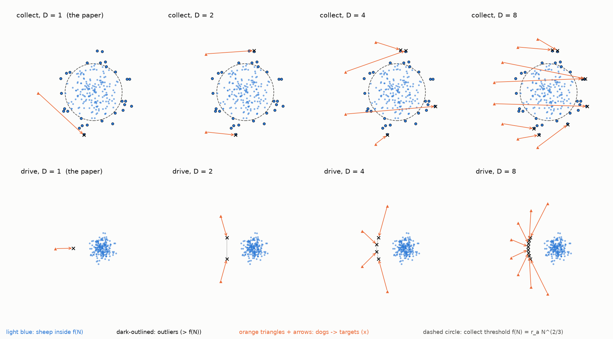
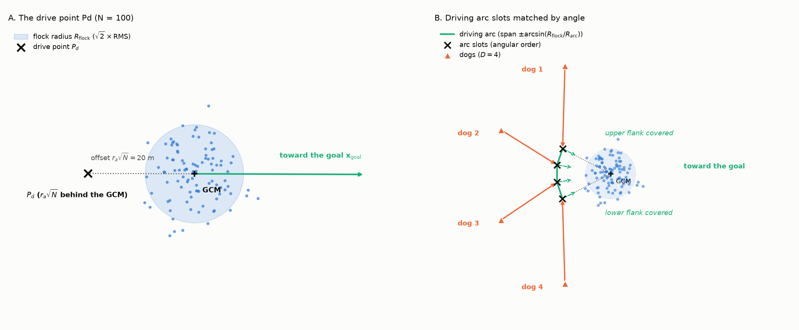

# Coordinated Multi-Agent Shepherd Architecture: `strombom_multi`

This document details the multi-agent coordination architecture of `strombom_multi`, which scales the classical single-dog heuristic of [Strömbom et al. (2014)](https://doi.org/10.1098/rsif.2014.0719) to a coordinated team of $D$ shepherds.

---

### Executive Overview

`strombom_multi` coordinates multiple shepherds through two dynamically switching operational modes, assigning each dog its own unique spatial waypoint at every tick ($\Delta t = 1$ s):

1. **Parallel Outlier Collection:** When stray sheep drift beyond the collect threshold $f(N)$, shepherds solve an optimal linear assignment (Hungarian algorithm) to collect up to $D$ outliers in parallel without path collision.
2. **Flank Driving Arc:** When all sheep are gathered within $f(N)$, shepherds arrange themselves along a circular rear arc spanning the flock's width, simultaneously pushing the herd toward the goal while preventing lateral escape.

**Figure 1: Behavioral execution of `strombom_multi` across team sizes $D \in \{1, 2, 4, 8\}$ ($N = 200$).**

* **Top row (Collecting mode on `wide` start):** Outliers outside collect distance $f(N)$ (dashed circle) are assigned to shepherds via Hungarian matching. Larger teams gather multiple stragglers simultaneously.
* **Bottom row (Driving mode on `compact` start):** Once the flock is compact, shepherds distribute across an arc of angular slots behind the herd, containing both left and right flanks.
* **Visual Symbols:** Light blue dots = sheep inside $f(N)$; Dark-outlined dots = outliers; Orange triangles = dogs; Orange arrows = target vectors toward waypoint `x`.

---

## 1. Mode Switching Condition: When to Collect vs. Drive

At each simulation tick, the team evaluates the maximum Euclidean distance from any sheep to the global centre of mass ($\mathrm{GCM} = \frac{1}{N}\sum_{k=1}^N \mathbf{x}_k$) against Strömbom's collect threshold:

$$
f(N) = r_a N^{2/3}
$$

* **Collecting Mode ($\max_i \lVert \mathbf{x}_i - \mathrm{GCM} \rVert > f(N)$):** At least one sheep has drifted beyond the flock boundary ($43.1$ m at $N = 100$ with $r_a = 2$ m). Outliers must be gathered before forward driving can occur.
* **Driving Mode ($\max_i \lVert \mathbf{x}_i - \mathrm{GCM} \rVert \le f(N)$):** All sheep are cohesive. The team forms a rear arc and drives the herd toward the goal.

> [!NOTE]
> **Physical Scaling of the Collect Distance:**  
> A compact herd packed at personal distance $r_a$ has an equilibrium radius that scales as $R \propto r_a\sqrt{N} = r_a N^{1/2}$. Because the collect threshold $f(N) \propto N^{2/3}$ grows faster than the physical flock radius, larger herds naturally tolerate a looser spatial boundary before triggering collection, preventing shepherds from thrashing between modes.

---

## 2. Parallel Outlier Collection via Hungarian Assignment

### 2.1 Target Waypoint for Outliers ($P_c$)

Let $n_{\mathrm{outliers}}$ denote the total number of sheep outside $f(N)$. The team identifies the $m = \min(D, n_{\mathrm{outliers}})$ outliers farthest from $\mathrm{GCM}$ (breaking ties deterministically by sheep index).

For each selected outlier $o$, its target collect waypoint $P_ {c}$ is positioned a distance $r_a = 2.0\text{ m}$ behind the outlier along the radial ray extending from $\mathrm{GCM}$ (Figure 2, Animation 1):

$$
P_c = \mathbf{x}_o + r_a \frac{\mathbf{x}_o - \mathrm{GCM}}{\lVert \mathbf{x}_o - \mathrm{GCM} \rVert}
$$

> [!TIP]
> **Directional Intuition:**  
> Stationing a shepherd at $P_ {c}$ places the dog on the outer side of the outlier relative to the flock. When the outlier enters the shepherd's repulsion zone ($r_s = 65$ m), the repulsive force steers the sheep directly back toward the herd center $\mathrm{GCM}$.

---

### 2.2 Optimal Non-Crossing Assignment (Hungarian Matching)

Given $D$ available shepherds and $m$ collect waypoints $P_ {c}$, HerdSim constructs the Euclidean distance cost matrix:

$$
C_{ij} = \lVert \mathbf{y}_i - P_{c,j} \rVert \quad \text{for } i \in \{1, \dots, D\}, \; j \in \{1, \dots, m\}
$$

The assignment is solved at every tick using the Kuhn-Munkres (Hungarian) algorithm (`scipy.optimize.linear_sum_assignment`):

1. **Global Optimality:** Minimizes the total squared travel distance $\sum C_{ij}$.
2. **Non-Crossing Guarantee:** In Euclidean 2D space, optimal linear sum assignment mathematically prevents shepherd trajectories from crossing each other, eliminating agent collisions.
3. **Core Flock Driving by Spare Dogs:** When $D > n_{\mathrm{outliers}}$, the $D - n_{\mathrm{outliers}}$ unassigned shepherds do not idle; they immediately form a driving arc behind the flock core (sheep currently inside $f(N)$).

**Figure 2: Geometric setup of outlier collect points and Hungarian assignment ($N = 100$, $D = 4$).**

* **Left panel (Geometry of $P_c$):** Demonstrates waypoint $P_ {c}$ positioned on the radial ray through outlier $o$ (offset shown at $4\,r_a$ for clarity).
* **Right panel (Assignment comparison):** Solid orange arrows display optimal Hungarian matching (parallel paths). Red dashed lines display a naive crossing assignment, illustrating how Hungarian matching prevents path conflicts.

**Animation 1: Real-time execution of `strombom_multi` on a 4-dog trial (`outlier_rich`, $N = 200$, $D = 4$, seed 0, 99% rule, 6 drive times).**

* **Behavioral Progression:** Dogs initially collect 4 outliers in parallel while spare dogs drive the core. Once all sheep enter $f(N)$, shepherds transition seamlessly into a driving arc, finishing the task in 277 s (`dmin_f99_m6`).

---

## 3. Flank Driving Arc and Large-Flock Scalability

### 3.1 Central Drive Point ($P_d$)

When all sheep lie within $f(N)$, the team pushes the flock toward the goal coordinate $\mathbf{x}_ {\mathrm{goal}}$ through the central drive point $P_ {d}$, located a distance $R_ {\mathrm{arc}} = r_a\sqrt{N}$ behind $\mathrm{GCM}$ opposite the goal (Figure 3):

$$
P_d = \mathrm{GCM} + r_a \sqrt{N} \frac{\mathrm{GCM} - \mathbf{x}_{\mathrm{goal}}}{\lVert \mathrm{GCM} - \mathbf{x}_{\mathrm{goal}} \rVert}
$$

*Intuition:* A compact flock of $N$ sheep packed at density $r_a$ has a physical rear boundary located at $r_a\sqrt{N}$. Positioning $P_ {d}$ at this exact distance stations shepherds immediately behind the herd's trailing edge.

---

### 3.2 Semicircular Driving Arc Slots

For multi-dog teams ($D > 1$), placing all dogs at single point $P_ {d}$ would cause severe physical bunching. Instead, HerdSim arranges $D$ target slots evenly along a rear circular arc of radius $R_ {\mathrm{arc}} = r_a\sqrt{N}$ centered at $\mathrm{GCM}$:

* **Angular Span:** The arc subtends an angular half-width:
  $$\phi = \arcsin\left(\min\left(1,\, \frac{R_{\mathrm{flock}}}{R_{\mathrm{arc}}}\right)\right)$$
  where $R_ {\mathrm{flock}} = \sqrt{2}\,\mathrm{RMS}(\mathbf{x}_k - \mathrm{GCM})$ is the instantaneous root-mean-square radius of the flock.
* **Flank Containment:** The outer slots align with the leftmost and rightmost edges of the herd, containing stragglers and preventing sheep from leaking laterally.
* **Ordered Slot Pairing:** Shepherds and arc slots are sorted by polar angle around $\mathrm{GCM}$ and paired monotonically, guaranteeing collision-free transitions into the driving arc.

**Figure 3: Geometric structure of drive point $P_d$ and the driving arc ($N = 100$, $D = 4$).**

* **Left panel ($D = 1$):** Single dog drives directly from $P_ {d}$, positioned $r_a\sqrt{N} = 20$ m behind $\mathrm{GCM}$.
* **Right panel ($D = 4$):** Four shepherds distribute across angular slots spanning $\pm \arcsin(R_ {\mathrm{flock}} / R_ {\mathrm{arc}})$, covering both flanks.
* **Visual Symbols:** Shaded circle = $R_ {\mathrm{flock}}$; Green curve = driving arc; `x` markers = slot waypoints; Orange triangles = dogs.

> [!NOTE]
> **Physical Responsiveness Boundary:**  
> The arc radius $R_ {\mathrm{arc}} = 2\sqrt{N}$ expands slower than detection range $r_s = 65$ m. $R_ {\mathrm{arc}}$ would exceed $r_s$ only at $N > (65/2)^2 = 1056$ sheep. Across all flock sizes evaluated in HerdSim ($N \le 566$), dogs on the driving arc remain well within the reaction range of rear sheep.

---

## 4. Shepherd Kinematics and Stop Rule

Every shepherd has complete sensing knowledge of all sheep positions and updates its motion at each tick ($\Delta t = 1$ s) after sheep have moved:

1. **Strömbom Stop Rule:** If any sheep comes closer than $3\,r_a = 6.0\text{ m}$ to a shepherd, the dog halts ($\mathbf{v}_ {d} = \mathbf{0}$) for that tick to avoid panicking the herd.
2. **Locomotion Heading:** Otherwise, the dog adds an exploratory angular noise vector $\boldsymbol{\epsilon}_ {d}$ (weight $e = 0.3$, drawn from the dog RNG stream) to the unit vector toward its assigned target $\mathbf{T}_ {d}$ ($P_ {c}$ or arc slot):

$$
\mathbf{v}_d = v_{\mathrm{dog}} \frac{\widehat{\mathbf{T}_d - \mathbf{y}_d} + e\,\boldsymbol{\epsilon}_d}{\left\lVert \widehat{\mathbf{T}_d - \mathbf{y}_d} + e\,\boldsymbol{\epsilon}_d \right\rVert}
$$

where shepherd speed is fixed at $v_ {\mathrm{dog}} = 1.5\text{ m/s}$ ($1.5\times$ maximum sheep walking speed).

---

## 5. Summary of Controller Distinctions

In the three-level controller hierarchy of HerdSim, `strombom_multi` represents **Level 2** (full multi-agent coordination):

* Removing Hungarian outlier assignment and driving arcs yields [`independent`](independent.md) (**Level 1**), where each dog runs single-dog logic independently.
* Removing both mode-switching and Hungarian assignment yields [`fat`](fat.md) (**Level 0**), where dogs greedily chase the sheep furthest from the goal.

---

## References

1. Strömbom, D., et al. (2014). *Solving the shepherding problem: heuristics for herding autonomous, interacting agents*. Journal of the Royal Society Interface, 11(100), 20140719. [doi:10.1098/rsif.2014.0719](https://doi.org/10.1098/rsif.2014.0719)
