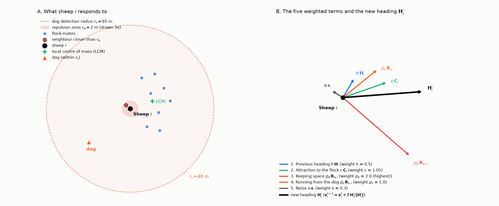
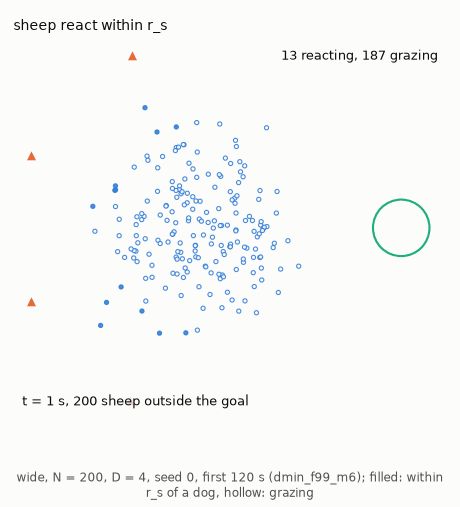
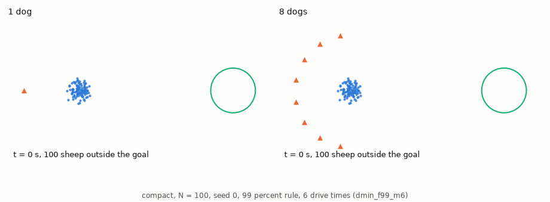

# Strombom et al. (2014) discrete behavioral model

In the model of [Strombom et al. (2014)](https://doi.org/10.1098/rsif.2014.0719) nobody plans for the flock as a whole. A sheep with a dog within $r_s = 65$ m reacts: it picks its own heading every tick (one time step, 1 s) from five influences (keep going, stay with the flock, keep a little space from any neighbour closer than $r_a = 2$ m, run from the dog, and noise; Figure 1). A sheep with no dog that close grazes, mostly standing still. The authors compared the model with GPS tracks of a real flock and dog. The check of HerdSim against the paper is in [strombom_check.md](strombom_check.md).

**Figure 1: The sheep rule of Strombom et al. (2014).** A reacting sheep's new heading is a weighted sum of its influences.

- Marks: the black dot is sheep $i$, blue dots its flock-mates, the red dot a neighbour closer than $r_a$, the green plus sign $\mathrm{LCM}_i$ (the local centre of mass of its neighbours) and the orange triangle a dog; the shaded discs have radii $r_a$ and $r_s$.
- Left: what sheep $i$ responds to.
- Right: the unit vectors with their weights, whose weighted sum is the new heading $\mathbf{H}_i'$.

For a reacting sheep $i$ at $\mathbf{x}_i$, with one unit vector per subsection below:

$$
\mathbf{H}_i' = h\thinspace \mathbf{H}_i + c\thinspace \mathbf{C}_i + \rho_a\thinspace \mathbf{R}_{a,i} + \rho_s\thinspace \mathbf{R}_{s,i} + e\thinspace \mathbf{\epsilon}_i
$$

## Previous heading

$\mathbf{H}_i$, weight $h = 0.5$, is the direction of the last step, so a sheep does not turn instantly:

$$
\mathbf{H}_i = \frac{\mathbf{x}_i^t - \mathbf{x}_i^{t-1}}{\lVert \mathbf{x}_i^t - \mathbf{x}_i^{t-1} \rVert}
$$

After a step in which the sheep did not move, HerdSim uses a zero vector; the paper does not say.

## Attraction to the flock

$\mathbf{C}_i$, weight $c = 1.05$, points toward the local centre of mass $\mathrm{LCM}_i$ of the sheep's $n$ nearest neighbours $\mathcal{N}_n(i)$:

$$
\mathbf{C}_i = \frac{\mathrm{LCM}_i - \mathbf{x}_i}{\lVert \mathrm{LCM}_i - \mathbf{x}_i \rVert}, \quad \text{where } \mathrm{LCM}_i = \frac{1}{n} \sum_{k \in \mathcal{N}_n(i)} \mathbf{x}_k
$$

In the paper's base case $n = N - 1$, the whole flock. The model parameter `n_neighbors` ([setting it in a protocol](../guides/configuration.md#model-parameters)) sets $n$: the default -1 means $N - 1$, and `0.25N` means $\lceil 0.25 N \rceil$.

> [!NOTE]
> A real sheep among hundreds cannot know where the whole flock's centre is. The study keeps the paper's $n = N - 1$; a local centre is one of the [limitations](../report/d_min_report.md#4-limitations).

## Keeping space

$\mathbf{R}_{a,i}$, weight $\rho_a = 2.0$, the largest, pushes sheep $i$ away from every neighbour closer than $r_a = 2$ m, and is zero when there is none:

$$
\mathbf{R}_{a,i} = \frac{\sum_{j \in \mathcal{N}_a(i)} \frac{\mathbf{x}_i - \mathbf{x}_j}{\lVert \mathbf{x}_i - \mathbf{x}_j \rVert}}{\left\lVert \sum_{j \in \mathcal{N}_a(i)} \frac{\mathbf{x}_i - \mathbf{x}_j}{\lVert \mathbf{x}_i - \mathbf{x}_j \rVert} \right\rVert}, \quad \text{where } \mathcal{N}_a(i) = \lbrace j \ne i \mid \lVert \mathbf{x}_i - \mathbf{x}_j \rVert \lt r_a\rbrace
$$

## Running from the dog

$\mathbf{R}_{s,i}$, weight $\rho_s = 1.0$, points away from the dogs within $r_s$. For several dogs see [multi-dog push blending](#multi-dog-push-blending-herdsim-extension).

## Noise

$\mathbf{\epsilon}_i$, weight $e = 0.3$, is a unit vector at an angle drawn uniformly from $[0, 2\pi)$.

## Moving

Each tick a reacting sheep moves $\delta = 1$ m along its new heading:

$$
\mathbf{x}_i^{t+1} = \mathbf{x}_i^t + \delta\thinspace \frac{\mathbf{H}_i'}{\lVert \mathbf{H}_i' \rVert}
$$

## Grazing

A sheep with every dog farther than $r_s$ grazes: with probability 0.95 it stays put, and with probability 0.05 it steps $\delta$ in a random direction $\mathbf{\epsilon}_{\mathrm{graze}}$:

$$
\mathbf{x}_i^{t+1} = \begin{cases}
\mathbf{x}_i^t + \delta\thinspace \mathbf{\epsilon}_{\mathrm{graze}}, & \text{with probability } 0.05 \\
\mathbf{x}_i^t, & \text{with probability } 0.95
\end{cases}
$$

The paper repels sheep from each other at any distance from the dog (its section 2). HerdSim's default applies the push from close neighbours only to sheep that react to a dog, so grazing sheep do not keep apart. Every study protocol runs with this default.

The model parameter `graze_repulsion` (default `false`, [setting it in a protocol](../guides/configuration.md#model-parameters)) turns the paper's repulsion on for grazing sheep. A grazing sheep with a neighbour closer than $r_a$ then steps $\delta$ at every time step, not only with probability 0.05. Its heading combines its previous heading, the push from its neighbours and noise, with the weights $h$, $\rho_a$ and $e$ of the reacting heading. The paper does not say how such a sheep moves, so this step is HerdSim's reading. The [check against the paper](strombom_check.md) runs with it on; how it changes the study's results is in the [report, limitations](../report/d_min_report.md#4-limitations).

With the default, a flock no dog reaches spreads slowly, by grazing steps. Animation 1 shows sheep switching from grazing to reacting as the dogs approach.

**Animation 1: Sheep react only within $r_s$ of a dog (`wide`, $N = 200$, $D = 4$, seed 0, 99% rule, 6 drive times, limit 839 s, first 120 s shown).** As the dogs come round behind the flock, the reacting part spreads from 13 of the 200 sheep at 1 s to all 200 by 120 s, packed in front of the dogs (protocol [`dmin_f99_m6`](../guides/protocols.md)).

- Marks: filled dots are reacting sheep, within $r_s = 65$ m of a dog; hollow dots are grazing sheep; triangles are dogs.

## Multi-dog push blending (HerdSim extension)

Strombom's model has one dog, so HerdSim must say how a sheep responds to several. Two dogs whose directions from the sheep differ by an angle $\phi$ give unit pushes that add up to $2\cos(\phi/2)$, more than the attraction weight $c = 1.05$ whenever $\phi$ is less than 116.7 deg. Summed pushes would then push a sheep away harder than the flock pulls it back, and from $D = 2$ on the dogs could break the flock apart. The summed rule was rejected on this argument and never run.

HerdSim instead adds the unit vectors away from every dog $j$ (at $\mathbf{y}_j$) that threatens the sheep, meaning it is within $r_s$, and normalises the sum. Strombom's weight $\rho_s = 1.0$ holds for any number of dogs; more dogs change only the direction of the push and which sheep react:

$$
\mathbf{R}_{s,i} = \frac{\sum_{j \in \mathrm{threat}} \frac{\mathbf{x}_i - \mathbf{y}_j}{\lVert \mathbf{x}_i - \mathbf{y}_j \rVert}}{\left\lVert \sum_{j \in \mathrm{threat}} \frac{\mathbf{x}_i - \mathbf{y}_j}{\lVert \mathbf{x}_i - \mathbf{y}_j \rVert} \right\rVert}, \quad \text{where } \mathrm{threat} = \lbrace j \mid \lVert \mathbf{x}_i - \mathbf{y}_j \rVert \lt r_s\rbrace
$$

For example, a sheep at $(0, 5)$ has dogs behind it at $(-3, 0)$ and $(3, 0)$. Their sideways pushes cancel and the forward parts add, so after normalising the push points straight ahead ($+y$) with the size of one dog's push.

Normalising is HerdSim's choice, and we have not tested what part it plays; whether real sheep flee harder from several dogs needs field data. A reacting sheep always moves 1 m per tick, so more dogs cannot make it walk faster ([report, section 4](../report/d_min_report.md#4-limitations)). Animation 2 shows one dog and eight dogs on the same flock.

**Animation 2: One dog and eight dogs on the same flock (`compact`, $N = 100$, seed 0, 99% rule, 6 drive times).** In this trial the flock walks to the goal at the same pace with eight dogs as with one (`dmin_f99_m6`).

- Marks: blue dots are sheep, orange triangles dogs and the green circle the goal; the bottom-left text gives the time and the sheep outside the goal.
- Left: 1 dog, finishing at 195 s.
- Right: 8 dogs, which gather in an arc behind the flock and finish at 192 s.

## References

1) Strombom, D., et al. (2014). *Solving the shepherding problem: heuristics for herding autonomous, interacting agents*. Journal of the Royal Society Interface, 11(100), 20140719. [DOI: 10.1098/rsif.2014.0719](https://doi.org/10.1098/rsif.2014.0719)
