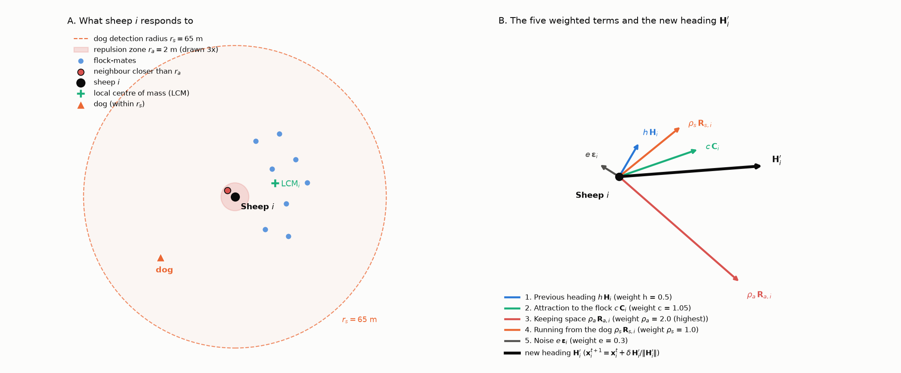
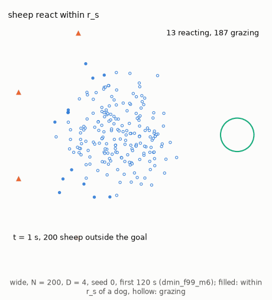
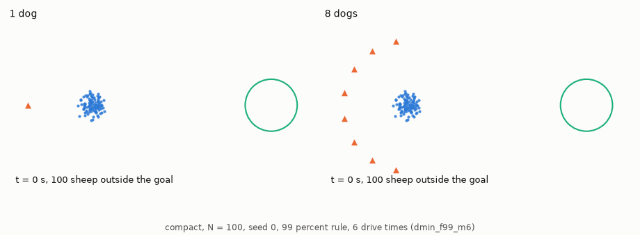

# Discrete Behavioral Sheep Model: Strömbom et al. (2014)

This document specifies the individual sheep motion model implemented in HerdSim, based on the local-interaction behavioral heuristics of [Strömbom et al. (2014)](https://doi.org/10.1098/rsif.2014.0719), along with HerdSim's multi-dog push blending extension.

---

### Executive Overview

Sheep dynamics in HerdSim operate on discrete time steps ($\Delta t = 1$ s) where sheep positions update immediately before dog positions update. A sheep's behavior switches between two distinct behavioral regimes based on its distance to the nearest dog:

1. **Reacting Mode ($\min_d \lVert \mathbf{x}_i - \mathbf{y}_d \rVert \le r_s = 65\text{ m}$):** The sheep senses shepherd threat, combining five competing behavioral drives into a normalized heading vector and taking a step of fixed length $\delta = 1$ m.
2. **Grazing Mode ($\min_d \lVert \mathbf{x}_i - \mathbf{y}_d \rVert > r_s$):** The sheep is unthreatened, mostly remaining stationary and taking a random Brownian step with probability $p = 0.05$.

**Figure 1: Geometric decomposition of the 5-force sheep behavioral model.**

* **Visual Guide:**
  * **Left (Spatial interaction zones around focal sheep $i$):** Black dot = focal sheep $i$; Blue dots = herd-mates; Red dot = neighbor within personal space $r_a = 2$ m (drawn at 3x scale for clarity); Green `+` = local centre of mass $\mathrm{LCM}_i$; Orange triangle = threatening shepherd within detection radius $r_s = 65$ m.
  * **Right (Vector summation):** Illustrates the five weighted behavioral vectors combining into the resultant unnormalized heading $\mathbf{H}_i'$.

---

## 1. Reacting Mode: The 5-Force Heading Vector

When a sheep detects any dog within reaction radius $r_s = 65$ m, its unnormalized heading $\mathbf{H}_i'$ is computed as the weighted linear combination of five unit vectors:

$$
\mathbf{H}_i' = h\,\mathbf{H}_i + c\,\mathbf{C}_i + \rho_a\,\mathbf{R}_{a,i} + \rho_s\,\mathbf{R}_{s,i} + e\,\boldsymbol{\epsilon}_i
$$

The sheep then steps by fixed length $\delta = 1$ m along the normalized heading:

$$
\mathbf{x}_i^{t+1} = \mathbf{x}_i^t + \delta\,\frac{\mathbf{H}_i'}{\lVert \mathbf{H}_i' \rVert}
$$

> [!NOTE]
> **Physical Intuition of Normalization:**  
> The heading $\mathbf{H}_i'$ balances five competing drives: forward momentum ($h$), flock cohesion ($c$), personal space ($\rho_a$), predator evasion ($\rho_s$), and exploratory noise ($e$). Normalizing $\mathbf{H}_i'$ guarantees that a reacting sheep **always travels at exactly $\delta = 1.0$ m/s**. Shepherds steer the direction of sheep flight; they cannot accelerate a sheep's maximum walking speed.

**Table 1: Detailed specification of the five behavioral force vectors.**

| Force Component | Symbol & Weight | Mathematical Definition | Physical Role & Interaction Radius |
| :--- | :---: | :--- | :--- |
| **Inertia (Previous Heading)** | $\mathbf{H}_i$ ($h = 0.5$) | $\mathbf{H}_i = \frac{\mathbf{x}_i^t - \mathbf{x}_i^{t-1}}{\lVert \mathbf{x}_i^t - \mathbf{x}_i^{t-1} \rVert}$ *(or $\mathbf{0}$ if stationary at $t-1$)* | Provides directional momentum, smoothing trajectories and preventing erratic oscillations. |
| **Flock Cohesion** | $\mathbf{C}_i$ ($c = 1.05$) | $\mathbf{C}_i = \frac{\mathrm{LCM}_i - \mathbf{x}_i}{\lVert \mathrm{LCM}_i - \mathbf{x}_i \rVert}$, with $\mathrm{LCM}_i = \frac{1}{n} \sum_{k \in \mathcal{N}_n(i)} \mathbf{x}_k$ | Draws the sheep toward the local center of mass of its $n$ nearest neighbors (global flock attraction when $n = N - 1$). |
| **Personal Space Repulsion** | $\mathbf{R}_{a,i}$ ($\rho_a = 2.0$, highest) | $\mathbf{R}_{a,i} = \frac{\sum_{j \in \mathcal{N}_a(i)} \widehat{\mathbf{x}_i - \mathbf{x}_j}}{\left\lVert \sum_{j \in \mathcal{N}_a(i)} \widehat{\mathbf{x}_i - \mathbf{x}_j} \right\rVert}$ | Prevents crowding and physical collision. Repels away from all neighbors within $r_a = 2$ m ($\mathcal{N}_a(i)$). |
| **Dog Evasion Repulsion** | $\mathbf{R}_{s,i}$ ($\rho_s = 1.0$) | Repulsion from threatening dogs within $r_s = 65$ m (see [Section 3](#3-multi-dog-push-blending-herdsim-extension)) | Steers the sheep directly away from the shepherd. Overrides cohesion when $\rho_a + \rho_s > c$. |
| **Exploratory Angular Noise** | $\boldsymbol{\epsilon}_i$ ($e = 0.3$) | $\boldsymbol{\epsilon}_i = (\cos \theta, \sin \theta)$, with $\theta \sim \mathcal{U}[0, 2\pi)$ | Introduces stochastic biological variability and breaks symmetric deadlocks. |

---

## 2. Grazing Mode

When no shepherd is within reaction range ($r_s = 65$ m), the sheep enters grazing mode (Animation 1):

$$
\mathbf{x}_i^{t+1} = \begin{cases}
\mathbf{x}_i^t + \delta\,\boldsymbol{\epsilon}_{\mathrm{graze}}, & \text{with probability } p = 0.05 \\
\mathbf{x}_i^t, & \text{with probability } 0.95
\end{cases}
$$

* **Baseline Behavior (`graze_repulsion: false`):** Used across all nine primary study protocols. Grazing sheep ignore neighbor repulsion within $r_a$ and take a 5% random exploratory step.
* **Grazing Repulsion (`graze_repulsion: true`):** Matches Section 2 of Strömbom et al. (2014) where sheep repel neighbors within $r_a$ even when unthreatened by dogs. Any grazing sheep with $\mathcal{N}_ {a}(i) \ne \emptyset$ steps by $\delta = 1$ m along the normalized sum:

$$
h\,\mathbf{H}_i + \rho_a\,\mathbf{R}_{a,i} + e\,\boldsymbol{\epsilon}_i
$$

*(As verified in the [report](../report/d_min_report.md#3-exceptions-and-pilot-checks), enabling grazing repulsion shifts calibrated $R_f$ by less than $1.1\%$ and changes 0 reliability decisions).*

**Animation 1: Transition dynamics from grazing to reacting mode ($N = 200$, $D = 4$, seed 0, first 120 s of `dmin_f99_m6`).**

* **Observation:** Hollow blue dots represent passive grazing sheep; filled blue dots represent active reacting sheep. As shepherds approach the rear of the flock, the reacting zone expands smoothly from 13 sheep at tick 1 to all 200 sheep by tick 120.

---

## 3. Multi-Dog Push Blending (HerdSim Extension)

Strömbom et al. (2014) originally formulated dog evasion $\mathbf{R}_{s,i}$ for a **single** shepherd. When multiple dogs $d \in \mathrm{threat}_i = \{j \mid \lVert \mathbf{x}_i - \mathbf{y}_j \rVert < r_s\}$ approach a sheep simultaneously, simply summing dog forces would allow two or more dogs to exert excessive artificial pressure.

HerdSim resolves this by taking the **normalized vector sum** of individual unit repulsions (Animation 2):

$$
\mathbf{R}_{s,i} = \frac{\sum_{j \in \mathrm{threat}_i} \widehat{\mathbf{x}_i - \mathbf{y}_j}}{\left\lVert \sum_{j \in \mathrm{threat}_i} \widehat{\mathbf{x}_i - \mathbf{y}_j} \right\rVert}
$$

> [!IMPORTANT]
> **Mathematical and Physical Proof:**  
> If individual dog pushes were added without normalization, two dogs separated by angle $\phi < 116.7^\circ$ would exert an unnormalized combined push:
> $$\lVert \mathbf{u}_1 + \mathbf{u}_2 \rVert = 2\cos(\phi/2) > c = 1.05 \iff \phi < 2\arccos(1.05/2) \approx 116.7^\circ$$
> This excessive force would overwhelm internal flock cohesion ($c = 1.05$), violently tearing the flock apart whenever dogs approach concurrently.  
> 
> Normalizing $\mathbf{R}_{s,i}$ guarantees that:
> 1. Effective dog repulsion weight is strictly capped at $\rho_s = 1.0$ regardless of team size $D$.
> 2. Multiple dogs blend their pushing angles smoothly into a unified escape direction.
> 3. Additional dogs alter the sheep's heading and expand perimeter coverage, but **never increase sheep walking speed beyond 1.0 m/s**.

**Animation 2: Pushing speed invariance: Single dog vs. 8 dogs on the same flock (`compact`, $N = 100$, seed 0, 99% rule, 6 drive times).**

* **Key Takeaway:** Because reacting step length is invariant ($\delta = 1.0$ m/s) and $\mathbf{R}_{s,i}$ is normalized, 8 dogs drive the herd at identical forward speed to 1 dog ($D = 1$ finishes at 195 s; $D = 8$ finishes at 192 s). Multi-dog advantages arise purely from lateral containment, not brute pushing force.

---

## References

1. Strömbom, D., et al. (2014). *Solving the shepherding problem: heuristics for herding autonomous, interacting agents*. Journal of the Royal Society Interface, 11(100), 20140719. [doi:10.1098/rsif.2014.0719](https://doi.org/10.1098/rsif.2014.0719)
