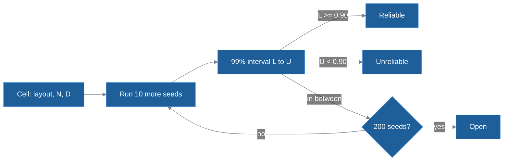
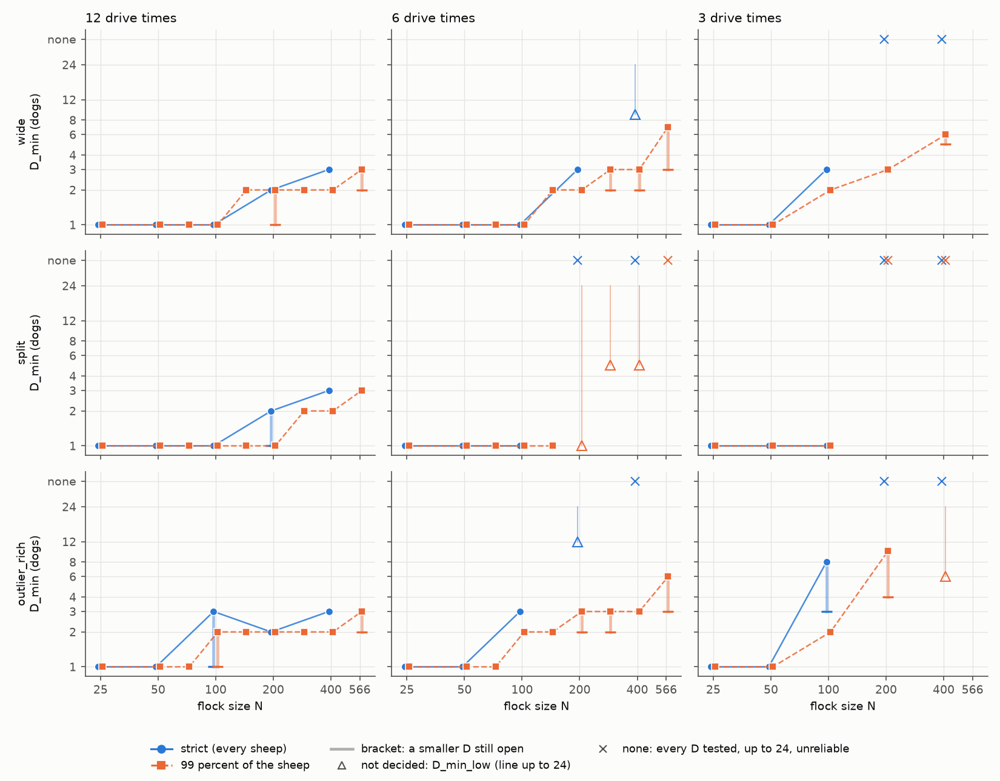
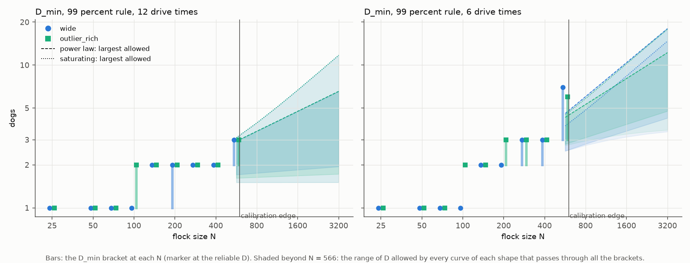
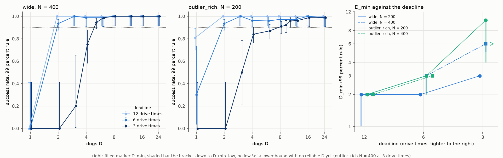

# How many dogs does a simulated flock need?

This report answers one question with HerdSim: how does the smallest reliable team of dogs, $D_{\min}$, grow with the number of sheep $N$, and how do the start layout and the deadline change it? The sheep follow the model of Strombom et al. (2014) and the dogs follow HerdSim's team rule, `strombom_multi`. The [README](../../README.md#task-and-methods) sets out the task, the layouts and the two success rules, so this report keeps to the decision rule, the results and their limits.

The answer, from 115,470 stored trials in six runs.

**Strict rule**

Flock sizes $N = 25$, 50, 100, 200 and 400.

- **12 drive times.** On `compact`, one dog is enough at every size. On `wide` and `outlier_rich`, a flock of 400 needs 3 dogs; across $N = 25$, 50, 100, 200 and 400 the log-log slope of $D_{\min}$ is 0.42 on both (0.32 to 0.42 on `split`).
- **6 drive times.** On `compact`, one dog is enough at every size. On the scattered layouts $D_{\min}$ rises faster: `wide` needs 3 dogs at $N = 200$ and only a lower bound [9] at $N = 400$; `split` and `outlier_rich` have no reliable team up to 24 dogs at $N = 400$.
- **3 drive times.** On `compact`, one dog is enough at every size. From $N = 200$, no team up to 24 dogs is reliable on `wide`, `split` or `outlier_rich`.

**99% rule**

Flock sizes $N = 25$, 50, 71, 100, 141, 200, 283, 400 and 566 at 12 and 6 drive times; $N = 25$, 50, 100, 200 and 400 at 3 drive times.

- **12 drive times.** On `compact`, one dog is enough through $N = 566$. On `wide` and `outlier_rich`, a flock of 400 needs 2 dogs; across $N = 25$, 50, 71, 100, 141, 200, 283, 400 and 566 the log-log slope of $D_{\min}$ is 0.27 to 0.38 on `wide` and 0.28 to 0.38 on `outlier_rich`.
- **6 drive times.** On `compact`, one dog is enough through $N = 566$. At $N = 400$, `wide` needs 2-3 dogs and `outlier_rich` needs 3; across $N = 25$, 50, 71, 100, 141, 200, 283, 400 and 566 the log-log slope is 0.38 to 0.61 on `wide` and 0.40 to 0.58 on `outlier_rich`.
- **3 drive times.** On `compact`, one dog is enough at every size ($N = 25$, 50, 100, 200 and 400). On `wide`, $D_{\min}$ is 2 at $N = 100$, 3 at 200 and 5-6 at 400; on `outlier_rich` at $N = 400$ only a lower bound [6]; on `split` from $N = 200$, no team up to 24 is reliable.
- A shorter deadline only cuts trials short. A trial shared by two runs succeeds at the shorter deadline exactly when it had finished inside that limit at the longer one.

Among curves that have a reliable team, flock size moves $D_{\min}$ at least as much as the start layout does at every rule and deadline, though in two of the six pairs the two are within 0.03 doublings.

## Contents

1) [The question](#1-the-question)
2) [Method](#2-method)
3) [Results](#3-results)
4) [Limitations](#4-limitations)
5) [Run record](#5-run-record)

## 1. The question

Strombom et al. (2014) gave a rule for one dog and a flock that stays together. This study keeps that sheep model and asks how the smallest reliable team grows with flock size under HerdSim's team rule, `strombom_multi`. Table 1 lists the three research questions (RQ).

**Table 1: Research questions and where they are answered.**

| RQ | Question | Answered in |
| :--- | :--- | :--- |
| RQ1 | How does $D_{\min}$ grow with $N$ from 25 to 566? | [3.1](#31-rq1-how-does-d_min-grow-with-n) |
| RQ2 | At a given deadline, which moves $D_{\min}$ more, the start layout or $N$? | [3.2](#32-rq2-layout-or-flock-size-which-moves-d_min-more) |
| RQ3 | How does $D_{\min}$ change from 12 to 6 to 3 drive times? | [3.3](#33-rq3-how-does-the-deadline-change-d_min) |

## 2. Method

### 2.1 Sheep and dogs

Sheep and dogs are points on an open field, moved one time step (a [tick](../glossary.md#trials-and-experiments)) at a time. A sheep reacts to a dog within $r_s = 65$ m: it walks away from the dog at 1 m/s and also heads toward the centre of the other sheep ([Strombom sheep](../methods/strombom_sheep.md)). A sheep farther from the flock centre than the collect distance $f(N) = 2 N^{2/3}$ m is an outlier.

Under the team rule ([team rule](../methods/strombom_multi.md)), while there are outliers the Hungarian algorithm pairs the dogs with the $D$ farthest outliers at the least total distance, and any spare dog drives the rest of the flock. With no outliers left, the dogs stand on an arc behind the flock around the drive point, $2\sqrt{N}$ m behind the flock centre, and push it toward the goal.

### 2.2 Task, layouts and deadlines

The dogs drive the flock into a circular goal. The field and the goal are sized by the flock radius $R_f(N)$, the radius a driven flock of $N$ sheep settles to, and so is the drive distance, $13 R_f$, unless the widest start layout needs more room, which it does from $N = 200$ ([sizing by the flock radius](../experiments/task_design.md#sizing-by-the-calibrated-flock-radius)). The deadline is counted in drive times: one drive time is what a sheep walking straight at 1 m/s needs to cover the drive distance. At $N = 400$ the drive is 207 m, so 3 drive times is 621 s.

A trial succeeds under the strict rule when every sheep is in the goal at the same tick, and under the 99% rule when $\lceil 0.99 N \rceil$ are, so the two rules are the same below $N = 100$; at $N = 566$ the 99% rule lets 5 sheep stay out. The flock starts in one of four layouts, defined in the [README](../../README.md#task-and-methods): `compact` keeps it together, while `wide`, `split` and `outlier_rich` start some sheep far out.

### 2.3 When a team is reliable

A cell is one layout, flock size $N$ and team size $D$ within one run, and a trial is one run of a cell with one seed ([glossary](../glossary.md#trials-and-experiments)). After $n$ trials with $k$ successes, $[L, U]$ is the exact two-sided 99% [Clopper-Pearson](https://doi.org/10.1093/biomet/26.4.404) interval of the success rate. The cell is reliable if $L \ge 0.90$ and unreliable if $U < 0.90$. Otherwise it gets 10 more seeds, up to 200, and a cell still in between at 200 stays open ([stopping early](../experiments/task_design.md#stopping-early-with-the-99-clopper-pearson-interval)).

On one curve of team sizes (one layout and $N$ under one rule), $D_{\min}$ is the smallest reliable $D$. The tables write it in four ways:

1) `3`: 3 dogs are reliable and every smaller team is unreliable.
2) `3-8`: 8 dogs are reliable, every team below 3 is unreliable, and 3 dogs are still open at 200 seeds. We call the lower end $D_{\min,\mathrm{low}}$.
3) `[5]`: no team is reliable yet, and $D_{\min}$ is at least 5.
4) `none`: every team tested, up to 24 dogs, is unreliable.

$D_{\min}$ looks only at smaller teams, and a larger team can be unreliable again. This happens on three curves, all `split` with $D_{\min} = 1$: strict rule, $N = 100$ at 6 drive times (3 dogs unreliable) and at 3 (2 to 4 dogs), and 99% rule, $N = 141$ at 6 (4 dogs). The smallest reliable team above the last unreliable one, $D_{\min,\mathrm{stable}}$, is 5, 5 and 7 dogs. Inside a bracket it happens once: `outlier_rich`, strict rule, $N = 100$ at 3 drive times is `3-8` with 4 dogs unreliable ([teams that fail above $D_{\min}$](results_tables.md#teams-that-fail-above-d_min), which also lists curves with a lower bound only).

### 2.4 The six runs

Each run is one protocol, the recipe of one experiment ([protocol catalogue](../guides/protocols.md)). All six use the four layouts and teams of 1, 2, 3, 4, 6, 8, 12, 16 and 24 dogs; where the answer changes between two team sizes, the campaign adds the team halfway between them ([midpoints](../experiments/task_design.md#midpoint-densification)). Seed $i$ gives the same start flock in every run, so the runs compare cell by cell ([paired random streams](../experiments/task_design.md#paired-random-streams)). The id names the settings: `f99` is the 99% rule and `m6` a deadline of 6 drive times.

**Table 2: The six runs.**

| Protocol | Rule | Deadline (drive times) | Flock sizes $N$ | Trials |
| :--- | :--- | :---: | :--- | :---: |
| `dmin_m12` | strict | 12 | 25, 50, 100, 200, 400 | 17,220 |
| `dmin_m6` | strict | 6 | 25, 50, 100, 200, 400 | 13,470 |
| `dmin_m3` | strict | 3 | 25, 50, 100, 200, 400 | 9530 |
| `dmin_f99_m12` | 99% | 12 | 25, 50, 71, 100, 141, 200, 283, 400, 566 | 31,590 |
| `dmin_f99_m6` | 99% | 6 | 25, 50, 71, 100, 141, 200, 283, 400, 566 | 31,920 |
| `dmin_f99_m3` | 99% | 3 | 25, 50, 100, 200, 400 | 11,740 |

The 99% runs at 12 and 6 drive times have four more sizes, 71, 141, 283 and 566, so that the sizes step by $\sqrt{2}$ and count equally in a log-log fit. They stop below about 600 sheep, the calibration edge, above which a driven flock started loose no longer settles to one radius ([flock size](../experiments/task_design.md#flock-size)).

## 3. Results

### 3.1 RQ1: How does D_min grow with N?

When there is time, a larger flock needs few more dogs. A `compact` flock needs one dog at every deadline from $N = 25$ to 400. At 12 drive times a scattered flock of 400 needs 3 dogs under the strict rule and 2 under the 99% rule (Table 3).

**Table 3: $D_{\min}$ on the scattered layouts, strict rule / 99% rule, $N = 25$-400 (`compact` is 1 / 1 in every cell).**

| Deadline | Layout | $N = 25$ | $N = 50$ | $N = 100$ | $N = 200$ | $N = 400$ |
| :---: | :--- | :---: | :---: | :---: | :---: | :---: |
| 12x | `wide` | 1 / 1 | 1 / 1 | 1 / 1 | 2 / 1-2 | 3 / 2 |
| 12x | `split` | 1 / 1 | 1 / 1 | 1 / 1 | 1-2 / 1 | 3 / 2 |
| 12x | `outlier_rich` | 1 / 1 | 1 / 1 | 1-3 / 1-2 | 2 / 2 | 3 / 2 |
| 6x | `wide` | 1 / 1 | 1 / 1 | 1 / 1 | 3 / 2 | [9] / 2-3 |
| 6x | `split` | 1 / 1 | 1 / 1 | 1 / 1 | none / [1] | none / [5] |
| 6x | `outlier_rich` | 1 / 1 | 1 / 1 | 3 / 2 | [12] / 2-3 | none / 3 |
| 3x | `wide` | 1 / 1 | 1 / 1 | 3 / 2 | none / 3 | none / 5-6 |
| 3x | `split` | 1 / 1 | 1 / 1 | 1 / 1 | none / none | none / none |
| 3x | `outlier_rich` | 1 / 1 | 1 / 1 | 3-8 / 2 | none / 4-10 | none / [6] |

*Data:* [results_tables.md: strict success](results_tables.md#d_min-by-layout-and-n-strict-success) and [results_tables.md: success at 99 percent](results_tables.md#d_min-by-layout-and-n-success-at-99-percent).

**Figure 1: $D_{\min}$ against flock size $N$, four layouts, both rules, at 12, 6 and 3 drive times ($N = 25$-400, and up to 566 under the 99% rule at 12 and 6 drive times).** Scattered flocks grow slowly at the loose deadline, and much faster under the strict rule from $N = 100$. Each marker is the $D_{\min}$ of one curve, coloured by layout; solid lines with circles are the strict rule and dashed lines with squares the 99% rule. Shaded bars are brackets still open at 200 seeds, hollow triangles lower bounds, and crosses no reliable team up to 24. Markers are shifted sideways so they do not overlap. The three panels are 12, 6 and 3 drive times from left to right, on log-log axes.

Up to $N = 50$ one dog is enough on every layout and deadline. At $N = 50$ the drive point is 14 m behind the flock centre and the farthest sheep starts at most 43 m from it (on `outlier_rich`), so a dog at the drive point is at most about 57 m from any sheep, inside $r_s = 65$ m. One dog may therefore reach almost every sheep at once, and the stored one-dog trials broadly agree. Call reach the share of the outer half of the flock (the sheep farther than the median distance from its centre) that is within $r_s$ of the dog, averaged over the ticks of a trial. Its median is 0.93 to 1.00 at $N \le 50$ on every layout at 12, 6 and 3 drive times (99% rule, at least 60 trials per entry, two decimals; [reach table](results_tables.md#reach-of-one-dog-99-percent)). On `compact` it is 1.00 at every size. On the scattered layouts it falls with $N$: at 6 drive times it is 0.84 on `wide`, 0.80 on `split` and 0.86 on `outlier_rich` at $N = 100$, and 0.14, 0.41 and 0.06 at $N = 400$, where each entry is 10 trials and none succeeds. Reach does not order $D_{\min}$ by itself: at $N = 100$ and 6 drive times `outlier_rich` has the highest reach of the three and needs two dogs, while `wide` and `split` need one. We have not tested whether low reach causes the growth of $D_{\min}$; at $N = 400$ it is measured over failed trials that run to the deadline.

From $N = 100$ on, $D_{\min}$ on the scattered layouts grows with $N$. Table 4 gives the slope of $\log_2 D_{\min}$ against $\log_2 N$; a slope of 0.5 means a flock four times larger needs twice the dogs. At 12 drive times the slopes are at most 0.42 under the strict rule and 0.30 under the 99% rule. At 6 and 3 drive times some slopes are steeper.

**Table 4: Slope of $\log_2 D_{\min}$ against $\log_2 N$, five sizes ($N = 25$-400).**

| Rule | Deadline | `wide` | `split` | `outlier_rich` |
| :--- | :---: | :---: | :---: | :---: |
| Strict | 12x | 0.42 | 0.32 to 0.42 | 0.42 |
| Strict | 6x | 0.48 ($N \le 200$) | flat ($N \le 100$) | 0.79 ($N \le 100$) |
| Strict | 3x | 0.79 ($N \le 100$) | flat ($N \le 100$) | 0.79 to 1.50 ($N \le 100$) |
| 99% | 12x | 0.20 to 0.30 | 0.20 | 0.30 |
| 99% | 6x | 0.30 to 0.42 | flat ($N \le 100$) | 0.42 to 0.48 |
| 99% | 3x | 0.62 to 0.68 | flat ($N \le 100$) | 0.70 to 1.10 ($N \le 200$) |

A range is the set of slopes the brackets allow, and "$N \le 100$" means the larger sizes had no decided $D_{\min}$.

*Data:* [results_tables.md: growth with N, strict](results_tables.md#growth-with-n-strict) and [results_tables.md: growth with N, 99 percent](results_tables.md#growth-with-n-99-percent).

Under the 99% rule the slope on `wide` and `outlier_rich` is steeper at 3 drive times than at 12 or 6, and on `outlier_rich` steeper at 6 than at 12; on `wide` the 12 and 6 ranges meet at 0.30. On `split` it does not rise, because at 6 and 3 drive times only $N \le 100$ has a decided $D_{\min}$, and there the curve is flat.

The nine sizes of the 99% runs at 12 and 6 drive times give the same picture with more points (Table 5). At 12 drive times the slopes the brackets allow are 0.27 to 0.38 on `wide` and 0.28 to 0.38 on `outlier_rich`. At 6 drive times they are 0.38 to 0.61 on `wide` and 0.40 to 0.58 on `outlier_rich`.

**Table 5: $D_{\min}$ on nine flock sizes, 99% rule, 12 and 6 drive times.**

| Layout, deadline | 25 | 50 | 71 | 100 | 141 | 200 | 283 | 400 | 566 |
| :--- | :---: | :---: | :---: | :---: | :---: | :---: | :---: | :---: | :---: |
| `wide`, 12x | 1 | 1 | 1 | 1 | 2 | 1-2 | 2 | 2 | 2-3 |
| `outlier_rich`, 12x | 1 | 1 | 1 | 1-2 | 2 | 2 | 2 | 2 | 2-3 |
| `wide`, 6x | 1 | 1 | 1 | 1 | 2 | 2 | 2-3 | 2-3 | 3-7 |
| `outlier_rich`, 6x | 1 | 1 | 1 | 2 | 2 | 2-3 | 2-3 | 3 | 3-6 |

*Data:* [results_tables.md: nine flock sizes, 99 percent](results_tables.md#nine-flock-sizes-99-percent).

The data cannot yet tell whether the team keeps growing or levels off. We fit two shapes to the brackets by maximum likelihood: a power law $D = a N^b$, and a saturating curve $D = 1 + (D_\infty - 1) N / (N + K)$, which rises from 1 toward a ceiling $D_\infty$ and is halfway there at $N = K$. The difference of their log-likelihoods, power law minus saturating curve (`log_odds` in the tables), is 0.0 at both deadlines, so the data favour neither (Figure 2). Larger flocks could tell them apart, but they lie beyond the calibration edge.

**Figure 2: $D_{\min}$ on nine flock sizes ($N = 25$-566, 99% rule), and where each curve shape could go.** Power laws and saturating curves both fit the data up to $N = 566$. `wide` is drawn with circles and `outlier_rich` with squares, on log-log axes. A marker is $D_{\min}$ and a bar runs down to $D_{\min,\mathrm{low}}$ where a smaller team is still open. The vertical line marks the calibration edge; to its right, the shaded regions show where power laws (dashed upper edge) and saturating curves (dotted upper edge) that fit the data could lie. The left panel is 12 drive times and the right panel 6.

*Data:* [results_tables.md: fits, dmin_f99_m12](results_tables.md#fits-dmin_f99_m12-d_minn-power-law-against-saturating-curve) and [results_tables.md: fits, dmin_f99_m6](results_tables.md#fits-dmin_f99_m6-d_minn-power-law-against-saturating-curve).

Cohesion may keep the slope low at the loose deadline. A sheep within $r_s$ of a dog also heads toward the centre of all $N - 1$ other sheep, with weight $c = 1.05$ ([attraction to the flock](../methods/strombom_sheep.md#attraction-to-the-flock)), so an outlier that a dog turns back may walk to the flock by itself. These runs do not vary cohesion, so this stays a guess.

### 3.2 RQ2: Layout or flock size, which moves D_min more?

In every row of Table 6 the spread across $N$ is at least the spread across layouts, though at strict 6x and 99% 3x the two are within 0.03. Table 6 measures both in doublings of $D_{\min}$, the base-2 logarithm of the largest $D_{\min}$ over the smallest, so going from 1 dog to 2 is one doubling. Each spread is averaged over the other factor. A bracket counts at its geometric midpoint and a lower bound such as [12] at its low end. Curves marked `none` are left out (strict rule: `split` from $N = 200$ and `outlier_rich` at 400 at 6 drive times, and every scattered layout from $N = 200$ at 3 drive times; 99% rule: `split` from $N = 200$ at 3 drive times), so the cases where the layout decides between a team and none are not counted.

**Table 6: Spread of $D_{\min}$ across layouts and across $N$ (doublings), four layouts, five sizes.**

| Rule | Deadline | Across layouts (fixed $N$) | Across $N$ (fixed layout) |
| :--- | :---: | :---: | :---: |
| Strict | 12x | 0.68 | 1.19 |
| Strict | 6x | 1.67 | 1.69 |
| Strict | 3x | 0.76 | 0.97 |
| 99% | 12x | 0.50 | 0.75 |
| 99% | 6x | 0.92 | 1.30 |
| 99% | 3x | 1.25 | 1.28 |

*Data:* the doubling summaries in [growth with N, strict](results_tables.md#growth-with-n-strict) and [growth with N, 99 percent](results_tables.md#growth-with-n-99-percent).

At strict 6x the two spreads, 1.67 and 1.69, are nearly tied (0.02 apart), and both are lower bounds: [12] on `outlier_rich` $N = 200$ and [9] on `wide` $N = 400$ enter at their low ends. Without those two curves both spreads are 0.79. The 99% 3x row also uses one lower bound, [6] on `outlier_rich` $N = 400$; without that curve it is 1.22 against 1.28.

Compact against scattered is only part of the layout effect, because the scattered layouts also differ among themselves. Under the 99% rule at 12 drive times `wide` and `outlier_rich` never differ by more than one dog on any of the nine sizes; under the strict rule at 6 drive times they differ widely at $N = 200$ (Table 3).

### 3.3 RQ3: How does the deadline change D_min?

Under the 99% rule, less time needs more dogs on large `wide` and `outlier_rich` flocks, mostly in the step from 6 to 3 drive times (Table 3, Figure 3). The 99% $D_{\min}$ rises:

1) on `wide` $N = 400$, by at most one dog from 12 to 6 drive times (2 to 2-3) and by 2 to 4 from 6 to 3 (2-3 to 5-6);
2) on `outlier_rich` $N = 400$, by one from 12 to 6 (2 to 3) and by at least 3 from 6 to 3 (3 to [6]);
3) on `outlier_rich` $N = 200$, by 0 to 1 from 12 to 6 (2 to 2-3) and by 1 to 8 from 6 to 3 (2-3 to 4-10);
4) at $N = 100$, and on `wide` $N = 200$, by at most one in either step.

At $N = 566$ the brackets leave the step from 12 to 6 open (Table 5). On `split` from $N = 200$ no team is decided reliable at 6 or 3 drive times.

**Figure 3: Success against team size at 12, 6 and 3 drive times, 99% rule.** A tighter deadline moves the curves to larger teams. The left panel is `wide` $N = 400$ and the middle panel `outlier_rich` $N = 200$: success rate against $D$, each point with its 99% Clopper-Pearson interval, in light, mid and dark blue for 12, 6 and 3 drive times; the dotted line is the threshold 0.90. The right panel gives $D_{\min}$ against the deadline for `wide` and `outlier_rich` at $N = 200$ (solid, circles) and $N = 400$ (dashed, squares); shaded bars are brackets and hollow markers lower bounds.

*Data:* [results_tables.md: success at 99 percent](results_tables.md#d_min-by-layout-and-n-success-at-99-percent) and [results_tables.md: N = 400 at three deadlines](results_tables.md#n--400-at-three-deadlines-99-percent).

At $N = 400$ and 3 drive times the 621 s limit cuts off slow trials, and the two layouts react differently to a larger team (99% rule). On `wide`, success climbs with the team: 2 of 10 trials for 3 dogs, 45 of 60 for 4, 189 of 200 for 5 (open) and 79 of 80 for 6, hence 5-6. A small team may bring the outliers back one after another before it drives the flock, while a larger team collects on several sides at once; we have not tested this. On `outlier_rich`, success stays between 12 of 20 trials (12 dogs) and 172 of 200 (6 dogs) from 5 dogs up, and no team up to 24 is reliable, hence [6].

A shorter deadline cuts the same trial short. In every pair of runs in Table 7, a shared trial (same cell and seed) succeeds at the shorter deadline exactly when it finished within that limit at the longer one, and trials that succeed in both finish at the same second. $D_{\min}$ at any deadline up to 12 drive times can therefore be read from the 12-drive-time trials, as far as their seeds reach.

**Table 7: Trials shared by two runs at different deadlines (drive times).**

| Rule | Runs compared | Shared trials |
| :--- | :--- | :---: |
| 99% | 12 against 6 | [26,620](results_tables.md#dmin_f99_m12-against-dmin_f99_m6-the-shorter-deadline-as-a-cut) |
| 99% | 6 against 3 | [10,760](results_tables.md#dmin_f99_m6-against-dmin_f99_m3-the-shorter-deadline-as-a-cut) |
| 99% | 12 against 3 | [10,360](results_tables.md#dmin_f99_m12-against-dmin_f99_m3-the-shorter-deadline-as-a-cut) |
| Strict | 12 against 6 | [10,500](results_tables.md#dmin_m12-against-dmin_m6-the-shorter-deadline-as-a-cut) |
| Strict | 6 against 3 | [8560](results_tables.md#dmin_m6-against-dmin_m3-the-shorter-deadline-as-a-cut) |
| Strict | 12 against 3 | [8250](results_tables.md#dmin_m12-against-dmin_m3-the-shorter-deadline-as-a-cut) |

*Data:* `uv run python -m docs.generate_docs.page nested <longer> <shorter>`, with the longer-deadline folder first.

## 4. Limitations

These results rest on HerdSim's choices:

1) Sheep and dogs are points that turn at once and never tire, on a field with no fences. In real fields, fences help dogs hold outliers.
2) Dogs know where every sheep is.
3) A reacting sheep always walks at 1 m/s, however many dogs push it. HerdSim scales the summed push of all dogs within 65 m down to one dog's push ([push blending](../methods/strombom_sheep.md#multi-dog-push-blending-herdsim-extension)); a plain sum was never run.
4) Grazing sheep, with no dog within 65 m, do not push each other apart, while the paper's sheep do at any distance from the dog ([grazing](../methods/strombom_sheep.md#grazing)). With that push on, the 99% runs at 6 and 3 drive times were run again on the same seeds at all their flock sizes. Each run calibrates its own $R_f$, which with the push on is up to about 1% smaller (9.68 against 9.79 m at $N = 141$), and the goal, drive, deadline and start positions, all scaled by $R_f$, shrink with it ([calibration](../experiments/task_design.md#sizing-by-the-calibrated-flock-radius)). None of the 526 shared cells is reliable in one run and unreliable in the other. 14 of the 56 $D_{\min}$ entries change, each through a cell still open at 200 seeds in one of the two runs; in each pair one entry lies within the other's bracket. The largest gap in trials is `split` at $N = 566$ and 6 drive times: 88 seeds succeed only with the push on and 49 only without, of 510 (sign test $p = 0.0011$, above the 0.0009 that a Bonferroni correction for 56 layout and size groups needs) ([grazing repulsion on](results_tables.md#grazing-repulsion-on-same-seeds)).
5) Reliability is checked after every batch of 10 seeds, up to 20 looks per cell, with no correction for the repeated looks. Computed exactly for this rule alone, a cell with true success rate 0.90 ends reliable with chance 1.27%, unreliable with 1.86% and open with 96.86%, so cells near 0.90 give brackets ([decision rates](results_tables.md#decision-rates-of-the-per-cell-rule)).
6) From $N = 200$ the drive distance is set by the farthest start, not by $13 R_f$: 13.4 $R_f$ at $N = 200$ and 18 $R_f$ at 400 ([sizing](../experiments/task_design.md#sizing-by-the-calibrated-flock-radius)). A drive time therefore stands for a relatively longer drive from $N = 200$ on, and the growth slopes that span $N = 200$ include this change; we have not tested how much it moves them.
7) The flock sizes stop at 566, below the calibration edge, so the shape of the curve beyond it is open.
8) Replays are exact on the same machine with `uv.lock` and one thread of the linear-algebra library (BLAS) per process. On another CPU, rare trials that end right at the deadline may change.
9) Above $(65/2)^2 \approx 1056$ sheep the drive point, $2\sqrt{N}$ m behind the flock centre, lies beyond the 65 m at which sheep react, so a driving dog reaches only the rear of the flock. Results for larger flocks would need a different drive.
10) Each sheep steers toward the centre of the whole flock ($n = N - 1$). We have not tested whether a local neighbourhood changes how fast $D_{\min}$ grows.
11) On `split`, where the flock starts in three clusters, no team is reliable from $N = 200$ at the tighter deadlines. All dogs follow one shared collect and drive rule; this may be because no dog stays with a cluster, and we have not tested it.

## 5. Run record

Table 8 gives each run as stored. A run was first made by the study queue (`cli/campaign.py run` with no protocol), which wrote one line per protocol to `results/queue_log.jsonl`; five of the six were later resumed and gained trials.

**Table 8: The stored runs. Undecided cells are still undecided on reliability at 200 seeds; open cells would still take seeds, on reliability or on a finish time; hours are the first pass at 20 workers.**

| Protocol | Trials | Cells | Undecided | Open | Errors | Hours, first pass | Trials added later |
| :--- | :---: | :---: | :---: | :---: | :---: | :---: | :---: |
| `dmin_m12` | 17,220 | 183 | 4 | 4 | 0 | 1.24 | 0 |
| `dmin_m6` | 13,470 | 191 | 21 | 21 | 0 | 0.28 | 1845 |
| `dmin_m3` | 9530 | 183 | 5 | 5 | 0 | 0.17 | 400 |
| `dmin_f99_m12` | 31,590 | 349 | 4 | 53 | 0 | 0.41 | 20,490 |
| `dmin_f99_m6` | 31,920 | 354 | 42 | 58 | 0 | 0.49 | 19,530 |
| `dmin_f99_m3` | 11,740 | 185 | 8 | 10 | 0 | 0.27 | 1070 |
| Total | 115,470 | 1445 | 84 | 151 | 0 | 2.86 | 43,335 |

*Data:* `uv run python -m docs.generate_docs.page record`; the trials added are the folder's trials now minus those in its queue log line.

Notes on the record:

1) No trial ended in a simulation error.
2) `dmin_f99_m12` and `dmin_f99_m6` were resumed with the four extra sizes. The three 99% runs had finish-time seeds (`decide_finish_times`) off in their first pass and on in their resumes; `dmin_m12` had them on. The option spends more seeds on a cell while its finish time is still being compared with its neighbours. This report does not use those comparisons, but the extra seeds also narrow some brackets, which is why the 99% runs have open cells that are decided on reliability. The `dmin_m12` file does not set the option, and its header says so.
3) The hours of the later sittings were not logged one by one.
4) Every trial row stores its seed and settings. The replay service reruns a stored trial and stops if its success or tick count differ.

## Data and code

Trials and cell decisions are stored under `results/<protocol>/`. The tables behind the numbers are in [results_tables.md](results_tables.md). To rerun a protocol, see the [CLI reference](../guides/cli_reference.md).

## References

1) Strombom D, Mann RP, Wilson AM, Hailes S, Morton AJ, Sumpter DJT, King AJ (2014). Solving the shepherding problem: heuristics for herding autonomous, interacting agents. *Journal of the Royal Society Interface* 11(100): 20140719.
