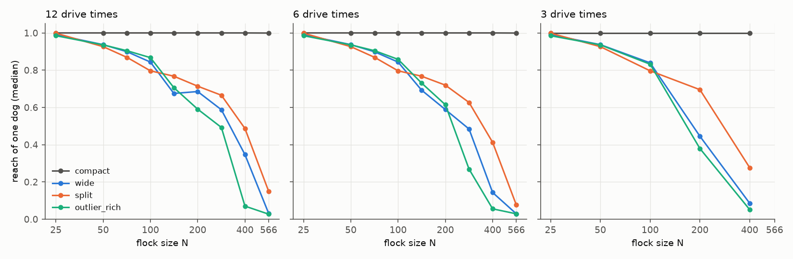

# How many dogs does a simulated flock need?

This report summarizes the simulation results from 115,470 stored trials across the six study protocols (`dmin_m12`, `dmin_m6`, `dmin_m3`, `dmin_f99_m12`, `dmin_f99_m6`, `dmin_f99_m3`) and three pilot protocols (`pilot_graze_on`, `pilot_graze_on_rest`, `pilot_graze_on_m3`). The task, start layouts, success rules and models are defined in the [README](../../README.md#task-and-methods), [task design](../experiments/task_design.md), [protocol catalogue](../guides/protocols.md) and [glossary](../glossary.md).

Summary of results across the six study protocols:

- **Strict rule ($N = 25$, 50, 100, 200, 400):**
  - `dmin_m12` (12 drive times): `compact` needs $D_{\min} = 1$ at every size. `wide` and `outlier_rich` reach $D_{\min} = 3$ at $N = 400$, with log-log slope 0.42 across $N = 25$-400 on both (0.32 to 0.42 on `split`).
  - `dmin_m6` (6 drive times): `compact` needs 1 dog at every size. `wide` needs 3 dogs at $N = 200$ and has only a lower bound `[9]` at $N = 400$; `split` (from $N = 200$) and `outlier_rich` (at $N = 400$, after `[12]` at $N = 200$) have no reliable team up to 24 dogs.
  - `dmin_m3` (3 drive times): `compact` needs 1 dog at every size. From $N = 200$, no team up to 24 dogs is reliable on `wide`, `split` or `outlier_rich`.
- **99% rule ($N = 25$, 50, 71, 100, 141, 200, 283, 400, 566 at 12 and 6 drive times; $N = 25$, 50, 100, 200, 400 at 3 drive times):**
  - `dmin_f99_m12` (12 drive times): `compact` needs 1 dog through $N = 566$. `wide` and `outlier_rich` need 2 dogs at $N = 400$ and 2-3 at $N = 566$; across all nine sizes, the log-log slope of $D_{\min}$ is 0.27 to 0.38 on `wide` and 0.28 to 0.38 on `outlier_rich`.
  - `dmin_f99_m6` (6 drive times): `compact` needs 1 dog through $N = 566$. At $N = 400$, `wide` needs 2-3 dogs and `outlier_rich` needs 3; across all nine sizes, the log-log slope is 0.38 to 0.61 on `wide` and 0.40 to 0.58 on `outlier_rich`.
  - `dmin_f99_m3` (3 drive times): `compact` needs 1 dog at every size ($N = 25$-400). `wide` needs 2 dogs at $N = 100$, 3 at $N = 200$ and 5-6 at $N = 400$; `outlier_rich` needs 2 at $N = 100$, 4-10 at $N = 200$ and `[6]` at $N = 400$; `split` has no reliable team up to 24 dogs from $N = 200$.
- **Deadline truncation:** Every trial shared between two deadlines succeeds at the shorter deadline if and only if it finished within that time limit at the longer one.
- **Layout against flock size:** On $N = 25$-400 with lower bounds counted at their low end, $N$ moves $D_{\min}$ at least as much as the start layout in all six runs. On curves with a decided reliable team only, $N$ moves $D_{\min}$ at least as much in five of the six runs (a tie at 0.79 doublings in `dmin_m6`), while layout moves it more in `dmin_f99_m6` on the five sizes (0.78 against 0.72 doublings), reversing on all nine sizes of `dmin_f99_m6` (0.93 across layouts against 1.07 across $N$).

## 1. The question

Each cell `(layout, N, D)` is tested with up to 200 seeds in batches of 10 using the two-sided 99% Clopper-Pearson interval $[L, U]$ against threshold 0.90: reliable when $L \ge 0.90$, unreliable when $U < 0.90$, and undecided otherwise ([stopping rule](../experiments/task_design.md#stopping-early-with-the-99-clopper-pearson-interval)). On each `(layout, N)` curve, $D_{\min}$ is the smallest reliable $D$, written in four forms:

1) `3`: $D = 3$ is reliable and every tested $D < 3$ is unreliable.
2) `3-8`: bracket $[D_{\min,\mathrm{low}}, D_{\min}]$; $D = 8$ is reliable, every $D < 3$ is unreliable, and $D = 3$ is undecided at 200 seeds.
3) `[5]`: lower bound only; no tested $D$ is reliable yet, and every $D < 5$ is unreliable.
4) `none`: every tested $D$ up to 24 is unreliable.

**Table 1: Research questions and where they are answered.**

| RQ | Question | Answered in |
| :--- | :--- | :--- |
| RQ1 | How does $D_{\min}$ grow with $N$ from 25 to 566? | [2.1](#21-rq1-how-does-d_min-grow-with-n) |
| RQ2 | At a given deadline, which moves $D_{\min}$ more, the start layout or $N$? | [2.2](#22-rq2-layout-or-flock-size-which-moves-d_min-more) |
| RQ3 | How does $D_{\min}$ change from 12 to 6 to 3 drive times? | [2.3](#23-rq3-how-does-the-deadline-change-d_min) |

## 2. Results

### 2.1 RQ1: How does D_min grow with N?

On `compact`, $D_{\min} = 1$ at every flock size, rule and deadline. Up to $N = 50$, $D_{\min} = 1$ on every layout and deadline as well. From $N = 100$ on, $D_{\min}$ grows on the three scattered layouts (Table 2, Figure 1).

**Table 2: $D_{\min}$ on the scattered layouts, strict rule / 99% rule, $N = 25$-400 (`compact` is 1 / 1 in every cell).**

| Deadline | Layout | $N = 25$ | $N = 50$ | $N = 100$ | $N = 200$ | $N = 400$ |
| :---: | :--- | :---: | :---: | :---: | :---: | :---: |
| 12x | `wide` | 1 / 1 | 1 / 1 | 1 / 1 | 2 / 1-2 | 3 / 2 |
| 12x | `split` | 1 / 1 | 1 / 1 | 1 / 1 | 1-2 / 1 | 3 / 2 |
| 12x | `outlier_rich` | 1 / 1 | 1 / 1 | 1-3 / 1-2 | 2 / 2 | 3 / 2 |
| 6x | `wide` | 1 / 1 | 1 / 1 | 1 / 1 | 3 / 2 | [9] / 2-3 |
| 6x | `split` | 1 / 1 | 1 / 1 | 1 / 1 | none / [1] | none / [5] |
| 6x | `outlier_rich` | 1 / 1 | 1 / 1 | 3 / 2 | [12] / 2-3 | none / 3 |
| 3x | `wide` | 1 / 1 | 1 / 1 | 3 / 2 | none / 3 | none / 5-6 |
| 3x | `split` | 1 / 1 | 1 / 1 | 1 / 1 | none / none | none / none |
| 3x | `outlier_rich` | 1 / 1 | 1 / 1 | 3-8 / 2 | none / 4-10 | none / [6] |

*Data:* [results_tables.md: strict success](results_tables.md#d_min-by-layout-and-n-strict-success) and [results_tables.md: success at 99 percent](results_tables.md#d_min-by-layout-and-n-success-at-99-percent).

**Figure 1: $D_{\min}$ against flock size $N$ on the three scattered layouts, both rules, at 12, 6 and 3 drive times ($N = 25$-400, and up to 566 under the 99% rule at 12 and 6 drive times; `compact` is 1 everywhere).**

- Marks: blue circles with solid lines are the strict rule and orange squares with dashed lines the 99% rule. Shaded bars are undecided brackets at 200 seeds, hollow triangles lower bounds, and crosses curves where every tested team up to 24 is unreliable. Axes are log-log.
- Panels: rows are `wide`, `split` and `outlier_rich`; columns 12, 6 and 3 drive times.

In the stored one-dog trials (`D = 1`), reach (the share of the outer half of the flock within reaction distance $r_s = 65$ m of the dog, averaged over ticks) has a median of 0.93 to 1.00 at $N \le 50$ on every layout and deadline (99% rule, at least 60 trials per entry) and 1.00 on `compact` at every size (Figure 2). On the scattered layouts it drops with $N$: at 6 drive times, from 0.84 (`wide`), 0.80 (`split`) and 0.86 (`outlier_rich`) at $N = 100$ to 0.14, 0.41 and 0.06 at $N = 400$ (10 failed trials each). Reach alone does not order $D_{\min}$: at $N = 100$ and 6 drive times, `outlier_rich` has the highest reach of the three (0.86) but needs 2 dogs, whereas `wide` and `split` need 1.

**Figure 2: Median reach of one dog against $N$, four layouts, 99% rule, at 12, 6 and 3 drive times.**

- Marks: one line per layout; median over the stored `D = 1` trials of the per-trial mean outer-half reach.
- Panels: 12, 6 and 3 drive times, left to right.

*Data:* [reach table](results_tables.md#reach-of-one-dog-99-percent).

Table 3 gives the log-log slopes of $\log_2 D_{\min}$ against $\log_2 N$ across the five main sizes ($N = 25$-400), and Table 4 gives the nine-size $D_{\min}$ brackets for `dmin_f99_m12` and `dmin_f99_m6` ($N = 25$-566, stepped by $\sqrt{2}$). Across all nine sizes under the 99% rule, the allowed slopes are 0.27 to 0.38 (`wide`) and 0.28 to 0.38 (`outlier_rich`) at 12 drive times, and 0.38 to 0.61 (`wide`) and 0.40 to 0.58 (`outlier_rich`) at 6 drive times.

**Table 3: Slope of $\log_2 D_{\min}$ against $\log_2 N$, five sizes ($N = 25$-400).**

| Rule | Deadline | `wide` | `split` | `outlier_rich` |
| :--- | :---: | :---: | :---: | :---: |
| Strict | 12x | 0.42 | 0.32 to 0.42 | 0.42 |
| Strict | 6x | 0.48 ($N \le 200$) | flat ($N \le 100$) | 0.79 ($N \le 100$) |
| Strict | 3x | 0.79 ($N \le 100$) | flat ($N \le 100$) | 0.79 to 1.50 ($N \le 100$) |
| 99% | 12x | 0.20 to 0.30 | 0.20 | 0.30 |
| 99% | 6x | 0.30 to 0.42 | flat ($N \le 100$) | 0.42 to 0.48 |
| 99% | 3x | 0.62 to 0.68 | flat ($N \le 100$) | 0.70 to 1.10 ($N \le 200$) |

*Data:* [results_tables.md: growth with N, strict](results_tables.md#growth-with-n-strict) and [results_tables.md: growth with N, 99 percent](results_tables.md#growth-with-n-99-percent).

**Table 4: $D_{\min}$ on nine flock sizes, 99% rule, 12 and 6 drive times.**

| Layout, deadline | 25 | 50 | 71 | 100 | 141 | 200 | 283 | 400 | 566 |
| :--- | :---: | :---: | :---: | :---: | :---: | :---: | :---: | :---: | :---: |
| `wide`, 12x | 1 | 1 | 1 | 1 | 2 | 1-2 | 2 | 2 | 2-3 |
| `outlier_rich`, 12x | 1 | 1 | 1 | 1-2 | 2 | 2 | 2 | 2 | 2-3 |
| `wide`, 6x | 1 | 1 | 1 | 1 | 2 | 2 | 2-3 | 2-3 | 3-7 |
| `outlier_rich`, 6x | 1 | 1 | 1 | 2 | 2 | 2-3 | 2-3 | 3 | 3-6 |

*Data:* [results_tables.md: nine flock sizes, 99 percent](results_tables.md#nine-flock-sizes-99-percent).

Maximum-likelihood fits of a power law $D = a N^b$ against a saturating curve $D = 1 + (D_\infty - 1) N / (N + K)$ on the nine sizes of `dmin_f99_m12` and `dmin_f99_m6` give a log-likelihood difference (`log_odds`) of 0.0 on both `wide` and `outlier_rich` at both deadlines: up to $N = 566$, the brackets fit both shapes equally well (Figure 3).

**Figure 3: $D_{\min}$ on nine flock sizes ($N = 25$-566, 99% rule), and where each curve shape could go.**

- Marks: `wide` (circles) and `outlier_rich` (squares) on log-log axes, with bars down to $D_{\min,\mathrm{low}}$. The vertical line marks the calibration edge $N = 630$ (3 seeds per start). Shaded bands above $N = 566$ show the envelopes of fitting power laws (dashed top) and saturating curves (dotted top).
- Left: 12 drive times (`dmin_f99_m12`). Right: 6 drive times (`dmin_f99_m6`).

*Data:* [results_tables.md: fits, dmin_f99_m12](results_tables.md#fits-dmin_f99_m12-d_minn-power-law-against-saturating-curve) and [results_tables.md: fits, dmin_f99_m6](results_tables.md#fits-dmin_f99_m6-d_minn-power-law-against-saturating-curve).

### 2.2 RQ2: Layout or flock size, which moves D_min more?

Table 5 compares the mean spread of $D_{\min}$ in doublings ($\log_2(\max D_{\min} / \min D_{\min})$) across the four layouts at fixed $N$ against the mean spread across $N = 25$-400 at fixed layout. Brackets use their geometric midpoint, lower bounds `[D]` use `D`, and `none` entries are omitted.

**Table 5: Spread of $D_{\min}$ across layouts and across $N$ (doublings), four layouts, five sizes ($N = 25$-400).**

| Rule | Deadline | Across layouts | Across $N$ | Across layouts, reliable team only | Across $N$, reliable team only |
| :--- | :---: | :---: | :---: | :---: | :---: |
| Strict | 12x | 0.68 | 1.19 | 0.68 | 1.19 |
| Strict | 6x | 1.67 | 1.69 | 0.79 | 0.79 |
| Strict | 3x | 0.76 | 0.97 | 0.76 | 0.97 |
| 99% | 12x | 0.50 | 0.75 | 0.50 | 0.75 |
| 99% | 6x | 0.92 | 1.30 | 0.78 | 0.72 |
| 99% | 3x | 1.25 | 1.28 | 1.22 | 1.28 |

*Data:* [growth with N, strict](results_tables.md#growth-with-n-strict) and [growth with N, 99 percent](results_tables.md#growth-with-n-99-percent).

With lower bounds included, the spread across $N$ is at least the spread across layouts in every run (within 0.03 at strict 6x and 99% 3x). Restricting to curves with a decided reliable team only, strict 6x ties (0.79 vs 0.79) and 99% 6x reverses on the five sizes (0.78 across layouts vs 0.72 across $N$), though across all nine sizes of `dmin_f99_m6` $N$ is larger again (0.93 across layouts vs 1.07 across $N$). Under the 99% rule at 12 drive times, `wide` and `outlier_rich` differ by at most 1 dog at every size; under the strict rule at 6 drive times, they diverge at $N = 200$ (`3` vs `[12]`).

### 2.3 RQ3: How does the deadline change D_min?

Shortening the deadline increases $D_{\min}$ on large scattered flocks, mainly between 6 and 3 drive times (Table 2, Figure 4). Under the 99% rule:

1) `wide` at $N = 400$: rises by at most 1 dog from 12x to 6x (`2` to `2-3`) and by 2 to 4 dogs from 6x to 3x (`2-3` to `5-6`; at 3x, success is 2/10 at $D = 3$, 45/60 at $D = 4$, 189/200 at $D = 5$ and 79/80 at $D = 6$).
2) `outlier_rich` at $N = 400$: rises by 1 dog from 12x to 6x (`2` to `3`) and by at least 3 dogs from 6x to 3x (`3` to `[6]`; at 3x, success stays between 12/20 at $D = 12$ and 172/200 at $D = 6$ for all $D \ge 5$).
3) `outlier_rich` at $N = 200$: rises by 0 to 1 dog from 12x to 6x (`2` to `2-3`) and by 1 to 8 dogs from 6x to 3x (`2-3` to `4-10`).
4) $N = 100$ (all scattered layouts) and `wide` at $N = 200$: rises by at most 1 dog in either step.
5) $N = 566$ from 12x to 6x: brackets allow 0 to 5 dogs on `wide` (`2-3` to `3-7`) and 0 to 4 on `outlier_rich` (`2-3` to `3-6`).

**Figure 4: Success against team size at 12, 6 and 3 drive times, 99% rule.**

- Marks: light, mid and dark blue are 12, 6 and 3 drive times; dotted line is threshold 0.90.
- Left and middle: success rate with 99% Clopper-Pearson intervals against $D$ for `wide` $N = 400$ and `outlier_rich` $N = 200$.
- Right: $D_{\min}$ against deadline for `wide` and `outlier_rich` at $N = 200$ (solid, circles) and $N = 400$ (dashed, squares).

*Data:* [results_tables.md: success at 99 percent](results_tables.md#d_min-by-layout-and-n-success-at-99-percent) and [results_tables.md: N = 400 at three deadlines](results_tables.md#n--400-at-three-deadlines-99-percent).

Because the deadline only changes `max_ticks` and seed $i$ initializes the exact same trial across deadlines, every shared trial between two deadlines under the same rule succeeds at the shorter deadline if and only if its finish time at the longer deadline was within the shorter limit, with identical finish ticks (Table 6).

**Table 6: Trials shared by two runs at different deadlines (drive times), with 0 mismatches.**

| Rule | Runs compared | Shared trials |
| :--- | :--- | :---: |
| 99% | 12 against 6 | [26,620](results_tables.md#dmin_f99_m12-against-dmin_f99_m6-the-shorter-deadline-as-a-cut) |
| 99% | 6 against 3 | [10,760](results_tables.md#dmin_f99_m6-against-dmin_f99_m3-the-shorter-deadline-as-a-cut) |
| 99% | 12 against 3 | [10,360](results_tables.md#dmin_f99_m12-against-dmin_f99_m3-the-shorter-deadline-as-a-cut) |
| Strict | 12 against 6 | [10,500](results_tables.md#dmin_m12-against-dmin_m6-the-shorter-deadline-as-a-cut) |
| Strict | 6 against 3 | [8560](results_tables.md#dmin_m6-against-dmin_m3-the-shorter-deadline-as-a-cut) |
| Strict | 12 against 3 | [8250](results_tables.md#dmin_m12-against-dmin_m3-the-shorter-deadline-as-a-cut) |

## 3. Exceptions and pilot checks

1) **Non-monotone curves ($D_{\min,\mathrm{stable}} > D_{\min}$):** On three curves, all on `split` with $D_{\min} = 1$, a larger team is unreliable before reliability returns at $D_{\min,\mathrm{stable}}$:
   - `dmin_m6`, `split`, $N = 100$: $D_{\min} = 1$, $D = 3$ is unreliable, $D_{\min,\mathrm{stable}} = 5$.
   - `dmin_m3`, `split`, $N = 100$: $D_{\min} = 1$, $D = 2, 3, 4$ are unreliable, $D_{\min,\mathrm{stable}} = 5$.
   - `dmin_f99_m6`, `split`, $N = 141$: $D_{\min} = 1$, $D = 4$ is unreliable, $D_{\min,\mathrm{stable}} = 7$.
   Inside an undecided bracket this occurs once: `dmin_m3`, `outlier_rich`, $N = 100$ has bracket `3-8` with $D = 4$ unreliable ([full list](results_tables.md#teams-that-fail-above-d_min)).
2) **Unresolved curves (`[D]` and `none`):** On `split` from $N = 200$, no team up to 24 dogs is decided reliable at 6x or 3x under either rule (`[1]` at $N = 200$ and `[5]` at $N = 400$ in `dmin_f99_m6`; `none` in `dmin_m6`, `dmin_m3` and `dmin_f99_m3`). At $N = 400$, `wide` has `[9]` in `dmin_m6` and `none` in `dmin_m3`; `outlier_rich` has `[12]` at $N = 200$ and `none` at $N = 400$ in `dmin_m6`, `none` from $N = 200$ in `dmin_m3`, and `[6]` at $N = 400$ in `dmin_f99_m3`.
3) **Grazing-repulsion pilots (`pilot_graze_on`, `pilot_graze_on_rest`, `pilot_graze_on_m3`):** Rerunning `dmin_f99_m6` (all 9 sizes) and `dmin_f99_m3` (all 5 sizes) with `graze_repulsion: true` on the same seeds shifts calibrated $R_f$ by $-1.1\%$ to $+0.4\%$ (9.68 m vs 9.79 m at $N = 141$). Across 526 shared cells, 0 cells flip between reliable and unreliable. Exactly 14 of 56 $D_{\min}$ entries shift, each through a cell undecided at 200 seeds in one of the two runs; 0 entries decided in both runs change. The largest trial-level difference is `split` at $N = 566$, 6x: 88 seeds succeed only with `graze_repulsion: true` and 49 only without, out of 510 (sign test $p = 0.0011$, above the Bonferroni threshold $0.0009$ for 56 groups; [pilot table](results_tables.md#grazing-repulsion-on-same-seeds)).
4) **Sequential stopping properties:** Checking the 99% Clopper-Pearson interval every 10 seeds up to 200 (20 looks without multiple-testing correction) classifies a cell with true success rate 0.90 as reliable with probability 1.27%, unreliable with 1.86%, and undecided with 96.86% ([decision rates](results_tables.md#decision-rates-of-the-per-cell-rule)).
5) **Task-geometry and calibration limits in the data:** From $N = 200$, the widest start layout exceeds $13 R_f$, so the drive distance is $13.4 R_f$ at $N = 200$ and $18 R_f$ at $N = 400$ ([sizing](../experiments/task_design.md#sizing-by-the-calibrated-flock-radius)). Flock sizes stop at $N = 566$ because 3-seed calibration fails its 5% settle tolerances from $N = 630$ ([flock size](../experiments/task_design.md#flock-size)).

## 4. Run record

**Table 7: Stored study runs (`undecided` = undecided on reliability at 200 seeds; `open` = flagged for more seeds on reliability or finish time, all at the 200-seed cap; hours are the first pass at 20 workers).**

| Protocol | Trials | Cells | Undecided | Open | Errors | Hours, first pass | Trials added later |
| :--- | :---: | :---: | :---: | :---: | :---: | :---: | :---: |
| `dmin_m12` | 17,220 | 183 | 4 | 4 | 0 | 1.24 | 0 |
| `dmin_m6` | 13,470 | 191 | 21 | 21 | 0 | 0.28 | 1845 |
| `dmin_m3` | 9530 | 183 | 5 | 5 | 0 | 0.17 | 400 |
| `dmin_f99_m12` | 31,590 | 349 | 4 | 53 | 0 | 0.41 | 20,490 |
| `dmin_f99_m6` | 31,920 | 354 | 42 | 58 | 0 | 0.49 | 19,530 |
| `dmin_f99_m3` | 11,740 | 185 | 8 | 10 | 0 | 0.27 | 1070 |
| Total | 115,470 | 1445 | 84 | 151 | 0 | 2.86 | 43,335 |

*Data:* `uv run python -m docs.generate_docs.page record`; stored trials and cell tables are in `results/<protocol>/` and [results_tables.md](results_tables.md).

Record notes:

1) **Zero simulation errors:** All 115,470 study trials completed without error, and deterministic replay checks pass on the stored rows.
2) **Archived calibration tolerances:** The archived `protocol.yaml` inside the six study folders and three pilot folders lists `settled_tolerance: 0.15` and `start_agreement: 0.25`, but the stored calibrated $R_f$ values match `results/diagnostics/calibration_dmin_f99_m6.csv` and `calibration_pilot_graze_on_rest.csv`, which satisfy the 5% (`0.05`) tolerances at every stored size $N \le 566$ ([settings](../guides/settings.md#calibration-of-r_f)).
3) **Resumes and `decide_finish_times`:** `dmin_f99_m12` and `dmin_f99_m6` were resumed with the four $\sqrt{2}$ midpoint sizes ($N = 71$, 141, 283, 566). The three `f99` runs had `decide_finish_times: false` on their first pass and `true` on their resumes (which explains why `open > undecided` in `dmin_f99_*`). `dmin_m12` was run with `decide_finish_times: true` even though neither its protocol file nor its archived `protocol.yaml` sets that key, so reproducing its exact seed counts requires `decide_finish_times: true`.
