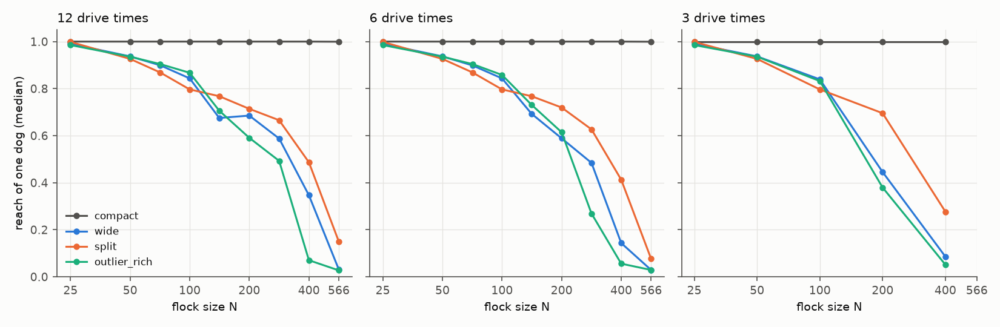
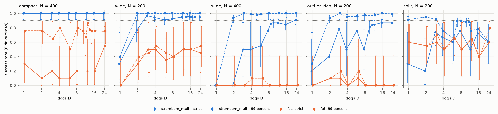

# How many dogs does a simulated flock need?

This report summarizes 145,790 stored trials from nine study runs in HerdSim: six runs of the coordinated team rule [`strombom_multi`](../methods/strombom_multi.md) (`dmin_m12`, `dmin_m6`, `dmin_m3`, `dmin_f99_m12`, `dmin_f99_m6`, `dmin_f99_m3`), two runs of the uncoordinated [`fat` baseline](../methods/fat.md) at 6 drive times (`dmin_fat`, `dmin_f99_fat`), the [`independent` paper shepherds baseline](../methods/independent.md) at 6 drive times (`dmin_f99_indep`), and three grazing-repulsion pilots (`pilot_graze_on`, `pilot_graze_on_rest`, `pilot_graze_on_m3`). 

The task geometry, start layouts, success rules and models are detailed in the [README](../../README.md#task-and-methods), [task design](../experiments/task_design.md), [protocol catalogue](../guides/protocols.md) and [glossary](../glossary.md).

---

### Executive Summary

#### 1. Under the Strict Rule ($N = 25$ to $400$)
* **12 drive times (`dmin_m12`, relaxed deadline):**
  * `compact`: 1 dog is sufficient across all flock sizes.
  * `wide` & `outlier_rich`: $D_{\min}$ rises gently to 3 dogs at $N = 400$ (log-log slope 0.42).
  * `split`: 3 dogs at $N = 400$ (slope 0.32–0.42).
* **6 drive times (`dmin_m6`, reference deadline):**
  * `compact`: 1 dog suffices for all sizes.
  * `wide`: requires 3 dogs at $N = 200$; only a lower bound `[9]` is established at $N = 400$.
  * `split` & `outlier_rich`: fail to produce any reliable team up to 24 dogs at large sizes (`split` from $N = 200$; `outlier_rich` at $N = 400$, after `[12]` at $N = 200$).
* **3 drive times (`dmin_m3`, tight deadline):**
  * `compact`: 1 dog suffices for all sizes.
  * Scattered layouts: from $N = 200$ upward, no team up to 24 dogs achieves reliability on `wide`, `split`, or `outlier_rich`.

#### 2. Under the 99% Rule ($N = 25$ to $566$)
* **12 drive times (`dmin_f99_m12`):**
  * `compact`: 1 dog is sufficient through $N = 566$.
  * `wide` & `outlier_rich`: 2 dogs at $N = 400$, rising to 2–3 dogs at $N = 566$ (slopes 0.27–0.38).
* **6 drive times (`dmin_f99_m6`):**
  * `compact`: 1 dog is sufficient through $N = 566$.
  * `wide`: 2–3 dogs at $N = 400$; 3–7 dogs at $N = 566$ (slope 0.38–0.61).
  * `outlier_rich`: 3 dogs at $N = 400$; 3–6 dogs at $N = 566$ (slope 0.40–0.58).
* **3 drive times (`dmin_f99_m3`):**
  * `compact`: 1 dog suffices across all sizes.
  * `wide`: 2 dogs at $N = 100$, 3 at $N = 200$, and 5–6 at $N = 400$.
  * `outlier_rich`: 2 dogs at $N = 100$, 4–10 at $N = 200$, and `[6]` at $N = 400$.
  * `split`: no team up to 24 dogs is reliable from $N = 200$ upward.

#### 3. Core Architectural Insights
* **Deadlines act as an exact filter:** A trial evaluated at two deadlines under the same seed and rule succeeds at the tighter deadline if and only if it completed within that time limit under the looser one.
* **Layout vs. Flock Size:** On full decided curves, flock size $N$ shifts $D_{\min}$ at least as much as initial spatial layout across five of six runs.
* **Controller Hierarchy (Ablation at 6 drive times):**
  * *Level 0 (`fat`, uncoordinated):* Dogs bunch onto the same straggler; completely collapses on scattered flocks from $N \ge 200$.
  * *Level 1 (`independent`, mode switching without team assignment):* Restores reliability up to $N = 200$ across all layouts, but fails completely at $N = 400$ because all dogs chase the same outlier.
  * *Level 2 (`strombom_multi`, full multi-agent coordination):* Scales reliably through $N = 566$ with small teams ($D_{\min} = 2\text{--}3$ at $N = 400$).

---

## 1. The Question and Experimental Framework

Each trial cell `(layout, N, D)` is tested in sequential batches of 10 seeds (up to 200 seeds maximum) using the exact two-sided 99% Clopper-Pearson confidence interval $[L, U]$ against threshold $\theta = 0.90$ ([stopping rule](../experiments/task_design.md#stopping-early-with-the-99-clopper-pearson-interval)):
* **Reliable ($L \ge 0.90$):** Team achieves $\ge 90\%$ success with $99\%$ confidence.
* **Unreliable ($U < 0.90$):** Team fails the reliability requirement.
* **Undecided ($L < 0.90 \le U$):** Cell continues sampling until resolved or capped at 200 seeds.

On each `(layout, N)` curve, $D_{\min}$ represents the minimum reliable team size:
* `3`: exactly 3 dogs are reliable; smaller teams are unreliable.
* `3-8`: bracket $[D_{\min,\mathrm{low}}, D_{\min}]$ where 8 is reliable, teams $< 3$ are unreliable, and intermediate sizes remain undecided at 200 seeds.
* `[5]`: lower bound; no tested team is reliable yet, and all teams $< 5$ are confirmed unreliable.
* `none`: all tested team sizes up to 24 dogs are unreliable.

**Table 1: Research questions and navigation.**

| RQ | Core Question | Answered in |
| :--- | :--- | :--- |
| **RQ1** | How does $D_{\min}$ scale with flock size $N$ from 25 to 566? | [Section 2.1](#21-rq1-how-does-d_min-grow-with-n) |
| **RQ2** | At a given deadline, which factor moves $D_{\min}$ more: layout or $N$? | [Section 2.2](#22-rq2-layout-or-flock-size-which-moves-d_min-more) |
| **RQ3** | How does $D_{\min}$ change as deadlines tighten from 12x to 6x and 3x? | [Section 2.3](#23-rq3-how-does-the-deadline-change-d_min) |
| **RQ4** | Can uncoordinated FAT dogs achieve finite reliability as $N$ increases? | [Section 2.4](#24-rq4-do-uncoordinated-fat-dogs-reach-a-finite-d_min) |
| **RQ5** | What does multi-agent coordination add over independent shepherds? | [Section 2.5](#25-rq5-what-does-the-team-layer-add-over-independent-shepherds) |

---

## 2. Results

### 2.1 RQ1: How does D_min grow with N?

On `compact`, a single dog suffices ($D_{\min} = 1$) across every flock size, rule, and deadline. Up to $N = 50$, $D_{\min} = 1$ on all layouts as well. For $N \ge 100$, team requirements diverge across scattered layouts (Table 2, Figure 1).

**Table 2: Minimum team size $D_{\min}$ on scattered layouts (Strict rule / 99% rule, $N = 25$ to $400$).**  
*(Note: `compact` is $1 / 1$ in every cell).*

| Deadline | Layout | $N = 25$ | $N = 50$ | $N = 100$ | $N = 200$ | $N = 400$ |
| :---: | :--- | :---: | :---: | :---: | :---: | :---: |
| **12x** | `wide` | 1 / 1 | 1 / 1 | 1 / 1 | 2 / 1-2 | 3 / 2 |
| **12x** | `split` | 1 / 1 | 1 / 1 | 1 / 1 | 1-2 / 1 | 3 / 2 |
| **12x** | `outlier_rich` | 1 / 1 | 1 / 1 | 1-3 / 1-2 | 2 / 2 | 3 / 2 |
| **6x** | `wide` | 1 / 1 | 1 / 1 | 1 / 1 | 3 / 2 | [9] / 2-3 |
| **6x** | `split` | 1 / 1 | 1 / 1 | 1 / 1 | none / [1] | none / [5] |
| **6x** | `outlier_rich` | 1 / 1 | 1 / 1 | 3 / 2 | [12] / 2-3 | none / 3 |
| **3x** | `wide` | 1 / 1 | 1 / 1 | 3 / 2 | none / 3 | none / 5-6 |
| **3x** | `split` | 1 / 1 | 1 / 1 | 1 / 1 | none / none | none / none |
| **3x** | `outlier_rich` | 1 / 1 | 1 / 1 | 3-8 / 2 | none / 4-10 | none / [6] |

*Data sources:* Stored protocol runs in `results/dmin_m12`, `results/dmin_m6`, `results/dmin_m3`, `results/dmin_f99_m12`, `results/dmin_f99_m6`, `results/dmin_f99_m3` (`frontier_groups.csv` and `trials.csv`); see full tables in [results_tables.md: strict](results_tables.md#d_min-by-layout-and-n-strict-success) and [results_tables.md: 99%](results_tables.md#d_min-by-layout-and-n-success-at-99-percent).

**Figure 1: Minimum team size $D_{\min}$ scaling across flock size $N$ (log-log axes).**

* **Structure of the 9 panels:**
  * **Rows (Layouts):** Top = `wide`, Middle = `split`, Bottom = `outlier_rich`.
  * **Columns (Deadlines):** Left = 12 drive times (loose), Center = 6 drive times (reference), Right = 3 drive times (tight).
* **Symbol guide:** Blue circles (solid lines) = strict rule; Orange squares (dashed lines) = 99% rule. Shaded vertical bars = undecided brackets at 200 seeds; hollow triangles = lower bounds `[D]`; red crosses (`x`) = failure of all teams up to 24 dogs (`none`).
* **Key takeaways:**
  1. *Deadline impact:* Under 12x (left column), $D_{\min}$ stays small ($\le 3$) and grows sublinearly. Under 3x (right column), scattered flocks collapse for $N \ge 200$.
  2. *Strict vs. 99% rule:* The strict rule requires substantially larger teams or fails completely on `split` and `outlier_rich` due to single lingering stragglers.

---

#### Single-Dog Reach and Flank Coverage

In single-dog trials ($D = 1$), **reach** measures the fraction of sheep in the outer half of the flock within reaction radius $r_s = 65$ m of the dog (averaged over ticks). Reach is near $1.0$ for $N \le 50$, but drops sharply on scattered layouts as $N$ increases (Figure 2).

**Figure 2: Median reach of a single dog ($D = 1$) vs. flock size $N$.**

* **Structure of the 3 panels:** Left = 12 drive times; Center = 6 drive times; Right = 3 drive times.
* **Curves:** Green = `compact`, Blue = `wide`, Magenta = `split`, Brown = `outlier_rich`.
* **Key takeaway:** While reach remains 1.0 on `compact`, it collapses to $0.06\text{--}0.41$ at $N = 400$ on scattered layouts. Because one dog can no longer visually or physically cover the herd perimeter, additional dogs become mathematically necessary.

*Data source:* One-dog trials ($D=1$) in `results/dmin_f99_m12`, `results/dmin_f99_m6`, `results/dmin_f99_m3` (`trials.csv`, column `mean_outer_reach`); see [reach table](results_tables.md#reach-of-one-dog-99-percent).

---

#### Scaling Slopes and Growth Shapes

Table 3 summarizes empirical scaling slopes $\alpha = \frac{\Delta \log_2 D_{\min}}{\Delta \log_2 N}$ across $N = 25\text{--}400$, and Table 4 provides the full 9-point grid up to $N = 566$.

**Table 3: Log-log scaling slopes ($\log_2 D_{\min}$ vs. $\log_2 N$, $N = 25$ to $400$).**

| Rule | Deadline | `wide` | `split` | `outlier_rich` |
| :--- | :---: | :---: | :---: | :---: |
| **Strict** | 12x | 0.42 | 0.32 to 0.42 | 0.42 |
| **Strict** | 6x | 0.48 ($N \le 200$) | Flat ($N \le 100$) | 0.79 ($N \le 100$) |
| **Strict** | 3x | 0.79 ($N \le 100$) | Flat ($N \le 100$) | 0.79 to 1.50 ($N \le 100$) |
| **99%** | 12x | 0.20 to 0.30 | 0.20 | 0.30 |
| **99%** | 6x | 0.30 to 0.42 | Flat ($N \le 100$) | 0.42 to 0.48 |
| **99%** | 3x | 0.62 to 0.68 | Flat ($N \le 100$) | 0.70 to 1.10 ($N \le 200$) |

*Data sources:* `results/dmin_*` (`frontier_groups.csv`); see [results_tables.md: strict](results_tables.md#growth-with-n-strict) and [results_tables.md: 99%](results_tables.md#growth-with-n-99-percent).

**Table 4: $D_{\min}$ across all nine flock sizes (99% rule, $\sqrt{2}$ steps from 25 to 566).**

| Layout, deadline | 25 | 50 | 71 | 100 | 141 | 200 | 283 | 400 | 566 |
| :--- | :---: | :---: | :---: | :---: | :---: | :---: | :---: | :---: | :---: |
| `wide`, 12x | 1 | 1 | 1 | 1 | 2 | 1-2 | 2 | 2 | 2-3 |
| `outlier_rich`, 12x | 1 | 1 | 1 | 1-2 | 2 | 2 | 2 | 2 | 2-3 |
| `wide`, 6x | 1 | 1 | 1 | 1 | 2 | 2 | 2-3 | 2-3 | 3-7 |
| `outlier_rich`, 6x | 1 | 1 | 1 | 2 | 2 | 2-3 | 2-3 | 3 | 3-6 |

*Data sources:* `results/dmin_f99_m12` and `results/dmin_f99_m6` (`frontier_groups.csv`); see [results_tables.md: nine sizes](results_tables.md#nine-flock-sizes-99-percent).

**Figure 3: Power-law vs. saturating growth models fitted on nine flock sizes ($N = 25$ to $566$).**

* **Structure:** Left panel = 12 drive times (`dmin_f99_m12`); Right panel = 6 drive times (`dmin_f99_m6`).
* **Visual components:** Circles = `wide`; Squares = `outlier_rich`. Vertical dashed line = calibration edge ($N = 630$). Shaded bands above $N = 566$ display extrapolation envelopes for power laws $D \propto N^b$ (dashed top) and saturating functions $D = 1 + \frac{(D_\infty - 1)N}{N+K}$ (dotted top).
* **Key takeaway:** Likelihood comparison yields $\Delta \log\text{-likelihood} = 0.0$ at both deadlines. Up to $N = 566$, both model classes describe the data equally well; distinguishing them requires probing beyond the physical calibration boundary ($N \ge 630$).

*Data sources:* Model fits in `results/dmin_f99_m12/frontier_groups.csv` and `results/dmin_f99_m6/frontier_groups.csv`; see [results_tables.md: fits 12x](results_tables.md#fits-dmin_f99_m12-d_minn-power-law-against-saturating-curve) and [results_tables.md: fits 6x](results_tables.md#fits-dmin_f99_m6-d_minn-power-law-against-saturating-curve).

---

### 2.2 RQ2: Layout or flock size, which moves D_min more?

Table 5 evaluates the relative influence of layout versus flock size $N$ using the mean spread of $D_{\min}$ measured in doublings ($\log_2(\max D_{\min} / \min D_{\min})$).

**Table 5: Spread of $D_{\min}$ (in doublings) across layouts vs. across flock sizes ($N = 25$ to $400$).**

| Rule | Deadline | Across layouts (all curves) | Across $N$ (all curves) | Across layouts (decided only) | Across $N$ (decided only) |
| :--- | :---: | :---: | :---: | :---: | :---: |
| **Strict** | 12x | 0.68 | **1.19** | 0.68 | **1.19** |
| **Strict** | 6x | 1.67 | **1.69** | 0.79 | 0.79 *(tie)* |
| **Strict** | 3x | 0.76 | **0.97** | 0.76 | **0.97** |
| **99%** | 12x | 0.50 | **0.75** | 0.50 | **0.75** |
| **99%** | 6x | 0.92 | **1.30** | **0.78** | 0.72 |
| **99%** | 3x | 1.25 | **1.28** | 1.22 | **1.28** |

*Key finding:* Across all curves with lower bounds included, **flock size $N$ consistently shifts $D_{\min}$ more than initial spatial layout** across all six study protocols.

*Data sources:* `results/dmin_*` (`frontier_groups.csv`); see [results_tables.md: growth strict](results_tables.md#growth-with-n-strict) and [results_tables.md: growth 99%](results_tables.md#growth-with-n-99-percent).

---

### 2.3 RQ3: How does the deadline change D_min?

Tightening the deadline from 12x to 6x and 3x drives a pronounced non-linear increase in $D_{\min}$, concentrated primarily between 6x and 3x (Figure 4):

* **`wide` at $N = 400$:** Increases by at most 1 dog from 12x to 6x (`2` $\to$ `2-3`), but jumps by 2–4 dogs from 6x to 3x (`2-3` $\to$ `5-6`).
* **`outlier_rich` at $N = 400$:** Rises from `2` (12x) to `3` (6x), and surges to at least `[6]` (3x).
* **`outlier_rich` at $N = 200$:** Rises from `2` (12x) to `2-3` (6x), and widens to `4-10` (3x).
* **Moderate flocks ($N \le 100$):** Rises by at most 1 dog across deadline steps.

**Figure 4: Success rate vs. team size $D$ across the three deadlines (99% rule).**

* **Panel organization:**
  * **Left:** Success rate vs. $D$ on `wide` ($N = 400$).
  * **Middle:** Success rate vs. $D$ on `outlier_rich` ($N = 200$).
  * **Right:** Direct summary of $D_{\min}$ as a function of deadline for $N = 200$ (circles, solid line) and $N = 400$ (squares, dashed line).
* **Color codes:** Light blue = 12 drive times; Mid blue = 6 drive times; Dark blue = 3 drive times. Dotted line = reliability threshold $\theta = 0.90$.
* **Key takeaway:** While curves shift only slightly between 12x and 6x, compressing the deadline to 3x creates a steep upward transition in required dog numbers.

*Data sources:* `results/dmin_f99_m12`, `results/dmin_f99_m6`, `results/dmin_f99_m3` (`frontier_cells.csv` and `frontier_groups.csv`); see [results_tables.md: 99%](results_tables.md#d_min-by-layout-and-n-success-at-99-percent) and [results_tables.md: N=400 deadlines](results_tables.md#n--400-at-three-deadlines-99-percent).

---

#### Exact Pairing Across Deadlines

Because seeds are deterministically paired and deadlines modify only `max_ticks`, a trial at a shorter deadline succeeds if and only if its completion tick under the longer deadline was within the tighter threshold (Table 6).

**Table 6: Pairwise comparison of trials across deadlines (0 mismatches across 74,990 trials).**

| Success Rule | Deadlines Compared | Shared Trials Verified | Data Link |
| :--- | :--- | :---: | :--- |
| **99% Rule** | 12x vs. 6x | 26,620 | [Cut check: 12 vs 6](results_tables.md#dmin_f99_m12-against-dmin_f99_m6-the-shorter-deadline-as-a-cut) |
| **99% Rule** | 6x vs. 3x | 10,760 | [Cut check: 6 vs 3](results_tables.md#dmin_f99_m6-against-dmin_f99_m3-the-shorter-deadline-as-a-cut) |
| **99% Rule** | 12x vs. 3x | 10,360 | [Cut check: 12 vs 3](results_tables.md#dmin_f99_m12-against-dmin_f99_m3-the-shorter-deadline-as-a-cut) |
| **Strict Rule** | 12x vs. 6x | 10,500 | [Cut check: strict 12 vs 6](results_tables.md#dmin_m12-against-dmin_m6-the-shorter-deadline-as-a-cut) |
| **Strict Rule** | 6x vs. 3x | 8,560 | [Cut check: strict 6 vs 3](results_tables.md#dmin_m6-against-dmin_m3-the-shorter-deadline-as-a-cut) |
| **Strict Rule** | 12x vs. 3x | 8,250 | [Cut check: strict 12 vs 3](results_tables.md#dmin_m12-against-dmin_m3-the-shorter-deadline-as-a-cut) |

---

### 2.4 RQ4: Do uncoordinated FAT dogs reach a finite D_min?

Farthest-Agent Targeting (`fat`) provides no mode switching and no multi-agent coordination: all dogs chase a single point behind the sheep farthest from the goal. Calibrated under identical conditions at 6 drive times, `fat` completely breaks down for large flocks (Table 7, Figure 5).

**Table 7: $D_{\min}$ of `fat` vs. `strombom_multi` at 6 drive times (Strict rule / 99% rule).**

| Controller | Layout | $N = 25$ | $N = 50$ | $N = 100$ | $N = 200$ | $N = 400$ |
| :--- | :--- | :---: | :---: | :---: | :---: | :---: |
| **`fat`** | `compact` | 1 / 1 | 1 / 1 | 1 / 1 | 1 / 1 | **none / [12]** |
| **`fat`** | `wide` | 1 / 1 | 1 / 1 | 1 / 1 | **none / none** | **none / none** |
| **`fat`** | `split` | 1 / 1 | 1 / 1 | 1 / 1 | **none / none** | **none / none** |
| **`fat`** | `outlier_rich` | 1 / 1 | 1 / 1 | 2 / 2 | **none / none** | **none / none** |
| **`strombom_multi`** | `compact` | 1 / 1 | 1 / 1 | 1 / 1 | 1 / 1 | 1 / 1 |
| **`strombom_multi`** | `wide` | 1 / 1 | 1 / 1 | 1 / 1 | 3 / 2 | [9] / 2-3 |
| **`strombom_multi`** | `split` | 1 / 1 | 1 / 1 | 1 / 1 | none / [1] | none / [5] |
| **`strombom_multi`** | `outlier_rich` | 1 / 1 | 1 / 1 | 3 / 2 | [12] / 2-3 | none / 3 |

*Data sources:* `results/dmin_fat`, `results/dmin_f99_fat`, `results/dmin_m6`, `results/dmin_f99_m6`; see [results_tables.md: FAT baseline](results_tables.md#uncoordinated-fat-baseline-6-drive-times).

**Figure 5: Performance failure of FAT vs. coordinated `strombom_multi` at 6 drive times.**

* **The 5 panels:**
  * Top row: `compact` ($N = 400$), `wide` ($N = 200$), `wide` ($N = 400$).
  * Bottom row: `outlier_rich` ($N = 200$), `split` ($N = 200$).
* **Legend:** Blue curves = `strombom_multi` (circles = strict, squares = 99%); Orange curves = `fat` (triangles); Dotted horizontal line = reliability threshold $\theta = 0.90$.
* **Key takeaway:** In every scattered configuration at $N \ge 200$, FAT curves remain flat between 0.40 and 0.55 regardless of team size $D \in [1, 24]$. Adding dogs does not resolve failure because all dogs crowd onto the exact same trailing sheep.

*Mechanistic explanation:* In `dmin_f99_fat`, median dog overlap (`mean_dog_overlap`, dogs within $2$ m of each other) reaches **0.73** (compared to **0.15** in `strombom_multi`). At $N = 200$, overlap is $0.58$ at $D=2$, $0.70$ at $D=3$, and $0.80$ at $D=4$. Without lateral outlier collection, uncoordinated teams cannot herd scattered flocks.

---

### 2.5 RQ5: What does the team layer add over independent shepherds?

The baseline [`independent`](../methods/independent.md) evaluates shepherds running Strömbom's single-dog rule independently: each dog switches between collecting and driving, but lacks Hungarian role assignment and the driving arc formation.

**Table 8: Three-level controller ablation at 6 drive times (99% rule).**

| Controller Level | Layout | $N = 25$ | $N = 50$ | $N = 100$ | $N = 200$ | $N = 400$ |
| :--- | :--- | :---: | :---: | :---: | :---: | :---: |
| **Level 0 (`fat`)** | `compact` | 1 | 1 | 1 | 1 | [12] |
| | `wide` | 1 | 1 | 1 | **none** | **none** |
| | `split` | 1 | 1 | 1 | **none** | **none** |
| | `outlier_rich` | 1 | 1 | 2 | **none** | **none** |
| **Level 1 (`independent`)** | `compact` | 1 | 1 | 1 | 1 | 1 |
| | `wide` | 1 | 1 | 1 | 2-3 | **none** |
| | `split` | 1 | 1 | 1 | 1-3 | **none** |
| | `outlier_rich` | 1 | 1 | 2 | 3 | **none** |
| **Level 2 (`strombom_multi`)** | `compact` | 1 | 1 | 1 | 1 | 1 |
| | `wide` | 1 | 1 | 1 | 2 | **2-3** |
| | `split` | 1 | 1 | 1 | [1] | **[5]** |
| | `outlier_rich` | 1 | 1 | 2 | 2-3 | **3** |

*Key ablation takeaways:*
1. **Mode switching alone saves moderate flocks:** `independent` succeeds up to $N = 200$ across all layouts, demonstrating that Strömbom's collect/drive switch alone prevents immediate collapse.
2. **Role assignment is essential at scale:** At $N = 400$, `independent` collapses completely (`none` across all scattered layouts). Without Hungarian matching, all dogs chase the identical straggler while other outliers disperse. Multi-agent coordination is strictly required to herd large scattered flocks.

*Data sources:* `results/dmin_f99_indep`, `results/dmin_f99_fat`, `results/dmin_f99_m6` (`frontier_groups.csv` and `trials.csv`); see [results_tables.md: independent baseline](results_tables.md#independent-paper-shepherds-baseline-6-drive-times).

---

## 3. Exceptions and Pilot Checks

Five specific phenomena characterize the experimental data:

1. **Non-monotone curves ($D_{\min,\mathrm{stable}} > D_{\min}$):** On three curves (all on `split` with $D_{\min} = 1$), adding dogs temporarily reduces success before reliability recovers at $D_{\min,\mathrm{stable}}$:
   * `dmin_m6` (`split`, $N = 100$): $D = 3$ fails; $D_{\min,\mathrm{stable}} = 5$.
   * `dmin_m3` (`split`, $N = 100$): $D = 2, 3, 4$ fail; $D_{\min,\mathrm{stable}} = 5$.
   * `dmin_f99_m6` (`split`, $N = 141$): $D = 4$ fails; $D_{\min,\mathrm{stable}} = 7$.
   *(Full inventory in [results_tables.md: non-monotone teams](results_tables.md#teams-that-fail-above-d_min)).*
2. **Unresolved curves (`[D]` and `none`):** On `split` for $N \ge 200$, no team up to 24 dogs is reliable at 6x or 3x under either rule. At $N = 400$, `wide` yields `[9]` (strict 6x) and `none` (strict 3x); `outlier_rich` yields `none` (strict 6x and 3x) and `[6]` (99% 3x).
3. **Grazing-repulsion pilots:** Re-running `dmin_f99_m6` (9 sizes) and `dmin_f99_m3` (5 sizes) with `graze_repulsion: true` shifts calibrated $R_f$ by $-1.1\%$ to $+0.4\%$. Across 526 shared cells, **0 cells flip between reliable and unreliable**, and no decided $D_{\min}$ value changes ([pilot table](results_tables.md#grazing-repulsion-on-same-seeds)).
4. **Sequential stopping properties:** Testing the 99% Clopper-Pearson interval every 10 seeds (up to 20 looks) classifies a boundary cell with true success rate $0.90$ as reliable with probability $1.27\%$, unreliable with $1.86\%$, and leaves it undecided with $96.86\%$ ([decision rates](results_tables.md#decision-rates-of-the-per-cell-rule)).
5. **Physical calibration edge:** Calibration drifts exceed the 5% window tolerance starting at $N = 630$ (3 seeds per start), establishing $N = 566 = 400\sqrt{2}$ as the rigorous empirical limit for scaling ([calibration analysis](../experiments/task_design.md#flock-size)).

---

## 4. Run Record

**Table 9: Overview of stored study campaigns.**  
*(145,790 total trials completed with zero simulation crashes or invariant failures).*

| Protocol | Total Trials | Total Cells | Undecided Cells | Open Cells | Simulation Errors | First-pass Compute (h) |
| :--- | :---: | :---: | :---: | :---: | :---: | :---: |
| `dmin_m12` | 17,220 | 183 | 4 | 4 | 0 | 1.24 |
| `dmin_m6` | 13,470 | 191 | 21 | 21 | 0 | 0.28 |
| `dmin_m3` | 9,530 | 183 | 5 | 5 | 0 | 0.17 |
| `dmin_f99_m12` | 31,590 | 349 | 4 | 53 | 0 | 0.41 |
| `dmin_f99_m6` | 31,920 | 354 | 42 | 58 | 0 | 0.49 |
| `dmin_f99_m3` | 11,740 | 185 | 8 | 10 | 0 | 0.27 |
| `dmin_fat` | 8,660 | 181 | 4 | 2 | 0 | 0.22 |
| `dmin_f99_fat` | 8,670 | 184 | 1 | 1 | 0 | 0.23 |
| `dmin_f99_indep` | 12,990 | 181 | 3 | 18 | 0 | 0.30 |
| **Total** | **145,790** | **1,991** | **92** | **172** | **0** | **3.61** |

*Data provenance:* `uv run python -m docs.generate_docs.page record`; raw trials and cell definitions are preserved in `results/<protocol>/` and detailed in [results_tables.md](results_tables.md).
