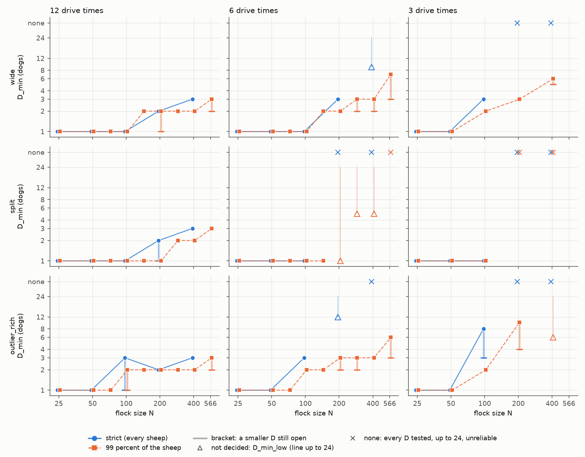
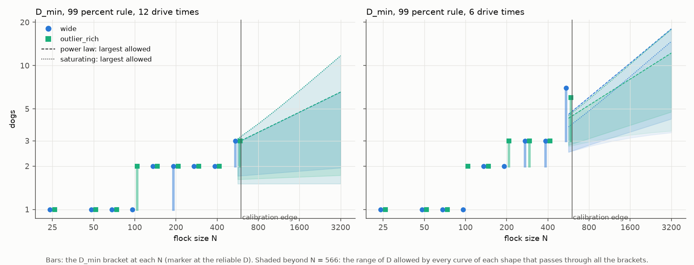
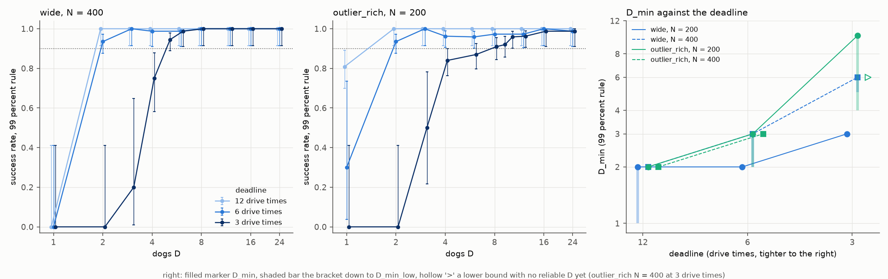

# How many dogs does a simulated flock need?

This report gives the results of 145,790 stored trials from nine study runs in HerdSim, plus three pilot runs. The question is the smallest reliable team $D_{\min}$: the fewest dogs that bring a flock of $N$ sheep into the goal in at least 90% of trials, at 99% confidence. The runs are:

- Six runs of the coordinated team rule [`strombom_multi`](../methods/strombom_multi.md): `dmin_m12`, `dmin_m6`, `dmin_m3` (strict rule) and `dmin_f99_m12`, `dmin_f99_m6`, `dmin_f99_m3` (99% rule), at 12, 6 and 3 drive times.
- Two runs of the uncoordinated baseline [`fat`](../methods/fat.md) at 6 drive times: `dmin_fat` and `dmin_f99_fat`.
- One run of the [`independent`](../methods/independent.md) baseline at 6 drive times: `dmin_f99_indep`.
- Three grazing-repulsion pilots: `pilot_graze_on`, `pilot_graze_on_rest`, `pilot_graze_on_m3`.

The task, start layouts (`compact`, `wide`, `split`, `outlier_rich`), success rules (strict and 99%) and deadlines in drive times are explained in the [README](../../README.md#how-a-trial-works), the [task design](../experiments/task_design.md), the [protocol catalogue](../guides/protocols.md) and the [glossary](../glossary.md). The ways $D_{\min}$ is written (`3`, `2-3`, `[9]`, `none`) are defined in [section 1](#1-the-question); in tables, `a / b` gives the strict rule, then the 99% rule.

## Summary

Under the strict rule (all sheep in the goal), at $N = 25$, 50, 100, 200 and 400:

- 12 drive times (`dmin_m12`): on `compact`, one dog is enough at every size. On `wide` and `outlier_rich`, a flock of 400 needs 3 dogs, with log-log slope 0.42 across $N = 25$-400 on both (0.32 to 0.42 on `split`).
- 6 drive times (`dmin_m6`): on `compact`, one dog is enough at every size. `wide` needs 3 dogs at $N = 200$ and has only a lower bound `[9]` at $N = 400$. `split` (from $N = 200$) and `outlier_rich` (at $N = 400$, after `[12]` at $N = 200$) have no reliable team up to 24 dogs.
- 3 drive times (`dmin_m3`): on `compact`, one dog is enough at every size. From $N = 200$, no team up to 24 dogs is reliable on `wide`, `split` or `outlier_rich`.

Under the 99% rule, at $N = 25$, 50, 71, 100, 141, 200, 283, 400 and 566 (12 and 6 drive times) and $N = 25$, 50, 100, 200 and 400 (3 drive times):

- 12 drive times (`dmin_f99_m12`): on `compact`, one dog is enough through $N = 566$. On `wide` and `outlier_rich`, a flock of 400 needs 2 dogs and one of 566 needs 2-3. Across all nine sizes the log-log slope of $D_{\min}$ is 0.27 to 0.38 on `wide` and 0.28 to 0.38 on `outlier_rich`.
- 6 drive times (`dmin_f99_m6`): on `compact`, one dog is enough through $N = 566$. At $N = 400$, `wide` needs 2-3 dogs and `outlier_rich` needs 3. Across all nine sizes the slope is 0.38 to 0.61 on `wide` and 0.40 to 0.58 on `outlier_rich`.
- 3 drive times (`dmin_f99_m3`): on `compact`, one dog is enough at every size ($N = 25$-400). On `wide`, $D_{\min}$ is 2 at $N = 100$, 3 at 200 and 5-6 at 400. On `outlier_rich` it is 2 at $N = 100$, 4-10 at 200 and `[6]` at 400. On `split` from $N = 200$, no team up to 24 dogs is reliable.

Three further findings:

- Shorter deadline as a cut: a trial shared by two deadlines under the same rule succeeds at the shorter deadline if and only if it had finished within that limit at the longer one.
- Layout against flock size: on $N = 25$-400, with lower bounds counted at their low end, $N$ moves $D_{\min}$ at least as much as the start layout in all six `strombom_multi` runs. On curves with a decided reliable team only, $N$ moves it at least as much in five of the six runs (a tie at 0.79 doublings in `dmin_m6`). The exception is the five sizes of `dmin_f99_m6`, where layout moves it more (0.78 against 0.72 doublings); across all nine sizes of `dmin_f99_m6`, $N$ moves it more again (1.07 against 0.93).
- Three dog rules at 6 drive times, each adding one layer to the one before:
  - `fat` (no collect or drive switch, no assignment): the dogs bunch on the same sheep. No team up to 24 dogs is reliable from $N = 200$ on any scattered layout, and at $N = 400$ even `compact` has `none / [12]`.
  - `independent` (adds Strombom's collect or drive switch): reliable up to $N = 200$ on every scattered layout (`wide` 2-3 dogs, `outlier_rich` 3, `split` 1-3), and `none` on all scattered layouts at $N = 400$ (99% rule).
  - `strombom_multi` (adds the Hungarian assignment of outliers and the driving arc): under the 99% rule it has a reliable team on `wide` and `outlier_rich` at every size through $N = 566$ ($D_{\min}$ 2-3 and 3 at $N = 400$). On `split` it has only lower bounds at $N = 200$ and 400 (`[1]` and `[5]`), while `independent` has 1-3 at $N = 200$.

## 1. The question

A cell is one setup `(layout, N, D)`, for example "can 3 dogs herd 200 `wide` sheep within 6 drive times?". Each cell gets up to 200 seeds, in batches of 10. After each batch, the 99% Clopper-Pearson interval $[L, U]$ of its success rate is compared with the threshold $\theta = 0.90$ ([stopping rule](../experiments/task_design.md#stopping-early-with-the-99-clopper-pearson-interval)):

- Reliable: $L \ge 0.90$.
- Unreliable: $U < 0.90$.
- Undecided: neither, after 200 seeds.

On each curve `(layout, N)`, $D_{\min}$ is the smallest reliable $D$. It is written in one of four ways:

- Single number `3`: $D = 3$ is reliable and every tested $D < 3$ is unreliable.
- Bracket `3-8`: $[D_{\min,\mathrm{low}}, D_{\min}]$. $D = 8$ is reliable, every $D < 3$ is unreliable, and $D = 3$ is still undecided at 200 seeds.
- Lower bound `[5]`: no tested $D$ is reliable yet, and every tested $D < 5$ is unreliable.
- `none`: every tested $D$ up to 24 is unreliable.

Table 1 lists the five research questions:

**Table 1: Research questions and where they are answered.**

| RQ | Question | Answered in |
| :--- | :--- | :--- |
| RQ1 | How does $D_{\min}$ grow with $N$ from 25 to 566? | [2.1](#21-rq1-how-does-d_min-grow-with-n) |
| RQ2 | At a given deadline, which moves $D_{\min}$ more, the start layout or $N$? | [2.2](#22-rq2-layout-or-flock-size-which-moves-d_min-more) |
| RQ3 | How does $D_{\min}$ change from 12 to 6 to 3 drive times? | [2.3](#23-rq3-how-does-the-deadline-change-d_min) |
| RQ4 | Do uncoordinated FAT dogs reach a finite $D_{\min}$ as $N$ grows? | [2.4](#24-rq4-do-uncoordinated-fat-dogs-reach-a-finite-d_min) |
| RQ5 | What does the team layer add over independent shepherds? | [2.5](#25-rq5-what-does-the-team-layer-add-over-independent-shepherds) |

## 2. Results

### 2.1 RQ1: How does D_min grow with N?

On `compact`, $D_{\min} = 1$ at every flock size, rule and deadline. Up to $N = 50$, $D_{\min} = 1$ on every layout and deadline too. From $N = 100$ on, $D_{\min}$ grows on the three scattered layouts (Table 2, Figure 1).

**Table 2: $D_{\min}$ on the scattered layouts, strict rule / 99% rule, $N = 25$-400 (`compact` is 1 / 1 in every cell).**

| Deadline | Layout | $N = 25$ | $N = 50$ | $N = 100$ | $N = 200$ | $N = 400$ |
| :---: | :--- | :---: | :---: | :---: | :---: | :---: |
| 12x | `wide` | 1 / 1 | 1 / 1 | 1 / 1 | 2 / 1-2 | 3 / 2 |
| 12x | `split` | 1 / 1 | 1 / 1 | 1 / 1 | 1-2 / 1 | 3 / 2 |
| 12x | `outlier_rich` | 1 / 1 | 1 / 1 | 1-3 / 1-2 | 2 / 2 | 3 / 2 |
| 6x | `wide` | 1 / 1 | 1 / 1 | 1 / 1 | 3 / 2 | [9] / 2-3 |
| 6x | `split` | 1 / 1 | 1 / 1 | 1 / 1 | none / [1] | none / [5] |
| 6x | `outlier_rich` | 1 / 1 | 1 / 1 | 3 / 2 | [12] / 2-3 | none / 3 |
| 3x | `wide` | 1 / 1 | 1 / 1 | 3 / 2 | none / 3 | none / 5-6 |
| 3x | `split` | 1 / 1 | 1 / 1 | 1 / 1 | none / none | none / none |
| 3x | `outlier_rich` | 1 / 1 | 1 / 1 | 3-8 / 2 | none / 4-10 | none / [6] |

*Data:* [results_tables.md: strict success](results_tables.md#d_min-by-layout-and-n-strict-success) and [results_tables.md: success at 99 percent](results_tables.md#d_min-by-layout-and-n-success-at-99-percent).

**Figure 1: $D_{\min}$ against flock size $N$ on the three scattered layouts, both rules, at 12, 6 and 3 drive times ($N = 25$-400, and up to 566 under the 99% rule at 12 and 6 drive times; `compact` is 1 everywhere).** $D_{\min}$ stays small at 12 drive times and rises fastest at 3 drive times.

- Marks: blue circles with solid lines are the strict rule and orange squares with dashed lines the 99% rule. Shaded bars are undecided brackets at 200 seeds, hollow triangles are lower bounds, and crosses are curves where every tested team up to 24 is unreliable. Axes are log-log.
- Panels: rows are `wide`, `split` and `outlier_rich`; columns are 12, 6 and 3 drive times.

#### Reach of one dog

Reach is the share of the outer half of the flock within the detection radius $r_s = 65$ m of a dog, averaged over the ticks of a trial. In the stored one-dog trials ($D = 1$, 99% rule), its median is 0.93 to 1.00 at $N \le 50$ on every layout and deadline (at least 60 trials per entry), and 1.00 on `compact` at every size (Figure 2). On the scattered layouts it drops as $N$ grows. At 6 drive times it falls from 0.84 (`wide`), 0.80 (`split`) and 0.86 (`outlier_rich`) at $N = 100$ to 0.14, 0.41 and 0.06 at $N = 400$ (10 failed trials each).

Reach alone does not set the order of $D_{\min}$. At $N = 100$ and 6 drive times, `outlier_rich` has the highest reach of the three (0.86) but needs 2 dogs, while `wide` and `split` need 1.

**Figure 2: Median reach of one dog against $N$, four layouts, 99% rule, at 12, 6 and 3 drive times.** Reach stays at 1.00 on `compact` and drops with $N$ on the scattered layouts.

- Marks: one line per layout; each point is the median, over the stored $D = 1$ trials, of the per-trial mean reach of the outer half.
- Panels: 12, 6 and 3 drive times, left to right.

*Data:* [reach table](results_tables.md#reach-of-one-dog-99-percent).

#### Growth with N

Table 3 gives the slope of $\log_2 D_{\min}$ against $\log_2 N$ over the five main sizes ($N = 25$-400). A slope of 0.5 means $D_{\min}$ grows like $\sqrt{N}$; a range is given where brackets allow more than one slope. Table 4 gives $D_{\min}$ on the nine sizes of `dmin_f99_m12` and `dmin_f99_m6` ($N = 25$-566, in steps of $\sqrt{2}$). Over these nine sizes under the 99% rule, the possible slopes are 0.27 to 0.38 (`wide`) and 0.28 to 0.38 (`outlier_rich`) at 12 drive times, and 0.38 to 0.61 (`wide`) and 0.40 to 0.58 (`outlier_rich`) at 6 drive times.

**Table 3: Slope of $\log_2 D_{\min}$ against $\log_2 N$, five sizes ($N = 25$-400).**

| Rule | Deadline | `wide` | `split` | `outlier_rich` |
| :--- | :---: | :---: | :---: | :---: |
| Strict | 12x | 0.42 | 0.32 to 0.42 | 0.42 |
| Strict | 6x | 0.48 ($N \le 200$) | flat ($N \le 100$) | 0.79 ($N \le 100$) |
| Strict | 3x | 0.79 ($N \le 100$) | flat ($N \le 100$) | 0.79 to 1.50 ($N \le 100$) |
| 99% | 12x | 0.20 to 0.30 | 0.20 | 0.30 |
| 99% | 6x | 0.30 to 0.42 | flat ($N \le 100$) | 0.42 to 0.48 |
| 99% | 3x | 0.62 to 0.68 | flat ($N \le 100$) | 0.70 to 1.10 ($N \le 200$) |

*Data:* [results_tables.md: growth with N, strict](results_tables.md#growth-with-n-strict) and [results_tables.md: growth with N, 99 percent](results_tables.md#growth-with-n-99-percent).

**Table 4: $D_{\min}$ on nine flock sizes, 99% rule, 12 and 6 drive times.**

| Layout, deadline | 25 | 50 | 71 | 100 | 141 | 200 | 283 | 400 | 566 |
| :--- | :---: | :---: | :---: | :---: | :---: | :---: | :---: | :---: | :---: |
| `wide`, 12x | 1 | 1 | 1 | 1 | 2 | 1-2 | 2 | 2 | 2-3 |
| `outlier_rich`, 12x | 1 | 1 | 1 | 1-2 | 2 | 2 | 2 | 2 | 2-3 |
| `wide`, 6x | 1 | 1 | 1 | 1 | 2 | 2 | 2-3 | 2-3 | 3-7 |
| `outlier_rich`, 6x | 1 | 1 | 1 | 2 | 2 | 2-3 | 2-3 | 3 | 3-6 |

*Data:* [results_tables.md: nine flock sizes, 99 percent](results_tables.md#nine-flock-sizes-99-percent).

Two curve shapes were fitted by maximum likelihood to the nine sizes of `dmin_f99_m12` and `dmin_f99_m6`: a power law $D = a N^b$, which keeps growing, and a saturating curve $D = 1 + (D_\infty - 1) N / (N + K)$, which levels off at $D_\infty$. The log-likelihood difference (`log_odds`) is 0.0 on both `wide` and `outlier_rich` at both deadlines. Up to $N = 566$ the data therefore fit both shapes equally well (Figure 3).

**Figure 3: $D_{\min}$ on nine flock sizes ($N = 25$-566, 99% rule), and where each curve shape could go.** Above $N = 566$ the two shapes part, but the study cannot test sizes there.

- Marks: `wide` (circles) and `outlier_rich` (squares) on log-log axes, with bars down to $D_{\min,\mathrm{low}}$. The vertical line marks the calibration edge $N = 630$ (3 seeds per start). Shaded bands above $N = 566$ show the range of the fitting power laws (dashed top) and saturating curves (dotted top).
- Left: 12 drive times (`dmin_f99_m12`).
- Right: 6 drive times (`dmin_f99_m6`).

*Data:* [results_tables.md: fits, dmin_f99_m12](results_tables.md#fits-dmin_f99_m12-d_minn-power-law-against-saturating-curve) and [results_tables.md: fits, dmin_f99_m6](results_tables.md#fits-dmin_f99_m6-d_minn-power-law-against-saturating-curve).

### 2.2 RQ2: Layout or flock size, which moves D_min more?

In most runs flock size moves $D_{\min}$ at least as much as the start layout; the one exception is the five sizes of `dmin_f99_m6` when only curves with a decided reliable team are counted.

Table 5 measures how much $D_{\min}$ changes in doublings, $\log_2(\max D_{\min} / \min D_{\min})$. It compares the mean change across the four layouts at a fixed $N$ with the mean change across $N = 25$-400 at a fixed layout. A bracket counts at its geometric midpoint, a lower bound `[D]` counts as `D`, and `none` entries are left out. The first two spread columns count every curve, lower bounds included; the last two count only curves with a decided reliable team.

**Table 5: Spread of $D_{\min}$ across layouts and across $N$ (doublings), four layouts, five sizes ($N = 25$-400).**

| Rule | Deadline | Across layouts | Across $N$ | Across layouts, reliable team only | Across $N$, reliable team only |
| :--- | :---: | :---: | :---: | :---: | :---: |
| Strict | 12x | 0.68 | 1.19 | 0.68 | 1.19 |
| Strict | 6x | 1.67 | 1.69 | 0.79 | 0.79 |
| Strict | 3x | 0.76 | 0.97 | 0.76 | 0.97 |
| 99% | 12x | 0.50 | 0.75 | 0.50 | 0.75 |
| 99% | 6x | 0.92 | 1.30 | 0.78 | 0.72 |
| 99% | 3x | 1.25 | 1.28 | 1.22 | 1.28 |

*Data:* [growth with N, strict](results_tables.md#growth-with-n-strict) and [growth with N, 99 percent](results_tables.md#growth-with-n-99-percent).

With lower bounds included, the spread across $N$ is at least the spread across layouts in every run (within 0.03 at strict 6x and 99% 3x). On curves with a decided reliable team only, strict 6x is a tie (0.79 and 0.79) and 99% 6x reverses on the five sizes (0.78 across layouts, 0.72 across $N$). Across all nine sizes of `dmin_f99_m6`, $N$ is larger again (0.93 across layouts, 1.07 across $N$). Under the 99% rule at 12 drive times, `wide` and `outlier_rich` differ by at most 1 dog at every size; under the strict rule at 6 drive times, they part at $N = 200$ (`3` and `[12]`).

### 2.3 RQ3: How does the deadline change D_min?

A shorter deadline raises $D_{\min}$ on large scattered flocks, mostly between 6 and 3 drive times (Table 2, Figure 4). Under the 99% rule:

- `wide` at $N = 400$: up by at most 1 dog from 12x to 6x (`2` to `2-3`), and by 2 to 4 dogs from 6x to 3x (`2-3` to `5-6`). At 3x, success is 2/10 at $D = 3$, 45/60 at $D = 4$, 189/200 at $D = 5$ and 79/80 at $D = 6$.
- `outlier_rich` at $N = 400$: up by 1 dog from 12x to 6x (`2` to `3`), and by at least 3 dogs from 6x to 3x (`3` to `[6]`). At 3x, success stays between 12/20 at $D = 12$ and 172/200 at $D = 6$ for all $D \ge 5$.
- `outlier_rich` at $N = 200$: up by 0 to 1 dog from 12x to 6x (`2` to `2-3`), and by 1 to 8 dogs from 6x to 3x (`2-3` to `4-10`).
- $N = 100$ (all scattered layouts) and `wide` at $N = 200$: up by at most 1 dog in either step.
- $N = 566$ from 12x to 6x: the brackets allow 0 to 5 more dogs on `wide` (`2-3` to `3-7`) and 0 to 4 on `outlier_rich` (`2-3` to `3-6`).

**Figure 4: Success against team size at 12, 6 and 3 drive times, 99% rule.** The curves move little from 12 to 6 drive times and move right from 6 to 3.

- Marks: light, mid and dark blue are 12, 6 and 3 drive times; the dotted line is the threshold 0.90.
- Left and middle: success rate with 99% Clopper-Pearson intervals against $D$ for `wide` $N = 400$ and `outlier_rich` $N = 200$.
- Right: $D_{\min}$ against deadline for `wide` and `outlier_rich` at $N = 200$ (solid, circles) and $N = 400$ (dashed, squares).

*Data:* [results_tables.md: success at 99 percent](results_tables.md#d_min-by-layout-and-n-success-at-99-percent) and [results_tables.md: N = 400 at three deadlines](results_tables.md#n--400-at-three-deadlines-99-percent).

The deadline changes only the number of ticks a trial may run (`max_ticks`), and seed $i$ starts the same trial at every deadline. A trial shared by two deadlines under the same rule therefore succeeds at the shorter deadline if and only if it finished within that limit at the longer one, at the same tick. Table 6 checks this on every shared trial and finds 0 mismatches.

**Table 6: Trials shared by two runs at different deadlines (drive times), with 0 mismatches.**

| Rule | Runs compared | Shared trials |
| :--- | :--- | :---: |
| 99% | 12 against 6 | [26,620](results_tables.md#dmin_f99_m12-against-dmin_f99_m6-the-shorter-deadline-as-a-cut) |
| 99% | 6 against 3 | [10,760](results_tables.md#dmin_f99_m6-against-dmin_f99_m3-the-shorter-deadline-as-a-cut) |
| 99% | 12 against 3 | [10,360](results_tables.md#dmin_f99_m12-against-dmin_f99_m3-the-shorter-deadline-as-a-cut) |
| Strict | 12 against 6 | [10,500](results_tables.md#dmin_m12-against-dmin_m6-the-shorter-deadline-as-a-cut) |
| Strict | 6 against 3 | [8560](results_tables.md#dmin_m6-against-dmin_m3-the-shorter-deadline-as-a-cut) |
| Strict | 12 against 3 | [8250](results_tables.md#dmin_m12-against-dmin_m3-the-shorter-deadline-as-a-cut) |

### 2.4 RQ4: Do uncoordinated FAT dogs reach a finite D_min?

[`fat`](../methods/fat.md) (farthest-agent targeting) dogs do not coordinate. Every dog goes behind the sheep farthest from the goal; there is no collect or drive switch, no assignment of outliers and no driving arc. The runs [`dmin_fat`](../guides/protocols.md#dmin_fat) (strict rule) and [`dmin_f99_fat`](../guides/protocols.md#dmin_f99_fat) (99% rule) use 6 drive times. `fat` is calibrated with `strombom_multi`, so both rules share the same $R_f(N)$, start flocks, goal radius, drive distance and deadline. From $N = 200$ on, `fat` has no reliable team up to 24 dogs on any scattered layout under either rule (Table 7, Figure 5).

**Table 7: $D_{\min}$ at 6 drive times for `fat` (`dmin_fat` / `dmin_f99_fat`) and `strombom_multi` (`dmin_m6` / `dmin_f99_m6`), strict rule / 99% rule.**

| Controller | Layout | $N = 25$ | $N = 50$ | $N = 100$ | $N = 200$ | $N = 400$ |
| :--- | :--- | :---: | :---: | :---: | :---: | :---: |
| `fat` | `compact` | 1 / 1 | 1 / 1 | 1 / 1 | 1 / 1 | none / [12] |
| `fat` | `wide` | 1 / 1 | 1 / 1 | 1 / 1 | none / none | none / none |
| `fat` | `split` | 1 / 1 | 1 / 1 | 1 / 1 | none / none | none / none |
| `fat` | `outlier_rich` | 1 / 1 | 1 / 1 | 2 / 2 | none / none | none / none |
| `strombom_multi` | `compact` | 1 / 1 | 1 / 1 | 1 / 1 | 1 / 1 | 1 / 1 |
| `strombom_multi` | `wide` | 1 / 1 | 1 / 1 | 1 / 1 | 3 / 2 | [9] / 2-3 |
| `strombom_multi` | `split` | 1 / 1 | 1 / 1 | 1 / 1 | none / [1] | none / [5] |
| `strombom_multi` | `outlier_rich` | 1 / 1 | 1 / 1 | 3 / 2 | [12] / 2-3 | none / 3 |

*Data:* [results_tables.md: uncoordinated FAT baseline, 6 drive times](results_tables.md#uncoordinated-fat-baseline-6-drive-times).

**Figure 5: Success against team size $D$ for `strombom_multi` and `fat` at 6 drive times, $N = 200$ and 400, strict and 99% rules.** `fat` reaches the threshold $\theta = 0.90$ at no team size in any panel. It reaches at most 0.55 on `wide` and `outlier_rich`, and its best is 174 of 200 trials (0.87, undecided) at $D = 12$ on `compact` $N = 400$ under the 99% rule.

- Marks: blue is `strombom_multi` and orange is `fat`; circles with solid lines are the strict rule and squares with dashed lines the 99% rule. Error bars are 99% Clopper-Pearson intervals, and the dotted line is $\theta = 0.90$.
- Panels: `compact` $N = 400$, `wide` $N = 200$ and 400, `outlier_rich` $N = 200$, and `split` $N = 200$.

*Data:* `results/dmin_fat`, `dmin_f99_fat`, `dmin_m6` and `dmin_f99_m6` ([curves](results_tables.md#uncoordinated-fat-baseline-6-drive-times)).

Up to $N = 100$, one dog is enough for `fat` on every layout except `outlier_rich` at $N = 100$, where `fat` needs `2 / 2` and `strombom_multi` needs `3 / 2`. This may be because the detection radius $r_s = 65$ m of one dog covers most of a flock of this size (median reach of one `strombom_multi` dog 0.80 to 0.86 on the scattered layouts at $N = 100$, 6 drive times, 99% rule); we have not tested it.

From $N = 200$ on, every `fat` dog aims at the same point, so more dogs bunch on one sheep instead of sharing the outliers. Overlap is the share of dogs with another dog within $r_a = 2$ m. Across all multi-dog trials ($D > 1$) at 6 drive times under the 99% rule, its median is 0.73 in `dmin_f99_fat` (five sizes, $N = 25$-400) and 0.15 in `dmin_f99_m6` (all nine sizes). At $N = 200$ it is 0.58 against 0.00 at $D = 2$, 0.70 against 0.00 at $D = 3$, and 0.80 against 0.00 at $D = 4$. On `wide` $N = 200$ (99% rule), `strombom_multi` succeeds in every trial from $D = 2$ on (60 to 100 trials per team), while `fat` succeeds in 4/10 to 11/20 trials per team from $D = 2$ to $D = 24$ (10 to 20 trials each). This may also be because `fat` pushes the last sheep toward the goal and never brings outliers back to the flock; we have not tested it.

### 2.5 RQ5: What does the team layer add over independent shepherds?

The run [`dmin_f99_indep`](../guides/protocols.md#dmin_f99_indep) tests [independent paper shepherds](../methods/independent.md) at 6 drive times under the 99% rule. Each dog runs Strombom's one-dog rule on the whole flock: it keeps the collect or drive switch, but has no assignment of outliers and no driving arc. Table 8 compares $D_{\min}$ for the three dog rules.

**Table 8: $D_{\min}$ of `fat`, `independent` and `strombom_multi` at 6 drive times (99% rule).**

| Controller | Layout | $N = 25$ | $N = 50$ | $N = 100$ | $N = 200$ | $N = 400$ |
| :--- | :--- | :---: | :---: | :---: | :---: | :---: |
| `fat` | `compact` | 1 | 1 | 1 | 1 | [12] |
| `fat` | `wide` | 1 | 1 | 1 | none | none |
| `fat` | `split` | 1 | 1 | 1 | none | none |
| `fat` | `outlier_rich` | 1 | 1 | 2 | none | none |
| `independent` | `compact` | 1 | 1 | 1 | 1 | 1 |
| `independent` | `wide` | 1 | 1 | 1 | 2-3 | none |
| `independent` | `split` | 1 | 1 | 1 | 1-3 | none |
| `independent` | `outlier_rich` | 1 | 1 | 2 | 3 | none |
| `strombom_multi` | `compact` | 1 | 1 | 1 | 1 | 1 |
| `strombom_multi` | `wide` | 1 | 1 | 1 | 2 | 2-3 |
| `strombom_multi` | `split` | 1 | 1 | 1 | [1] | [5] |
| `strombom_multi` | `outlier_rich` | 1 | 1 | 2 | 2-3 | 3 |

*Data:* [results_tables.md: independent paper shepherds](results_tables.md#independent-paper-shepherds-baseline-6-drive-times).

Independent shepherds are reliable up to $N = 200$ on every scattered layout (`wide` needs 2-3 dogs, `outlier_rich` 3, and `split` 1-3), where `fat` has `none`. The two rules differ only in the target each dog picks: Strombom's one-dog rule, with its collect or drive switch, against the point behind the sheep farthest from the goal.

At $N = 400$, independent shepherds have `none` on all three scattered layouts, while `strombom_multi` has a reliable team on `wide` (2-3) and `outlier_rich` (3). This may be because all independent dogs chase the same outlier while the others drift away; we have not tested it.

On `split` at $N = 200$, independent shepherds have $D_{\min} = 1$-3 (every team from 3 to 24 dogs is reliable), while `strombom_multi` has only the lower bound `[1]`. This may be because the Hungarian assignment spreads the dogs over the three clusters and so delays driving; we have not tested it.

## 3. Exceptions and pilot checks

This section lists what limits the curves of section 2: curves that are not monotone, curves with no decided reliable team, and three checks on the method.

### 3.1 Curves that dip above D_min

On some curves a team larger than $D_{\min}$ is unreliable, and reliability returns only at a larger team, $D_{\min,\mathrm{stable}}$. This happens on three curves, all on `split` with $D_{\min} = 1$ (Table 9):

**Table 9: Curves with an unreliable team above $D_{\min}$.**

| Run | Layout, $N$ | $D_{\min}$ | Unreliable above it | $D_{\min,\mathrm{stable}}$ |
| :--- | :--- | :---: | :---: | :---: |
| `dmin_m6` | `split`, 100 | 1 | 3 | 5 |
| `dmin_m3` | `split`, 100 | 1 | 2, 3, 4 | 5 |
| `dmin_f99_m6` | `split`, 141 | 1 | 4 | 7 |

Inside an undecided bracket it happens once more: on `dmin_m3` `outlier_rich` $N = 100$ (`3-8`), $D = 4$ is unreliable ([full list](results_tables.md#teams-that-fail-above-d_min)).

### 3.2 Curves with no decided reliable team

A lower bound `[D]` or `none` in Table 2 means no team up to 24 dogs was decided reliable. The 12-drive-time runs have none. The others have:

- `dmin_m6` (strict, 6x): `split` at $N = 200$ and 400 (`none`), `wide` at $N = 400$ (`[9]`), `outlier_rich` at $N = 200$ (`[12]`) and 400 (`none`).
- `dmin_m3` (strict, 3x): `wide`, `split` and `outlier_rich` at $N = 200$ and 400 (`none`).
- `dmin_f99_m6` (99%, 6x): `split` at $N = 200$ (`[1]`) and 400 (`[5]`).
- `dmin_f99_m3` (99%, 3x): `split` at $N = 200$ and 400 (`none`), `outlier_rich` at $N = 400$ (`[6]`).

### 3.3 Grazing-repulsion pilots

The pilots `pilot_graze_on`, `pilot_graze_on_rest` and `pilot_graze_on_m3` rerun `dmin_f99_m6` (all 9 sizes) and `dmin_f99_m3` (all 5 sizes) on the same seeds with [grazing repulsion](../methods/strombom_sheep.md#grazing) on. Each pilot calibrates its own $R_f$, so its field sizes differ slightly from the run it repeats. Turning grazing repulsion on changes little:

- Calibrated $R_f$ moves by $-1.1\%$ to $+0.4\%$ (9.68 m against 9.79 m at $N = 141$).
- Of 526 shared cells, 0 flip between reliable and unreliable.
- Of the $D_{\min}$ entries decided in both runs, 0 change. 14 of 56 entries move through a cell that is undecided at 200 seeds in one of the two runs.
- The largest trial-level difference is `split` at $N = 566$, 6x: of 510 paired trials (same cell and seed), 88 succeed only with grazing repulsion on and 49 only without. The sign test gives $p = 0.0011$, above the Bonferroni threshold 0.0009 for 56 groups, so the difference is not significant ([pilot table](results_tables.md#grazing-repulsion-on-same-seeds)).

### 3.4 Error rates of the stopping rule

The 99% Clopper-Pearson interval is checked every 10 seeds up to 200, so a cell gets up to 20 looks, with no correction for repeated testing. A cell whose true success rate is exactly 0.90 ends reliable with probability 1.27%, unreliable with 1.86% and undecided with 96.86% ([decision rates](results_tables.md#decision-rates-of-the-per-cell-rule)).

### 3.5 Limits of the task size

From $N = 200$ the drive distance is set by the widest start layout, not by $13 R_f$ ([sizing](../experiments/task_design.md#sizing-by-the-calibrated-flock-radius)). Flock sizes stop at $N = 566$, the last $\sqrt{2}$ step below $N = 630$, where calibration with 3 seeds per start fails its 5% limits ([flock size](../experiments/task_design.md#flock-size)).

## 4. Run record

Table 10 lists the stored study runs, with their trial counts and first-pass compute time:

**Table 10: Stored study runs (`undecided` = undecided on reliability at 200 seeds; `open` = flagged for more seeds on reliability or finish time, all at the 200-seed cap; hours are the first pass at 20 workers).**

| Protocol | Trials | Cells | Undecided | Open | Errors | Hours, first pass | Trials added later |
| :--- | :---: | :---: | :---: | :---: | :---: | :---: | :---: |
| `dmin_m12` | 17,220 | 183 | 4 | 4 | 0 | 1.24 | 0 |
| `dmin_m6` | 13,470 | 191 | 21 | 21 | 0 | 0.28 | 1845 |
| `dmin_m3` | 9530 | 183 | 5 | 5 | 0 | 0.17 | 400 |
| `dmin_f99_m12` | 31,590 | 349 | 4 | 53 | 0 | 0.41 | 20,490 |
| `dmin_f99_m6` | 31,920 | 354 | 42 | 58 | 0 | 0.49 | 19,530 |
| `dmin_f99_m3` | 11,740 | 185 | 8 | 10 | 0 | 0.27 | 1070 |
| `dmin_fat` | 8660 | 181 | 4 | 2 | 0 | 0.22 | 90 |
| `dmin_f99_fat` | 8670 | 184 | 1 | 1 | 0 | 0.23 | 220 |
| `dmin_f99_indep` | 12,990 | 181 | 3 | 18 | 0 | 0.30 | 0 |
| Total | 145,790 | 1991 | 92 | 172 | 0 | 3.61 | 43,645 |

*Data:* `uv run python -m docs.generate_docs.page record`; stored trials and cell tables are in `results/<protocol>/` and [results_tables.md](results_tables.md).

Notes on the record:

- Replay and errors: all 145,790 study trials finished without a simulation error, and the deterministic replay checks pass on the stored rows.
- Archived calibration tolerances: the archived `protocol.yaml` in the nine study folders and three pilot folders lists `settled_tolerance` as `0.15` and `start_agreement` as `0.25`. The stored calibrated $R_f$ values match `results/diagnostics/calibration_dmin_f99_m6.csv` and `calibration_pilot_graze_on_rest.csv`, which meet the 5% (`0.05`) limits at every stored size $N \le 566$ ([settings](../guides/settings.md#calibration-of-r_f)).
- Resumes, pruning and finish-time seeds: `dmin_f99_m12` and `dmin_f99_m6` were resumed with the four $\sqrt{2}$ sizes in between ($N = 71$, 141, 283, 566). `dmin_f99_m12`, `dmin_f99_m6` and `dmin_f99_m3` had `decide_finish_times` off on their first pass and on during their resumes. `dmin_f99_indep` had it on from the start; it pruned 11 cells above saturation and has 18 open cells, of which 3 are undecided on reliability and 15 wait only on a finish-time comparison. In `dmin_fat`, two undecided cells on `compact` $N = 200$ ($D = 12, 24$) were pruned above the confirmed saturation at $D_{\min} = 1$ (`open = 2`, `undecided = 4`). `dmin_m12` was run with `decide_finish_times` on, although neither its protocol file nor its archived `protocol.yaml` sets that key; reproducing its exact seed counts requires turning `decide_finish_times` on.
