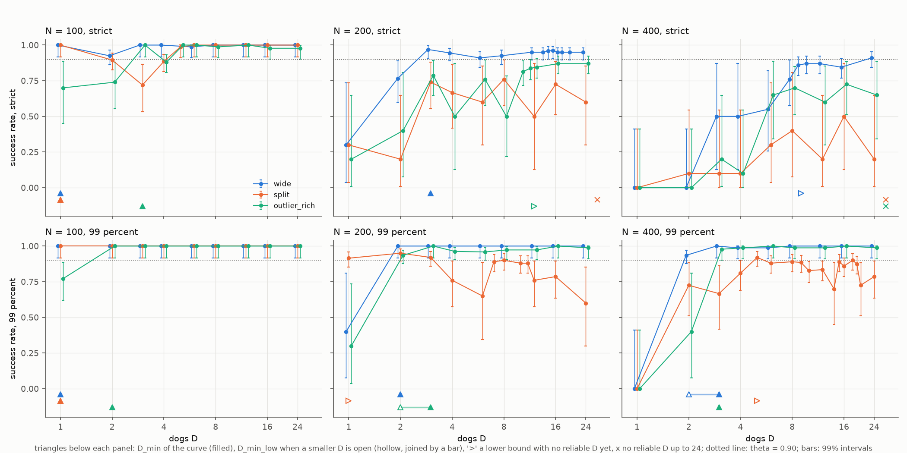

# Quy mô đội tối thiểu để lùa một bầy cừu mô phỏng: sự phụ thuộc vào kích thước bầy, bố cục xuất phát, thời hạn và tiêu chí thành công

Dự án HerdSim. Bản thảo ngày 2026-10-22, viết từ đề cương nghiên cứu và các lượt chạy từ 2026-10-20 đến 22.

## Tóm tắt (Abstract)

Cần bao nhiêu chó để lùa một bầy cừu vào đích trước một thời hạn? Chúng tôi nghiên cứu câu hỏi này
bằng mô phỏng, dùng mô hình cừu của Strömbom et al. (2014) và một phần mở rộng đa chó của người
chăn kiểu gom-và-lùa, trong đó mỗi chó nhận một cừu lạc đàn riêng khi gom và một vị trí riêng trên
một cung phía sau bầy khi lùa. Chúng tôi định nghĩa D_min là đội nhỏ nhất có tỉ lệ thành công được
khoảng tin cậy Clopper-Pearson hai phía 99% cho thấy là ít nhất 0.90. Hạt giống (seed) chỉ được
thêm vào các ô mà quyết định vẫn còn bỏ ngỏ, tối đa 200 mỗi ô, và một đường cong mà các cỡ đội nhỏ
hơn vẫn bỏ ngỏ thì được báo cáo dưới dạng khoảng chặn (bracket). Chúng tôi lập bản đồ D_min theo
kích thước bầy N = 25 đến 400, bốn bố cục xuất phát và các thời hạn 12, 6 và 3 thời gian lùa, dưới
hai tiêu chí thành công: mọi cừu nằm trong đích, và 99% số cừu nằm trong đích. Qua 23 giao thức
(164,740 lượt chạy, không có lỗi), một bầy compact cần một chó ở mọi N và mọi thời hạn. Trên các
bố cục phân tán, D_min bằng 1 với N <= 50 và tăng chậm theo N, đạt 2 hoặc 3 chó ở N = 400 với 12
thời gian lùa. Độ dốc log-log là 0.2 đến 0.5 ở 12 thời gian lùa, và 0.3 đến 0.8 ở 6 thời gian lùa
tại những nơi D_min được quyết định ở ba cỡ đội trở lên. Dưới tiêu chí 99%, rút ngắn thời hạn từ 12
xuống 3 thời gian lùa làm D_min trên bố cục wide ở N = 400 tăng từ 2 lên 5-6 chó, trong khi tăng N
lên bốn lần ở 12 thời gian lùa chỉ làm nó tăng từ 1 lên 2. Hai tiêu chí thành công khác nhau ở
chỗ chúng đo cái gì. Trong các lượt thất bại strict của đội từ sáu chó trở lên (wide và
outlier_rich, N >= 100), 95% số lượt đã đưa 99% số cừu vào đích ở một tick nào đó và 92% kết thúc
với ít hơn một nửa số cừu nằm trong đích: bầy đã đến nơi rồi bị lùa ra ngoài. Dưới tiêu chí strict,
mười một ô ở N >= 200 không có D_min được quyết định, trong đó sáu ô được tiêu chí 99% quyết định,
và việc đổi các quy ước thiết lập (khoảng cách xuất phát, vị trí xuất phát của chó, bộ tham số
cừu, tốc độ chó) làm D_min thay đổi từ ba lần trở lên ở một số ô. Dưới tiêu chí 99%, cũng những
thay đổi đó giữ D_min trong phạm vi một chó so với khoảng chặn cơ sở ở mọi ô, trừ trường hợp đích
hẹp hơn. Một quy tắc chó không có tầng điều phối đội (mọi chó nhắm vào cừu xa đích nhất), chạy
trên cùng nhiệm vụ, không cải thiện theo cỡ đội và không có D_min ở N >= 200 trên bất kỳ bố cục
phân tán nào. Trên bố cục gồm ba cụm tách rời, tỉ lệ thành công không tăng theo cỡ đội ở N >= 200
với 6 và 3 thời gian lùa. Sự tăng của D_min theo N không đảo chiều ở bất kỳ biến thể nào mà ta đọc
được; thứ tự giữa các bố cục và tác động của thời hạn chỉ được kiểm tra trên thiết lập cơ sở. Mọi
D_min được báo cáo đều cần kèm thời hạn và tiêu chí thành công.

Từ khóa: chăn dắt (shepherding), điều khiển bầy đa tác tử (multi-agent herding), khả năng mở rộng
(scalability), mô phỏng dựa trên tác tử (agent-based simulation), chó chăn cừu, quy mô đội tối
thiểu, kiểm định tuần tự (sequential testing)

## 1. Giới thiệu (Introduction)

Chăn cừu bằng chó là ví dụ tiêu chuẩn về việc một số ít tác tử được điều khiển di chuyển nhiều tác
tử không được điều khiển. Cùng bài toán này xuất hiện trong robot và kỹ thuật dưới dạng dẫn hướng
bầy robot, điều khiển đám đông hoặc giữ động vật tránh khỏi các khu vực nhạy cảm (Strömbom et al.
2014), và nói chung hơn là điều khiển các quần thể tác tử lớn bằng một số ít tác tử có cơ cấu chấp
hành (di Bernardo 2026). Strömbom et al. (2014) cho thấy một người chăn đơn lẻ luân phiên giữa gom
những cừu xa tâm bầy nhất và lùa bầy từ phía sau thì tái hiện được các đặc điểm chính của dữ liệu
từ một chó chăn cừu thật và cừu thật, và có thể chăn các bầy tới 150 cá thể khi mỗi con cừu bị hút
về một phần đủ lớn của bầy. Dữ liệu thực địa từ một chó Border Collie lùa 14 con cừu cho thấy chó
làm việc sát phía sau con cừu cuối cùng và điều chỉnh theo bầy (Jadhav et al. 2024).

Với nhiều hơn một người chăn, có nhiều chiến lược điều khiển. Pierson và Schwager (2015) cho hai
hoặc nhiều chó robot bao vây một phần đàn và chứng minh sự hội tụ cho trường hợp một cừu. Kubo et
al. (2022) thêm lực đẩy giữa các chó khiến chúng tạo thành một vòng tròn quanh bầy, và báo cáo
rằng nhiều chó hơn dẫn bầy nhanh hơn và đáng tin cậy hơn. Auletta et al. (2021) nghiên cứu các
quy tắc cục bộ và việc chọn mục tiêu cho những người chăn gom các mục tiêu ngẫu nhiên không có
liên kết, Li et al. (2025) cho thấy việc chăn dắt hoạt động với cảm biến chỉ đo góc phương vị, và
Brown et al. (2025) đặt bài toán dưới dạng điều khiển tối ưu của m chó và n cừu. Các nghiên cứu này
cho thấy nhiều người chăn hơn có thể có ích và so sánh các chiến lược ở những cỡ đội đã chọn, nhưng
không hỏi đội nhỏ nhất là bao nhiêu.

Có hai nghiên cứu hỏi thẳng câu hỏi đó. Lama và di Bernardo (2024) thấy rằng số người chăn tối
thiểu cần để gom M mục tiêu không liên kết tăng theo căn bậc hai của M, và dưới một mật độ mục tiêu
tới hạn thì số này tăng nhanh hơn. Một bản thảo chưa công bố, "Collective nudging that scales: how
many dogs do I need to herd sheep?" (bản thảo 2025; bản chúng tôi có không ghi tên tác giả), đo đội
chó nhỏ nhất gom, giữ và nhốt tới 400 cừu trong 10,000 tick, và thấy mức tăng phi tuyến theo kích
thước bầy và việc mất thành công khi dùng quá nhiều chó. Trong các kết quả chính, cả hai đều cố
định phân bố xuất phát và giới hạn thời gian, nên để ngỏ việc câu trả lời thay đổi thế nào theo thời
gian cho phép và theo hình dạng của bầy lúc xuất phát, và cả hai đều không hỏi câu trả lời phụ
thuộc ra sao vào phần bầy phải đến đích.

Ở đây chúng tôi đo D_min, đội nhỏ nhất đạt độ tin cậy, cho bầy Strömbom được lùa vào một đích hình
tròn, và coi bố cục xuất phát, thời hạn và tiêu chí thành công là các yếu tố bên cạnh kích thước
bầy. Các đóng góp là:

1. Một định nghĩa D_min như một quyết định thống kê, với cách phân bổ hạt giống thích ứng chỉ tiêu
   tốn lượt chạy ở nơi quyết định còn bỏ ngỏ và đánh dấu các ô nó không quyết định được.
2. Một bản đồ D_min theo năm kích thước bầy, bốn bố cục xuất phát và ba thời hạn, dưới hai tiêu
   chí thành công, cho cừu Strömbom và một phần mở rộng đa chó của người chăn của nó với tầng điều
   phối đội.
3. Bằng chứng rằng yêu cầu mọi cừu phải nằm trong đích quyết định nhiều ô bầy lớn thông qua một
   hoặc hai con cừu cuối cùng, một mô tả về kiểu thất bại tạo ra điều này, và một thảo luận về gợi
   ý của nó cho cách một nhiệm vụ chăn dắt có thể định nghĩa thành công.
4. Một phân tích độ nhạy trên các quy ước thiết lập không có quy tắc ngoài đời thực (vị trí xuất
   phát của chó, khoảng cách xuất phát, kích thước đích, bộ tham số cừu, tốc độ chó), chạy dưới cả
   hai tiêu chí thành công, giúp tách phần vững chắc của kết quả khỏi số lượng chó tuyệt đối.
5. Một so sánh trên cùng nhiệm vụ với một quy tắc chó không có tầng điều phối đội (FAT), quy tắc
   này không cải thiện theo cỡ đội, để cho thấy D_min hữu hạn ở N lớn là tính chất của quy tắc đội
   chứ không chỉ của số lượng chó.

Mục 2 điểm lại các công trình liên quan. Mục 3 nêu các câu hỏi nghiên cứu và định nghĩa D_min. Mục
4 và 5 mô tả mô hình và thiết kế thực nghiệm. Mục 6 đưa ra kết quả, mục 7 thảo luận, mục 8 liệt kê
các hạn chế và mục 9 kết luận.

## 2. Các công trình liên quan (Related work)

### 2.1 Một người chăn

Strömbom et al. (2014) mô hình mỗi con cừu như một hạt tự hành bị hút về tâm của n láng giềng gần
nhất của nó, bị đẩy khỏi các láng giềng sát và khỏi người chăn. Người chăn lùa bầy từ một điểm phía
sau bầy khi mọi cừu đều nằm trong khoảng cách f(N) tính từ tâm bầy, và nếu không thì đi ra sau con
cừu xa nhất để đưa nó về. Chuyển động qua lại của chó chăn cừu thật xuất hiện từ việc chuyển đổi
giữa hai chế độ. Với lực hút toàn cục (n = N - 1), người chăn luôn thành công với N tới 150 (với
khoảng cách phản ứng 45 trong hình đó; các lượt chạy chính của chúng tôi dùng 65); dưới n khoảng
0.53 N thì thành công giảm, và với n << N thì hiếm khi xảy ra. Bài báo ghi nhận rằng các bầy lớn
hơn thường được nhiều người chăn dắt, dù trong thực tế một chó chăn đơn lẻ vẫn chăn được các bầy từ
80 con trở lên, và không đưa ra quy tắc nào cho nhiều người chăn.

### 2.2 Nhiều người chăn

Pierson và Schwager (2015) thiết kế các bộ điều khiển phản hồi cho hai hoặc nhiều chó, đưa hệ chó-cừu
về mô hình unicycle, và trình bày mô phỏng với tới 12 chó và 10 cừu cùng một thí nghiệm robot với 3
chó và 1 cừu. Kubo et al. (2022) dùng một mô hình lực cho cừu và chó, trong đó mỗi chó đẩy con cừu
xa đích nhất và bị các chó khác đẩy ra; lực đẩy này làm các chó tản ra quanh bầy. Năm chó đã dẫn
1000 cừu, các đội từ 1 đến 20 chó được chạy ở N = 1000, và tới 80 chó ở N = 400. Auletta et al.
(2021) so sánh việc chọn mục tiêu tĩnh và động cho hai hoặc ba người chăn và 3 đến 60 mục tiêu không
liên kết. Li et al. (2025) bỏ giả định về vị trí chính xác và chăn các bầy chỉ bằng số đo góc phương
vị. Brown et al. (2025) thử điều khiển tối ưu số cho các đội nhỏ gồm chó và cừu: một bộ giải bài
toán giá trị biên thường không hội tụ, và một phương pháp tuyến tính-bậc hai lặp cho ra các đường đi
răng cưa khi chó và cừu ở gần nhau.

### 2.3 Số người chăn mở rộng thế nào

Lama và di Bernardo (2024) nghiên cứu những người chăn có khả năng cảm nhận hạn chế và các mục tiêu
không có liên kết. Số người chăn tối thiểu N* đưa một tỉ lệ chi* = 0.99 trong M mục tiêu vào đích
tăng theo sqrt(M) với cảm nhận vô hạn, và với cảm nhận hạn chế thì chỉ khi số mục tiêu vượt một
ngưỡng tới hạn. Họ giải thích ngưỡng bằng hiện tượng thấm lọc (percolation) của một đồ thị khả năng
chăn dắt (herdability graph). Mỗi người chăn của họ đuổi theo mục tiêu xa đích nhất trong số những
mục tiêu nó cảm nhận được, và một người chăn nhường cho người chăn gần hơn, nhờ đó các mục tiêu được
chia cho các người chăn chỉ bằng thông tin cục bộ.

Bản thảo 2025 dùng một mô hình bầy theo mật độ cục bộ với bảy láng giềng topo, một trường có biên,
một nhiệm vụ ba pha (gom, giữ 800 tick, ra qua một cổng) và tính một lượt là thắng khi mọi cừu đã
ra qua cổng trong 10,000 tick. Bản thảo báo cáo rằng một chó thành công tới 100 cừu, rằng cần 3 chó
ở 150, 20 ở 200 và 35 ở 400 để có tỉ lệ thành công ít nhất 90%, rằng quá nhiều chó làm giảm thành
công ở các bầy nhỏ, và rằng độ tản trung bình của bầy dự đoán thành công (tương quan Spearman -0.70
trên 110 điều kiện, và -0.83 khi độ tản được nhân với N). Kiểm tra độ nhạy của nó đã đưa thành công
tại (D = 6, N = 400) từ 0 lên 92% chỉ bằng cách đổi một bán kính đẩy.

Bảng 1 tóm tắt các nghiên cứu gần nhất với nghiên cứu của chúng tôi.

Bảng 1. Các nghiên cứu nhiều người chăn và nghiên cứu này. "Thành công" là tiêu chí dùng cho một lượt chạy.

| Nghiên cứu | Mô hình cừu | Quy tắc người chăn | Kích thước bầy | Cỡ đội | Thành công | Có hỏi đội tối thiểu |
|---|---|---|---|---|---|---|
| Strömbom et al. 2014 | hút-đẩy, n láng giềng | gom hoặc lùa | 2 to 150 | 1 | tâm bầy gần mục tiêu, 8000 bước | không |
| Pierson and Schwager 2015 | trường thế | bao vây một phần | 1 to 10 | 2 to 12 | hội tụ về vùng đích | không |
| Kubo et al. 2022 | lực, trường nhìn | xa đích nhất, đẩy giữa các chó | 100 to 1000 | 1 to 80 | nêu: mọi cừu trong đích; đo: tâm bầy trong mục tiêu và bầy nằm trong vòng tròn bán kính 10, 500 s | so sánh các cỡ đội, không có mức tối thiểu |
| Lama and di Bernardo 2024 | Brown, không liên kết | mục tiêu xa đích nhất, chia cục bộ giữa các người chăn | thay đổi | thay đổi | 99% mục tiêu trong đích (các hình chính) | có, N* ~ sqrt(M) |
| 2025 manuscript | mật độ cục bộ, 7 láng giềng | gom, lùa trên cung, tuần tra | 5 to 400 | 1 to 35 | mọi cừu qua một cổng, 10,000 tick | có, thời gian cố định |
| this study | Strömbom, n = N - 1 | gom hoặc lùa, tầng điều phối đội | 25 to 400 | 1 to 24 | tất cả, hoặc 99%, số cừu trong đích trước một thời hạn | có, thời hạn là một yếu tố |

## 3. Câu hỏi nghiên cứu và định nghĩa D_min

Chúng tôi hỏi cần bao nhiêu chó để lùa một bầy cừu vào đích một cách đạt độ tin cậy trong một thời hạn, và con số đó phụ thuộc thế nào vào bầy cừu và nhiệm vụ. Cụ thể:

- RQ1. D_min tăng thế nào theo kích thước bầy N, với từng bố cục xuất phát và từng thời hạn?
- RQ2. Với cùng thời hạn, yếu tố nào làm D_min thay đổi nhiều hơn, bố cục xuất phát hay N?
- RQ3. D_min phụ thuộc thế nào vào thời hạn?
- RQ4. Tiêu chí thành công làm D_min thay đổi ra sao?
- RQ5. Những câu trả lời cho RQ1 đến RQ4 nào vẫn đứng vững khi đổi các quy ước thiết lập không có quy tắc tương ứng ngoài thực tế?
- RQ6. Một quy tắc chó không có tầng điều phối đội có đạt D_min hữu hạn trên cùng nhiệm vụ không, và so với quy tắc đội thì thế nào?

Một ô là một tổ hợp của quy tắc chó, bố cục, N, thời hạn và kích thước đội D. Một lượt chạy thành công khi tỉ lệ cừu yêu cầu nằm trong đích tại một tick trước thời hạn. Với một ô có k lần thành công trong n lượt chạy, gọi [L, U] là khoảng tin cậy Clopper-Pearson hai phía 99% của tỉ lệ thành công. Với theta = 0.90, ô được xếp là

- đạt độ tin cậy khi L >= theta,
- không đạt độ tin cậy khi U < theta,
- chưa ngã ngũ trong các trường hợp còn lại.

Với một đường cong gồm các ô trên lưới kích thước đội, ở quy tắc, bố cục, N và thời hạn cố định,

    D_min     = D nhỏ nhất mà ô tương ứng đạt độ tin cậy,
    D_min_low = D nhỏ nhất mà cận trên U đạt tới theta.

Khi đường cong đã ngã ngũ, D_min_low = D_min và chúng tôi báo cáo một số. Khi D_min tồn tại nhưng một D nhỏ hơn vẫn chưa ngã ngũ, giá trị thật nằm trong [D_min_low, D_min], và chúng tôi báo cáo khoảng chặn (bracket) dưới dạng "D_min_low-D_min" (ví dụ "3-8"). Khi chưa có D nào đạt độ tin cậy nhưng vẫn còn một D chưa ngã ngũ, chúng tôi báo cáo "[D_min_low]", một cận dưới. Khi mọi D trên lưới đều đã ngã ngũ là không đạt độ tin cậy, chúng tôi báo cáo "none". Một ô đạt độ tin cậy cần ít nhất 51 lần thành công liên tiếp (0.9^51 < 0.005), và với cỡ lô 10 thì con số này được làm tròn lên thành 60 lượt chạy.

Thời hạn là một phần của câu hỏi. Nếu thời gian không giới hạn, một con chó cuối cùng cũng lùa được hầu hết các bầy cừu có độ kết dính, nên D_min chỉ có ý nghĩa khi thời gian bị giới hạn. Chúng tôi viết thời hạn dưới dạng bội số m của thời gian lùa, tức quãng lùa chia cho tốc độ tối đa của cừu. Một bầy gọn do một con chó lùa từ tick đầu tiên đến đích với trung vị 1.46 đến 1.74 thời gian lùa (N = 25 đến 400), nên m dưới khoảng 1.5 không thể đạt được, và m lớn hơn đặt câu hỏi cần bao nhiêu chó để còn gom được một bầy cừu bị tản ra trong phần thời gian còn lại.

## 4. Mô hình

### 4.1 Cừu

Cừu theo Strömbom et al. (2014). Một con cừu ở xa mọi con chó hơn r_s thì gặm cỏ: nó đứng yên, hoặc với xác suất p đi một bước dài delta theo hướng ngẫu nhiên đều. Một con cừu ở trong khoảng r_s quanh một con chó lấy hướng đi

    H' = h H + c C + rho_a R_a + rho_s R_s + e eps                                  (1)

trong đó mỗi số hạng là một vector đơn vị: H là hướng đi trước đó, C hướng về tâm khối của n láng giềng gần nhất, R_a hướng ra xa các láng giềng gần hơn r_a, R_s hướng ra xa các con chó trong khoảng r_s, và eps là ngẫu nhiên. Sau đó cừu di chuyển delta theo H'. Bài báo chỉ có một người chăn. Với nhiều chó, chúng tôi cộng các lực đẩy đơn vị từ mọi con chó trong khoảng r_s rồi chuẩn hóa tổng về độ dài đơn vị, nên nhiều chó đẩy một con cừu như một con chó theo hướng trung bình của chúng. Bài báo để ngỏ ba chi tiết, và chúng tôi đọc như sau: cừu đang gặm cỏ không chịu lực đẩy từ láng giềng, một bước gặm cỏ có độ dài delta, và hướng đi trước đó bằng không sau một tick không di chuyển. Các cách đọc này ảnh hưởng đến cừu nằm ngoài tầm tác động của mọi con chó, và đến tick đầu tiên sau khi một con cừu bước vào tầm đó. Các số hạng của phương trình (1) được vẽ từ mã trong hình S1.

Hình S1. Cừu Strömbom, tính bằng mã mô phỏng. Trái: một con cừu trong khoảng cách phản ứng với năm số hạng của phương trình (1), trọng số của chúng và hướng đi kết quả. Phải: một con chó và các con cừu quanh nó; trong r_s cừu di chuyển, ngoài r_s cừu gặm cỏ.

### 4.2 Chó

Với một con chó, quy tắc là người chăn của Strömbom et al. (2014) (hình S2). Chó gom khi có bất kỳ con cừu nào cách tâm bầy xa hơn f(N) = r_a N^(2/3), nhắm vào một điểm cách r_a phía sau con cừu xa nhất nhìn từ tâm. Nếu không, nó lùa, nhắm vào một điểm cách r_a sqrt(N) phía sau tâm bầy nhìn từ đích. Nó đi với tốc độ delta_s về phía mục tiêu với nhiễu góc e và đứng yên khi ở trong 3 r_a quanh bất kỳ con cừu nào.

Hình S2. Người chăn của Strömbom et al. (2014), một con chó. Trái: một con cừu nằm ngoài f(N) so với tâm khối, nên chó đi đến điểm gom Pc phía sau con cừu xa nhất. Phải: bầy cừu kết dính, nên chó đi đến điểm lùa Pd phía sau bầy nhìn từ đích. Chó đứng yên trong 3 r_a quanh một con cừu (vùng tô bóng).

Với nhiều chó, một tầng điều phối đội cho mỗi con chó mục tiêu riêng (hình 1). Khi gom, D con cừu lạc đàn xa nhất được ghép với D con chó theo phép gán có tổng quãng đường đi ngắn nhất, mỗi con chó đi đến điểm gom của con cừu lạc đàn của riêng nó; những con chó thừa thì lùa. Khi lùa, các con chó chiếm các vị trí trên một cung phía sau bầy ở khoảng cách lùa, trải đều trên góc bao phủ bề rộng của bầy, với điểm lùa của bài báo ở giữa khi số chó lẻ (khi số chó chẵn, điểm đó nằm giữa hai vị trí), và giữ nguyên phía của mình nhờ ghép với các vị trí theo góc. Mỗi con chó biết vị trí của mọi con cừu và mọi con chó khác. Chúng tôi gọi quy tắc này là strombom_multi. Việc cho mỗi con chó mục tiêu riêng không giữ các con chó cách nhau trong không gian: ở D lớn, nhiều con chó đứng cách một con khác trong vòng 2 đơn vị (mục 6.1).

Hình 1. Từ một con chó đến nhiều con chó, vẽ từ mã mô phỏng tại thời điểm bắt đầu một lượt chạy. Cột bên trái: một con chó, quy tắc của Strömbom et al. (2014). Hàng trên: ở thế xuất phát rộng, các con chó gom, mỗi con đi đến điểm gom của con cừu lạc đàn của riêng nó, ghép theo tổng quãng đường đi ngắn nhất. Hàng dưới: ở thế xuất phát gọn, các con chó lùa từ các vị trí trên một cung phía sau bầy, trải theo bề rộng của bầy; một đường mảnh nối các vị trí. Dấu chéo đánh dấu các mục tiêu.

### 4.3 Đường cơ sở không có tầng điều phối đội (FAT)

Để xem tầng điều phối đội đóng góp gì, chúng tôi cũng chạy một quy tắc không có tầng này, FAT (farthest from the goal, xa đích nhất). Mỗi con chó nhắm vào điểm cách r_a phía sau con cừu xa đích nhất và di chuyển theo bước chó của Strömbom, kể cả việc đứng yên trong 3 r_a quanh một con cừu. Cách chọn mục tiêu là của chó Kubo, nhưng không có lực đẩy giữa các con chó. FAT không có phép gán cừu lạc đàn, không có vị trí lùa và không chuyển đổi giữa gom và lùa. Mọi con chó nhìn thấy cùng một bầy, nên tất cả chọn cùng một con cừu và cùng một điểm, và khi chúng gặp nhau thì di chuyển như những bản sao (hình S3). FAT là một cấu trúc của HerdSim, dùng ở đây làm đường cơ sở. Nó khác strombom_multi ở hai điểm, thiếu tầng điều phối đội và thiếu chuyển đổi giữa gom và lùa, và phép so sánh với nó không tách riêng hai điểm này. Một đội gồm các bản sao độc lập của người chăn trong bài báo, vốn sẽ tách riêng tầng điều phối đội, chưa được chạy.

FAT chạy trên cùng nhiệm vụ với strombom_multi. Bán kính bầy R_f quyết định đích và việc lùa (mục 5.1) và được hiệu chuẩn với một con chó. Một con chó FAT đơn lẻ làm bầy lắng xuống lỏng hơn (R_f lớn hơn tới 28% ở N = 400), điều này sẽ cho FAT một đích lớn hơn và một quãng lùa dài hơn. Vì vậy chúng tôi hiệu chuẩn R_f cho FAT bằng người chăn của bài báo trên cùng các con cừu, cách này tái tạo chính xác R_f của các lượt chạy strombom_multi, nên chỉ có quy tắc chó khác nhau giữa hai bên.

Hình S3. FAT. Trái: người chăn của bài báo (một con chó) chọn con cừu xa tâm bầy nhất. Giữa: một con chó FAT chọn con cừu xa đích nhất. Phải: với nhiều chó, mọi con chó FAT chọn cùng một con cừu và cùng một điểm, nên các con chó trở thành bản sao một khi chúng gặp nhau.

### 4.4 Mô hình cừu thứ hai

Để kiểm tra mô hình cừu, chúng tôi cũng chạy mô hình lực của Kubo et al. (2022) với các con chó riêng của nó: cừu chịu lực đẩy, căn chỉnh hướng, hút và bỏ chạy khỏi chó; mỗi con chó bị kéo về phía con cừu xa đích nhất, bị đẩy ra xa con cừu đó và xa đích, và bị đẩy bởi các con chó khác (hình S4). Mô hình không có nhiễu, nên hạt giống (seed) chỉ thay đổi thế xuất phát. Vì mô hình này nén bầy về một bán kính cố định, chúng tôi chạy nó đến N = 100. Phiên bản của chúng tôi khác bài báo ở bốn điểm, được nêu trong mã: dấu của số hạng đích (phương trình 11 của bài báo in với dấu trừ, nhưng văn bản và phân tích ổn định của nó cần dấu cộng), lực đẩy giữa các con chó tác động ở mọi khoảng cách (bài báo không nêu tầm), K_f4 là 3000 (bài báo dùng 1000 và 3000), và số hạng căn chỉnh hướng chỉ lấy trung bình trên các con cừu đang di chuyển.

Hình S4. Mô hình lực của Kubo et al. (2022). Trái: bốn lực lên một con cừu. Giữa: bốn lực lên một con chó; độ dài mũi tên là căn bậc hai của lực, với độ dài tối thiểu để các lực nhỏ hiện rõ, và con số trong chú giải là lực. Phải: một ảnh chụp (tick 450) của một lượt chạy với N = 50 và 4 con chó.

### 4.5 Tham số

Bảng 2 liệt kê các tham số Strömbom, là các giá trị của Bảng 1 trong bài báo đó. Một tick được hiểu là 1 s và một đơn vị độ dài là 1 m. Với mô hình Kubo, chúng tôi dùng các tham số trong Bảng 1 của nó, với bước thời gian (0.05 s) và giới hạn tốc độ (cừu 5, chó 10) lấy từ một bản chuyển MATLAB công khai, vì bài báo không nêu các giá trị này.

Bảng 2. Tham số của cừu và người chăn Strömbom trong các lượt chạy chính.

| Ký hiệu | Giá trị | Ý nghĩa |
|---|---|---|
| r_a | 2 | khoảng cách tương tác cừu-cừu; cũng đặt các độ lệch của chó |
| rho_a | 2 | trọng số của lực đẩy từ láng giềng |
| c | 1.05 | trọng số của lực hút đến láng giềng |
| rho_s | 1 | trọng số của lực đẩy từ chó |
| h | 0.5 | trọng số của hướng đi trước đó |
| e | 0.3 | trọng số của nhiễu góc (cừu và chó) |
| delta | 1 | bước của cừu mỗi tick |
| p | 0.05 | xác suất một bước gặm cỏ |
| r_s | 65 | khoảng cách mà trong đó cừu phản ứng với chó |
| n | N - 1 | số láng giềng trong số hạng hút |
| delta_s | 1.5 | bước của chó mỗi tick |
| - | 3 r_a | chó trong khoảng cách này quanh một con cừu thì đứng yên |

Strömbom et al. (2014) cũng đưa ra một bộ tham số khớp thực địa cho phép so sánh với một bầy thật (r_a = 1, e = 0.1, r_s = 75), mà bài báo đã khớp với một bầy thật gồm 46 con cừu. Chúng tôi dùng nó làm một biến thể độ nhạy (mục 5.7), và áp dụng cho các bầy lên đến 400. So với dữ liệu thực địa của Jadhav et al. (2024), bầy theo Bảng 1 thưa hơn 1.4 đến 7 lần và con chó của nó làm việc ở xa hơn 3 đến 7 lần phía sau tâm bầy; bộ khớp thực địa gần hơn ở cả hai điểm (hình S5).

Hình S5. Bầy thực địa của Jadhav et al. (2024) so với bộ tham số cơ sở và bộ tham số khớp thực địa ở N = 100: bán kính bầy, mật độ, khoảng cách làm việc của chó phía sau tâm bầy, và khoảng cách dừng của chó. Các giá trị thật là các giá trị được báo cáo cho 14 con cừu và một con chó; cột cho khoảng cách của chó là khoảng 3 đến 7 m được báo cáo, vẽ ở giữa khoảng.

## 5. Thiết kế thực nghiệm

Hình 2 cho thấy toàn bộ thiết kế: các bước mà mọi giao thức đều đi qua, và mỗi nhóm lượt chạy bao phủ những gì.

Hình 2. Thiết kế. Trên: một giao thức. Một tệp cố định lưới, các phương pháp và các thiết lập; hiệu chuẩn đo bán kính bầy quyết định đích, việc lùa và thời hạn; các vòng thích ứng cho mỗi ô 10 hạt giống (seed) và thêm 10 cho các ô còn mở, tối đa 200; quy tắc quyết định đọc khoảng tin cậy 99% của mỗi tỉ lệ thành công; kết quả là D_min của mỗi đường cong, dưới dạng một số hoặc một khoảng chặn (bracket). Dưới: mỗi nhóm lượt chạy bao phủ những gì. 14 lượt chạy độ nhạy là bộ cơ sở và sáu biến thể, mỗi cái dưới cả hai quy tắc thành công.

### 5.1 Nhiệm vụ và hiệu chuẩn

Bầy cừu xuất phát quanh một điểm tâm và phải được lùa vào một đích hình tròn. Mọi độ dài đều theo
bán kính bầy R_f(N), tức bán kính của một bầy được một chó lùa, đo theo từng mô hình cừu và từng N
trong một lượt chạy hiệu chuẩn: một chó lùa một bầy gọn về phía một đích không thể tới được trong 300 s (3 hạt giống (seed),
hai cỡ xuất phát), và R_f bằng sqrt(2) lần bán kính RMS trong 90 s cuối, lấy trung vị
qua các seed và các lần xuất phát. Hiệu chuẩn thất bại nếu R_f đổi quá 15% giữa hai cửa sổ cuối
hoặc quá 25% giữa các cỡ xuất phát. Bầy Strömbom ổn định được đến N = 400, và đó là
giá trị N lớn nhất.

Bán kính đích là 1.9 R_f. Quãng lùa, từ tâm xuất phát đến tâm đích, là

    l = max(13 R_f, 80, reach + 1.9 R_f + R_f)                                       (2)

trong đó reach là khoảng xa nhất mà một con cừu có thể xuất phát trong bất kỳ bố cục nào của giao thức. 13 R_f quyết định
quãng lùa đến N = 100 và số hạng reach quyết định từ N = 200 (hình 3). Sân không có biên: các cá thể
có thể rời sân, như trong cả hai bài gốc. Hình chữ nhật của sân chỉ dùng để đặt điểm xuất phát.

Hình 3. Nhiệm vụ ở N = 200, đúng tỉ lệ. Trái: bầy cừu xuất phát quanh một tâm và được lùa vào một
đích hình tròn. Đĩa xanh là khoảng xa nhất mà một con cừu có thể xuất phát trong bất kỳ bố cục nào, vòng chấm
là bán kính bầy R_f. Giữa: quãng lùa (đường xám rộng) là số hạng lớn nhất trong ba
số hạng của phương trình (2); mức sàn 80 không có tác dụng với N >= 25. Phải: bán kính bầy và bán kính
đích theo N.

Chúng tôi thử một bức tường phản xạ ở mép sân, cách vùng làm việc 80 đơn vị về phía ngoài, với các
lần xuất phát phân tán ở N = 200 và 400 (2160 lượt chạy ghép cặp, 20 seed mỗi ô). Bức tường làm tăng tỉ lệ thành công khoảng
5 điểm nhờ trả về những con cừu lẽ ra sẽ hết thời hạn, và tăng 30 điểm ở ô khó nhất
(outlier_rich, N = 400, D = 6: 0.85 so với 0.55), trong khi khoảng trống 250 cho kết quả tương đương
không có tường (hình S6). Vì bức tường làm giảm D_min vì những lý do không liên quan đến chó, và không bài gốc nào
có tường, nghiên cứu này không dùng biên. Mã của bức tường đã được gỡ sau đó; chỉ giữ lại các lượt chạy
của lần kiểm tra này, trong docs/figures/data.

Hình S6. Tỉ lệ thành công theo D với tường phản xạ ở khoảng trống 80 và 250, và không có
tường nào chạm tới được (3000), trên cùng các seed, 20 seed mỗi điểm (60 ở khung cuối, gộp
ba bố cục). Khác biệt rõ ràng là outlier_rich ở N = 400; các khác biệt còn lại nằm trong
nhiễu của 20 seed.

### 5.2 Bố cục xuất phát

Bảng 3 định nghĩa bốn bố cục (hình 4). Các bố cục phân tán được định cỡ theo khoảng cách gom
L = f(N) = 2 N^(2/3), để chúng luôn đặt cừu ở xa hơn khoảng đó và chó phải gom.
Nếu định cỡ theo R_f, các lần xuất phát split và outlier_rich không có con cừu nào ở xa hơn khoảng cách gom
với N >= 100.

Bảng 3. Các bố cục xuất phát. R_f là bán kính bầy đã hiệu chuẩn, L = 2 N^(2/3) là khoảng cách gom.

| Bố cục | Hình dạng |
|---|---|
| compact | Gaussian, sigma = 0.5 R_f, cắt ở 3 sigma |
| wide | Gaussian, sigma = 0.5 L, cắt ở 3 sigma |
| split | 3 cụm gọn (2 khi N < 12) trên một vòng bán kính L |
| outlier_rich | 80% trong một lõi gọn, 20% ở cách tâm 1.1 đến 1.6 L |

Hình 4. Bốn bố cục ở N = 200, một seed, cùng một tỉ lệ, với 4 chó trên các cung phía sau bầy
và đích ở bên phải. Vòng nét đứt là khoảng cách gom f(N) quanh tâm bầy;
chó gom khi còn con cừu nào ở ngoài vòng đó. Lần xuất phát compact không có con nào ở ngoài, nên chó chỉ
lùa.

### 5.3 Vị trí xuất phát của chó

Không bài gốc nào quy định nhiều chó xuất phát ở đâu. Trong thiết lập cơ sở, các chó đứng trên các nửa
vòng tròn phía sau bầy, cách con cừu xa nhất có thể xuất phát 30 đơn vị, dàn đều và
cách nhau ít nhất 5; một cung chứa được bao nhiêu chó thì chứa, phần còn lại ra các cung xa hơn 5 đơn vị (hình S7).
Một chó xuất phát trên đường lùa, như trong bài báo. Ở các lần xuất phát compact, mọi con cừu đều nằm trong r_s của
chó ở tick 0. Ở các lần xuất phát phân tán với N >= 50, 66 đến 100% số cừu nằm ngoài tầm với và
gặm cỏ cho đến khi có chó tiến lại; ở N = 25 chỉ có 8 đến 18% như vậy (hình S8). Hai phương án khác, một vòng quanh bầy và một điểm người điều khiển duy nhất
phía sau bầy, cùng các khoảng cách 15 và 60 đơn vị, được chạy như các biến thể độ nhạy.
Vòng này bỏ trống hình nón, nhìn từ tâm bầy, chứa đích. Một vòng tròn đầy đủ đặt một chó lên trục lùa
giữa bầy và đích với mọi D chẵn, và từ N = 200 chó đó xuất phát bên trong
đích, vì bán kính vòng lớn hơn khoảng cách đến mép gần của đích. Một lần chạy vòng đầu tiên
với vòng tròn đầy đủ mắc lỗi này và không được dùng.

Hình S7. Các vị trí xuất phát của chó. Trên: các cung cho D = 1, 2, 4, 8, 24 và 64 ở lần xuất phát compact. Một chó
xuất phát phía sau bầy trên đường lùa và mỗi chó thêm vào có vị trí riêng. Dưới: ba
cách đặt (cung, vòng, điểm người điều khiển) cho 8 chó ở lần xuất phát wide; vòng chừa một khoảng trống
về phía đích, và điểm người điều khiển hiện một tam giác cho cả 8 chó.

Hình S8. Lần xuất phát với một chó trên các cung, theo bố cục và N. Vòng tròn là khoảng cách phản ứng
r_s = 65. Cừu xanh phản ứng ở tick 0, cừu xám gặm cỏ. Con số là khoảng cách từ chó đến
tâm bầy.

### 5.4 Thời hạn

Thời hạn là T = m l / delta giây mô hình với m thuộc {12, 6, 3}. Với N = 200, thời gian lùa là
140 s, nên các thời hạn là khoảng 1680, 839 và 420 s. Một lượt chạy thất bại chạy đến hết thời hạn. Một lượt chạy
hoàn thành trong một thời hạn chặt cũng thành công trong một thời hạn lỏng hơn, nên một lần chạy có thể được đọc ở bất kỳ
thời hạn chặt hơn nào, nhưng các seed của nó được phân bổ cho thời hạn riêng của nó. Vì vậy mỗi thời hạn được chạy
như một giao thức riêng trên cùng các seed.

### 5.5 Tiêu chí thành công

Theo tiêu chí strict (100%), một lượt chạy thành công khi mọi con cừu đều nằm trong đích ở cùng một tick, đây là
quy tắc của Li et al. (2025). Kubo et al. (2022) nêu mục tiêu là mọi con cừu vào đích cùng lúc nhưng
đo thành công bằng tâm bầy nằm trong đích với bầy nằm trong một vòng tròn bán kính 10
trong 500 s, và Strömbom et al. (2014) kết thúc nhiệm vụ khi tâm bầy nằm trong một khoảng cách nhất định
của đích. Theo tiêu chí 99%, một lượt chạy thành công khi có ít nhất ceil(0.99 N) con cừu nằm
trong đích ở cùng một tick, tỉ lệ mà Lama và di Bernardo (2024) dùng. Với
N = 25 và 50, ceil(0.99 N) = N, nên hai tiêu chí trùng nhau ở đó; với N = 100, 200 và 400 thì
tiêu chí 99% cho phép 1, 2 và 4 con cừu nằm ngoài. Các lần chạy 99% được thêm vào sau khi các kết quả
strict đầu tiên cho thấy cá thể rớt lại cuối cùng có thể quyết định một lượt chạy (mục 6.6). Cả hai tiêu chí dùng cùng
lưới, seed và vật lý, nên seed i là cùng một bầy xuất phát ở cả hai tiêu chí.

### 5.6 Seed, quyết định và phân bổ thích ứng

Một tick di chuyển cừu, rồi chó, ghi các chỉ số và kiểm tra thành công và thời hạn. Seed
i của mọi ô là 2026 + i và sinh ra ba dòng ngẫu nhiên (bố cục, nhiễu của cừu, nhiễu của chó),
nên các ô chỉ khác nhau ở D xuất phát từ cùng một bầy và thấy cùng các giá trị ngẫu nhiên của cừu cho đến khi chó
làm thay đổi hành vi của cừu.

Mỗi ô nhận một đợt 10 seed. Sau mỗi vòng, chỉ các ô còn chưa ngã ngũ nhận
thêm một đợt, tối đa 200 seed. Khi hai cỡ đội kề nhau rơi vào các vùng khác nhau, một cỡ đội
nằm giữa chúng được thêm vào (ví dụ D = 5 hoặc 10). Một ô còn dưới mức trần có thể
vẫn ngã ngũ, nên nó chờ; một ô còn chưa ngã ngũ ở mức trần thì không, và cỡ đội giữa
nó và một ô lân cận đã ngã ngũ được thêm vào, để D_min không bao giờ nằm trên một D chưa được thử bên trong
khoảng chặn (bracket) của chính nó (quy tắc này được thêm sau các lần chạy đầu tiên, rồi các lần chạy đó được bổ sung). Trên một
mức bão hòa đã xác nhận, các ô mà chó di chuyển như bản sao của nhau (trung bình ít nhất 90% số
chó có một chó khác trong vòng 2 đơn vị) không nhận thêm seed. Một ô có tỉ lệ thực nằm gần theta vẫn chưa ngã ngũ đến mức trần
theo cấu trúc: tỉ lệ thực 0.93 không đạt L >= 0.90 trong 200 lượt chạy.

### 5.7 Các giao thức

Bảng 4 liệt kê các lần chạy. Ba thời hạn chính dùng chung seed và sân và so sánh trực tiếp được. Các
giao thức độ nhạy lặp lại một lưới nhỏ hơn với mỗi lần một thay đổi và được so với một lần chạy cơ sở
của cùng lưới, từng ô một trên cùng các seed. Một lần chạy thử với 10 seed mỗi ô, không tính trong
23 lần chạy, đã chọn các thời hạn và lưới cỡ đội (Phụ lục B, hình S11).

Bảng 4. Các giao thức. Lưới chính: các bố cục compact, wide, split và outlier_rich; N thuộc {25, 50, 100,
200, 400}; D thuộc {1, 2, 3, 4, 6, 8, 12, 16, 24}. Lưới độ nhạy: wide và outlier_rich; N thuộc
{100, 200, 400}; D thuộc {1, 2, 3, 4, 6, 8, 12, 16}; thời hạn 6 thời gian lùa.

| Giao thức | Lưới | Thay đổi | Tiêu chí |
|---|---|---|---|
| dmin_m12, dmin_m6, dmin_m3 | chính, m = 12, 6, 3 | không | strict |
| dmin_f99_m12, dmin_f99_m6, dmin_f99_m3 | chính, m = 12, 6, 3 | không | 99% |
| dmin_fat, dmin_f99_fat | chính, m = 6 | quy tắc chó FAT, R_f của strombom_multi | strict, 99% |
| dmin_kubo | mô hình Kubo, compact, N 25 đến 100, D 1 đến 10, 500 s | mô hình cừu | strict |
| dmin_s_base | độ nhạy | không (tham chiếu) | strict |
| dmin_s_matched | độ nhạy | bộ tham số cừu khớp thực địa (r_a 1, e 0.1, r_s 75; tỉ lệ bố cục 1 và khoảng cách cặp đôi 1 theo r_a) | strict |
| dmin_s_handler | độ nhạy | mọi chó xuất phát ở một điểm phía sau bầy | strict |
| dmin_s_ring | độ nhạy | chó xuất phát trên một vòng tròn quanh bầy, trừ hình nón của đích | strict |
| dmin_s_goal | độ nhạy | bán kính đích 1.5 R_f | strict |
| dmin_s_gap | độ nhạy | khoảng cách xuất phát 15, 30, 60 | strict |
| dmin_s_dogspeed | độ nhạy | tốc độ chó 1.15, tỉ số tốc độ chó so với cừu ngoài thực địa | strict |
| dmin_f99_s_* (cả bảy) | độ nhạy | như trên | 99% |

Các biến thể xuất phát (handler, ring, gap) giữ nguyên bầy xuất phát của mỗi seed, nên các lượt chạy của chúng
được ghép cặp với lần chạy cơ sở. Bộ khớp thực địa thay đổi vật lý, và vì các bố cục co giãn theo r_a
nên các bố cục phân tán của nó cũng nhỏ hơn, do đó cùng các seed sinh ra các bầy khác nhau và phép so sánh của nó
là giữa các giá trị đã ngã ngũ. Một đích 1.5 R_f cũng làm quãng lùa ngắn đi 2 đến 3% ở N >= 200
qua phương trình (2), điều này đi ngược lại việc kết luận đích chặt hơn khó hơn (hình S9).

Hình S9. Lần xuất phát của từng biến thể độ nhạy trên bố cục wide ở N = 200 với 4 chó. Khung
handler hiện một tam giác cho cả 4 chó. Biến thể tốc độ chó trông giống lần chạy cơ sở.

### 5.8 Triển khai và kiểm chứng

HerdSim được viết bằng Python. Trước mỗi chiến dịch, 268 kiểm thử đơn vị đối chiếu các phương trình với
tính tay và một cách đọc bài báo theo từng con cừu làm tham chiếu, quy tắc đội, các bố cục và vị trí
xuất phát của chó, tỉ lệ thành công, các quy tắc quyết định trên các đường cong dựng sẵn có đáp án đã biết,
và các lượt chạy thật ngắn của mọi phương pháp. Một bộ bench gồm 22 kiểm tra chạy các chiến dịch nhỏ từ đầu đến cuối và
kiểm tra các tính chất định tính mà không gắn cứng số liệu, trong đó có: một bầy gọn chỉ cần một
chó, một lần xuất phát phân tán thất bại nhiều hơn với một chó so với tám chó, không thành công nào
nhanh hơn mức cho phép của quãng lùa theo đường thẳng, và một với bốn tiến trình worker cho các dòng
lượt chạy giống hệt nhau. Một kiểm tra đột biến, làm một lần, cho thấy việc giảm tốc độ chó từ 1.5 xuống 0.4 khiến
bộ bench thất bại. Sau các lần chạy, một lần rà soát một lần đã cài đặt lại mô hình một chó với cừu và người chăn như
một vòng lặp riêng theo từng con cừu, kết quả khớp với engine đến 6e-13 qua 300 tick trên các giá trị ngẫu nhiên
dùng chung, và tính lại mọi quyết định của ô và mọi D_min từ các lượt chạy đã lưu bằng một
cài đặt Clopper-Pearson độc lập; tất cả khớp với các bảng. Các script của lần rà soát này
không có trong kho mã. Hình 5 cho thấy một lượt chạy.

Hình 5. Một lượt chạy: xuất phát wide, N = 200, D = 4, seed 2026. Các chó tản ra đến các cừu lạc đàn,
đưa chúng vào, xếp hàng phía sau bầy và lùa bầy vào đích. Lượt chạy hoàn thành trong 279 tick,
khoảng hai thời gian lùa.

## 6. Kết quả thực nghiệm (Results)

23 giao thức đã chạy 164,740 lượt chạy không có lỗi, mất khoảng 7 h trên 20 worker (Phụ lục A). Việc phân bổ thích ứng đã quyết định được 89 đến 99% số ô của mỗi giao thức chính về độ tin cậy. Ta viết "a / b" cho giá trị strict và giá trị 99% của cùng một ô, "lo-hi" cho một khoảng chặn (bracket), "[n]" cho một đường cong chưa có D nào đạt độ tin cậy và D_min_low = n, và "none" cho một đường cong không có D nào trên lưới đạt độ tin cậy (mục 3).

### 6.1 Một chú chó lùa được bầy co cụm

Trên bố cục compact, D_min = 1 ở mọi N từ 25 đến 400, ở mọi thời hạn và theo cả hai tiêu chí. Với cừu Strömbom, thêm chó không làm đổi thời gian hoàn thành: trung vị thời gian hoàn thành chia cho thời gian lùa nằm trong khoảng từ 1.44 đến 1.74 với mọi D từ 1 đến 24 (hình 6, trái), và với 16 chó thì 84 đến 86% số chó có một chú chó khác trong phạm vi 2 đơn vị, tính trung bình trên lượt chạy, nên chúng làm cùng một việc. (Một lần kiểm tra thử với 64 chó, không lưu lại, cho 93%.)

Mô hình Kubo cũng chỉ cần một chú chó ở N = 25, 50 và 100: cả 18 ô của nó đều được quyết định và D_min = 1. Khác với bầy Strömbom, thời gian hoàn thành của nó giảm khi số chó tăng, từ 102 đến 116 s với một chú chó xuống còn khoảng 30 s với mười chú (hình 6, phải), phù hợp với báo cáo của bài báo rằng nhiều chó dẫn bầy nhanh hơn. Với điểm xuất phát co cụm, nhiều hơn một chú chó làm bầy Kubo nhanh hơn nhưng không cần thiết cho độ tin cậy.

Hình 6. Thời gian hoàn thành theo D trên các điểm xuất phát co cụm. Trái: cừu Strömbom với quy tắc đội (dmin_m6, các lượt chạy thành công): trung vị thời gian hoàn thành chia cho thời gian lùa, với năm cỡ bầy; không đổi theo D. Phải: mô hình Kubo (dmin_kubo, thời hạn 500 s): trung vị thời gian hoàn thành với ba cỡ bầy; giảm theo D. Tỉ lệ thành công là 1.00 ở mọi ô của cả hai biểu đồ.

### 6.2 D_min theo bố cục, quy mô đàn và thời hạn

Bảng 5 cho D_min của các bố cục rải rác. Hình 7 cho cùng các giá trị theo N, hình 8 cho các đường cong tỉ lệ thành công cùng khoảng tin cậy dùng để đọc D_min, và hình 9 cho tỉ lệ thành công của mọi ô ở 6 thời gian lùa.

Bảng 5. D_min, strict / 99%. Compact là 1 / 1 ở mọi ô và được bỏ qua. Ở N = 25 và 50 hai tiêu chí là cùng một quy tắc (mục 5.5).

| Thời hạn | Bố cục | N = 25 | 50 | 100 | 200 | 400 |
|---|---|---|---|---|---|---|
| 12 | wide | 1 / 1 | 1 / 1 | 1 / 1 | 2 / 1-2 | 3 / 2 |
| 12 | split | 1 / 1 | 1 / 1 | 1 / 1 | 1-2 / 1 | 3 / 2 |
| 12 | outlier_rich | 1 / 1 | 1 / 1 | 1-3 / 1-2 | 2 / 2 | 3 / 2 |
| 6 | wide | 1 / 1 | 1 / 1 | 1 / 1 | 3 / 2 | [9] / 2-3 |
| 6 | split | 1 / 1 | 1 / 1 | 1 / 1 | none / [1] | none / [5] |
| 6 | outlier_rich | 1 / 1 | 1 / 1 | 3 / 2 | [12] / 2-3 | none / 3 |
| 3 | wide | 1 / 1 | 1 / 1 | 3 / 2 | none / 3 | none / 5-6 |
| 3 | split | 1 / 1 | 1 / 1 | 1 / 1 | none / none | none / none |
| 3 | outlier_rich | 1 / 1 | 1 / 1 | 3-8 / 2 | none / 4-10 | none / [6] |

Hình 7. D_min theo N ở ba thời hạn, strict (nét liền, hình tròn) và 99% (nét đứt, hình vuông); hai quy tắc và bốn bố cục được lệch nhẹ theo N để các dấu không chồng lên nhau. Một thanh tô bóng chạy từ D_min_low đến D_min ở nơi một D nhỏ hơn vẫn chưa ngã ngũ với 200 hạt giống. Tam giác rỗng là một đường cong chưa có D nào đạt độ tin cậy, tại D_min_low của nó, với một đường nối lên 24; dấu chéo là một đường cong không có D nào trên lưới đạt độ tin cậy. Compact bằng 1 ở mọi nơi.

Hình 8. Tỉ lệ thành công theo D cùng khoảng tin cậy Clopper-Pearson 99% ở 6 thời gian lùa, strict (trên) và 99% (dưới), cho N = 100, 200 và 400 và ba bố cục rải rác (compact bằng 1 ở mọi D). Các tam giác dưới mỗi biểu đồ đánh dấu D_min của đường cong cùng màu: đặc ở nơi nó đã được quyết định, rỗng tại D_min_low và nối với tam giác đặc bằng một thanh ở nơi một D nhỏ hơn vẫn còn bỏ ngỏ, '>' là cận dưới ở nơi chưa có D nào đạt độ tin cậy, và x ở nơi không có D nào đến 24 đạt độ tin cậy. Đường chấm là theta = 0.90. Một khoảng tin cậy rộng là một ô có 10 hạt giống.

Hình 8 cho thấy vì sao một số mục của Bảng 5 là khoảng chặn. Một D đạt độ tin cậy khi toàn bộ khoảng tin cậy nằm trên 0.90, nên một đường cong có tỉ lệ thành công ổn định quanh 0.93, như wide ở N = 200 theo tiêu chí strict, có các khoảng tin cậy nằm vắt ngang 0.90 với nhiều D, và 200 hạt giống không tách chúng ra được. Theo tiêu chí 99%, cùng các ô đó đạt 1.00 và được quyết định ở D nhỏ.

Hình 9. Tỉ lệ thành công của mọi ô ở 6 thời gian lùa, strict (trên) và 99% (dưới). Khung đen đánh dấu một ô được quyết định là đạt độ tin cậy; các ô gạch chéo không được kiểm tra. Các ô được quyết định là không đạt độ tin cậy thì ngừng nhận hạt giống, nên nhiều tỉ lệ thấp, chủ yếu ở N = 400 theo quy tắc strict, dựa trên 10 đến 20 hạt giống.

Mọi bố cục đều cần một chú chó ở N <= 50. Ở nơi D_min được quyết định trên một bố cục rải rác tại N = 200 và 400, nó là 1 đến 3 chó ở 12 và 6 thời gian lùa. Ở 3 thời gian lùa theo tiêu chí 99%, nó là 5 hoặc 6 chó trên wide ở N = 400 và nằm giữa 4 và 10 trên outlier_rich ở N = 200, nơi mọi D được kiểm tra từ 4 đến 9 vẫn chưa ngã ngũ với 200 hạt giống, với tỉ lệ thành công từ 0.84 đến 0.92. Outlier_rich cần ít nhất bằng wide số chó ở mọi N và thời hạn, và nhiều hơn ở N = 100 tại 6 và 3 thời gian lùa (strict 3 và 3-8 so với 1 và 3; 99% 2 so với 1 ở 6 thời gian lùa). Ở N = 400 và 12 thời gian lùa hai bố cục cần số chó như nhau. Split cần ít chó nhất ở thời hạn rộng và không có giá trị nào được quyết định ở N >= 200 với các thời hạn chặt hơn (mục 6.7).

Một số mục là khoảng chặn vì tỉ lệ thành công của một D nhỏ hơn vẫn ở gần 0.90. Ở outlier_rich tại N = 100 và 12 thời gian lùa, D = 3 đạt độ tin cậy theo tiêu chí strict còn D = 1 và 2 chưa ngã ngũ, nên D_min thật là 1, 2 hoặc 3; đường cong này từng trông như một sự đảo chiều theo N (3 ở N = 100, 2 ở N = 200) khi chỉ in ra D_min.

### 6.3 Tốc độ tăng theo N (RQ1)

Bảng 6 cho khoảng giá trị độ dốc của log2 D_min theo log2 N mà các khoảng chặn cho phép, trên các N có giá trị. D_min là một số nguyên trên lưới thô, nên khoảng này không phải là sai số; ở hầu hết các hàng mỗi N có một giá trị duy nhất và khoảng này là một con số.

Bảng 6. Độ dốc của log2 D_min theo log2 N trên các bố cục rải rác. Compact phẳng. "Flat" với split nghĩa là D_min = 1 ở mọi N nơi nó được quyết định.

| Tiêu chí | Thời hạn | wide | split | outlier_rich |
|---|---|---|---|---|
| strict | 12 | 0.42 | 0.32 to 0.42 | 0.42 |
| strict | 6 | 0.48 (N <= 200) | flat (N <= 100) | 0.79 (N <= 100) |
| strict | 3 | 0.79 (N <= 100) | flat (N <= 100) | 0.79 to 1.50 (N <= 100) |
| 99% | 12 | 0.20 to 0.30 | 0.20 | 0.30 |
| 99% | 6 | 0.30 to 0.42 | flat (N <= 100) | 0.42 to 0.48 |
| 99% | 3 | 0.62 to 0.68 | flat (N <= 100) | 0.70 to 1.10 (N <= 200) |

Ở 12 thời gian lùa, độ dốc là 0.2 đến 0.5 trên mọi bố cục: nhân đôi bầy cừu tốn 0.2 đến 0.5 lần một lần nhân đôi của đội. Ở 6 thời gian lùa, chúng là 0.3 đến 0.5 trên wide và outlier_rich theo tiêu chí 99%, và 0.5 (wide) và 0.8 (outlier_rich) theo tiêu chí strict, chỉ khớp trên các cỡ bầy nơi D_min được quyết định. Các cỡ này dừng ở N = 200 với wide và ở N = 100 với outlier_rich, và D_min của wide ở N = 400 ít nhất là 9 theo tiêu chí strict, nên độ dốc strict 0.5 đánh giá thấp mức tăng từ N = 200 đến N = 400, nơi D_min tăng từ 3 lên 9 hoặc hơn. Split phẳng ở nơi nó được quyết định, N <= 100. Ở 3 thời gian lùa, độ dốc là 0.6 đến 1.5, trên N <= 100 hoặc 200. Mọi độ dốc dựa trên ba đến năm giá trị của N và chỉ mang tính mô tả.

### 6.4 Bố cục so với quy mô đàn (RQ2)

Bảng 7 so sánh độ trải của D_min giữa các bố cục ở một N với độ trải giữa các N ở một bố cục, cả hai tính bằng số lần nhân đôi (log2 của trung điểm khoảng chặn lớn nhất chia cho nhỏ nhất), lấy trung bình.

Bảng 7. Độ trải trung bình của D_min theo số lần nhân đôi. Các ô không có giá trị bị bỏ qua.

| Tiêu chí | Thời hạn | Giữa các bố cục ở một N | Giữa các N ở một bố cục |
|---|---|---|---|
| strict | 12 | 0.68 | 1.19 |
| strict | 6 | 1.67 | 1.69 |
| strict | 3 | 0.76 | 0.97 |
| 99% | 12 | 0.50 | 0.75 |
| 99% | 6 | 0.92 | 1.30 |
| 99% | 3 | 1.25 | 1.28 |

N làm D_min thay đổi ít nhất bằng bố cục ở cả sáu hàng, rõ ràng ở 12 thời gian lùa và với chênh lệch nhỏ ở 6 (strict) và 3 (99%). Phần lớn hiệu ứng của bố cục là sự khác biệt giữa điểm xuất phát compact và ba điểm xuất phát rải rác.

### 6.5 Thời hạn (RQ3)

Theo tiêu chí 99%, rút ngắn thời hạn từ 12 xuống 3 thời gian lùa làm D_min trên bố cục wide tăng từ 1-2 lên 3 ở N = 200 và từ 2 lên 5-6 ở N = 400, và trên outlier_rich từ 2 lên 4-10 ở N = 200. Ở 12 thời gian lùa, đi từ N = 100 đến N = 400 trên bố cục wide làm D_min tăng từ 1 lên 2. Hiệu ứng của thời hạn không đều: từ 12 xuống 6 thời gian lùa, D_min đổi nhiều nhất một chú chó ở mọi ô wide và outlier_rich đã được quyết định, và các bước nhảy lớn nằm giữa 6 và 3. Ở các ô mà cả hai đầu đều được quyết định, tức là trường hợp theo tiêu chí 99%, mức đổi từ 12 xuống 3 thời gian lùa (wide N = 400: 2 lên 5-6; wide N = 200: 1-2 lên 3; outlier_rich N = 200: 2 lên 4-10) lớn hơn mức đổi từ N = 100 đến N = 400 ở 12 thời gian lùa (wide: 1 lên 2). Theo tiêu chí strict, mức tăng tương tự bị cắt ngang bởi các ô không có giá trị được quyết định. Hình 10 cho thấy cách này xảy ra: thời hạn chặt hơn dịch toàn bộ đường cong thành công sang phải.

Hình 10. Trái và giữa: tỉ lệ thành công theo D theo tiêu chí 99% ở 12, 6 và 3 thời gian lùa, cho wide ở N = 400 và outlier_rich ở N = 200, với khoảng tin cậy 99%. Phải: D_min theo thời hạn cho bốn ô; dấu đặc là D_min, thanh tô bóng là khoảng chặn xuống đến D_min_low, và '>' rỗng là cận dưới khi chưa có D nào đạt độ tin cậy (outlier_rich ở N = 400 tại 3 thời gian lùa).

### 6.6 Tiêu chí thành công (RQ4)

Ở nơi cả hai tiêu chí đều cho giá trị, D_min theo tiêu chí 99% không bao giờ lớn hơn D_min theo tiêu chí strict, và nó nhỏ hơn ở 9 trong 34 ô rải rác mà cả hai đều được quyết định, với mức chênh 1 đến 6 chó, tất cả ở N >= 100. Sáu ô không có giá trị strict được quyết định nhưng có giá trị 99% được quyết định: wide N = 400 ở 6 thời gian lùa, wide N = 200 và 400 ở 3, outlier_rich N = 200 và 400 ở 6, và outlier_rich N = 200 ở 3. Hình 11 cho thấy hai tỉ lệ thành công của mọi ô, tính trên cùng các hạt giống.

Hình 11. Tỉ lệ thành công theo tiêu chí strict so với tỉ lệ theo tiêu chí 99%, mỗi điểm là một ô của các bố cục rải rác ở N >= 100 với ít nhất 20 hạt giống dùng chung, ở 12, 6 và 3 thời gian lùa. Cả hai tỉ lệ dùng cùng các hạt giống, nên không có điểm nào nằm dưới đường chéo. Vùng tô bóng là nơi một ô dưới 0.90 theo tiêu chí strict và bằng hoặc trên 0.90 theo tiêu chí 99%: 6 trong 78 ô ở 12 thời gian lùa, 21 trong 57 ở 6 và 13 trong 33 ở 3.

Trong các lần thất bại strict của những đội lớn hơn, bầy thường đã đến nơi. Trong 704 lần thất bại strict của các đội từ sáu chó trở lên trên wide và outlier_rich ở N >= 100 trong ba lần chạy strict chính, 95% đã đưa 99% số cừu vào đích tại một tick nào đó, và 92% kết thúc với ít hơn một nửa số cừu ở trong. Với một hoặc hai chó, bức tranh khác: trong 361 lần thất bại, 45% đã đạt 99%, vì một đội nhỏ thường không hoàn thành bầy kịp thời gian. Trên lưới độ nhạy với D >= 6, 99 đến 100% mọi lượt chạy có 99% số cừu trong đích tại một tick nào đó, trong khi tỉ lệ thành công strict là 0.68 đến 1.00 (hình 12, trái). Thời gian để đạt 99% nằm gọn trong thời hạn (khoảng 427 s trên 1241 s với wide, N = 400). Ta đã đọc chi tiết bốn lượt chạy thất bại (N = 400, 8 đến 16 chó). Ở mỗi lượt, 386 đến 399 trong 400 con cừu vào đích, mọi chú chó khi đó đều ở phía đích của bầy, bầy bị lùa ra xa 100 đơn vị hoặc hơn so với tâm đích, và nó quay lại 400 đến 800 tick sau (hình 12, phải). Các lần thành công strict của những đội này có vẻ đến ở lượt đưa bầy vào lần thứ hai: ở wide N = 400 với 12 chó, trung vị thời gian hoàn thành của một lần thành công strict là 876 s, khoảng gấp đôi thời gian để đạt 99%. Bốn vết chạy này là một cách đọc cơ chế, không phải một phép đếm mức độ thường xuyên của hiện tượng; các số đếm ở trên là bằng chứng về mức độ thường xuyên.

Hình 12. Trái: tỉ lệ các lượt chạy có 6 chó trở lên (gộp qua các lượt chạy) thành công theo tiêu chí strict (đậm), đạt 99% số cừu trong đích tại một tick nào đó (gạch chéo), và thành công theo tiêu chí strict với chú chó chậm hơn của mục 6.8 (cam). Phải: một bầy xuất phát (wide, N = 400, 16 chó, hạt giống 2): khoảng cách từ tâm bầy đến đích (trên) và số cừu ngoài đích (dưới; tuyến tính đến 1, logarit ở trên đó). Với tốc độ chó 1.5, bầy đến nơi với một con cừu ở ngoài, bị lùa ra, quay lại và lại bị lùa ra; với tốc độ chó 1.15, mọi con cừu đều ở trong ngay lượt đầu và lượt chạy kết thúc tại tick đó.

Vì vậy, bước mà một đội strict thất bại là sự đến nơi của con cừu cuối cùng, sau khi bầy đã được đưa vào. Một D_min strict ở N >= 100 và các thời hạn chặt một phần là một phát biểu về bước đó. Mục 6.8 cho thấy cùng bước này giải thích phần lớn độ nhạy theo thiết lập của các lần chạy strict, và mục 7.3 thảo luận ý nghĩa của điều này đối với việc chọn quy tắc thành công.

### 6.7 Các ô mà nhiều chó hơn lại kém hơn

Trên bố cục split ở N >= 200, tỉ lệ thành công không tăng theo D ở 6 và 3 thời gian lùa (hình 13). Ở N = 200 và 6 thời gian lùa theo tiêu chí 99%, nó là 0.92 (D = 1), 0.95 (2) và 0.92 (3), và 0.60 đến 0.90 với D = 4 đến 24, trong khi trung vị thời gian hoàn thành của các lượt chạy thành công tăng từ 425 s ở D = 1 lên 650 đến 700 s ở D >= 6, so với thời hạn 839 s. Ở N = 400 tỉ lệ thành công giữ ở 0.67 đến 0.92 với D >= 2. Bố cục split ở N >= 200 và các thời hạn 6 và 3 thời gian lùa nên được đọc là chưa ngã ngũ, và các phát biểu về tăng trưởng ở mục 6.3 không bao trùm nó.

Một nguyên nhân một phần là cách tầng điều phối đội giao các việc gom. Các việc này là D con cừu lạc đàn xa tâm bầy nhất, theo thứ hạng, và ở điểm xuất phát split thì những con cừu xa nhất thường nằm trong một cụm. Ta đã chạy lại split ở N = 200, 6 thời gian lùa và tiêu chí 99% với 12 hạt giống mỗi cỡ đội và ghi lại, tại mỗi tick gom, outlier của mỗi chú chó thuộc cụm xuất phát nào (Bảng 8). Với 4 chó trở lên, việc của mọi chú chó đến từ một cụm trong 82 đến 91% số tick gom. Trong một thí nghiệm phản thực tế với các việc được rải qua các cụm (lấy các outlier xa nhất theo thứ tự, bỏ qua bất kỳ con nào gần một việc đã lấy hơn f(N)), trung vị thời gian hoàn thành giảm từ 631 xuống 318 s ở D = 4 nhưng thay đổi ít ở D = 8 (678 xuống 662 s) và D = 16 (724 xuống 703 s). Sự dồn vào một cụm là có thật, nhưng mối liên hệ của nó với các lần chạy đầy đủ là yếu. Ô 200 hạt giống ở D = 4 có một chỗ trũng thành công (0.76 trên 50 lượt chạy) và trung vị thời gian hoàn thành 341 s, không chậm hơn ở D = 3 (579 s) hay D = 1 (425 s), nên con số 631 s của lần chạy lại 12 hạt giống không thấy ở đó. Mục 6.10 xét đến sự chậm lại ở D >= 8, điều mà việc rải các việc không loại bỏ được. Cả hai lần kiểm tra dùng 12 hạt giống và là một chẩn đoán, không phải một kết quả.

Bảng 8. Chạy lại split, N = 200, 6 thời gian lùa, tiêu chí 99%, 12 hạt giống mỗi D.

| D | tỉ lệ thành công | trung vị thời gian hoàn thành (s) | tick gom có mọi việc trong một cụm | trung vị thời gian hoàn thành, việc được rải (s) |
|---|---|---|---|---|
| 1 | 1.00 | 424 | - | - |
| 2 | 0.83 | 365 | 0.65 | 394 |
| 4 | 0.92 | 631 | 0.82 | 318 |
| 8 | 1.00 | 678 | 0.90 | 662 |
| 16 | 0.83 | 724 | 0.91 | 703 |

Hình 13. Tỉ lệ thành công theo D ở 6 thời gian lùa với khoảng tin cậy 99%, strict và 99% (lệch một chút theo D để phân biệt hai đường). Trên split ở N = 100, 200 và 400, tỉ lệ 99% không tăng theo D ở N >= 200; wide ở N = 400 được hiển thị để đối chiếu. Đường chấm là theta = 0.90.

Các lần chạy chính có bốn ô strict trên D_min được quyết định là không đạt độ tin cậy, tất cả trên split ở N = 100 (D = 3 ở 6 thời gian lùa, tỉ lệ thành công 0.72; D = 2, 3 và 4 ở 3 thời gian lùa, 0.50 đến 0.81). Theo tiêu chí 99%, cùng các ô đó thành công trong 60 trên 60 lượt chạy, trừ D = 3 ở 3 thời gian lùa (187 trên 200, chưa ngã ngũ), nên những chỗ trũng này là hiệu ứng cừu cuối của mục 6.6. Các ô khác trên D_min chưa ngã ngũ với 200 hạt giống với tỉ lệ 0.88 đến 0.95. Ví dụ, ở wide N = 200 tại 6 thời gian lùa, tỉ lệ thành công strict giữ ở 0.91 đến 0.97 với mọi D từ 3 đến 24 trong khi lần chạy 99% ở 1.00, nên nhiều chó hơn không nâng được tỉ lệ strict ở ô đó.

### 6.8 Độ nhạy với các quy ước thiết lập (RQ5)

Bảng 9 so sánh từng biến thể với cơ sở trên lưới độ nhạy, theo cả hai tiêu chí. Lưới dừng ở D = 16, nên "none" ở đây nghĩa là không có D đạt độ tin cậy nào tới 16. Hình 14 cho thấy cùng các giá trị đó.

Bảng 9. D_min, cơ sở / biến thể, tại 6 thời gian lùa.

| Tiêu chí | Biến thể | wide 100 | wide 200 | wide 400 | outlier 100 | outlier 200 | outlier 400 |
|---|---|---|---|---|---|---|---|
| strict | bộ cừu khớp thực địa | 1 / 1-6 | 3 / none | [9] / none | 3 / [1] | [12] / none | none / none |
| strict | xuất phát tại người chăn | 1 / 1 | 3 / 3 | [9] / none | 3 / 2 | [12] / [3] | none / none |
| strict | xuất phát theo vòng | 1 / 1 | 3 / 3-5 | [9] / [8] | 3 / 2-7 | [12] / [5] | none / none |
| strict | đích 1.5 R_f | 1 / 1-3 | 3 / none | [9] / none | 3 / 3 | [12] / none | none / none |
| strict | khoảng cách 15 | 1 / 1 | 3 / [3] | [9] / none | 3 / [1] | [12] / none | none / none |
| strict | khoảng cách 30 (giá trị cơ sở) | 1 / 1 | 3 / 3 | [9] / [9] | 3 / 3 | [12] / [12] | none / none |
| strict | khoảng cách 60 | 1 / 1 | 3 / 3-4 | [9] / 6-7 | 3 / 3 | [12] / 5 | none / [12] |
| strict | tốc độ chó 1.15 | 1 / 1 | 3 / 3 | [9] / 5 | 3 / 2-3 | [12] / 4 | none / 6 |
| 99% | bộ cừu khớp thực địa | 1 / 1 | 2 / 1 | 2-3 / 2 | 2 / 1 | 2-3 / 1 | 3 / 2-3 |
| 99% | xuất phát tại người chăn | 1 / 1 | 2 / 2-3 | 2-3 / 2-3 | 2 / 2 | 2-3 / 2-3 | 3 / 3 |
| 99% | xuất phát theo vòng | 1 / 1 | 2 / 2-3 | 2-3 / 3 | 2 / 2 | 2-3 / 2 | 3 / 3 |
| 99% | đích 1.5 R_f | 1 / 1 | 2 / 2 | 2-3 / 5-6 | 2 / 2 | 2-3 / 2-3 | 3 / none |
| 99% | khoảng cách 15 | 1 / 1 | 2 / 2 | 2-3 / 2-3 | 2 / 1-2 | 2-3 / 2 | 3 / 3 |
| 99% | khoảng cách 30 (giá trị cơ sở) | 1 / 1 | 2 / 2 | 2-3 / 2-3 | 2 / 2 | 2-3 / 2-3 | 3 / 3 |
| 99% | khoảng cách 60 | 1 / 1 | 2 / 2-3 | 2-3 / 2-3 | 2 / 2 | 2-3 / 2-3 | 3 / 3 |
| 99% | tốc độ chó 1.15 | 1 / 1 | 2 / 2-3 | 2-3 / 2-3 | 2 / 2 | 2-3 / 2-3 | 3 / 3 |

Hình 14. Bảng 9 dưới dạng hình, strict ở trên đường kẻ và 99% ở dưới. Ô càng đậm càng cần nhiều chó hơn (tô theo D_min, hoặc theo đầu trên của một khoảng chặn); ô nhạt là ô còn mở (khoảng chặn "lo-hi" hoặc cận dưới "[n]"); nét gạch chéo đánh dấu "none", ở đây là không có D đạt độ tin cậy nào tới 16.

Hai nửa của Bảng 9 kể hai câu chuyện khác nhau. Với tiêu chí strict, các biến thể phân tán. Outlier_rich ở N = 200 có D_min ít nhất là 12 ở cơ sở và 4 với chó chậm hơn, còn outlier_rich ở N = 400 không có đội nào đạt độ tin cậy trên lưới ở cơ sở và có 6 với chó chậm hơn: chênh nhau từ ba lần trở lên, và từ none thành đã xác định. Bộ cừu khớp thực địa và đích chặt hơn đi theo chiều ngược lại và biến các ô đã xác định thành "none". Với tiêu chí 99%, mọi biến thể trừ đích chặt hơn đều nằm trong phạm vi một chó so với khoảng chặn cơ sở ở mọi ô, và phần lớn các khoảng chặn chồng lên giá trị cơ sở; trường hợp duy nhất mà bản thân D_min khác nhau hai chó là bộ khớp thực địa trên outlier_rich ở N = 200 (1 so với khoảng chặn cơ sở 2-3). Các quy ước xuất phát (người chăn, vòng, khoảng cách) và tốc độ chó khi đó không tạo ra khác biệt nào mà các lượt chạy này phân giải được. Phần lớn độ nhạy với thiết lập của các lượt chạy strict vì vậy là bước cá thể rớt lại của mục 6.6, mà các quy ước này đẩy về phía này hay phía kia, chứ không phải khác biệt về số chó cần để đưa bầy vào. Lưới độ nhạy có hai bố cục và một thời hạn, nên điều này đúng cho wide và outlier_rich tại 6 thời gian lùa.

Biến thể khoảng cách 30 lặp lại cơ sở ở mọi ô theo cả hai tiêu chí. Đó là cùng một cấu hình chạy lại trên cùng các hạt giống, nên nó cho thấy chạy lại cho ra cùng các lượt chạy; nó không phải là một lần lặp lại độc lập.

Bộ cừu khớp thực địa cho kết luận ngược nhau theo hai tiêu chí. Với tiêu chí strict, nó là thiết lập khó nhất trong nghiên cứu: tỉ lệ thành công quanh 0.9 ở N = 100 với mọi D, D_min trên wide N = 100 nằm giữa 1 và 6 trong khi cơ sở cần 1, và năm ô còn lại không có giá trị. Với tiêu chí 99%, nó cần số chó bằng hoặc ít hơn cơ sở ở cả sáu ô (1 so với 2-3 trên outlier_rich N = 200). Với r_a = 1, chó dừng và lùa từ khoảng cách bằng một nửa và khoảng cách gom giảm một nửa; chúng tôi kỳ vọng điều này để một cá thể rớt lại nằm trong khoảng cách gom, nhưng chúng tôi không kiểm tra riêng điều đó.

Vị trí xuất phát của chó có ý nghĩa với tiêu chí strict, và ý nghĩa đó phụ thuộc vào N. Với 8 chó trở lên ở N = 400, vòng có tỉ lệ thành công strict cao nhất (wide 0.92 so với 0.86 của các cung; outlier_rich 0.81 so với 0.69) và trên wide có thời gian hoàn thành nhanh nhất (trung vị 464 s so với 889 s); xuất phát tại người chăn có thấp nhất (wide 0.55, outlier_rich 0.20), trên 30 đến 60 lượt chạy vì các ô của nó dừng sớm (hình 15). Với tiêu chí 99%, các cung và vòng đạt 0.97 đến 1.00 với 8 chó trở lên ở mọi ô, và xuất phát tại người chăn đạt 0.94 đến 1.00 trừ outlier_rich ở N = 400 (0.86 đến 0.93, 200 lượt chạy mỗi ô); D_min khớp nhau trong các khoảng chặn. Xuất phát tại người chăn khi đó vẫn chậm nhất: ở wide N = 400, thời gian hoàn thành trung vị của nó là 874 s so với 427 s của các cung, điều mà chúng tôi cho là do toàn bộ chó của nó rời đi từ một điểm (chưa kiểm tra riêng). Khoảng cách xuất phát 60 cho giá trị strict đã xác định ở nơi cơ sở không có (wide
N = 400: 6-7; outlier_rich N = 200: 5); khoảng cách 15 để lại các ô strict chưa ngã ngũ mà cơ sở đã xác định. Với tiêu chí 99%, khoảng cách không thay đổi gì quá một chó.

Đích chặt hơn là biến thể duy nhất cần nhiều chó hơn theo cả hai tiêu chí. Với tiêu chí 99%, nó cần 5-6 chó trên wide N = 400 so với 2-3, và không có D đạt độ tin cậy nào tới 16 trên outlier_rich N = 400. Đích 1.5 R_f để lại ít chỗ quanh một bầy đã ổn định, và đích 1.3 R_f sẽ không chứa vừa bầy: trong một lần kiểm tra thử, không lưu lại, một chó trên điểm xuất phát gọn cho tỉ lệ thành công 0.2 ở N = 100 và 0 ở N = 200 (hình S10).

Hình S10. Bộ cơ sở và bộ khớp thực địa dưới dạng các bầy được lùa ở N = 100 với một chó, cùng một tỉ lệ, tại tick 120. Bên phải: bầy đã ổn định trong các đích có bán kính 1.9 (xanh lá), 1.5 (cam), 1.3 (vàng) và 1.1 (xám) bán kính bầy, kèm số cừu còn nằm ngoài mỗi đích; các dòng chữ mang màu của vòng tròn tương ứng.

Với tiêu chí strict, chó chậm hơn cần ít chó hơn ở nơi cơ sở không có giá trị (wide
N = 400: 5; outlier_rich N = 200: 4; N = 400: 6). Với tiêu chí 99%, lợi thế này biến mất: D_min khớp với cơ sở trong các khoảng chặn ở cả sáu ô. Cả hai tốc độ chó đều đưa 99% bầy vào vào cùng một thời điểm xấp xỉ (Phụ lục C). Khác biệt ở tiêu chí strict là con cừu cuối cùng có vào trong tại một tick hay không, và bầy của chó nhanh hơn là bầy bị lùa ra khỏi đích (hình 12, bên phải).

Hình 15. Tỉ lệ thành công theo D cho ba vị trí xuất phát của chó (các cung, vòng, điểm người chăn) tại 6 thời gian lùa, trên cùng các hạt giống, strict (trên) và 99% (dưới). Dấu rỗng là ô có ít hơn 30 lượt chạy. Đường chấm là theta = 0.90.

Ở mọi biến thể và mọi ô mà D_min đã xác định tại hai kích thước, D_min không giảm khi N tăng (ví dụ wide với chó chậm hơn: 1, 3, 5; bộ khớp thực địa theo 99%: 1, 1, 2). Các giá trị tuyệt đối thay đổi theo bộ cừu, đích, vị trí xuất phát của chó, khoảng cách và tốc độ chó, từ ba lần trở lên ở một số ô theo tiêu chí strict, và nhiều nhất một chó so với khoảng chặn cơ sở theo tiêu chí 99% ngoại trừ kích thước đích. Lưới độ nhạy bao gồm hai bố cục, ba kích thước và một thời hạn, nên nó không kiểm tra thứ tự bố cục hay ảnh hưởng của thời hạn.

### 6.9 Quy tắc cho chó không có tầng điều phối đội (RQ6)

Hình 16 và Bảng 10 so sánh strombom_multi với FAT trên cùng nhiệm vụ, hạt giống và thời hạn (6 thời gian lùa). Đến N = 100, hai quy tắc cần đội cỡ gần bằng nhau: một chó trên mọi bố cục trừ outlier_rich, nơi FAT cần 2 và strombom_multi cần 3 (strict) hoặc 2 (99%). Từ N = 200, FAT không có D đạt độ tin cậy nào trên bất kỳ bố cục phân tán nào theo cả hai tiêu chí, và trên bố cục gọn ở N = 400 nó không có theo tiêu chí strict và chỉ có cận dưới 12 theo tiêu chí 99%, nơi strombom_multi cần một chó.

Bảng 10. D_min của FAT, strict / 99%, thời hạn 6 thời gian lùa, kèm strombom_multi (dmin_m6 và
dmin_f99_m6) trong ngoặc.

| Bố cục | N = 25 | 50 | 100 | 200 | 400 |
|---|---|---|---|---|---|
| compact | 1 / 1 | 1 / 1 | 1 / 1 | 1 / 1 | none / [12] (1 / 1) |
| wide | 1 / 1 | 1 / 1 | 1 / 1 | none / none (3 / 2) | none / none ([9] / 2-3) |
| split | 1 / 1 | 1 / 1 | 1 / 1 | none / none (none / [1]) | none / none (none / [5]) |
| outlier_rich | 1 / 1 | 1 / 1 | 2 / 2 (3 / 2) | none / none ([12] / 2-3) | none / none (none / 3) |

Tỉ lệ thành công của FAT không tăng theo D. Trên wide ở N = 200, nó giữ ở 0.30 đến 0.50 từ D = 2 đến 24 theo tiêu chí strict và 0.40 đến 0.55 theo tiêu chí 99%, và trên compact ở N = 400 ở 0.10 đến 0.30 với D = 1 đến 16 theo tiêu chí strict, trong khi strombom_multi thành công ở mọi lượt chạy với một chó; phần lớn các ô FAT này có 10 đến 20 lượt chạy. Với D >= 2 trên các bầy gọn, 83% (N = 200) đến 92% (N = 400) số chó FAT có một chó khác trong vòng 2 đơn vị, lấy trung bình trên lượt chạy: các chó chọn cùng một con cừu và cùng một điểm và di chuyển như một. Ngay cả một chó FAT đơn lẻ cũng yếu hơn người chăn trong bài báo trên một bầy gọn lớn (tỉ lệ thành công strict 0.30 so với 1.00 ở N = 400); chúng tôi kỳ vọng điều này là do đẩy con cừu ở sau cùng không lái được bầy như lùa từ phía sau tâm bầy, nhưng chưa kiểm tra. Trên các điểm xuất phát phân tán ở N >= 200, FAT hiếm khi đưa được 99% bầy vào (0 đến 69% số lượt chạy, so với 99 đến 100% của strombom_multi với 6 chó trở lên trên wide và outlier_rich, mục 6.6).

Hình 16. Tỉ lệ thành công theo D cho strombom_multi (xanh dương) và FAT (cam) trên cùng nhiệm vụ, strict (nét liền) và 99% (nét đứt), thời hạn 6 thời gian lùa, cho compact ở N = 400, wide ở N = 200 và 400, outlier_rich ở N = 200 và split ở N = 200. Dấu rỗng là ô có ít hơn 30 lượt chạy. FAT không cải thiện khi có thêm chó.

Vì vậy, trên nhiệm vụ này, một quy tắc không có tầng điều phối đội không đạt D_min hữu hạn ở N >= 200, và thêm chó cho nó không đem lại gì. FAT thiếu hai thứ mà quy tắc đội có, tầng điều phối đội và việc chuyển đổi giữa gom và lùa, và phép so sánh này không cho biết thứ nào trong hai thứ đó quan trọng. Một đội gồm các bản sao độc lập của người chăn trong bài báo, vốn sẽ tách riêng tầng điều phối đội, chưa được chạy.

### 6.10 Các chỉ số theo lượt chạy bổ sung điều gì

Mỗi lượt chạy lưu giá trị trung bình, nhỏ nhất và lớn nhất trong lượt chạy của 19 phép đo theo tick về bầy, các chó và đích. D_min không cần phần lớn trong số đó. Hai chỉ số liên quan đến các câu hỏi còn bỏ ngỏ ở trên, và chúng tôi đọc chúng từ các lượt chạy đã lưu, kèm một lần chạy lại nhỏ để chẩn đoán (hình 17).

Hình 17. (a) Tỉ lệ thành công của mọi ô có ít nhất 20 hạt giống tại 6 thời gian lùa theo độ phân tán trung bình của bầy (khoảng cách RMS đến trọng tâm bầy), strict (hình tròn) và 99% (hình vuông), kèm tương quan Spearman của từng loại. (b) Trung vị trên các lượt chạy của tỉ lệ chó đứng yên và (c) của tỉ lệ chó có một chó đôi trong vòng 2 đơn vị, theo D, ở N = 200 theo tiêu chí 99%, cho ba bố cục phân tán; chỉ vẽ các D có ít nhất 20 lượt chạy, nên điểm D = 1 bị thiếu ở wide và outlier_rich (10 lượt chạy).

Độ phân tán của bầy và tỉ lệ thành công. Bản thảo ẩn danh năm 2025 báo cáo rằng độ phân tán trung bình của bầy dự đoán tỉ lệ thành công, với tương quan Spearman là -0.70 trên 110 điều kiện của nó, và rằng độ phân tán nhân N cho kết quả tốt hơn (-0.83). Bảng 11 cho cùng tương quan đó trên các ô của chúng tôi có ít nhất 20 hạt giống.

Bảng 11. Tương quan Spearman giữa tỉ lệ thành công của một ô và độ phân tán bầy của nó, theo từng lượt chạy chính. Độ phân tán là khoảng cách RMS của cừu đến trọng tâm bầy, lấy trung bình trên lượt chạy, hoặc giá trị đỉnh trong lượt chạy. Hai cột cuối chỉ dùng các bố cục phân tán.

| Lượt chạy | Số ô (phân tán) | Độ phân tán trung bình, mọi ô | Độ phân tán đỉnh, mọi ô | Độ phân tán trung bình | Độ phân tán trung bình x N |
|---|---|---|---|---|---|
| strict, 12 thời gian lùa | 180 (135) | -0.58 | -0.53 | -0.59 | -0.58 |
| strict, 6 | 167 (122) | -0.76 | -0.74 | -0.79 | -0.81 |
| strict, 3 | 135 (90) | -0.68 | -0.62 | -0.73 | -0.75 |
| 99%, 12 | 177 (132) | -0.17 | -0.12 | -0.16 | -0.16 |
| 99%, 6 | 185 (140) | -0.66 | -0.66 | -0.68 | -0.68 |
| 99%, 3 | 157 (112) | -0.56 | -0.49 | -0.60 | -0.60 |

Tại 6 và 3 thời gian lùa, tương quan nằm giữa -0.56 và -0.81 theo cả hai tiêu chí, quanh mức -0.70 của bản thảo. Tại 12 thời gian lùa theo tiêu chí 99% nó là -0.17, vì gần như mọi ô đều thành công và có rất ít để xếp hạng. Nhân với N làm tương quan thay đổi nhiều nhất 0.02, không phải 0.13 như bản thảo báo cáo. Độ phân tán đỉnh cho giá trị tương tự, nên kết quả không đến từ độ dài lượt chạy: các lượt chạy thất bại chạy đến thời hạn còn các lượt thành công dừng sớm, điều này làm lệch giá trị trung bình trong lượt chạy. Tương quan này là giữa các ô và bao gồm ảnh hưởng của D, vì nhiều chó hơn tạo ra bầy chặt hơn; nó không nói gì về nguyên nhân.

Chó chen chúc và đứng yên trên split. Mục 6.7 để ngỏ lý do tỉ lệ thành công trên split không tăng theo D. Một phỏng đoán tự nhiên là nhiều chó chen nhau. Bảng 12 cho thấy bản thân việc chen chúc không phân biệt được split: tỉ lệ chó có chó đôi đạt 0.55 trên wide ở D = 16, nơi tỉ lệ thành công là 1.00 và thời gian hoàn thành giữ ở 267 s. Điều phân biệt split là một phần tư số chó của nó đứng yên từ D = 4 trở lên, so với khoảng 1% trên wide.

Bảng 12. Split và wide ở N = 200, thời hạn 6 thời gian lùa, tiêu chí 99%. Trung vị trên các lượt chạy của một ô; tỉ lệ cho split tại D = 4 dựa trên 50 lượt chạy và tại D = 16 trên 70, vì các ô được quyết định là unreliable thôi nhận hạt giống.

| D | Thành công, split / wide | Chó đứng yên, split / wide | Chó có chó đôi, split / wide | Thời gian hoàn thành trung vị (s), split / wide |
|---|---|---|---|---|
| 2 | 0.95 / 1.00 | 0.13 / 0.05 | 0.00 / 0.00 | 366 / 401 |
| 3 | 0.92 / 1.00 | 0.18 / 0.03 | 0.00 / 0.00 | 579 / 278 |
| 4 | 0.76 / 1.00 | 0.26 / 0.01 | 0.14 / 0.00 | 341 / 271 |
| 8 | 0.90 / 1.00 | 0.25 / 0.01 | 0.32 / 0.07 | 677 / 269 |
| 16 | 0.79 / 1.00 | 0.25 / 0.01 | 0.59 / 0.55 | 703 / 267 |

Một chó đứng yên khi nó ở trong vòng 3 r_a của một con cừu (mục 4.2). Để kiểm tra liệu quy tắc này có làm chậm split không, chúng tôi chạy lại split và wide ở N = 200 với khoảng cách dừng giảm còn r_a, 12 hạt giống mỗi ô (Bảng 13). Trên split, nó làm giảm tỉ lệ chó đứng yên, rút ngắn thời gian hoàn thành trung vị 20 đến 24% tại D = 8 và 16, và nâng tỉ lệ thành công tại D = 16 từ 10 lên 12 trên 12 lượt chạy. Trên wide, nó không thay đổi gì.

Bảng 13. Chạy lại split và wide ở N = 200, tiêu chí 99%, 12 hạt giống mỗi ô: khoảng cách dừng 3 r_a
(cơ sở) và r_a.

| Bố cục | D | Thành công, 3 r_a / r_a | Thời gian hoàn thành trung vị (s), 3 r_a / r_a | Chó đứng yên, 3 r_a / r_a |
|---|---|---|---|---|
| split | 2 | 0.83 / 0.83 | 365 / 332 | 0.14 / 0.02 |
| split | 8 | 1.00 / 1.00 | 678 / 536 | 0.24 / 0.16 |
| split | 16 | 0.83 / 1.00 | 724 / 550 | 0.25 / 0.18 |
| wide | 8 | 1.00 / 1.00 | 270 / 270 | 0.02 / 0.01 |
| wide | 16 | 1.00 / 1.00 | 268 / 268 | 0.02 / 0.01 |

Vì vậy quy tắc dừng là một nguyên nhân gây chậm trên split tại D >= 8, bên cạnh việc các chó đang gom dồn vào một cụm tại D = 4 (mục 6.7). Với khoảng cách dừng ngắn hơn, split vẫn chậm gấp đôi wide (550 s so với 268 s), nên còn một nguyên nhân thứ ba chưa rõ. Các tỉ lệ thành công tại D = 4 và 16 trong Bảng 12 dựa trên ít lượt chạy; các thời gian hoàn thành trung vị, 680 đến 700 s so với thời hạn 839 s, là dấu hiệu ổn định hơn. Lần chạy lại dùng 12 hạt giống và là một chẩn đoán, không phải một kết quả.

## 7. Thảo luận

### 7.1 So sánh với các kết quả về mở rộng quy mô trước đây

Lama và di Bernardo (2024) thấy số chó chăn tối thiểu N* tăng theo sqrt(M), tức độ dốc 0.5 trong thang
log-log, với các mục tiêu không kết dính, cảm biến vô hạn, trong một đấu trường cố định. Độ dốc của
chúng tôi cho các bầy Strömbom kết dính là 0.2 đến 0.5 ở 12 thời gian lùa (Bảng 6), và ở 6 thời gian
lùa, nơi D_min được xác định tại ba kích thước trở lên, là 0.3 đến 0.8. Các thiết lập khác nhau về
hình học (các bố cục phân tán của chúng tôi tăng theo N^(2/3)), về thời hạn và về tiêu chí thành
công, nên chúng tôi chỉ so sánh độ dốc một cách sơ lược và không khẳng định có sự trùng khớp. Một
phỏng đoán tự nhiên là lực hút toàn cục của cừu Strömbom (n = N - 1) giúp một bầy phân tán tự dồn lại
khi chó tiến đến, và do đó làm giảm độ dốc. Chúng tôi chưa kiểm tra điều này; thay đổi n là việc cần
làm sau.

Bản thảo năm 2025 báo cáo 3 chó với 150 cừu, 20 chó với 200 cừu và 35 chó với 400 cừu, nhiều hơn hẳn
2 hoặc 3 chó ở N = 400 với 12 thời gian lùa của chúng tôi. Hai tác vụ khác nhau ở nhiều điểm (có cổng
và giai đoạn giữ đàn, trường có biên, mô hình cừu theo mật độ cục bộ với bảy láng giềng, giới hạn
thời gian cố định), nên các con số không so sánh được với nhau, và phỏng đoán về lực hút toàn cục ở
trên cũng áp dụng ở đây.

Trên bố cục split ở N >= 200, chúng tôi thấy những chỗ lệch lớn nhất so với dạng ngưỡng theo D (mục
6.7). Một phần sự chậm lại ở D >= 8 đến từ việc chó đứng yên theo quy tắc dừng, quy tắc này giữ khoảng
một phần tư số chó đứng yên trên split và 1% trên wide, và việc rút ngắn khoảng cách dừng làm giảm
thời gian hoàn thành khoảng một phần năm trong một lần chạy lại với 12 hạt giống (mục 6.10). Riêng
việc chen chúc không phải là nguyên nhân: các bầy wide có cùng tỉ lệ chó có chó đôi và không bị ảnh
hưởng. Việc dồn các chó đang gom vào một cụm là một nguyên nhân khả dĩ ở D = 4, nhưng các lượt chạy
200 hạt giống không cho thấy thời gian hoàn thành chậm đi ở đó (mục 6.7). Trên các bầy compact, các
chó của chúng tôi hội tụ về các vị trí song song mà không làm giảm tỉ lệ thành công của tác vụ (mục
6.1).

Phát hiện của bản thảo rằng độ trải trung bình của bầy dự đoán thành công cũng đúng ở đây trên các ô,
với tương quan Spearman nằm giữa -0.56 và -0.81 ở 6 và 3 thời gian lùa theo cả hai tiêu chí, gần với
-0.70 của bản thảo (Bảng 11). Cải thiện mà bản thảo có được khi gia trọng độ trải theo N thì không có
ở đây: việc gia trọng làm đổi tương quan tối đa 0.02. Sự phù hợp này nằm trên các mô hình cừu khác
nhau, và nó là một tương quan, vì thêm chó cũng làm bầy chặt lại.

### 7.2 Thời hạn là một yếu tố chính

Các nghiên cứu trước cố định giới hạn thời gian. Trong các ô mà cả hai đầu đều được xác định, tức là
trường hợp theo tiêu chí 99%, việc chuyển thời hạn từ 12 xuống 3 thời gian lùa làm D_min đổi nhiều hơn
việc đổi N gấp bốn lần (mục 6.5), và tác động tập trung ở các thời hạn ngắn: từ 12 xuống 6 thời gian
lùa D_min đổi tối đa một chó, từ 6 xuống 3 thì đổi vài chó (wide N = 400 từ 2 lên 5-6 và outlier_rich
N = 200 từ 2 lên 4-10). Một số chó chăn tối thiểu mà không nêu thời hạn là chưa đầy đủ. Một cách đọc
thực tế là, với quy tắc đội này, chó thêm vào chủ yếu mua thêm thời gian để gom một bầy phân tán: bầy
compact cần một chó ở mọi thời hạn chúng tôi đạt được, còn các bố cục phân tán tiến gần đến một hoặc
hai chó khi thời hạn nới ra.

### 7.3 Tiêu chí thành công đo cái gì

Chúng tôi báo cáo cả hai tiêu chí cạnh nhau và coi sự khác biệt giữa chúng là một phát hiện của
nghiên cứu. Tiêu chí strict (100%) là quy tắc của Li et al. (2025); Kubo et al. (2022) nêu nó như mục
tiêu nhưng đo thành công theo cách khác, Strömbom et al. (2014) kết thúc tác vụ dựa trên tâm bầy, và
bản thảo 2025 đếm số cừu đi qua cổng. Tiêu chí 99% là tỉ lệ mà Lama và di Bernardo (2024) dùng. Hai
tiêu chí trả lời hai câu hỏi khác nhau. Tiêu chí 99% hỏi đội có thể đưa bầy vào hay không. Tiêu chí
strict hỏi đội có thể đưa toàn bộ bầy vào và để mọi con cừu nằm trong đích cùng một tick hay không, và
trong một đích mở, điều đó còn phụ thuộc vào việc chó làm gì sau khi bầy đã đến.

Ba kết quả gợi ý rằng, với quy tắc đội này, tiêu chí strict phần lớn đo bước cuối đó. Trong các lượt
thất bại strict của các đội lớn hơn, bầy đã đến nơi: 95% số lượt chạy có từ 6 chó trở lên đã đưa 99%
số cừu vào đích, còn sớm hơn thời hạn nhiều, và các vết quỹ đạo cho thấy bầy bị lùa ra khỏi đích rồi
quay lại (mục 6.6). Chó chậm hơn, vốn không có lợi thế nào khi đưa bầy vào, lại có lợi thế lớn theo
tiêu chí strict và không có lợi thế theo tiêu chí 99% (Phụ lục C). Và các quy ước thiết lập làm D_min
strict đổi từ ba lần trở lên thì chỉ làm D_min theo 99% đổi tối đa một chó so với khoảng chặn cơ sở
(mục 6.8). Một nghiên cứu chỉ báo cáo D_min strict sẽ quy cho khoảng cách xuất phát, vị trí xuất phát
của chó hay tốc độ chó một tác động mà trong các lượt chạy này thuộc về phần cuối của tác vụ.

Điều này gợi ý một điểm về cách một tác vụ chăn dắt có thể định nghĩa thành công. Với một quy tắc đội
không có bước kết thúc tác vụ, yêu cầu mọi tác tử phải nằm trong đích cùng một tick trong một đích mở
làm kết quả phụ thuộc vào một bước mà quy tắc chăn dắt không được thiết kế cho, và phụ thuộc vào một
hoặc hai tác tử. Một đặc tả tác vụ có thể tách hai bước: việc bầy đến nơi, đọc như một tỉ lệ các tác
tử nằm trong (như chi* trong Lama và di Bernardo 2024), và việc giữ bầy, đọc như khoảng thời gian bầy
ở lại bên trong, như giai đoạn giữ đàn của bản thảo 2025, hoặc thay bằng một chuồng giữ bầy. Quy tắc
đội của chúng tôi không có bước giữ; trong các vết thất bại, mọi chó đều kết thúc ở phía đích của bầy
và bầy lại rời khỏi đích. Chúng tôi không xem xét vì sao chó đến đó, và không kiểm tra một quy tắc
giữ. Một quy tắc đội có bước kết thúc tác vụ tường minh, và một quy tắc thành công đòi bầy ở lại bên
trong trong một khoảng thời gian định trước, là các phép thử tự nhiên tiếp theo để xem D_min strict có
giảm xuống D_min theo 99% khi phần kết thúc tác vụ được xử lý hay không.

### 7.4 Điều gì vững

Theo tiêu chí strict, số chó tuyệt đối phụ thuộc vào những thiết lập không có quy tắc nào từ việc
chăn dắt thực: khoảng cách xuất phát, vị trí xuất phát của chó, bộ tham số cừu, tốc độ chó. Các lượt
chạy độ nhạy làm nó đổi từ ba lần trở lên ở một số ô. Theo tiêu chí 99%, cũng những thiết lập đó giữ
nó trong phạm vi một chó so với khoảng chặn cơ sở, và chỉ kích thước đích làm nó đổi nhiều hơn. Mức
tăng theo N không đảo chiều ở biến thể nào mà nó đọc được; đây là phụ thuộc duy nhất được kiểm tra
với các biến thể thiết lập, vốn gồm hai bố cục ở một thời hạn. Cùng với các lượt chạy chính, các phát
biểu chúng tôi coi là có cơ sở là: bầy compact cần một chó; trên các bố cục phân tán D_min tăng chậm
theo N; ở nơi cả hai đầu được xác định, thời hạn làm D_min đổi nhiều hơn việc đổi N gấp bốn lần; tiêu
chí strict nâng D_min ở N lớn và thời hạn chặt; theo tiêu chí 99% các số tuyệt đối vững trước các quy
ước xuất phát trong phạm vi một chó trên wide và outlier_rich ở 6 thời gian lùa; và một quy tắc không
có tầng điều phối đội không đạt D_min hữu hạn nào ở N >= 200. Thứ tự bố cục và tác động của thời hạn
chỉ dựa trên thiết lập cơ sở.

### 7.5 Tầng điều phối đội đóng góp gì

So sánh với FAT (mục 6.9) cho thấy các chó cùng theo một quy tắc và chọn cùng một mục tiêu không thêm
được gì: mỗi chó thêm vào lặp lại chó đầu, và tỉ lệ thành công vẫn ở mức một chó FAT để lại. Với tầng
điều phối đội, các chó thêm vào nhận các cừu lạc đàn khác nhau hoặc các đoạn khác nhau của mép sau
bầy, và tỉ lệ thành công tăng theo D cho đến khi vượt 0.90. FAT thiếu cả việc chuyển đổi gom và lùa
lẫn tầng điều phối đội, nên phép so sánh không tách được hai yếu tố này. Kubo et al. (2022) đạt được
sự phân chia các chó nhờ lực đẩy giữa các chó, làm chúng dàn ra quanh bầy; tầng điều phối đội của
chúng tôi đạt được nó bằng phân công. Bản thảo 2025 chia việc tuần tra cho các chó, và Lama và di
Bernardo (2024) chia các mục tiêu bằng một quy tắc cục bộ. Một hướng mở rộng tự nhiên là một quy tắc
đội chỉ dùng thông tin cục bộ, trong đó việc phân chia công việc phải tự nảy sinh như ở công trình
sau, cùng với một đội các chó chăn độc lập theo bài báo để tách riêng tầng điều phối đội.

## 8. Hạn chế

D_min ở đây là thuộc tính của một quy tắc đội, strombom_multi, trên cừu Strömbom với một bộ quy ước
xuất phát. Quy tắc chó thứ hai, FAT, không có tầng điều phối đội và không có việc chuyển đổi gom và
lùa, và đóng vai trò đường cơ sở; nó không có D_min ở N lớn, nên không thể kiểm tra thứ tự bố cục hay
mức tăng theo N, và nó không tách riêng tầng điều phối đội. Mô hình Kubo chỉ được chạy trên xuất phát
compact. Việc các mẫu hình này có đúng với quy tắc đội khác hay mô hình cừu khác hay không chưa được
kiểm tra.

Thiết lập cơ sở không thực tế ở nhiều điểm: bầy lỏng hơn bầy thực địa của Jadhav et al. (2024), chó
làm việc xa hơn phía sau, khoảng cách phản ứng r_s chưa được đo ở cừu thật, đích là một hình tròn mở
lớn hơn nhiều so với một chuồng, và tốc độ cừu trong mô hình thấp hơn giá trị thực địa 25% (điều này
chỉ làm đổi nhãn thời gian). Không có dữ liệu thực địa về cách bố trí nhiều chó hay số chó được dùng,
nên các cỡ đội trên khoảng 3 chỉ mang tính thăm dò.

Các ô có tỉ lệ thật gần 0.90 vẫn chưa ngã ngũ ở 200 hạt giống, nên một số giá trị là khoảng chặn
(bracket) hoặc "none". D_min là một số nguyên trên lưới chín cỡ đội và N có năm giá trị, nên các độ
dốc dựa trên ba đến năm điểm, và ít hơn ở 3 thời gian lùa. Tiêu chí 99% chỉ được chạy với một tỉ lệ,
và không có quy tắc thành công nào đòi bầy ở lại bên trong trong một khoảng thời gian định trước
được chạy.

Nguyên nhân của ba quan sát còn bỏ ngỏ: vì sao nhiều chó hơn lại kém hơn trên split ở N >= 200 ngoài
việc các chó đang gom dồn vào một cụm và quy tắc dừng (mục 6.7 và 6.10, các chẩn đoán 12 hạt giống),
vì sao bầy của chó nhanh hơn lại rời khỏi đích lần nữa, và vì sao ô split N = 50, D = 2 ở 3 thời gian
lùa nằm ở 188 trên 200. Ô đó có cùng số đếm theo cả hai tiêu chí, nhưng ở N = 50 hai tiêu chí là cùng
một quy tắc (mục 5.5), nên sự trùng khớp không loại trừ được hiệu ứng cá thể rớt lại.

Các số đo lưu cùng mỗi lượt chạy là trung bình, cực tiểu và cực đại trên toàn bộ lượt chạy. Các lượt
chạy thất bại chạy đến thời hạn còn các lượt thành công dừng sớm, nên so sánh trung bình của hai lượt
chạy trộn lẫn độ dài của chúng; các so sánh giữa các ô ở mục 6.10 ít chịu ảnh hưởng này hơn, và một
phân tích theo thời gian sẽ cần các tệp theo từng tick, vốn chỉ được giữ cho 3 hạt giống mỗi ô. Cặp
cừu gần nhau nhất trong một lượt chạy cách nhau dưới 0.1 đơn vị ở 97.5% số lượt (trung vị 0.006, và
0.0014 ở N = 400), so với khoảng cách tương tác là 2: cừu Strömbom không có lực đẩy lõi cứng, nên cừu
có thể chiếm gần như cùng một điểm.

Tầng điều phối đội như được đặc tả có ba tính chất mà một thiết kế khác có thể thay đổi: với D chẵn
thì không có chó nào đứng ở điểm lùa của bài báo; các chó còn dư trong lúc gom lùa phần lõi của bầy từ
khoảng cách đặt cho cả bầy; và các chó đang gom nhận các cừu lạc đàn xa nhất theo thứ hạng, nên chúng
có thể cùng đi về một cụm.

Một số phân tích đến từ các tập lệnh nháp không có trong kho mã: Bảng 8 và 13, phép kiểm tra tường
(chỉ các lượt chạy của nó được giữ), thống kê cặp gần nhất, và các phép kiểm tra nháp với 64 chó và
với đích 1.3 R_f. Bảng 11 và 12 có thể tính lại từ các lượt chạy đã lưu, nhưng không có lệnh nào trong
kho mã tạo ra chúng. dmin_m12 được chạy với việc so sánh thời gian hoàn thành quyết định hạt giống
(decide_finish_times true), trong khi mặc định phát hành là false; để tái tạo cách phân bổ hạt giống
của nó, hãy đặt giá trị này trong giao thức. Mã băm vật lý bao phủ các thiết lập của một lượt chạy,
không bao phủ mã nguồn.

17 lượt chạy đầu tiên được tạo từ một cây làm việc nằm trên commit 420c4ec và được commit ở 995a99d.
Sau commit đó chỉ có xuất phát dạng vòng, tùy chọn hiệu chuẩn một phương pháp bằng chó của phương
pháp khác, và quy tắc thêm một cỡ đội cạnh một ô còn mở ở giới hạn hạt giống là thay đổi; các lượt
chạy không dùng chúng không bị ảnh hưởng. Các thiết lập đã lưu của 23 lượt chạy nghiên cứu tái tạo
được mã băm vật lý của chúng; của lượt chạy thử thì không, vì nó được chạy trước khi các thiết lập
sau này được thêm vào.

## 9. Kết luận và hướng phát triển

Với một bầy Strömbom được đội chó của nghiên cứu này lùa vào đích, bầy compact cần một chó ở mọi kích
thước từ 25 đến 400 và mọi thời hạn chúng tôi đã thử. Một bầy phân tán cần một chó đến 50 cừu và một
đội tăng chậm ở trên mức đó, với độ dốc log-log từ 0.2 đến 0.5 ở 12 thời gian lùa và từ 0.3 đến 0.8
ở 6 thời gian lùa, ở nơi có thể khớp được. Theo tiêu chí 99%, một thời hạn chặt hơn làm D_min đổi
nhiều hơn việc đổi N gấp bốn lần. Yêu cầu mọi con cừu phải nằm trong đích nâng D_min ở N lớn vì một lý
do không phải là gom hay lùa: trong các lượt thất bại strict của các đội lớn hơn, bầy đã đến nơi rồi
sau đó bị lùa ra. Dưới yêu cầu đó, các số đếm tuyệt đối phụ thuộc vào quy ước xuất phát và tốc độ chó
đến mức ba lần trở lên ở một số ô; khi chỉ cần 99% bầy đến nơi, cũng những quy ước đó giữ chúng trong
phạm vi một chó so với khoảng chặn cơ sở trên wide và outlier_rich ở 6 thời gian lùa, và chỉ kích
thước đích có ảnh hưởng lớn hơn. Mức tăng theo N không đảo chiều ở biến thể nào mà nó đọc được. Một
quy tắc không có tầng điều phối đội và không có việc chuyển đổi gom và lùa không cải thiện theo cỡ đội
và không có D_min ở N >= 200, nên một D_min hữu hạn ở N lớn phụ thuộc vào quy tắc đội chứ không chỉ
vào số chó; phần nào của quy tắc là quan trọng thì chưa được tách riêng.

Về việc định nghĩa các tác vụ chăn dắt, các kết quả gợi ý tách việc bầy đến nơi khỏi việc giữ bầy: một
quy tắc thành công đếm một tỉ lệ lớn của bầy nằm trong, và một yêu cầu riêng rằng bầy ở lại bên trong,
hoặc một chuồng giữ bầy. Một quy tắc giữ chưa được kiểm tra. Các bước tiếp theo: một quy tắc đội có
bước kết thúc tác vụ tường minh và một quy tắc thành công có thời gian giữ; một đội các chó chăn độc
lập theo bài báo, để tách riêng tầng điều phối đội; nguyên nhân của bất thường trên split ngoài quy
tắc dừng; một quy tắc đội chỉ dùng thông tin cục bộ; một quy tắc đội khác và mô hình Kubo trên các bố
cục phân tán; và thay đổi số láng giềng n để kiểm tra lời giải thích ở mục 7.1.

## Data and code availability

Mọi lượt chạy được lưu theo giao thức dưới results/ trong kho HerdSim. Bản ghi các lượt chạy (Phụ lục
A), các Bảng 5 đến 7, 9 và 10 và các hình được tạo từ chúng bằng các lệnh dưới đây; các Bảng 8 và 11
đến 13 được mô tả ở mục 8:

    make install && make check && make bench
    uv run cli/run_queue.py --workers 20                 # tất cả giao thức; tiếp tục, bỏ qua phần đã xong
    uv run cli/dmin_tables.py record                     # Phụ lục A
    uv run cli/dmin_tables.py dmin dmin_m12 dmin_m6 dmin_m3 dmin_f99_m12 dmin_f99_m6 dmin_f99_m3
    uv run cli/dmin_tables.py dmin dmin_fat dmin_f99_fat
    uv run cli/dmin_tables.py growth dmin_m12 dmin_m6 dmin_m3
    uv run cli/dmin_tables.py compare dmin_s_matched dmin_s_handler dmin_s_ring --base dmin_s_base
    uv run cli/dmin_tables.py compare dmin_f99_s_matched dmin_f99_s_ring --base dmin_f99_s_base
    uv run cli/campaign.py run --protocol dmin_m3 --workers 20   # một lượt chạy đã xong: chỉ thêm các ô còn thiếu
    uv run --with matplotlib python docs/figures/make_figures.py
    uv run --with matplotlib python docs/figures/make_result_figures.py

Mọi bảng được tập hợp trong results_tables.md cạnh báo cáo này. Kết quả giống hệt từng bit trên một
máy và khớp trong một dung sai giữa các máy, vì động lực học có tính hỗn loạn.

## References

Anonymous (2025). Collective nudging that scales: how many dogs do I need to herd sheep?
Unpublished manuscript, a copy in docs/papers; the copy names no authors.

Auletta F, Fiore D, Richardson MJ, di Bernardo M (2021). Herding stochastic autonomous agents via
local control rules and online global target selection strategies. arXiv:2010.00386 (preprint
submitted to Robotics and Autonomous Systems).

Brown D, Garrity T, Perkins D, Hunter D, Pochman W (2025). Optimal control strategies for
multi-agent sheep herding. arXiv:2510.25115.

di Bernardo M (2026). Multi-scale control of large agent populations: from density dynamics to
individual actuation. arXiv:2603.15160.

Jadhav V, Pasqua R, Zanon C, Roy M, Tredan G, Bon R, Guttal V, Theraulaz G (2024). Collective
responses of flocking sheep (Ovis aries) to a herding dog (border collie). Communications Biology
7: 1543. doi:10.1038/s42003-024-07245-8.

Kubo M, Tashiro M, Sato H, Yamaguchi A (2022). Herd guidance by multiple sheepdog agents with
repulsive force. Artificial Life and Robotics 27: 416-427. doi:10.1007/s10015-021-00726-7.

Kubo model parameters not in the paper (time step, speed caps): public MATLAB port of the method,
github.com/PatrickHup/Force-Based-Sheep-Herding-Algorithm.

Lama A, di Bernardo M (2024). Shepherding control and herdability in complex multiagent systems.
Physical Review Research 6: L032012. doi:10.1103/PhysRevResearch.6.L032012 (arXiv:2307.16797).

Li A, Ogura M, Wakamiya N (2025). Swarm shepherding using bearing-only measurements. Phil. Trans.
R. Soc. A 383: 20240145. doi:10.1098/rsta.2024.0145.

Pierson A, Schwager M (2015). Bio-inspired non-cooperative multi-robot herding. IEEE International
Conference on Robotics and Automation (ICRA).

Strömbom D, Mann RP, Wilson AM, Hailes S, Morton AJ, Sumpter DJT, King AJ (2014). Solving the
shepherding problem: heuristics for herding autonomous, interacting agents. J. R. Soc. Interface
11(100): 20140719. doi:10.1098/rsif.2014.0719.

## Appendix A. Record of runs

"Open at cap" (còn mở ở giới hạn) đếm các ô vẫn chưa ngã ngũ về độ tin cậy sau 200 hạt giống. Số ô
vượt quá lưới (180 chính, 48 độ nhạy, 144 khoảng cách) nghĩa là các cỡ đội ở giữa đã được thêm vào,
phần lớn trong đợt bổ sung ngày 2026-10-22 giữa một ô còn mở ở giới hạn và một ô lân cận đã ngã ngũ.
dmin_m12 là lượt chạy duy nhất còn dùng hạt giống để so sánh thời gian hoàn thành giữa các cỡ đội
(decide_finish_times true). Số lượt chạy gồm cả đợt bổ sung; số giờ là của lần chạy đầu, trừ dmin_m6,
được chạy thành hai phần (0.28 giờ cho phần thứ hai, khoảng 0.41 giờ tổng cộng).

| Giao thức | Số lượt chạy | Ô | Đã ngã ngũ | Còn mở ở giới hạn | Lỗi | Giờ |
|---|---|---|---|---|---|---|
| dmin_m12 | 17220 | 183 | 179 | 4 | 0 | 1.24 |
| dmin_m6 | 13470 | 191 | 170 | 21 | 0 | 0.41 |
| dmin_m3 | 9530 | 183 | 178 | 5 | 0 | 0.17 |
| dmin_f99_m12 | 11100 | 180 | 178 | 2 | 0 | 0.41 |
| dmin_f99_m6 | 14240 | 191 | 174 | 17 | 0 | 0.49 |
| dmin_f99_m3 | 11140 | 185 | 177 | 8 | 0 | 0.27 |
| dmin_fat | 8660 | 181 | 179 | 2 | 0 | 0.22 |
| dmin_f99_fat | 8670 | 184 | 183 | 1 | 0 | 0.23 |
| dmin_kubo | 1080 | 18 | 18 | 0 | 0 | 0.08 |
| dmin_s_base | 4850 | 55 | 42 | 13 | 0 | 0.21 |
| dmin_s_matched | 4090 | 50 | 33 | 17 | 0 | 0.09 |
| dmin_s_handler | 2450 | 49 | 47 | 2 | 0 | 0.10 |
| dmin_s_ring | 4470 | 52 | 40 | 12 | 0 | 0.23 |
| dmin_s_goal | 2590 | 51 | 48 | 3 | 0 | 0.09 |
| dmin_s_gap | 12880 | 161 | 133 | 28 | 0 | 0.58 |
| dmin_s_dogspeed | 2620 | 50 | 49 | 1 | 0 | 0.11 |
| dmin_f99_s_base | 3360 | 48 | 46 | 2 | 0 | 0.16 |
| dmin_f99_s_matched | 3980 | 50 | 46 | 4 | 0 | 0.16 |
| dmin_f99_s_handler | 5560 | 54 | 41 | 13 | 0 | 0.40 |
| dmin_f99_s_ring | 2990 | 48 | 47 | 1 | 0 | 0.14 |
| dmin_f99_s_goal | 4940 | 54 | 48 | 6 | 0 | 0.27 |
| dmin_f99_s_gap | 11740 | 151 | 135 | 16 | 0 | 0.58 |
| dmin_f99_s_dogspeed | 3110 | 48 | 45 | 3 | 0 | 0.16 |
| tổng | 164740 | | | | 0 | |

Lần chạy đầu của xuất phát dạng vòng với vòng tròn đầy đủ (3,790 lượt chạy) đặt một chó vào bên trong
đích ở N >= 200 và được giữ ở results/dmin_s_ring_dog_in_goal nhưng không được dùng.

## Appendix B. Pilot

Hình S11. Lượt chạy thử (10 hạt giống mỗi ô): tỉ lệ thành công theo D cho wide và outlier_rich ở N =
200 và 400, đọc ở 3, 6 và 12 thời gian lùa; đường chấm là theta = 0.90 và đường 6 thời gian lùa nằm
dưới đường 12 thời gian lùa từ D = 4 ở panel đầu. Lượt chạy thử được dùng để chọn các thời hạn và lưới
cỡ đội.

Tỉ lệ thành công trên bố cục wide trong lượt chạy thử (10 hạt giống mỗi ô, không có biên), đọc ở ba
thời hạn. Các lượt chạy chính khác ở một số chỗ.

| N | Thời hạn | D = 1 | 2 | 3 | 4 | 6 | 8 | 12 | 16 |
|---|---|---|---|---|---|---|---|---|---|
| 200 | 3 | 0.0 | 0.4 | 0.4 | 0.9 | 0.9 | 0.8 | 0.9 | 0.9 |
| 200 | 6 | 0.3 | 0.7 | 0.9 | 1.0 | 1.0 | 1.0 | 1.0 | 1.0 |
| 200 | 12 | 0.7 | 1.0 | 1.0 | 1.0 | 1.0 | 1.0 | 1.0 | 1.0 |
| 400 | 3 | 0.0 | 0.0 | 0.0 | 0.1 | 0.1 | 0.4 | 0.3 | 0.6 |
| 400 | 6 | 0.0 | 0.0 | 0.5 | 0.5 | 0.6 | 0.8 | 0.9 | 0.8 |
| 400 | 12 | 0.0 | 0.7 | 0.9 | 1.0 | 1.0 | 1.0 | 1.0 | 1.0 |

## Appendix C. The two dog speeds

Các lượt chạy với D >= 6 trên lưới độ nhạy ở 6 thời gian lùa. Bán kính bầy đã hiệu chuẩn của hai lượt
chạy khớp nhau trong phạm vi 1%, nên đích và các thời hạn là như nhau.

| Bố cục, N | Chó 1.5: strict | đạt 99% | trung vị s đến 99% | Chó 1.15: strict | đạt 99% | trung vị s đến 99% |
|---|---|---|---|---|---|---|
| wide 100 | 1.00 | 1.00 | 205 | 1.00 | 1.00 | 207 |
| wide 200 | 0.94 | 1.00 | 268 | 1.00 | 1.00 | 277 |
| wide 400 | 0.85 | 1.00 | 427 | 1.00 | 1.00 | 442 |
| outlier_rich 100 | 0.99 | 1.00 | 210 | 1.00 | 1.00 | 213 |
| outlier_rich 200 | 0.83 | 0.99 | 276 | 1.00 | 1.00 | 283 |
| outlier_rich 400 | 0.68 | 0.99 | 460 | 1.00 | 1.00 | 448 |

Ở wide N = 400 với 12 chó, thời gian trung vị để đạt thành công strict là 876 s với chó nhanh hơn và
444 s với chó chậm hơn, và con chó trung vị đi 1130 so với 511 đơn vị. Theo tiêu chí 99%, mọi lượt
chạy của chó chậm hơn với D >= 6 đều thành công (240 trên 240 ở mỗi nhóm), so với 0.97 đến 1.00 của
cơ sở, và các thời gian hoàn thành trung vị chênh nhau trong phạm vi 4%.
