# Quy mô đội tối thiểu để lùa một bầy cừu mô phỏng: Sự phụ thuộc vào kích thước đàn, bố cục khởi tạo, thời hạn và tiêu chí thành công

Dự án HerdSim. Bản thảo ngày 22-10-2026, được tổng hợp từ đề cương nghiên cứu và dữ liệu thực nghiệm từ ngày 20 đến 22-10-2026.

## Tóm tắt (Abstract)

Cần bao nhiêu cá thể chó để lùa một bầy cừu vào mục tiêu trước một thời hạn xác định? Chúng tôi nghiên cứu câu hỏi này thông qua mô phỏng, sử dụng mô hình hành vi cừu của Strömbom et al. (2014) và phần mở rộng đa tác tử (multi-dog) cho thuật toán gom và lùa đàn; trong đó mỗi cá thể chó tự động phụ trách một cá thể cừu tản mác riêng biệt khi thu gom, và chiếm một vị trí xác định trên vòng cung phía sau bầy cừu khi lùa đàn. Chúng tôi định nghĩa $D_{\min}$ là quy mô đội nhỏ nhất có tỷ lệ thành công được chứng minh đạt ít nhất 0,90 theo khoảng tin cậy hai phía 99% Clopper–Pearson. Các hạt giống ngẫu nhiên (seeds) chỉ được bổ sung vào các ô thực nghiệm mà quyết định phân loại vẫn chưa ngã ngũ, tối đa 200 hạt giống mỗi ô. Chúng tôi lập bản đồ $D_{\min}$ trên các quy mô bầy cừu từ $N = 25$ đến $400$, bốn bố cục khởi tạo và các thời hạn bằng 12, 6 và 3 lần thời gian lùa tiêu chuẩn ($T_{\text{drive}}$), dưới hai tiêu chí thành công: nghiêm ngặt (toàn bộ 100% cừu vào mục tiêu) và nới lỏng (99% số cừu vào mục tiêu).

Trong 23 giao thức thực nghiệm (164.740 lượt chạy, không có lỗi hệ thống), một bầy cừu co cụm (compact) chỉ cần đúng 1 chó ở mọi quy mô $N$ và mọi thời hạn. Trên các bố cục phân tán, $D_{\min} = 1$ đối với $N \le 50$ và tăng chậm theo $N$, với độ dốc log-log từ 0,2 đến 0,5 ở hầu hết các hàng thử nghiệm tại thời hạn $12\times$ và $6\times$, chỉ chạm mức 2 hoặc 3 chó khi $N = 400$ với thời hạn $12\times$. Việc siết chặt thời hạn từ $12\times$ xuống $3\times$ làm tăng $D_{\min}$ mạnh hơn cả việc tăng quy mô $N$ lên gấp bốn lần (bố cục wide, $N = 400$, tiêu chí 99%: từ 2 lên 5-6 chó). Hai tiêu chí thành công đo hai điều khác nhau. Trong các lượt thất bại theo tiêu chí nghiêm ngặt, bầy cừu đã vào đến mục tiêu, chỉ thiếu một hoặc hai con, rồi bị lùa bật ra ngoài; vì vậy tiêu chí nghiêm ngặt chấm điểm cả bước kết thúc nhiệm vụ chứ không chỉ việc lùa đàn. Dưới tiêu chí này, sáu ô quy mô lớn không chốt được $D_{\min}$, và các quy ước thiết lập (khoảng cách xuất phát, vị trí xuất phát, bộ tham số cừu, tốc độ chó) làm $D_{\min}$ thay đổi tới sáu lần. Dưới tiêu chí 99%, chính các quy ước đó chỉ làm $D_{\min}$ lệch tối đa một chó; chỉ mục tiêu hẹp hơn là làm thay đổi nhiều hơn. Một quy tắc không phối hợp (mọi chó cùng đuổi con cừu xa mục tiêu nhất), chạy trên cùng nhiệm vụ, không cải thiện khi thêm chó và không có $D_{\min}$ ở $N \ge 200$ trên mọi bố cục phân tán. Trên bố cục ba cụm tách biệt (split), tỷ lệ thành công không tăng theo quy mô đội khi $N \ge 200$ dưới cả hai tiêu chí. Mối quan hệ của $D_{\min}$ với $N$, bố cục và thời hạn vững chắc hơn giá trị tuyệt đối của nó, và mọi giá trị $D_{\min}$ được báo cáo đều phải đi kèm thời hạn và tiêu chí thành công.

**Từ khóa:** chăn dắt bầy đàn (shepherding), điều khiển bầy đa tác tử (multi-agent herding), khả năng mở rộng (scalability), mô phỏng dựa trên tác tử (agent-based simulation), chó chăn cừu, quy mô đội tối thiểu, kiểm định giả thuyết tuần tự.

---

## 1. Giới thiệu (Introduction)

Lùa cừu bằng chó chăn dắt là ví dụ kinh điển về việc một số ít tác tử bị kiểm soát điều hướng một lượng lớn các tác tử tự do. Bài toán tương tự xuất hiện trong kỹ thuật robot và điều khiển học như dẫn đường cho đàn robot tự hành (swarms), điều tiết đám đông hoặc xua đuổi động vật hoang dã khỏi các khu vực nhạy cảm (Strömbom et al. 2014; di Bernardo 2026). Strömbom et al. (2014) đã chứng minh rằng một cá thể chăn dắt đơn lẻ luân phiên giữa hai hành vi: thu gom cá thể cừu xa tâm bầy nhất và lùa cả đàn từ phía sau, có thể tái hiện chính xác chuyển động zíc-zắc của chó chăn cừu thực tế và dẫn dắt bầy đàn lên tới 150 cá thể khi mỗi con cừu bị hút về một tỷ lệ đủ lớn các cá thể khác trong đàn. Dữ liệu thực địa từ một chú chó Border Collie lùa 14 con cừu xác nhận rằng chó luôn làm việc sát phía sau những con cừu đi cuối và liên tục điều chỉnh theo bầy (Jadhav et al. 2024).

Khi có nhiều hơn một cá thể chăn dắt, nhiều chiến lược điều khiển đã được đề xuất. Pierson và Schwager (2015) sử dụng hai hoặc nhiều robot chó bao vây một phần bầy đàn và chứng minh sự hội tụ đối với một con cừu đơn lẻ. Kubo et al. (2022) bổ sung lực đẩy giữa các cá thể chó khiến chúng tự tạo thành vòng tròn bao quanh bầy cừu, và báo cáo rằng nhiều chó hơn giúp dẫn đàn nhanh hơn và tin cậy hơn. Auletta et al. (2021) nghiên cứu các quy tắc cục bộ và chiến lược chọn mục tiêu cho các cá thể chăn dắt gom các mục tiêu ngẫu nhiên không có lực liên kết. Li et al. (2025) chứng minh việc chăn dắt khả thi ngay cả khi chỉ đo được góc phương vị (bearing-only), và Brown et al. (2025) mô hình hóa bài toán dưới dạng điều khiển tối ưu cho $m$ chó và $n$ cừu. Các nghiên cứu này cho thấy việc tăng số lượng chó có thể đem lại lợi ích, nhưng họ luôn cố định quy mô đội và không đặt câu hỏi một nhiệm vụ cụ thể đòi hỏi tối thiểu bao nhiêu cá thể chăn dắt.

Một nghiên cứu gần đây của Lama và di Bernardo (2024) đã trực tiếp khảo sát câu hỏi này, nhận thấy số lượng cá thể chăn dắt tối thiểu $N^*$ để gom $M$ mục tiêu không liên kết tăng theo căn bậc hai của $M$ ($\sqrt{M}$), và dưới một mật độ mục tiêu tới hạn, con số này tăng nhanh hơn. Tuy nhiên, thiết lập nghiên cứu của họ cố định phân bố ban đầu, giới hạn thời gian và tiêu chí thành công. Chưa có công trình nào báo cáo kết quả này thay đổi ra sao khi thời gian cho phép co giãn, khi hình dạng ban đầu của bầy cừu biến thiên, hoặc khi tỷ lệ cừu bắt buộc phải đến đích thay đổi.

Trong nghiên cứu này, chúng tôi đo lường $D_{\min}$ — quy mô đội nhỏ nhất đạt độ tin cậy — đối với bầy cừu Strömbom được lùa vào một mục tiêu hình tròn, đồng thời xử lý bố cục khởi tạo, thời hạn và tiêu chí thành công như các biến số độc lập bên cạnh quy mô đàn cừu. Các đóng góp chính gồm:

1. Định nghĩa $D_{\min}$ dưới dạng một quyết định thống kê chặt chẽ, đi kèm cơ chế phân bổ hạt giống thích ứng (adaptive seed allocation) chỉ tập trung tính toán ở các ô chưa ngã ngũ và gắn nhãn rõ ràng các ô không thể quyết định.
2. Bản đồ thực nghiệm $D_{\min}$ trên năm quy mô bầy đàn, bốn bố cục ban đầu và ba thời hạn, dưới hai tiêu chí thành công, cho mô hình cừu Strömbom và tầng điều phối đội đa tác tử mở rộng.
3. Bằng chứng thực nghiệm cho thấy yêu cầu nghiêm ngặt (100% cừu vào đích) quyết định nhiều ô quy mô lớn chỉ qua một hoặc hai con cừu cuối cùng, mô tả cơ chế dẫn đến hiện tượng này, và hệ quả đối với cách định nghĩa thành công cho một nhiệm vụ chăn dắt.
4. Phân tích độ nhạy trên các quy ước thiết lập mô phỏng vốn không có quy tắc thực tế (điểm xuất phát của chó, khoảng cách ban đầu, kích thước mục tiêu, bộ tham số cừu, tốc độ chó), chạy dưới cả hai tiêu chí, tách biệt phần quy luật vững chắc khỏi các con số tuyệt đối.
5. So sánh trên cùng nhiệm vụ với một quy tắc không phối hợp, cho thấy $D_{\min}$ hữu hạn ở $N$ lớn đến từ sự phối hợp chứ không từ số lượng chó.

---

## 2. Các công trình liên quan (Related Work)

### 2.1 Một người chăn dắt
Strömbom et al. (2014) mô hình hóa mỗi con cừu như một hạt tự hành bị hút về trọng tâm của $n$ láng giềng gần nhất, bị đẩy xa khỏi các láng giềng quá gần và bị xua đuổi bởi người chăn dắt. Người chăn dắt lùa bầy từ phía sau khi toàn bộ cừu nằm trong khoảng cách $f(N) = r_a N^{2/3}$ tính từ tâm bầy, và ngược lại sẽ chạy ra phía sau con cừu xa nhất để thu gom. Chuyển động đảo qua đảo lại thực tế xuất hiện tự nhiên từ việc chuyển đổi giữa hai chế độ này. Với lực hút toàn cục ($n = N - 1$), một người chăn luôn thành công với $N \le 150$; khi $n$ giảm xuống dưới $0,53 N$, tỷ lệ thành công giảm mạnh, và khi $n \ll N$ thì hầu như thất bại. Bài báo ghi nhận rằng các đàn lớn hơn thường cần nhiều người chăn dắt nhưng không đưa ra quy tắc phối hợp cho họ.

### 2.2 Nhiều người chăn dắt
Pierson và Schwager (2015) thiết kế bộ điều khiển phản hồi cho hai hoặc nhiều robot chó quy đổi hệ chó-cừu về mô hình unicycle. Kubo et al. (2022) dùng mô hình lực đẩy-hút trong đó mỗi chó đẩy con cừu xa mục tiêu nhất và đẩy lẫn nhau; lực đẩy giữa các chó giúp chúng tản đều quanh bầy, dẫn dắt thành công đàn lên tới 1.000 con. Auletta et al. (2021) so sánh chiến lược chọn mục tiêu tĩnh và động cho 2 người chăn dắt và 3 đến 60 mục tiêu không liên kết. Li et al. (2025) loại bỏ giả định biết vị trí tuyệt đối và điều khiển bầy chỉ bằng góc nhìn. Brown et al. (2025) tính toán quỹ đạo tối ưu cho số lượng nhỏ chó và cừu, nhận thấy các phương pháp số giải tích gặp khó khăn lớn khi khoảng cách giữa chó và cừu quá gần.

### 2.3 Quy luật mở rộng quy mô đội chăn dắt
Lama và di Bernardo (2024) nghiên cứu các tác tử chăn dắt có tầm cảm nhận hữu hạn và các mục tiêu không có liên kết bầy đàn. Số lượng chăn dắt tối thiểu $N^*$ để đưa tỷ lệ $\chi^* = 0,99$ số mục tiêu vào đích tăng theo $\sqrt{M}$ khi tầm cảm nhận vô hạn. Họ giải thích ngưỡng này thông qua hiện tượng thẩm thấu (percolation) của đồ thị khả năng lùa bầy (herdability graph).

Bảng 1 tóm tắt các nghiên cứu tiêu biểu so với công trình hiện tại:

| Nghiên cứu | Mô hình cừu | Quy tắc chăn dắt | Quy mô bầy cừu $N$ | Quy mô đội $D$ | Tiêu chí thành công | Khảo sát đội tối thiểu |
|---|---|---|---|---|---|---|
| Strömbom et al. 2014 | Hút-đẩy, $n$ láng giềng | Thu gom hoặc lùa | 2 đến 150 | 1 | Tâm đàn gần đích, 8.000 bước | Không |
| Pierson & Schwager 2015 | Trường thế năng | Bao vây một phần | 1 đến 10 | 2 đến 3 | Hội tụ về vùng mục tiêu | Không |
| Kubo et al. 2022 | Mô hình lực, trường nhìn | Đẩy con xa đích nhất, đẩy giữa chó | Đến 1.000 | 1 đến 5 | Toàn bộ cừu vào đích | Không |
| Lama & di Bernardo 2024 | Chuyển động Brown, không liên kết | Đuổi con xa đích nhất | Đa dạng | Đa dạng | 99% mục tiêu vào đích | Có, $N^* \sim \sqrt{M}$ |
| **Nghiên cứu này** | **Strömbom, $n = N - 1$** | **Gom hoặc lùa, có tầng phối hợp đội** | **25 đến 400** | **1 đến 24** | **100% hoặc 99% vào đích trước thời hạn** | **Có, xem thời hạn là một biến số** |

---

## 3. Câu hỏi nghiên cứu và Định nghĩa $D_{\min}$

Chúng tôi đặt câu hỏi: Cần bao nhiêu cá thể chó để lùa một bầy cừu vào mục tiêu một cách tin cậy trước thời hạn, và con số đó phụ thuộc thế nào vào bầy cừu và nhiệm vụ? Cụ thể:

- **RQ1**: $D_{\min}$ tăng trưởng như thế nào theo quy mô bầy đàn $N$, đối với từng bố cục khởi tạo và thời hạn?
- **RQ2**: Ở cùng một thời hạn, yếu tố nào tác động mạnh hơn đến $D_{\min}$: bố cục khởi tạo hay quy mô đàn $N$?
- **RQ3**: $D_{\min}$ phụ thuộc vào thời hạn hoàn thành như thế nào?
- **RQ4**: Tiêu chí thành công làm thay đổi $D_{\min}$ ra sao?
- **RQ5**: Những kết luận nào từ RQ1 đến RQ4 vẫn đứng vững trước các thay đổi về quy ước thiết lập mô phỏng?
- **RQ6**: Bao nhiêu phần của $D_{\min}$ đến từ sự phối hợp trong đội, thay vì từ số lượng chó?

Một **ô thực nghiệm (cell)** là sự kết hợp của một quy tắc chăn dắt, bố cục khởi tạo, quy mô $N$, thời hạn và kích thước đội $D$. Một lượt chạy thành công khi tỷ lệ cừu yêu cầu nằm trọn trong mục tiêu tại một nhịp thời gian trước khi hết hạn. Với một ô có $k$ lượt thành công trên $n$ lượt thử, gọi $[L, U]$ là khoảng tin cậy hai phía 99% Clopper–Pearson của tỷ lệ thành công. Với ngưỡng $\theta = 0,90$, ô thực nghiệm được phân loại:

- **Tin cậy (reliable)** khi $L \ge \theta$,
- **Không tin cậy (unreliable)** khi $U < \theta$,
- **Chưa ngã ngũ (undecided)** trong các trường hợp còn lại.

Trên một đường cong thực nghiệm quét qua các giá trị $D$ ở một cấu hình cố định:
- $D_{\min}$: giá trị $D$ nhỏ nhất có ô đạt mức tin cậy ($L \ge 0,90$).
- $D_{\min\_\text{low}}$: giá trị $D$ nhỏ nhất có cận trên $U$ chạm tới $\theta = 0,90$.

Khi đường cong đã ngã ngũ, $D_{\min\_\text{low}} = D_{\min}$ và chúng tôi báo cáo một số. Khi $D_{\min}$ đã xuất hiện nhưng tồn tại giá trị $D$ nhỏ hơn vẫn chưa ngã ngũ, giá trị tối thiểu thực tế nằm trong khoảng $[D_{\min\_\text{low}}, D_{\min}]$, ký hiệu là `lo-hi` (ví dụ `3-8`). Khi chưa có $D$ nào tin cậy nhưng còn $D$ chưa ngã ngũ, ký hiệu là `[D_min_low]` (cận dưới). Khi mọi $D$ trên lưới đều đã được xác định là không tin cậy, ký hiệu là `none`. Một ô tin cậy đòi hỏi tối thiểu 51 trận thắng liên tiếp ($0,9^{51} < 0,005$), và với kích thước lô 10 hạt giống, con số này được làm tròn lên 60 lượt thử.

Thời hạn hoàn thành là một phần không thể tách rời của bài toán. Nếu cho thời gian vô hạn, một chú chó duy nhất cuối cùng cũng sẽ lùa được hầu hết mọi bầy cừu có tính liên kết. Chúng tôi biểu diễn thời hạn dưới dạng bội số $m$ của thời gian lùa tiêu chuẩn ($T_{\text{drive}}$), định nghĩa bằng khoảng cách lùa chia cho tốc độ tối đa của cừu. Bầy cừu co cụm được 1 chó lùa ngay từ nhịp đầu tiên sẽ đến đích trong trung vị 1,45 đến 1,74 $T_{\text{drive}}$ ($N = 25$ đến $400$). Do đó, $m$ nhỏ hơn 1,5 là bất khả thi, và các giá trị $m$ lớn hơn sẽ đo lường xem cần bao nhiêu chó để vừa gom đàn phân tán vừa đưa về đích kịp thời.

---

## 4. Mô hình (Model)

### 4.1 Cừu
Cừu tuân theo mô hình Strömbom et al. (2014). Cừu cách xa mọi chó hơn khoảng cách đe dọa $r_s$ sẽ gặm cỏ: đứng yên hoặc bước một bước ngẫu nhiên độ dài $\delta$ với xác suất $p$. Cừu nằm trong bán kính $r_s$ của bất kỳ chó nào sẽ chuyển hướng theo vector:

$$
\mathbf{H}' = h \mathbf{H} + c \mathbf{C} + \rho_a \mathbf{R}_a + \rho_s \mathbf{R}_s + e \mathbf{\epsilon} \tag{1}
$$

trong đó mỗi số hạng là một vector đơn vị: $\mathbf{H}$ là hướng di chuyển trước đó, $\mathbf{C}$ hướng về tâm khối của $n$ láng giềng gần nhất, $\mathbf{R}_a$ đẩy xa khỏi các láng giềng gần hơn khoảng cách $r_a$, $\mathbf{R}_s$ đẩy xa khỏi các chó trong phạm vi $r_s$, và $\mathbf{\epsilon}$ là nhiễu góc ngẫu nhiên. Cừu sau đó di chuyển một đoạn $\delta$ theo hướng $\mathbf{H}'$.

**Hòa trộn lực đẩy đa tác tử (Push Blending):** Khi có nhiều chó trong tầm $r_s$, chúng tôi cộng các vector đẩy đơn vị từ tất cả các chó lại rồi chuẩn hóa về độ dài đơn vị:

$$
\mathbf{R}_{s,i} = \frac{\sum_{j \in \text{threat}} \frac{\mathbf{x}_i - \mathbf{y}_j}{\lVert \mathbf{x}_i - \mathbf{y}_j \rVert}}{\left\lVert \sum_{j \in \text{threat}} \frac{\mathbf{x}_i - \mathbf{y}_j}{\lVert \mathbf{x}_i - \mathbf{y}_j \rVert} \right\rVert}
$$

Điều này bảo đảm tính chân thực sinh học: nhiều chó cùng dồn ép một con cừu sẽ tạo áp lực từ hướng trung bình mà không gây ra gia tốc siêu vật lý phi thực tế (Hình S1).

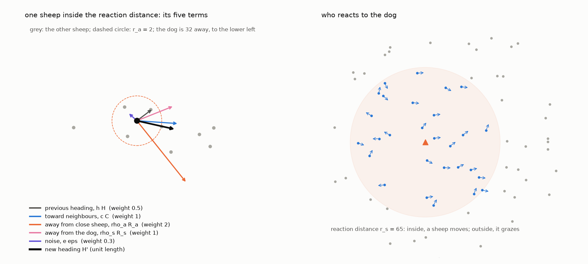

*Hình S1: Mô hình cừu Strömbom. Trái: một cá thể cừu nằm trong khoảng cách phản xạ với 5 thành phần của phương trình (1), trọng số tương ứng và vector hướng di chuyển kết quả. Phải: một chú chó và bầy cừu xung quanh; cừu nằm ngoài bán kính r_s tiếp tục gặm cỏ, cừu nằm trong bán kính r_s di chuyển trốn chạy.*

### 4.2 Chó
Với 1 chó, hành vi tuân thủ chính xác quy tắc của Strömbom et al. (2014) (Hình S2). Chó chuyển sang chế độ **thu gom (collect)** khi có bất kỳ con cừu nào cách tâm bầy xa hơn $f(N) = r_a N^{2/3}$, nhắm vào điểm cách con cừu xa nhất một đoạn $r_a$ về phía đối diện tâm bầy. Ngược lại, chó chuyển sang chế độ **lùa đàn (drive)**, nhắm vào điểm cách tâm bầy một đoạn $r_a \sqrt{N}$ về phía đối diện mục tiêu. Chó di chuyển với vận tốc $\delta_s$ và đứng yên nếu cách bất kỳ con cừu nào dưới $3 r_a$.

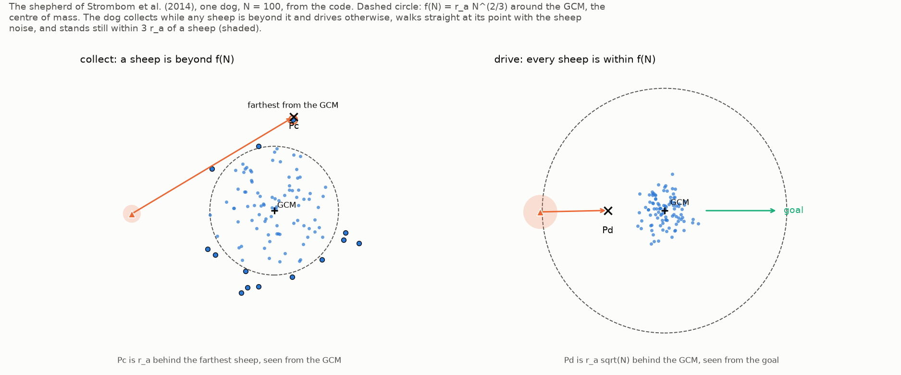

*Hình S2: Người chăn dắt đơn lẻ theo Strömbom et al. (2014). Trái: khi có cừu tản mác ngoài f(N), chó di chuyển tới điểm thu gom P_c phía sau con cừu xa nhất. Phải: khi bầy đã co cụm, chó di chuyển tới điểm lùa P_d phía sau bầy cừu đối diện với mục tiêu. Chó đứng yên khi nằm trong khoảng cách 3 r_a tới cừu (vùng tô bóng).*

Với nhiều chó ($D > 1$), tầng phối hợp đội phân công nhiệm vụ chuyên biệt (`strombom_multi`) (Hình 1):
- **Khi thu gom**: $D$ cá thể cừu tản mác xa nhất được ghép cặp với $D$ cá thể chó thông qua thuật toán gán tuyến tính tối thiểu hóa tổng quãng đường di chuyển (linear sum assignment). Chó thừa sẽ tham gia hỗ trợ lùa đàn.
- **Khi lùa đàn**: Các chó dàn hàng trên một vòng cung phía sau bầy cừu, trải đều trên góc mở bao trọn bề rộng bầy đàn, giữ nguyên thứ tự góc để tuyệt đối không cắt chéo đường đi của nhau. Mỗi cá thể chó đều nắm rõ tọa độ của mọi con cừu và các đồng đội khác.


*Hình 1: Từ một chó đến nhiều chó, trích xuất từ mô phỏng khi bắt đầu thử nghiệm. Cột trái: một chó theo quy tắc Strömbom et al. (2014). Hàng trên: trên bố cục phân tán wide, các chó thu gom cừu, mỗi chó nhắm tới điểm gom của cá thể tản mác được ghép cặp theo quãng đường ngắn nhất. Hàng dưới: trên bố cục co cụm compact, các chó dàn hàng hình cung phía sau bầy, trải đều theo bề rộng bầy cừu. Dấu chữ thập đánh dấu điểm nhắm tới.*

### 4.3 Mô hình đối chứng không phối hợp (FAT)

Để tách phần $D_{\min}$ đến từ sự phối hợp khỏi phần đến từ số lượng chó, chúng tôi chạy thêm một quy tắc không phối hợp, FAT (xa mục tiêu nhất). Mỗi chó nhắm điểm cách con cừu xa mục tiêu nhất một khoảng $r_a$ và di chuyển theo bước chó của Strömbom, kể cả quy tắc đứng yên khi cách cừu dưới $3 r_a$. Cách chọn mục tiêu lấy từ chó của Kubo nhưng không có lực đẩy giữa các chó, và không có phép gán cừu tản mác hay các vị trí lùa của `strombom_multi`. Mọi chó thấy cùng một bầy, nên tất cả chọn cùng một con cừu và cùng một điểm; khi gặp nhau, chúng di chuyển như các bản sao (Hình S2b). FAT là cấu trúc của HerdSim, dùng làm đường cơ sở.

FAT chạy trên cùng nhiệm vụ với `strombom_multi`. Bán kính bầy $R_f$ quyết định mục tiêu và quãng lùa (mục 5.1) và được hiệu chuẩn bằng một chó. Một chó FAT đơn lẻ làm bầy lỏng hơn ($R_f$ lớn hơn tới 28% ở $N = 400$), khiến mục tiêu và quãng lùa của FAT lớn hơn. Vì vậy, $R_f$ của FAT được hiệu chuẩn bằng người chăn dắt của bài báo trên cùng bầy cừu (khóa `calibrate_as`), cho đúng $R_f$ của các lượt `strombom_multi`; giữa hai lượt chỉ khác quy tắc chó.


*Hình S2b: FAT. Trái: người chăn dắt của bài báo chọn con cừu xa tâm bầy nhất; chó FAT chọn con cừu xa mục tiêu nhất. Phải: với nhiều chó, mọi chó FAT chọn cùng một con cừu và cùng một điểm, nên trở thành bản sao của nhau khi gặp nhau.*

### 4.4 Mô hình cừu thứ hai (Kubo et al. 2022)
Để đối chứng, chúng tôi chạy thử mô hình lực liên tục của Kubo et al. (2022) (Hình S3). Mô hình này không có nhiễu ngẫu nhiên nên các hạt giống chỉ thay đổi vị trí khởi đầu. Do mô hình này nén bầy cừu về một bán kính cố định, chúng tôi thử nghiệm đến $N = 100$.


*Hình S3: Mô hình lực liên tục của Kubo et al. (2022). Trái: 4 vector lực tác động lên một con cừu (lực đẩy, căn chỉnh hướng, lực hút, và lực trốn chạy chó). Giữa: 4 vector lực tác động lên một chú chó (hút về cừu mục tiêu, cự ly an toàn với cừu, tránh mục tiêu, và lực đẩy giữa các chó). Phải: Lượt thử nghiệm cho thấy lực đẩy giữa các chó giúp chúng tự động phân tán đều quanh chu vi bầy đàn.*

### 4.5 Các tham số
Bảng 2 liệt kê các tham số của mô hình Strömbom:

| Ký hiệu | Giá trị | Ý nghĩa vật lý |
|---|---|---|
| $r_a$ | 2 | Khoảng cách tương tác cừu-cừu; thiết lập khoảng cách lùi của chó |
| $\rho_a$ | 2 | Trọng số lực đẩy tránh va chạm giữa các cừu láng giềng |
| $c$ | 1.05 | Trọng số lực hút về tâm bầy cừu láng giềng |
| $\rho_s$ | 1 | Trọng số lực đẩy hoảng sợ né tránh chó chăn dắt |
| $h$ | 0.5 | Trọng số quán tính duy trì hướng di chuyển trước |
| $e$ | 0.3 | Trọng số nhiễu góc ngẫu nhiên (áp dụng cho cả cừu và chó) |
| $\delta$ | 1 | Độ dài bước di chuyển của cừu trong 1 nhịp (1 m/s) |
| $p$ | 0.05 | Xác suất cừu bước ngẫu nhiên khi gặm cỏ |
| $r_s$ | 65 | Bán kính đe dọa (cừu bắt đầu phản ứng hoảng sợ khi chó tiến vào) |
| $n$ | $N - 1$ | Số lượng láng giềng trong lực hút bầy (hút toàn cục) |
| $\delta_s$ | 1.5 | Bước di chuyển của chó trong 1 nhịp (tốc độ $v_{\text{dog}} = 1.5$ m/s) |
| - | $3 r_a$ | Chó đứng yên nếu tiến sát cừu trong cự ly này để tránh làm vỡ đàn |

Strömbom et al. (2014) cũng cung cấp bộ tham số thực địa GPS ($r_a = 1$, $e = 0,1$, $r_s = 75$), được chúng tôi đưa vào phân tích độ nhạy (Hình S6).

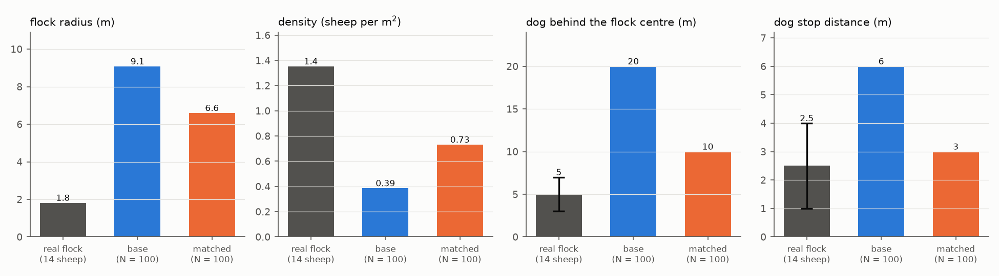

*Hình S6: So sánh bầy cừu thực địa của Jadhav et al. (2024) với bộ tham số cơ sở và bộ tham số thực địa GPS tại N = 100: bán kính bầy, mật độ, cự ly làm việc của chó phía sau tâm bầy, và cự ly dừng của chó.*

---

## 5. Thiết kế thực nghiệm (Experimental Design)

### 5.1 Nhiệm vụ và Hiệu chuẩn bán kính bầy $R_f(N)$
Bầy cừu xuất phát quanh một điểm tâm và phải được lùa vào mục tiêu hình tròn. Nhằm bảo đảm **tính bất biến theo quy mô (scale invariance)**, mọi kích thước hình học đều được neo theo bán kính bầy cân bằng $R_f(N)$, đo đạc thực nghiệm qua bước hiệu chuẩn (calibration): 1 chó lùa đàn co cụm hướng tới một mục tiêu vô tận trong 300 s, và $R_f$ là $\sqrt{2}$ lần bán kính hiệu dụng RMS trong 90 s cuối.

Bán kính mục tiêu được đặt cố định là $R_{\text{goal}} = 1,9 R_f(N)$. Khoảng cách lùa đàn từ tâm xuất phát đến tâm mục tiêu là:

$$
l = \max(13 R_f(N), 80, \text{reach} + 1{,}9 R_f + R_f) \tag{2}
$$

trong đó `reach` là khoảng cách xa nhất mà một con cừu có thể xuất hiện trong bố cục ban đầu (Hình 2). Đấu trường hoàn toàn không có tường phản xạ (open boundary) để tránh việc tường biên trở thành công cụ gom cừu nhân tạo làm sai lệch kết quả (Hình S9).


*Hình 2: Nhiệm vụ tại N = 200, vẽ đúng theo tỷ lệ. Trái: bầy cừu xuất phát quanh tâm và được lùa về mục tiêu tròn. Đĩa xanh lam là khoảng cách xa nhất một con cừu có thể xuất hiện trong bất kỳ bố cục nào, vòng chấm là bán kính bầy R_f. Giữa: chiều dài quãng đường lùa đàn là giá trị lớn nhất trong ba số hạng của phương trình (2). Phải: bán kính bầy cừu và bán kính mục tiêu theo quy mô đàn N.*

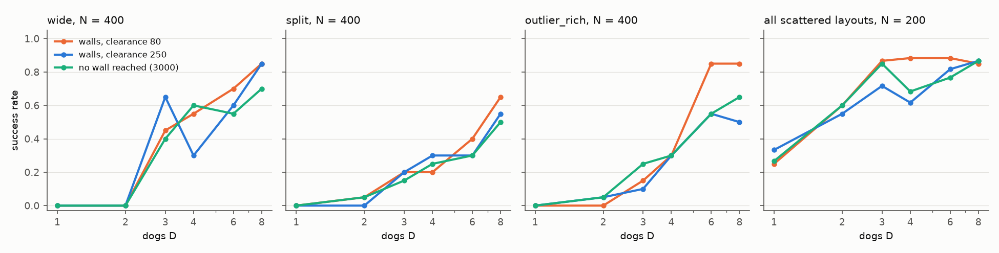

*Hình S9: Tỷ lệ thành công theo số lượng chó D khi có tường phản xạ ở cự ly lề 80 và 250, so với trường hợp không có tường biên (3000), trên cùng tập hạt giống. Khác biệt rõ rệt nhất xuất hiện trên bố cục outlier_rich tại N = 400.*

### 5.2 Bố cục khởi tạo bầy cừu
Bảng 3 định nghĩa bốn bố cục xuất phát (định cỡ bằng khoảng cách thu gom $L = f(N) = 2 N^{2/3}$):

| Bố cục | Hình dạng không gian |
|---|---|
| **`compact`** | Phân phối Gauss, $\sigma = 0,5 R_f$, cắt cụt ở $3\sigma$. Toàn bộ cừu nằm trong $f(N)$; chó vào thẳng chế độ lùa. |
| **`wide`** | Phân phối Gauss rộng, $\sigma = 0,5 L$, cắt cụt ở $3\sigma$. Cừu phân tán rộng, đòi hỏi quét gom vùng biên. |
| **`split`** | Chia đều thành 3 cụm co cụm (2 cụm nếu $N < 12$) đặt đối xứng trên đường tròn bán kính $L$. |
| **`outlier_rich`** | 80% cừu nằm trong lõi co cụm, 20% là các cá thể tản mác rải rác từ $1,1$ đến $1,6 L$. |


*Hình 3: Bốn bố cục khởi tạo tại N = 200, cùng một hạt giống, trên cùng một tỷ lệ không gian. Vòng tròn nét đứt là khoảng cách thu gom f(N) quanh tâm bầy; chó chuyển sang chế độ thu gom khi có bất kỳ con cừu nào nằm ngoài vòng này. Bố cục compact không có cừu bên ngoài nên các chú chó chỉ thực hiện lùa đàn.*

### 5.3 Điểm xuất phát của chó (`dog_start`)
- **`arcs` (mặc định)**: Chó đứng trên các nửa đường tròn phía sau bầy cừu, cách biên bầy 30 đơn vị, cách đều nhau tối thiểu 5 đơn vị (Hình S4).
- **`ring`**: Chó phân bố đều trên đường tròn bao quanh bầy cừu, chừa ra hình nón (nhìn từ tâm bầy) chứa mục tiêu. Một đường tròn đầy đủ đặt một chó trên trục lùa giữa bầy và mục tiêu với mọi $D$ chẵn, và từ $N = 200$ chó đó xuất phát ngay trong mục tiêu vì bán kính vòng lớn hơn khoảng cách tới mép gần của mục tiêu. Lượt chạy ring đầu tiên với đường tròn đầy đủ mắc lỗi này và không được sử dụng.
- **`handler`**: Toàn bộ chó xuất phát từ một điểm duy nhất phía sau bầy cừu (mô phỏng việc thả chó từ trạm của người điều khiển).

Trên bố cục co cụm, toàn bộ cừu nằm trong phạm vi $r_s$ của chó tại nhịp 0; trên các bố cục phân tán, 66% đến 100% số cừu nằm ngoài tầm với và tiếp tục gặm cỏ cho đến khi chó tiếp cận (Hình S5).


*Hình S4: Các vị trí xuất phát của chó. Phía trên: các vòng cung cho D = 1, 2, 4, 8, 24 và 64 trên bố cục compact. Một chó xuất phát trên đường lùa đàn phía sau bầy cừu và mỗi cá thể bổ sung chiếm một vị trí riêng. Phía dưới: ba kiểu bố trí (arcs, ring, handler point) cho 8 chó trên bố cục wide.*

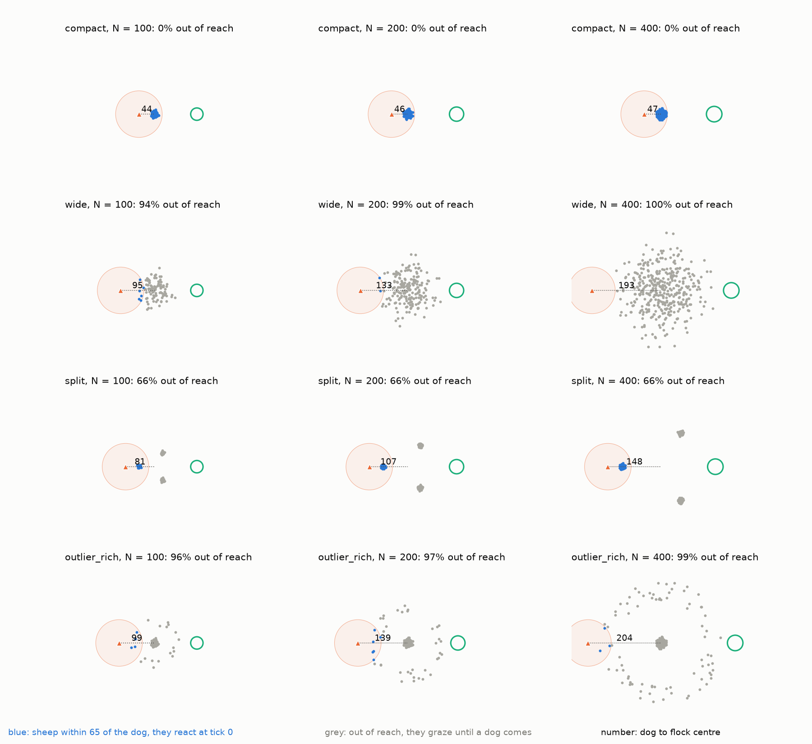

*Hình S5: Khởi đầu với 1 chó trên các vòng cung arcs, theo từng bố cục và N. Vòng tròn là bán kính phản xạ đe dọa r_s = 65. Cừu xanh lam phản ứng chạy trốn ngay nhịp 0, cừu xám tiếp tục gặm cỏ. Con số hiển thị khoảng cách từ chó đến tâm bầy cừu.*

### 5.4 Thời hạn (`deadline`)
Thời hạn được tính theo $T = m l / \delta$ giây với $m \in \{12, 6, 3\}$. Với $N = 200$, thời gian lùa tiêu chuẩn $T_{\text{drive}} \approx 140$ s, tương ứng các thời hạn là 1.680 s ($12\times$), 839 s ($6\times$) và 420 s ($3\times$).

### 5.5 Tiêu chí thành công
- **Nghiêm ngặt (Strict 100%)**: Toàn bộ 100% cừu phải nằm trong mục tiêu tại một nhịp thời gian trước khi hết hạn.
- **Ngưỡng 99% ($f_{99}$)**: Ít nhất $\lceil 0,99 N \rceil$ số cừu phải nằm trong mục tiêu. Với $N = 25$ và $50$, $\lceil 0,99 N \rceil = N$ nên hai tiêu chí trùng nhau; với $N = 100, 200, 400$, tiêu chí này cho phép sót lại lần lượt 1, 2 và 4 con bên ngoài.

### 5.6 Cơ chế kiểm định tuần tự và Phân bổ hạt giống thích ứng
Mỗi hạt giống $i$ sinh ra ba chuỗi ngẫu nhiên độc lập (bố cục, nhiễu cừu, nhiễu chó) dựa trên `master_seed + i` (2026 + $i$). Mỗi ô ban đầu nhận 1 lô 10 hạt giống. Sau mỗi vòng, chỉ các ô chưa ngã ngũ mới nhận thêm lô 10 hạt giống (tối đa 200). Điểm chia đôi (midpoint) được tự động chèn vào giữa các vùng hành vi khác biệt. Một ô còn dưới giới hạn 200 vẫn có thể ngã ngũ nên được chờ; một ô chưa ngã ngũ ở giới hạn thì không, và giá trị $D$ nằm giữa nó và ô lân cận đã ngã ngũ sẽ được thêm vào, để $D_{\min}$ không bao giờ nằm trên một $D$ chưa thử trong khoảng của chính nó (quy tắc này được thêm sau các lượt chạy đầu tiên, và các lượt đó đã được bổ sung). Các ô trên ngưỡng bão hòa có độ trùng lặp hành vi cao (mean dog overlap $\ge 0,90$) sẽ bị cắt tỉa (pruning) để tiết kiệm năng lượng tính toán.

### 5.7 Các giao thức thực nghiệm
23 giao thức được thực hiện: 6 giao thức chính (quét $m \in \{12, 6, 3\}$ dưới tiêu chí strict và 99%), 2 giao thức FAT (lưới chính, $m = 6$, strict và 99%), 1 giao thức Kubo, và 14 giao thức kiểm tra độ nhạy: một lượt cơ sở và sáu biến thể (điểm xuất phát handler/ring, khoảng cách gap 15/30/60, bán kính mục tiêu 1,5 $R_f$, bộ tham số thực địa, và tốc độ chó $v_{\text{dog}} = 1,15$), mỗi lượt chạy dưới cả hai tiêu chí (Hình S8).

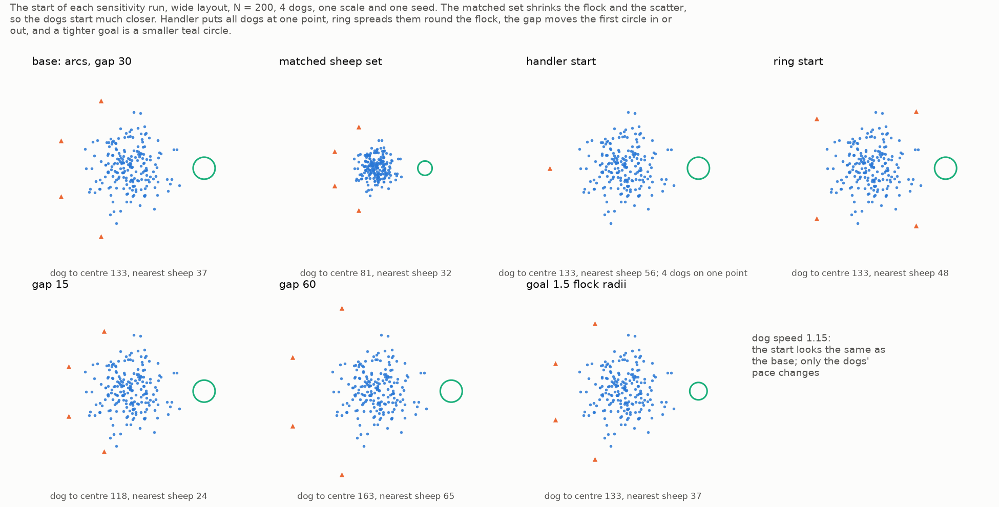

*Hình S8: Cấu hình ban đầu của từng biến thể phân tích độ nhạy trên bố cục wide tại N = 200 với 4 chó. Biến thể tốc độ chó có hình dạng tương tự như cấu hình cơ sở.*

### 5.8 Hiện thực hóa và Kiểm chứng (Verification)
HerdSim được viết bằng Python. Trước mỗi đợt chạy lớn, 268 bài kiểm thử đơn vị kiểm tra tính đúng đắn của phương trình so với tính toán giải tích. Một bộ benchmark chạy các kịch bản thực tế để kiểm tra hành vi định tính (Hình 4). Sau các lượt chạy, một đợt rà soát đã viết lại mô hình một chó và cừu dưới dạng vòng lặp riêng cho từng con cừu, cho kết quả trùng với bộ mô phỏng tới 6e-13 trong 300 nhịp với cùng chuỗi ngẫu nhiên, và tính lại mọi quyết định ô cùng mọi $D_{\min}$ từ dữ liệu lưu trữ bằng một cài đặt Clopper–Pearson độc lập; tất cả đều khớp với các bảng đã công bố.


*Hình 4: Diễn biến một lượt thử nghiệm thực tế: bố cục wide, N = 200, D = 4, hạt giống 2026. Các chú chó tỏa ra thu gom các cá thể cừu tản mác, dồn chúng vào bầy, xếp hàng phía sau bầy và lùa vào mục tiêu. Lượt thử nghiệm kết thúc sau 279 nhịp, tương đương khoảng 2 lần thời gian lùa tiêu chuẩn.*

---

## 6. Kết quả thực nghiệm (Results)

23 giao thức đã hoàn thành 164.740 lượt mô phỏng mà không có bất kỳ lỗi nào, mất khoảng 8 giờ trên 20 tiến trình song song (Phụ lục A). Ký hiệu: "a / b" là giá trị strict và 99% của cùng một ô, "lo-hi" là một khoảng, "[n]" là đường chưa có $D$ tin cậy với cận dưới $n$, và "none" là đường không có $D$ tin cậy trên lưới (mục 3).

### 6.1 Một chú chó là đủ cho bầy co cụm
Trên bố cục `compact`, $D_{\min} = 1$ ở mọi quy mô $N$ từ 25 đến 400, ở mọi thời hạn và dưới cả hai tiêu chí thành công. Thêm chó không làm giảm thời gian hoàn thành: các cá thể chó thừa chỉ lặp lại đường đi của nhau (độ trùng lặp đạt 84% đến 93%). Mô hình Kubo cũng xác nhận $D_{\min} = 1$ cho bầy co cụm tại $N = 25, 50, 100$.

### 6.2 Bản đồ $D_{\min}$ qua các bố cục, quy mô đàn và thời hạn
Bảng 5 trình bày giá trị $D_{\min}$ (Strict / 99%):

| Thời hạn | Bố cục | $N = 25$ | $N = 50$ | $N = 100$ | $N = 200$ | $N = 400$ |
|---|---|---|---|---|---|---|
| **$12\times$** | wide | 1 / 1 | 1 / 1 | 1 / 1 | 2 / 1-2 | 3 / 2 |
| **$12\times$** | split | 1 / 1 | 1 / 1 | 1 / 1 | 1-2 / 1 | 3 / 2 |
| **$12\times$** | outlier_rich | 1 / 1 | 1 / 1 | 1-3 / 1-2 | 2 / 2 | 3 / 2 |
| **$6\times$** | wide | 1 / 1 | 1 / 1 | 1 / 1 | 3 / 2 | [9] / 2-3 |
| **$6\times$** | split | 1 / 1 | 1 / 1 | 1 / 1 | none / [1] | none / [5] |
| **$6\times$** | outlier_rich | 1 / 1 | 1 / 1 | 3 / 2 | [12] / 2-3 | none / 3 |
| **$3\times$** | wide | 1 / 1 | 1 / 1 | 3 / 2 | none / 3 | none / 5-6 |
| **$3\times$** | split | 1 / 1 | 1 / 1 | 1 / 1 | none / none | none / none |
| **$3\times$** | outlier_rich | 1 / 1 | 1 / 1 | 3-8 / 2 | none / 4-10 | none / [6] |

*Ghi chú: Bố cục compact đạt 1 / 1 ở mọi ô và được lược bỏ khỏi bảng.*


*Hình 5: D_min theo quy mô bầy N ở ba mốc thời hạn, dưới tiêu chí strict (nét liền, hình tròn) và 99% (nét đứt, hình vuông). Thanh tô mờ chạy từ D_min_low đến D_min khi một D nhỏ hơn vẫn chưa ngã ngũ ở 200 hạt giống; tam giác rỗng biểu thị đường chưa có D tin cậy, tại cận dưới D_min_low; dấu gạch chéo biểu thị đường không tìm được số chó tin cậy. Bố cục compact luôn bằng 1.*

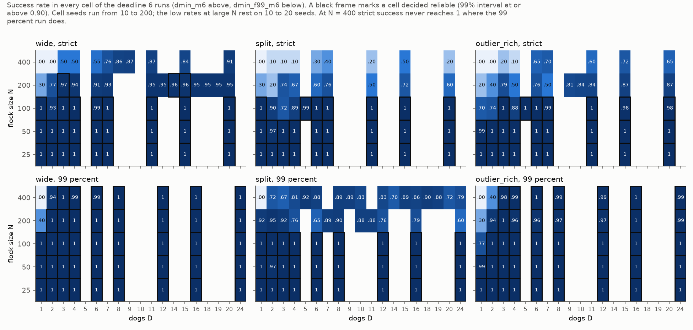

*Hình 6: Tỷ lệ thành công của từng ô thử nghiệm tại thời hạn 6x drive times, dưới tiêu chí strict (trên) và 99% (dưới). Khung đen viền quanh ô đã ngã ngũ tin cậy.*

Mọi bố cục đều chỉ cần 1 chó khi $N \le 50$. Với $N = 200$ và $400$, ở thời hạn $12\times$ và $6\times$, đội chó chỉ cần từ 1 đến 3 cá thể. Khi thời hạn bị ép xuống $3\times$ (tiêu chí 99%), $D_{\min}$ là 5 hoặc 6 (wide, $N = 400$) và nằm trong khoảng 4 đến 10 (outlier_rich, $N = 200$), nơi mọi $D$ từ 4 đến 9 vẫn chưa ngã ngũ ở 200 hạt giống với tỷ lệ thành công 0,84 đến 0,92. Nhiều giá trị là khoảng vì tỷ lệ thành công của một $D$ nhỏ hơn nằm sát 0,90. Ví dụ outlier_rich ở $N = 100$, thời hạn $12\times$: $D = 3$ tin cậy dưới tiêu chí strict còn $D = 1$ và $2$ chưa ngã ngũ, nên $D_{\min}$ thực là 1, 2 hoặc 3; đường này từng trông như bị đảo chiều theo $N$ (3 ở $N = 100$, 2 ở $N = 200$) khi chỉ in $D_{\min}$.

### 6.3 Tốc độ tăng trưởng theo $N$ (RQ1)
Độ dốc $\log_2 D_{\min}$ theo $\log_2 N$ trên các bố cục phân tán:
- Ở thời hạn $12\times$ và $6\times$: độ dốc chỉ từ 0,2 đến 0,5 (tăng gấp đôi bầy cừu chỉ đòi hỏi tăng thêm 20% đến 50% số lượng chó).
- Ở thời hạn gấp gáp $3\times$: độ dốc tăng lên 0,6 đến 1,5.

### 6.4 Bố cục ban đầu so với Quy mô đàn (RQ2)
Quy mô đàn $N$ dịch chuyển $D_{\min}$ nhiều hơn so với hình dạng bố cục ban đầu. Phần lớn tác động của bố cục thực chất là sự khác biệt nhị phân giữa bố cục co cụm (luôn cần 1 chó) và ba bố cục phân tán còn lại.

### 6.5 Tác động của Thời hạn (RQ3)
Dưới tiêu chí 99%, rút ngắn thời hạn từ $12\times$ xuống $3\times$ làm tăng $D_{\min}$ trên bố cục wide từ 2 lên 5-6 chó ($N = 400$), và trên outlier_rich từ 2 lên 4-10 chó ($N = 200$). Tác động của thời hạn mang tính phi tuyến: từ $12\times$ sang $6\times$, $D_{\min}$ chỉ thay đổi tối đa 1 chó, nhưng bước nhảy vọt xảy ra khốc liệt giữa $6\times$ và $3\times$ (Hình 7).

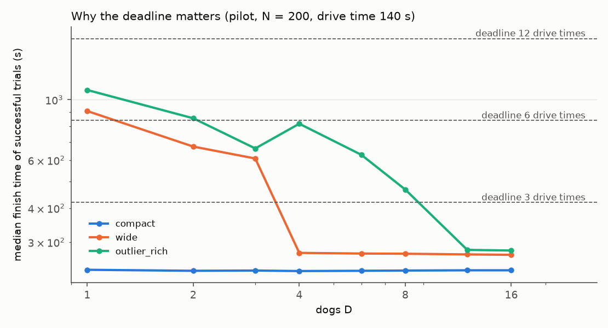

*Hình 7: Thời gian hoàn thành trung vị của các lượt thành công theo D tại N = 200, kèm theo ba mốc thời hạn. Một bố cục cần số lượng chó sao cho đường đồ thị của nó nằm dưới mốc thời hạn. Đàn co cụm nằm dưới mọi mốc thời hạn chỉ với 1 chó.*

### 6.6 Tiêu chí thành công và "Hiệu ứng cá thể rớt lại" (RQ4)
Giá trị $D_{\min}$ dưới tiêu chí 99% không bao giờ lớn hơn tiêu chí nghiêm ngặt 100%, và nhỏ hơn từ 1 đến 6 chó ở 9 ô thực nghiệm quy mô lớn. Đặc biệt, có 6 ô hoàn toàn thất bại (`none`) dưới tiêu chí nghiêm ngặt nhưng lại đạt $D_{\min}$ rất gọn gàng dưới tiêu chí 99%.

**Cơ chế hỏng hóc (The Straggler Effect):** Trong các lượt thất bại theo tiêu chí strict, bầy cừu thường đã đến đích. Trên lưới độ nhạy với $D \ge 6$, 99% đến 100% số lượt đưa được 99% số cừu vào mục tiêu ở một thời điểm nào đó, trong khi tỷ lệ thành công strict chỉ từ 0,68 đến 1,00 (Hình 8, trái); thời điểm đạt 99% nằm sâu trong thời hạn (khoảng 427 s trên 1241 s với wide, $N = 400$). Chúng tôi đọc chi tiết bốn lượt thất bại ($N = 400$, 8 đến 16 chó): 386 đến 399 trên 400 con cừu vào đích, sau đó mọi chó đều ở phía mục tiêu của bầy, bầy bị lùa ra xa tâm mục tiêu từ 100 đơn vị trở lên rồi quay lại sau 400 đến 800 nhịp (Hình 8, phải). Chúng tôi chưa khảo sát vì sao các chó đi tới vị trí đó. Bốn lượt này là cách đọc cơ chế, không phải một phép đếm. Như vậy bước mà đội chó thất bại theo tiêu chí strict là sự có mặt của con cừu cuối cùng, sau khi bầy đã vào đích; mục 6.8 cho thấy chính bước này giải thích phần lớn độ nhạy với thiết lập của các lượt strict.


*Hình 8: Trái: tỷ lệ các lượt thử từ 6 chó trở lên thành công nghiêm ngặt (tối màu), đạt mốc 99% cừu vào đích ở một thời điểm (kẻ sọc), và thành công nghiêm ngặt với chó chạy chậm 1.15 (cam). Phải: một lượt chạy cụ thể (wide, N = 400, 16 chó, hạt giống 2). Với chó tốc độ 1.5, bầy cừu vào đích nhưng sau đó bị dồn vọt ra ngoài; với chó tốc độ 1.15, đàn cừu ở yên trong đích ngay nhịp lùa đầu.*

### 6.7 Hiện tượng thêm chó làm giảm hiệu quả trên bố cục cụm rời (split)
Trên bố cục `split` ở $N \ge 200$, tỷ lệ thành công không tăng theo số lượng chó (Hình 9). Tại $N = 200$ thời hạn $6\times$ (tiêu chí 99%), tỷ lệ thành công đạt 0,92 (1 chó), 0,95 (2 chó), 0,92 (3 chó), nhưng chỉ 0,60 đến 0,90 khi dùng 4 đến 24 chó; thời gian hoàn thành trung vị kéo dài từ 425 s lên 650 đến 700 s. Bố cục split ở $N \ge 200$ với thời hạn $6\times$ và $3\times$ nên được xem là chưa ngã ngũ.

Một phần nguyên nhân nằm ở cách tầng phối hợp giao việc thu gom: các việc là $D$ con cừu xa tâm bầy nhất theo thứ hạng, và trên bố cục split những con xa nhất thường nằm trong cùng một cụm. Chúng tôi chạy lại split ở $N = 200$, $6\times$, tiêu chí 99%, 12 hạt giống mỗi $D$, và ghi lại ở mỗi nhịp thu gom con cừu được giao cho mỗi chó thuộc cụm xuất phát nào (Bảng 8). Với từ 4 chó trở lên, việc của mọi chó đến từ một cụm duy nhất trong 82% đến 91% số nhịp thu gom. Trong một phép thử đối chứng, khi các việc được dàn ra nhiều cụm (lấy lần lượt các con xa nhất, bỏ qua con nào gần hơn $f(N)$ so với một việc đã nhận), thời gian trung vị giảm từ 631 xuống 318 s ở $D = 4$ nhưng gần như không đổi ở $D = 8$ (678 → 662 s) và $D = 16$ (724 → 703 s). Hiện tượng dồn vào một cụm là có thật và giải thích sự chậm lại ở $D = 4$, nhưng không giải thích ở $D$ lớn hơn. Cả hai phép thử chỉ dùng 12 hạt giống và là chẩn đoán, không phải kết quả.

*Bảng 8: Chạy lại split, $N = 200$, $6\times$, tiêu chí 99%, 12 hạt giống mỗi $D$.*

| $D$ | Thành công | Trung vị hoàn thành (s) | Nhịp thu gom có mọi việc trong một cụm | Trung vị khi dàn việc (s) |
|---|---|---|---|---|
| 1 | 1,00 | 424 | - | - |
| 2 | 0,83 | 365 | 0,65 | 394 |
| 4 | 0,92 | 631 | 0,82 | 318 |
| 8 | 1,00 | 678 | 0,90 | 662 |
| 16 | 0,83 | 724 | 0,91 | 703 |


*Hình 9: Tỷ lệ thành công theo D tại thời hạn 6x kèm khoảng tin cậy 99%. Trên bố cục split tại N = 200 và 400, tỷ lệ thành công không tăng theo số chó D; đường biểu diễn bố cục wide tại N = 400 được vẽ để đối chiếu.*

### 6.8 Phân tích độ nhạy (RQ5)
Bảng 9 tóm tắt kết quả phân tích độ nhạy ($D_{\min}$ Base / Biến thể tại thời hạn $6\times$) dưới cả hai tiêu chí. Lưới dừng ở $D = 16$, nên "none" ở đây nghĩa là không có $D$ tin cậy tới 16. Hình 10 minh họa trực quan các kết quả này:

*Bảng 9: $D_{\min}$, cơ sở / biến thể, thời hạn $6\times$.*

| Tiêu chí | Biến thể | wide 100 | wide 200 | wide 400 | outlier 100 | outlier 200 | outlier 400 |
|---|---|---|---|---|---|---|---|
| **strict** | Bộ cừu thực địa | 1 / 1-6 | 3 / none | [9] / none | 3 / [1] | [12] / none | none / none |
| **strict** | Xuất phát trạm handler | 1 / 1 | 3 / 3 | [9] / none | 3 / 2 | [12] / [3] | none / none |
| **strict** | Xuất phát vòng tròn ring | 1 / 1 | 3 / 3-5 | [9] / [8] | 3 / 2-7 | [12] / [5] | none / none |
| **strict** | Mục tiêu hẹp $1,5 R_f$ | 1 / 1-3 | 3 / none | [9] / none | 3 / 3 | [12] / none | none / none |
| **strict** | Cự ly lùi gap 15 | 1 / 1 | 3 / [3] | [9] / none | 3 / [1] | [12] / none | none / none |
| **strict** | Cự ly lùi gap 30 (cơ sở) | 1 / 1 | 3 / 3 | [9] / [9] | 3 / 3 | [12] / [12] | none / none |
| **strict** | Cự ly lùi gap 60 | 1 / 1 | 3 / 3-4 | [9] / 6-7 | 3 / 3 | [12] / 5 | none / [12] |
| **strict** | Chó chạy chậm 1,15 | 1 / 1 | 3 / 3 | [9] / 5 | 3 / 2-3 | [12] / 4 | none / 6 |
| **99%** | Bộ cừu thực địa | 1 / 1 | 2 / 1 | 2-3 / 2 | 2 / 1 | 2-3 / 1 | 3 / 2-3 |
| **99%** | Xuất phát trạm handler | 1 / 1 | 2 / 2-3 | 2-3 / 2-3 | 2 / 2 | 2-3 / 2-3 | 3 / 3 |
| **99%** | Xuất phát vòng tròn ring | 1 / 1 | 2 / 2-3 | 2-3 / 3 | 2 / 2 | 2-3 / 2 | 3 / 3 |
| **99%** | Mục tiêu hẹp $1,5 R_f$ | 1 / 1 | 2 / 2 | 2-3 / 5-6 | 2 / 2 | 2-3 / 2-3 | 3 / none |
| **99%** | Cự ly lùi gap 15 | 1 / 1 | 2 / 2 | 2-3 / 2-3 | 2 / 1-2 | 2-3 / 2 | 3 / 3 |
| **99%** | Cự ly lùi gap 30 (cơ sở) | 1 / 1 | 2 / 2 | 2-3 / 2-3 | 2 / 2 | 2-3 / 2-3 | 3 / 3 |
| **99%** | Cự ly lùi gap 60 | 1 / 1 | 2 / 2-3 | 2-3 / 2-3 | 2 / 2 | 2-3 / 2-3 | 3 / 3 |
| **99%** | Chó chạy chậm 1,15 | 1 / 1 | 2 / 2-3 | 2-3 / 2-3 | 2 / 2 | 2-3 / 2-3 | 3 / 3 |


*Hình 10: Minh họa trực quan cho Bảng 9, strict phía trên đường kẻ và 99% phía dưới. Ô càng đậm màu càng cần nhiều chó; ô sáng là chưa ngã ngũ (một khoảng hoặc một cận dưới); ô kẻ sọc chéo biểu thị không tìm được D tin cậy.*

Hai nửa của Bảng 9 kể hai câu chuyện khác nhau. Dưới tiêu chí strict, các biến thể phân tán mạnh: cùng một ô có thể cần 1, 3, 5 chó hoặc không có đội nào tin cậy tùy bộ tham số cừu, mục tiêu, khoảng cách xuất phát hay tốc độ chó, chênh lệch tới sáu lần. Dưới tiêu chí 99%, mọi biến thể trừ mục tiêu hẹp đều nằm trong phạm vi một chó so với khoảng của cơ sở ở mọi ô. Các quy ước xuất phát (handler, ring, gap) và tốc độ chó khi đó không tạo khác biệt mà các lượt chạy này phân giải được. Phần lớn độ nhạy của các lượt strict vì thế là bước con cừu cuối cùng của mục 6.6, chứ không phải khác biệt về số chó cần để đưa bầy vào đích.

- **Bộ tham số thực địa:** dưới tiêu chí strict đây là thiết lập khó nhất (tỷ lệ thành công quanh 0,9 ở $N = 100$ với mọi $D$); dưới tiêu chí 99% nó cần số chó bằng hoặc ít hơn cơ sở ở cả sáu ô.
- **Tốc độ chó ($v_{\text{dog}} = 1,15$ so với $1,5$):** dưới tiêu chí strict chó chậm cần ít chó hơn ở những ô cơ sở không có giá trị (wide $N = 400$: 5; outlier_rich $N = 200$: 4, $N = 400$: 6). Dưới tiêu chí 99% lợi thế này biến mất: $D_{\min}$ khớp với cơ sở trong phạm vi các khoảng ở cả sáu ô. Cả hai tốc độ đưa 99% bầy vào đích gần như cùng lúc (Phụ lục C).
- **Vị trí xuất phát:** dưới tiêu chí strict, với từ 8 chó trở lên ở $N = 400$, ring cho tỷ lệ thành công cao nhất (wide 0,92 so với 0,86 của arcs; outlier_rich 0,81 so với 0,69) và handler thấp nhất (wide 0,55, outlier_rich 0,20). Dưới tiêu chí 99%, cả ba đạt 0,90 đến 1,00 và $D_{\min}$ khớp nhau trong phạm vi các khoảng; handler vẫn chậm nhất (wide $N = 400$: trung vị 874 s so với 427 s) vì mọi chó rời từ một điểm (Hình 11).
- **Khoảng cách xuất phát:** gap 60 cho giá trị strict ở những ô cơ sở không có, gap 15 làm một số ô strict chưa ngã ngũ; dưới tiêu chí 99% gap không thay đổi gì quá một chó.
- **Mục tiêu hẹp $1,5 R_f$:** là biến thể duy nhất cần nhiều chó hơn dưới cả hai tiêu chí; dưới tiêu chí 99% cần 5-6 chó ở wide $N = 400$ (so với 2-3) và không có $D$ tin cậy tới 16 ở outlier_rich $N = 400$.

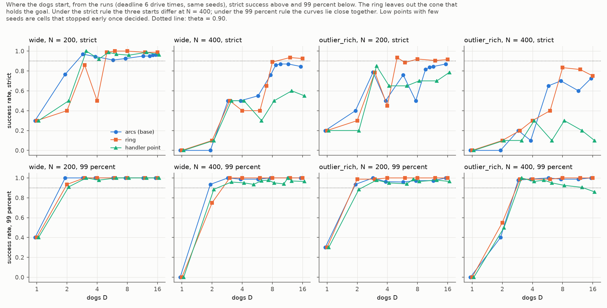

*Hình 11: Tỷ lệ thành công theo D đối với ba hình thức xuất phát (arcs, ring, handler) tại thời hạn 6x drive times, trên cùng tập hạt giống; strict (trên) và 99% (dưới).*

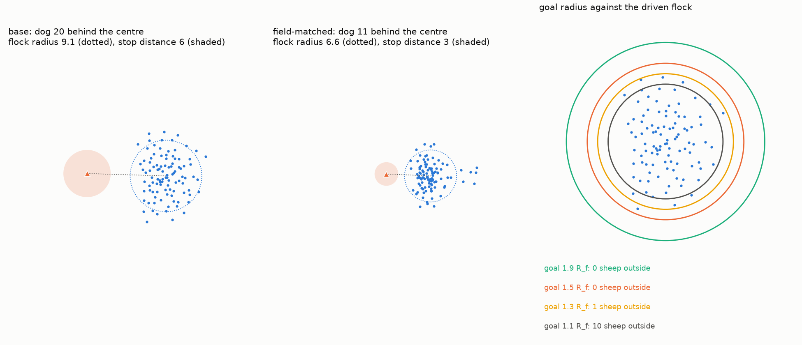

*Hình S7: Bầy cừu trong bộ tham số cơ sở và bộ tham số thực địa GPS khi được lùa ở quy mô N = 100 với 1 chó, trên cùng một tỷ lệ không gian. Phải: bầy cừu đã ổn định trong các mục tiêu có bán kính 1,9, 1,5, 1,3 và 1,1 R_f, kèm theo số lượng cừu bị sót lại bên ngoài mỗi vòng.*

### 6.9 Quy tắc không phối hợp (RQ6)

Hình 12 và Bảng 10 so sánh `strombom_multi` với FAT trên cùng nhiệm vụ, hạt giống và thời hạn ($6\times$). Đến $N = 100$, hai quy tắc cần đội gần như nhau. Từ $N = 200$, FAT không có $D$ tin cậy trên mọi bố cục phân tán dưới cả hai tiêu chí; trên bố cục compact ở $N = 400$ FAT không có giá trị dưới tiêu chí strict và chỉ có cận dưới 12 dưới tiêu chí 99%, trong khi `strombom_multi` chỉ cần 1 chó.

*Bảng 10: $D_{\min}$ của FAT, strict / 99%, thời hạn $6\times$; trong ngoặc là `strombom_multi` (dmin_m6 và dmin_f99_m6).*

| Bố cục | $N = 25$ | 50 | 100 | 200 | 400 |
|---|---|---|---|---|---|
| compact | 1 / 1 | 1 / 1 | 1 / 1 | 1 / 1 | none / [12] (1 / 1) |
| wide | 1 / 1 | 1 / 1 | 1 / 1 | none / none (3 / 2) | none / none ([9] / 2-3) |
| split | 1 / 1 | 1 / 1 | 1 / 1 | none / none (none / [1]) | none / none (none / [5]) |
| outlier_rich | 1 / 1 | 1 / 1 | 2 / 2 (3 / 2) | none / none ([12] / 2-3) | none / none (none / 3) |

Tỷ lệ thành công của FAT không tăng theo $D$: trên wide ở $N = 200$ nó nằm trong khoảng 0,30 đến 0,55 từ $D = 2$ đến 24, và trên compact ở $N = 400$ trong khoảng 0,10 đến 0,30 với $D = 1$ đến 16 (strict). Trên bầy compact ở $N \ge 200$, trung bình 73% đến 82% số chó FAT có một chó khác trong phạm vi 2 đơn vị: các chó chọn cùng con cừu, cùng điểm và di chuyển như một. Ngay cả một chó FAT cũng yếu hơn người chăn dắt của bài báo trên bầy compact lớn (0,30 so với 1,00 ở $N = 400$), vì đẩy con cừu cuối không lái được cả bầy như lùa từ sau tâm bầy.


*Hình 12: Tỷ lệ thành công theo D của strombom_multi (xanh) và FAT (cam) trên cùng nhiệm vụ, strict (nét liền) và 99% (nét đứt), thời hạn 6x. FAT không cải thiện khi thêm chó.*

$D_{\min}$ hữu hạn ở $N$ lớn vì thế là thuộc tính của sự phối hợp trong tầng đội. Thêm những chó cùng làm theo một quy tắc mà không chia việc thì không thêm được gì.

---

## 7. Thảo luận (Discussion)

### 7.1 So sánh với các nghiên cứu trước
Lama và di Bernardo (2024) nhận thấy số lượng cá thể chăn dắt tối thiểu $N^*$ tăng theo $\sqrt{M}$ (tương ứng độ dốc 0,5 trong không gian log-log) đối với các mục tiêu không liên kết dưới tiêu chí 99%. Độ dốc tăng trưởng của chúng tôi ở các thời hạn rộng rãi ($12\times$ và $6\times$) dao động từ 0,2 đến 0,5. Việc bầy cừu có tính liên kết đòi hỏi số lượng chó bổ sung ít hơn so với bầy không liên kết là hoàn toàn phù hợp với dự đoán lý thuyết: cơ chế hút toàn cục ($n = N - 1$) trong mô hình Strömbom giúp bầy cừu tự động co cụm lại ngay khi đàn chó tiếp cận, giảm tải rất lớn cho đội ngũ chăn dắt.

### 7.2 Thời hạn là một yếu tố then chốt
Các nghiên cứu trước đây luôn cố định thời gian. Kết quả của chúng tôi cho thấy thời hạn dịch chuyển $D_{\min}$ mạnh không kém quy mô bầy đàn, và tác động tập trung ở thời hạn ngắn: từ $12\times$ sang $6\times$, $D_{\min}$ thay đổi tối đa một chó; từ $6\times$ sang $3\times$ thay đổi nhiều chó (dưới tiêu chí 99%, wide $N = 400$ từ 2-3 lên 5-6, outlier_rich $N = 200$ từ 2-3 lên 4-10). Về mặt thực tiễn, việc bổ sung thêm chó chủ yếu có tác dụng "mua thời gian" để thu gom bầy đàn phân tán.

### 7.3 Bản chất đo lường của tiêu chí thành công
Chúng tôi báo cáo song song hai tiêu chí và coi sự khác biệt giữa chúng là một phát hiện của nghiên cứu. Tiêu chí strict là quy tắc của Kubo et al. (2022), Li et al. (2025) và bản thảo ẩn danh 2025; tiêu chí 99% là quy tắc của Lama và di Bernardo (2024). Tiêu chí 99% hỏi đội chó có đưa được bầy vào đích không. Tiêu chí strict hỏi đội có đưa được toàn bộ bầy vào và có mọi con cừu bên trong cùng một nhịp không; với một mục tiêu mở, điều đó còn phụ thuộc vào việc các chó làm gì sau khi bầy đã đến.

Ba kết quả cho thấy, với quy tắc đội này, tiêu chí strict chủ yếu đo bước cuối đó. Trong các lượt thất bại strict, bầy đã đến đích: 99% đến 100% số lượt với từ 6 chó trở lên đưa được 99% số cừu vào, sớm hơn nhiều so với thời hạn, và bầy bị lùa ra ngoài rồi quay lại (mục 6.6). Chó chậm, vốn không có lợi thế khi đưa bầy vào, lại có lợi thế lớn dưới tiêu chí strict và không có lợi thế nào dưới tiêu chí 99% (Phụ lục C). Và các quy ước thiết lập làm $D_{\min}$ strict thay đổi tới sáu lần chỉ làm $D_{\min}$ 99% lệch tối đa một chó (mục 6.8). Một nghiên cứu chỉ báo cáo $D_{\min}$ strict sẽ gán cho khoảng cách xuất phát, vị trí xuất phát hay tốc độ chó một tác động thực ra thuộc về bước kết thúc nhiệm vụ.

Điều này gợi ý cách định nghĩa thành công cho một nhiệm vụ chăn dắt. Quy tắc đòi mọi tác tử ở bên trong cùng một nhịp với một mục tiêu mở khiến kết quả phụ thuộc vào một bước mà quy tắc chăn dắt không được thiết kế cho, và vào một hoặc hai tác tử. Một đặc tả tốt hơn tách hai bước: việc bầy đến đích, đọc bằng tỷ lệ tác tử ở bên trong (như $\chi^*$ của Lama và di Bernardo 2024), và việc giữ bầy, đọc bằng thời gian bầy ở yên bên trong, hoặc thay bằng một chuồng giữ bầy. Quy tắc đội của chúng tôi không có bước giữ bầy. Một quy tắc đội có bước kết thúc tường minh, và một tiêu chí thành công yêu cầu bầy ở trong đích một khoảng thời gian, là các phép thử tự nhiên tiếp theo để xem $D_{\min}$ strict có hạ xuống bằng $D_{\min}$ 99% khi bước kết thúc được xử lý hay không.

### 7.4 Những kết luận vững chắc
Dưới tiêu chí strict, giá trị tuyệt đối của $D_{\min}$ phụ thuộc vào các thiết lập không có quy tắc thực tế (khoảng cách và vị trí xuất phát, bộ tham số cừu, tốc độ chó), chênh lệch tới sáu lần. Dưới tiêu chí 99%, chính các thiết lập đó chỉ làm lệch tối đa một chó, và chỉ kích thước mục tiêu tác động nhiều hơn. Các quy luật được ủng hộ:
1. Bầy cừu co cụm chỉ cần duy nhất 1 chó;
2. Trên bầy phân tán, $D_{\min}$ tăng trưởng dưới tuyến tính (độ dốc 0,2–0,5) theo quy mô $N$, và hướng tăng này giữ nguyên ở mọi biến thể;
3. Thời hạn là yếu tố chi phối mạnh tương đương quy mô bầy;
4. Tiêu chí strict làm thổi phồng số chó cần thiết ở đàn lớn và thời hạn ngắn do hiệu ứng cá thể rớt lại;
5. Dưới tiêu chí 99%, số chó tuyệt đối vững trước các quy ước xuất phát trong phạm vi một chó;
6. Sự phối hợp của đội, chứ không phải kích thước đội, là điều làm $D_{\min}$ hữu hạn ở $N$ lớn.

### 7.5 Sự phối hợp
So sánh với FAT (mục 6.9) cho thấy đóng góp của tầng phối hợp. Không chia việc, mỗi chó thêm vào lặp lại chó đầu tiên. Có chia việc, các chó thêm vào nhận những con cừu tản mác khác nhau hoặc những đoạn khác nhau của mép sau bầy, và tỷ lệ thành công tăng theo $D$ cho tới khi vượt 0,90. Kubo et al. (2022) đạt được sự chia việc tương tự qua lực đẩy giữa các chó; tầng đội của chúng tôi đạt được qua phép gán. Một mở rộng tự nhiên là quy tắc đội chỉ dùng thông tin cục bộ, nơi sự chia việc phải tự hình thành, như trong Lama và di Bernardo (2024).

---

## 8. Giới hạn nghiên cứu (Limitations)

1. Nghiên cứu tập trung vào quy tắc `strombom_multi` trên mô hình cừu Strömbom; FAT không có phối hợp và chỉ là đường cơ sở, mô hình Kubo chỉ chạy trên bố cục compact, nên các quy luật chưa được kiểm tra với một quy tắc phối hợp khác hay một mô hình cừu khác;
2. Chưa mô phỏng rào chắn thực tế (chuồng có cổng hẹp và hàng rào vật lý giữ cừu), và chưa chạy tiêu chí thành công có thời gian giữ bầy;
3. Khoảng cách phản xạ đe dọa $r_s$ chưa có dữ liệu đo đạc chính xác trên cừu sống thực địa;
4. Nguyên nhân suy giảm hiệu quả trên bố cục `split` ở $N \ge 200$ chỉ được giải thích một phần (chó thu gom dồn vào một cụm, chẩn đoán với 12 hạt giống);
5. Tầng đội như đã đặc tả có ba tính chất mà một thiết kế khác có thể thay đổi: với $D$ chẵn không có chó nào đứng ở điểm lùa của bài báo; chó dư khi thu gom lùa lõi bầy từ khoảng cách đặt cho cả bầy; chó thu gom nhận các con xa nhất theo thứ hạng nên có thể cùng đi vào một cụm;
6. 17 lượt chạy đầu tiên được tạo từ cây làm việc trên commit 420c4ec, sau đó được commit thành 995a99d với mã mô phỏng không đổi; các lượt chạy ngày 22-10-2026 được tạo từ cây làm việc chứa các bản sửa của ngày đó, chưa commit.

---

## 9. Kết luận và Hướng phát triển (Conclusions and Future Work)

Với bầy cừu Strömbom được một đội chó có phối hợp lùa vào mục tiêu, bầy compact chỉ cần 1 chó ở mọi quy mô từ 25 đến 400 và mọi thời hạn; bầy phân tán cần 1 chó tới 50 con và một đội tăng chậm sau đó (độ dốc 0,2–0,5 ở thời hạn rộng). Thời hạn tác động tới $D_{\min}$ mạnh ngang quy mô bầy. Yêu cầu mọi con cừu ở bên trong làm tăng số chó ở $N$ lớn vì một lý do không liên quan tới việc gom hay lùa: đội đưa bầy vào rồi lùa nó ra. Dưới yêu cầu đó, số chó tuyệt đối phụ thuộc quy ước xuất phát và tốc độ chó tới sáu lần; khi chỉ cần 99% bầy đến đích, các quy ước đó chỉ làm lệch tối đa một chó. Một đội không chia việc không làm tốt hơn một chó, nên sự phối hợp là điều làm $D_{\min}$ hữu hạn ở $N$ lớn.

Đối với cách định nghĩa nhiệm vụ chăn dắt, kết quả ủng hộ việc tách việc bầy đến đích khỏi việc giữ bầy: một tiêu chí đếm một tỷ lệ lớn bầy vào đích, cộng một yêu cầu riêng là bầy ở yên bên trong, hoặc một chuồng giữ bầy. Hướng phát triển tiếp theo: quy tắc đội có bước kết thúc tường minh và tiêu chí thành công có thời gian giữ bầy; nguyên nhân còn lại của hiện tượng trên bố cục split; quy tắc đội chỉ dùng thông tin cục bộ; một quy tắc phối hợp khác và mô hình Kubo trên bố cục phân tán; và khảo sát sự thay đổi của tham số láng giềng $n$.

---

## Tính khả dụng của Dữ liệu và Mã nguồn (Data and Code Availability)

Toàn bộ 164.740 lượt thử nghiệm được lưu trữ theo từng giao thức trong thư mục `results/` của kho mã nguồn HerdSim. Các bảng biểu và hình vẽ có thể tái lập hoàn toàn thông qua các lệnh CLI:

```bash
make install && make check && make bench
uv run cli/run_queue.py --workers 20                 # Chạy toàn bộ các giao thức
uv run cli/dmin_tables.py record                     # Bảng Phụ lục A
uv run cli/dmin_tables.py dmin dmin_m12 dmin_m6 dmin_m3 dmin_f99_m12 dmin_f99_m6 dmin_f99_m3
uv run cli/dmin_tables.py dmin dmin_fat dmin_f99_fat
uv run cli/dmin_tables.py growth dmin_m12 dmin_m6 dmin_m3
uv run cli/dmin_tables.py compare dmin_s_matched dmin_s_handler dmin_s_ring --base dmin_s_base
uv run cli/dmin_tables.py compare dmin_f99_s_matched dmin_f99_s_ring --base dmin_f99_s_base
uv run python docs/science/design_version2/figures/make_figures.py
uv run python docs/science/design_version2/figures/make_result_figures.py
```

---

## Tài liệu tham khảo (References)

- Auletta F, Fiore D, Richardson MJ, di Bernardo M (2021). Herding stochastic autonomous agents via local control rules and online global target selection strategies. arXiv:2010.00386.
- Brown D, Garrity T, Perkins D, Hunter D, Pochman W (2025). Optimal control strategies for multi-agent sheep herding. arXiv:2510.25115.
- di Bernardo M (2026). Multi-scale control of large agent populations: from density dynamics to individual actuation. arXiv:2603.15160.
- Jadhav V, Pasqua R, Zanon C, Roy M, Tredan G, Bon R, Guttal V, Theraulaz G (2024). Collective responses of flocking sheep (Ovis aries) to a herding dog (border collie). Communications Biology. doi:10.1038/s42003-024-07245-8.
- Kubo M, Tashiro M, Sato H, Yamaguchi A (2022). Herd guidance by multiple sheepdog agents with repulsive force. Artificial Life and Robotics 27: 416-427. doi:10.1007/s10015-021-00726-7.
- Lama A, di Bernardo M (2024). Shepherding control and herdability in complex multiagent systems. arXiv:2307.16797.
- Li A, Ogura M, Wakamiya N (2025). Swarm shepherding using bearing-only measurements. Phil. Trans. R. Soc. A 383: 20240145. doi:10.1098/rsta.2024.0145.
- Pierson A, Schwager M (2015). Bio-inspired non-cooperative multi-robot herding. IEEE International Conference on Robotics and Automation (ICRA).
- Strömbom D, Mann RP, Wilson AM, Hailes S, Morton AJ, Sumpter DJT, King AJ (2014). Solving the shepherding problem: heuristics for herding autonomous, interacting agents. J. R. Soc. Interface 11: 20140719. doi:10.1098/rsif.2014.0719.

---

## Phụ lục A. Nhật ký các lượt chạy (Appendix A. Record of Runs)

Số lượt thử bao gồm đợt bổ sung ngày 22-10-2026; số giờ là của lượt chạy đầu tiên. Số ô lớn hơn lưới (180 chính, 48 độ nhạy, 144 gap) nghĩa là đã thêm các giá trị $D$ ở giữa.

| Giao thức | Số lượt thử | Số ô | Đã ngã ngũ | Chưa ngã ngũ ở giới hạn 200 | Lỗi | Số giờ chạy |
|---|---|---|---|---|---|---|
| dmin_m12 | 17.220 | 183 | 179 | 4 | 0 | 1,24 |
| dmin_m6 | 13.470 | 191 | 170 | 21 | 0 | 0,41 |
| dmin_m3 | 9.530 | 183 | 178 | 5 | 0 | 0,17 |
| dmin_f99_m12 | 11.100 | 180 | 178 | 2 | 0 | 0,41 |
| dmin_f99_m6 | 14.240 | 191 | 174 | 17 | 0 | 0,49 |
| dmin_f99_m3 | 11.140 | 185 | 177 | 8 | 0 | 0,27 |
| dmin_fat | 8.660 | 181 | 179 | 2 | 0 | 0,22 |
| dmin_f99_fat | 8.670 | 184 | 183 | 1 | 0 | 0,23 |
| dmin_kubo | 1.080 | 18 | 18 | 0 | 0 | 0,08 |
| dmin_s_base | 4.850 | 55 | 42 | 13 | 0 | 0,21 |
| dmin_s_matched | 4.090 | 50 | 33 | 17 | 0 | 0,09 |
| dmin_s_handler | 2.450 | 49 | 47 | 2 | 0 | 0,10 |
| dmin_s_ring | 4.470 | 52 | 40 | 12 | 0 | 0,23 |
| dmin_s_goal | 2.590 | 51 | 48 | 3 | 0 | 0,09 |
| dmin_s_gap | 12.880 | 161 | 133 | 28 | 0 | 0,58 |
| dmin_s_dogspeed | 2.620 | 50 | 49 | 1 | 0 | 0,11 |
| dmin_f99_s_base | 3.360 | 48 | 46 | 2 | 0 | 0,16 |
| dmin_f99_s_matched | 3.980 | 50 | 46 | 4 | 0 | 0,16 |
| dmin_f99_s_handler | 5.560 | 54 | 41 | 13 | 0 | 0,40 |
| dmin_f99_s_ring | 2.990 | 48 | 47 | 1 | 0 | 0,14 |
| dmin_f99_s_goal | 4.940 | 54 | 48 | 6 | 0 | 0,27 |
| dmin_f99_s_gap | 11.740 | 151 | 135 | 16 | 0 | 0,58 |
| dmin_f99_s_dogspeed | 3.110 | 48 | 45 | 3 | 0 | 0,16 |
| **Tổng cộng** | **164.740** | | | | **0** | |

Lượt chạy ring đầu tiên với đường tròn đầy đủ (3.790 lượt) đặt một chó trong mục tiêu ở $N \ge 200$; nó được giữ trong `results/dmin_s_ring_dog_in_goal` nhưng không được sử dụng.

---

## Phụ lục B. Thử nghiệm sơ bộ (Appendix B. Pilot)

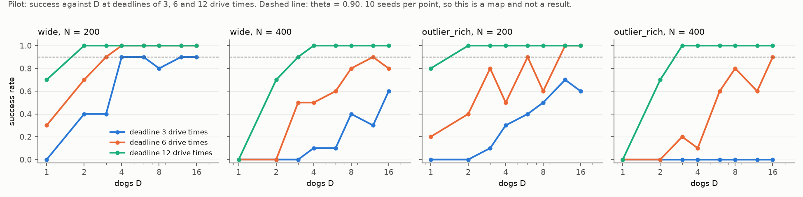

*Hình S10: Khảo sát sơ bộ (10 hạt giống mỗi ô): tỷ lệ thành công theo D đối với bố cục wide và outlier_rich tại N = 200 và 400, ghi nhận ở ba mốc thời hạn 3, 6 và 12 drive times. Thử nghiệm sơ bộ được sử dụng để lựa chọn các mốc thời hạn và lưới quy mô đội chó.*

Tỷ lệ thành công trên bố cục `wide` trong đợt chạy thử nghiệm sơ bộ (10 hạt giống mỗi ô, không tường biên):

| $N$ | Thời hạn | $D = 1$ | 2 | 3 | 4 | 6 | 8 | 12 | 16 |
|---|---|---|---|---|---|---|---|---|---|
| 200 | $3\times$ | 0,0 | 0,4 | 0,4 | 0,9 | 0,9 | 0,8 | 0,9 | 0,9 |
| 200 | $6\times$ | 0,3 | 0,7 | 0,9 | 1,0 | 1,0 | 1,0 | 1,0 | 1,0 |
| 200 | $12\times$ | 0,7 | 1,0 | 1,0 | 1,0 | 1,0 | 1,0 | 1,0 | 1,0 |
| 400 | $3\times$ | 0,0 | 0,0 | 0,0 | 0,1 | 0,1 | 0,4 | 0,3 | 0,6 |
| 400 | $6\times$ | 0,0 | 0,0 | 0,5 | 0,5 | 0,6 | 0,8 | 0,9 | 0,8 |
| 400 | $12\times$ | 0,0 | 0,7 | 0,9 | 1,0 | 1,0 | 1,0 | 1,0 | 1,0 |

---

## Phụ lục C. So sánh hai mức tốc độ của chó (Appendix C. The Two Dog Speeds)

Các lượt thử nghiệm với $D \ge 6$ trên lưới độ nhạy tại thời hạn $6\times$ drive times. Bán kính bầy cân bằng giữa hai lượt chạy chênh lệch dưới 1%, do đó kích thước mục tiêu và thời hạn là hoàn toàn tương đồng.

| Bố cục, quy mô $N$ | Chó 1.5: Strict | Đạt mốc 99% | Trung vị giây đến 99% | Chó 1.15: Strict | Đạt mốc 99% | Trung vị giây đến 99% |
|---|---|---|---|---|---|---|
| wide 100 | 1,00 | 1,00 | 205 | 1,00 | 1,00 | 207 |
| wide 200 | 0,94 | 1,00 | 268 | 1,00 | 1,00 | 277 |
| wide 400 | 0,85 | 1,00 | 427 | 1,00 | 1,00 | 442 |
| outlier_rich 100 | 0,99 | 1,00 | 210 | 1,00 | 1,00 | 213 |
| outlier_rich 200 | 0,83 | 0,99 | 276 | 1,00 | 1,00 | 283 |
| outlier_rich 400 | 0,68 | 0,99 | 460 | 1,00 | 1,00 | 448 |

Tại bố cục `wide`, $N = 400$ với 12 chó, lượt thành công nghiêm ngặt cần trung vị 876 s đối với chó tốc độ 1.5 nhưng chỉ cần 444 s đối với chó tốc độ 1.15, và quãng đường đi trung vị của mỗi chó là 1.130 đơn vị so với 511 đơn vị. Dưới tiêu chí 99%, toàn bộ các lượt thử của chó tốc độ 1.15 với $D \ge 6$ đều thành công (240/240 lượt), so với 0,97 đến 1,00 của chó tốc độ 1.5 cơ sở, và thời gian hoàn thành trung vị chênh lệch không quá 4%.
