# Quy mô đội để lùa một bầy cừu mô phỏng: Tối thiểu, đủ và quá nhiều chó

*Báo cáo nghiên cứu khoa học dự án HerdSim*  
*Đánh giá thực nghiệm qua 23 giao thức chiến dịch (164.740 lượt chạy mô phỏng) trên các kiến trúc chăn dắt đa tác tử, tiếp theo là 14 giao thức tiếp nối và ba lượt chạy tiếp (162.130 lượt): tổng cộng 37 giao thức và 326.870 lượt chạy, không có lỗi.*  
*(Lưu ý: Các phương trình động lực học vi mô và thuật toán điều phối được trình bày tại [docs/methods/models_vi.md](../methods/models_vi.md). Hình học nhiệm vụ, tính bất biến quy mô và cơ chế lấy mẫu thích ứng được trình bày tại [docs/experiments/task_design_vi.md](../experiments/task_design_vi.md). Báo cáo này tập trung chuyên sâu vào các quy luật mở rộng thực nghiệm, câu trả lời thống kê cho các câu hỏi nghiên cứu, phân tích vi mô cơ chế thất bại và các hàm ý khoa học.)*

---

## Tóm tắt (Abstract)

Cần bao nhiêu tác tử chăn dắt tự hành ($D$) để gom một bầy $N$ con cừu và lùa bầy vào vùng đích một cách tin cậy trước thời hạn: tối thiểu là bao nhiêu ($D_{\min}$), bao nhiêu thì đủ ($D_{\mathrm{sat}}$), và từ khi nào thêm chó lại làm hỏng việc? Chúng tôi khảo sát bài toán này thông qua môi trường mô phỏng trên 37 giao thức chiến dịch với tổng cộng 326.870 lượt chạy mà không phát sinh bất kỳ lỗi mô phỏng nào. Chúng tôi định nghĩa $D_{\min}$ là quy mô đội nhỏ nhất đạt độ tin cậy (tỷ lệ thành công được chứng minh $\ge 0{,}90$ dưới khoảng tin cậy nhị thức Clopper–Pearson hai phía ở mức ý nghĩa 99%). Sử dụng thuật toán phân bổ tuần tự thích ứng giúp tập trung tài nguyên tính toán vào các ô tham số ranh giới (tối đa 200 hạt giống mỗi ô), 23 giao thức đầu tiên (164.740 lượt) lập bản đồ $D_{\min}$ qua 5 quy mô bầy đàn ($N \in [25, 400]$), 4 bố cục không gian xuất phát (`compact`, `wide`, `split`, `outlier_rich`) và 3 mức thời hạn chuẩn hóa ($12\times$, $6\times$, và $3\times$ thời gian lùa tối thiểu) dưới cả hai tiêu chí: *chặn giữ nghiêm ngặt* (100% cừu trong đích) và *tiếp cận 99%* (tối thiểu $\lceil 0{,}99 N \rceil$ cừu trong đích). Các giao thức tiếp theo chỉ dùng tiêu chí 99% và bổ sung quy mô đội mà từ đó thêm chó không còn giúp ích (*D*<sub>sat</sub>), bốn quy mô bầy mới đến $N = 566$, các quy tắc đội, giữ đàn, giãn cách chó, độ gắn kết, tầm cảm nhận, và các bầy vượt giới hạn của mô hình đến $N = 3200$.

Các kết quả thực nghiệm chỉ ra:
1. **Tính bất biến của bầy co cụm**: Với bầy xuất phát co cụm (`compact`), $D_{\min} \equiv 1$ là một hằng số bất biến tuyệt đối trên mọi quy mô ($N = 25$ đến $400$) và mọi thời hạn. Bổ sung thêm chó không giúp rút ngắn thời gian lùa đàn.
2. **Quy luật tăng trưởng dưới tuyến tính trên bầy phân tán**: Với bầy phân tán, $D_{\min} = 1$ khi $N \le 50$, và chỉ cần 2 đến 3 chó ở $N = 400$ dưới thời hạn nới lỏng ($12\times$). Trong không gian log-log ($\log_2 D_{\min}$ theo $\log_2 N$), độ dốc tăng trưởng trên năm kích thước ban đầu dao động từ 0,20 đến 0,50 ở thời hạn $12\times$, và từ 0,30 đến 0,80 ở thời hạn $6\times$ (thu hẹp trên chín kích thước, mục 8).
3. **Áp lực thời hạn là yếu tố chi phối hàng đầu**: Rút ngắn thời hạn từ $12\times$ xuống $3\times$ làm tăng vọt $D_{\min}$ trên bố cục `wide` ở $N = 400$ từ 2 lên 5–6 chó—mức gia tăng này vượt qua cả tác động của việc mở rộng quy mô đàn cừu lên gấp bốn lần.
4. **Cơ chế cá thể lạc đàn (The Straggler Mechanism)**: Trong 95% số lượt thất bại nghiêm ngặt của các đội có từ 6 chó trở lên, đàn chó thực chất đã đưa được 99% số cừu vào đích từ rất sớm. Thất bại nghiêm ngặt xảy ra do đàn chó quay sang săn đuổi 1–2 cá thể rớt lại sau cùng, vượt quá đà và vô tình lùa ngược khối cừu chủ lực ra ngoài pasture. Việc giảm vận tốc chó ($v_{\mathrm{dog}} = 1{,}15\text{ m/s}$) loại bỏ được xung lực vượt đà này, giúp đưa $D_{\min}$ nghiêm ngặt từ thất bại hoàn toàn (`none`) xuống còn 6 chó ở bố cục `outlier_rich` ($N = 400$).
5. **Tính vững chắc của tiêu chí tiếp cận 99%**: Dưới tiêu chí 99%, giá trị $D_{\min}$ duy trì sự ổn định cao (dao động trong phạm vi $\pm 1$ chó so với mốc cơ sở) trước các thay đổi về quy ước mô phỏng (xuất phát từ cọc người chăn, xuất phát vòng tròn, cự ly xuất phát, và các tham số cừu thực địa GPS). Ngược lại, tiêu chí nghiêm ngặt phóng đại quá mức các sai số do quy ước hình học gây ra.
6. **Sự bắt buộc của tầng phối hợp đội**: Mô hình đối chứng không phối hợp (FAT) thiếu thuật toán gán nhiệm vụ và lực đẩy không gian đã thất bại hoàn toàn: các chú chó dồn cục thành bản sao trùng lặp (`dog_overlap` $> 0{,}80$), không đạt được bất kỳ giá trị $D_{\min}$ tin cậy nào ở $N \ge 200$.
7. **Đủ chó, và không có tác hại theo tiêu chí 99%** (mục 3.7): vượt quá quy mô đội *D*<sub>sat</sub> mà tại đó việc lùa không còn nhanh hơn, chó thêm giữ thời gian hoàn thành ở mức 0,96 đến 1,01 lần thời gian tại *D*<sub>sat</sub>, trong khi thời gian chó tăng tỉ lệ với $D$, và thời gian mỗi con cừu chạy trốn không tăng. Theo tiêu chí 99%, không quy mô đội nào đến 24 làm nhiệm vụ thất bại trên năm kích thước ban đầu (một lần sụt trên lưới dày hơn); chó thêm chỉ làm bầy `split` chậm hơn, ở $N \ge 200$.
8. **Lưới dày hơn** (mục 3.8): trên chín kích thước bầy, $D_{\min}$ tăng với độ dốc 0,27–0,38 ở $12\times$ và 0,38–0,61 ở $6\times$, còn *D*<sub>sat</sub> tăng nhanh gấp khoảng hai lần (0,70–0,91 trên `wide`). Đến $N = 566$, một quy luật lũy thừa và một đường cong chững lại khớp dữ liệu tốt như nhau.
9. **Các phần của quy tắc đội** (mục 3.9): riêng công tắc gom/lùa của bài báo đã đưa một đội chó độc lập đến $N = 200$; tầng đội là điều làm cho $N = 400$ trở nên khả thi.
10. **Quá nhiều chó** (mục 3.10): với chó chiếm chỗ (cách nhau 2 m), `outlier_rich` $N = 400$ thất bại từ $D = 9$ (được quyết định không đạt độ tin cậy đến $D = 24$), trong khi chó dạng điểm không cho thấy tác hại được quyết định đến 24.
11. **Độ gắn kết và tầm cảm nhận** (mục 3.11, 3.12): gắn kết yếu hơn làm sự tăng dốc hơn về phía 0,5 của mục tiêu không gắn kết; tầm nhìn cục bộ tốn khoảng một con chó ở $N = 200$, và chia sẻ với cả đội mua lại được con chó đó.
12. **Một giới hạn của quy tắc lùa** (mục 3.13): trên $N \approx 1056$, điểm lùa của bài báo nằm ngoài cự ly phản ứng của cừu, và không đội nào, dù lớn đến đâu, lùa được bầy. Khi giới hạn điểm lùa trong tầm với, một bầy phân tán cần 3 chó ở $N = 800$, 5–9 ở 1131 và hơn 12 ở 1600.

---

## 1. Câu hỏi nghiên cứu và mục tiêu

Các nghiên cứu trước đây về chăn dắt đa tác tử chủ yếu khảo sát các quy mô đội cố định hoặc trên các mục tiêu không liên kết (Pierson và Schwager 2015; Kubo et al. 2022; Lama và di Bernardo 2024). Để xác lập quy luật mở rộng quy mô của đội chăn tối thiểu dưới ảnh hưởng của lực hút bầy đàn, áp lực thời hạn và sự phân tán không gian, nghiên cứu này giải quyết 7 Câu hỏi Nghiên cứu (RQs):

- **RQ1 (Quy luật mở rộng quy mô $N$)**: Quy mô đội tối thiểu $D_{\min}$ tăng trưởng thế nào theo kích thước bầy $N \in [25, 400]$ trên các bố cục không gian và thời hạn khác nhau? Lực hút bầy đàn có làm giảm độ dốc tăng trưởng so với bầy không liên kết ($\sqrt{N}$) hay không?
- **RQ2 (Bố cục hình học so với quy mô dân số $N$)**: Với cùng một thời hạn, yếu tố nào chi phối $D_{\min}$ mạnh mẽ hơn: bố cục xuất phát (co cụm hay phân tán) hay quy mô đàn cừu $N$?
- **RQ3 (Áp lực thời hạn hoàn thành)**: Áp lực thời gian ($12\times \to 6\times \to 3\times$ thời gian lùa) làm dịch chuyển $D_{\min}$ ra sao? Tác động này là tuyến tính hay phi tuyến?
- **RQ4 (Tiêu chí thành công và Hiệu ứng cá thể lạc đàn)**: Tiêu chí nghiêm ngặt 100% khác biệt thế nào so với tiêu chí 99% tiếp cận? Cơ chế vi mô nào gây ra sự sụp đổ thành công của các đội nhiều chó dưới tiêu chí nghiêm ngặt?
- **RQ5 (Tính vững chắc trước các quy ước mô phỏng)**: Các quy luật mở rộng có đứng vững trước những thay đổi về quy ước thiết lập (vị trí thả chó, cự ly xuất phát, bán kính đích, tham số thực địa, vận tốc chó) hay không?
- **RQ6 (Sự cần thiết của phối hợp đa tác tử)**: Một đàn chó hoạt động độc lập không phối hợp (FAT) có thể đạt được $D_{\min}$ hữu hạn ở đàn lớn hay không?
- **RQ7 (Vượt quá $D_{\min}$: đủ chó và quá nhiều chó)**: Từ quy mô đội *D*<sub>sat</sub> nào thì thêm một con chó không còn làm việc lùa nhanh hơn, mỗi con chó vượt quá nó tốn bao nhiêu, nó có thêm áp lực lên cừu không, và có quy mô đội nào làm nhiệm vụ tệ đi không? (Phân tích tiếp theo trên các lượt chạy 99% hiện có; không chạy chiến dịch mới.)

Các chiến dịch tiếp theo (tiêu chí 99% xuyên suốt) bổ sung sáu câu hỏi:

- **RQ8 (Lưới dày hơn và hình dạng đường cong)**: Với chín kích thước bầy đến ngưỡng của mô hình ($N = 566$), $D_{\min}$ và *D*<sub>sat</sub> tăng nhanh thế nào, và có phân biệt được tăng đều với một đường cong chững lại không?
- **RQ9 (Phần nào của quy tắc quan trọng)**: Công tắc gom/lùa và tầng đội mỗi phần đóng góp gì, và một mô hình mà thời gian hoàn thành giảm theo $D$ (Kubo) bão hòa ra sao?
- **RQ10 (Quá nhiều chó)**: Việc giữ bầy trong đích, hay chó chiếm chỗ, có làm cho chó thêm gây hại không?
- **RQ11 (Độ gắn kết)**: Sự tăng của $D_{\min}$ thay đổi thế nào theo độ mạnh của sự gắn kết giữa các con cừu?
- **RQ12 (Chó nhìn thấy gì)**: Tầm cảm nhận giới hạn tốn thêm bao nhiêu chó, và việc chia sẻ những gì các chó thấy có bù lại được không?
- **RQ13 (N lớn)**: Điều gì xảy ra trên kích thước mà bầy của mô hình còn có kích thước riêng?

---

## 2. Phương pháp luận thống kê và quy tắc quyết định

*(Chi tiết đầy đủ về vòng lặp thích ứng, khoảng tin cậy Clopper–Pearson và hệ thống hạt giống ngẫu nhiên chung CRN được trình bày tại [docs/experiments/task_design_vi.md: Động cơ Lấy mẫu Thích ứng Tuần tự](../experiments/task_design_vi.md#3-động-cơ-lấy-mẫu-thích-ứng-tuần-tự-adaptive-sequential-sampling).)*

### 2.1 Tiêu chí quyết định hình thức cho *D*<sub>min</sub>
Một **ô (cell)** được xác định bởi bộ tham số (phương pháp, bố cục, $N$, thời hạn, $D$). Mỗi lượt chạy mô phỏng là một phép thử Bernoulli độc lập cho ra kết quả thành công ($1$) hoặc thất bại ($0$). Với một mẫu gồm $n_{\mathrm{trials}}$ hạt giống được đánh giá và $k$ lần thành công quan sát được, khoảng tin cậy nhị thức Clopper–Pearson hai phía 99% $[L, U]$ cho xác suất thành công thực tế $p$ được tính toán như sau:

$$
L = B\left(\frac{\alpha}{2}, k, n_{\mathrm{trials}} - k + 1\right), \quad U = B\left(1 - \frac{\alpha}{2}, k + 1, n_{\mathrm{trials}} - k\right)
$$

trong đó:
- $n_{\mathrm{trials}} \in [10, 200]$: Tổng số lượt mô phỏng tích lũy đã chạy cho ô tham số đó.
- $k \in [0, n_{\mathrm{trials}}]$: Số lượt mô phỏng ghi nhận thành công.
- $\alpha = 0{,}01$: Mức ý nghĩa thống kê, tương ứng với độ tin cậy hai phía $1 - \alpha = 99\%$ (mỗi phía đuôi phân phối chiếm $\alpha/2 = 0{,}005$).
- $B(q, a, b)$: Hàm phân vị (hàm phân phối tích lũy nghịch đảo) của phân phối Beta với hai tham số hình dạng $a$ và $b$, tính tại xác suất tích lũy $q$.
- $L$: Cận dưới thống kê của tỷ lệ thành công thực tế với độ tin cậy 99%.
- $U$: Cận trên thống kê của tỷ lệ thành công thực tế với độ tin cậy 99%.

Với ngưỡng tin cậy mục tiêu quy định là $\theta = 0{,}90$:
- **Đạt độ tin cậy (Reliable)**: $L \ge 0{,}90$. Chúng ta có độ tin cậy toán học 99% rằng tỷ lệ thành công thực tế đạt ít nhất 90% (đòi hỏi tối thiểu 51 trận thắng liên tiếp không có trận thua nào, được làm tròn thành 60 lượt chạy với kích thước lô 10).
- **Không đạt tin cậy (Unreliable)**: $U < 0{,}90$. Chúng ta tin cậy 99% rằng ô này không thể đạt ngưỡng 90%, kích hoạt cơ chế dừng sớm để tiết kiệm thời gian (thường dừng sau 10–20 lượt).
- **Chưa quyết định (Undecided)**: $L < 0{,}90 \le U$. Khoảng tin cậy vẫn đang bao trùm ngưỡng 90%, ô sẽ tiếp tục nhận các lô 10 hạt giống tiếp theo cho đến trần tối đa 200 hạt giống.

Trên một đường cong kiểm thử theo số lượng chó $D \in \mathcal{D}$:

$$
D_{\min} = \min \{ D \in \mathcal{D} \mid \mathrm{Cell}(D) \text{ is Reliable} \}
$$

$$
D_{\min,\mathrm{low}} = \min \{ D \in \mathcal{D} \mid U(D) \ge \theta \}
$$

- **Giá trị quyết định**: Khi $D_{\min,\mathrm{low}} = D_{\min}$, mọi $D < D_{\min}$ đều chắc chắn không đạt tin cậy ($U < 0{,}90$).
- **Khoảng chặn ($[D_{\min,\mathrm{low}}, D_{\min}]$)**: Khi $D_{\min}$ đạt tin cậy nhưng vẫn còn một số $D$ nhỏ hơn ở trạng thái chưa quyết định tại mốc 200 hạt giống (ví dụ `3-8`).
- **Cận dưới ($[n]$)**: Chưa có $D$ nào đạt tin cậy nhưng tồn tại $D \ge n$ chưa quyết định.
- **Thất bại (`none`)**: Toàn bộ các giá trị $D$ trên lưới kiểm thử (đến $D = 24$ ở các lượt chạy chính) đều chắc chắn không đạt độ tin cậy ($U < 0{,}90$).

### 2.2 Tổng quan ma trận giao thức thực nghiệm
Nghiên cứu đầu tiên bao gồm 23 giao thức (164.740 lượt chạy, 20 luồng worker, 0 lỗi):
- **Lưới chính (6 giao thức)**: Đánh giá đầy đủ 5 quy mô ($N \in [25, 400]$), 4 bố cục (`compact`, `wide`, `split`, `outlier_rich`), và 3 thời hạn ($12\times, 6\times, 3\times$ thời gian lùa) dưới cả hai tiêu chí Nghiêm ngặt 100% và Tiếp cận 99%.
- **Đối chứng không phối hợp (2 giao thức)**: `dmin_fat` và `dmin_f99_fat` ở thời hạn $6\times$.
- **Mô hình lực liên tục Kubo (1 giao thức)**: `dmin_kubo` trên bầy co cụm ($N \in [25, 100]$).
- **Bộ kiểm tra độ nhạy (14 giao thức)**: Đánh giá ở thời hạn $6\times$ qua 7 biến thể (cọc handler, vòng tròn ring, khoảng cách khởi đầu 15/30/60, bán kính đích $1{,}5 R_f$, tham số thực địa GPS, và tốc độ chó 1,15) dưới cả hai tiêu chí.

Phần tiếp theo bổ sung 14 giao thức và chạy tiếp ba lưới 99% (162.130 lượt, 0 lỗi, chỉ tiêu chí 99%), được liệt kê cùng RQ8–RQ13 và trong phụ lục.

---

## 3. Kết quả thực nghiệm và Câu trả lời trực tiếp cho các Câu hỏi nghiên cứu

### 3.1 RQ1: Quy mô đội tối thiểu *D*<sub>min</sub> mở rộng thế nào theo số lượng cừu *N*?

**Câu trả lời trực tiếp cho RQ1**:
- **Bầy tập trung (`compact`)**: $D_{\min} \equiv 1$ là một hằng số bất biến tuyệt đối trên mọi quy mô bầy ($N = 25$ đến $400$) và mọi mức thời hạn. Bố trí thêm chó không hề làm giảm thời gian lùa đàn (trung vị thời gian hoàn thành luôn duy trì trong khoảng 1,44–1,74 lần thời gian lùa lý thuyết cho mọi $D \in [1, 24]$).
- **Bầy phân tán (`wide`, `split`, `outlier_rich`)**: $D_{\min}$ mở rộng **dưới tuyến tính (sub-linear)** theo $N$. Ở thời hạn thong thả ($12\times$), $D_{\min} = 1$ cho bầy $N \le 50$, và chỉ cần 2 hoặc 3 chó cho đàn lớn $N = 400$.
- **Hệ số góc trong không gian log-log**: Trong không gian log-log ($\log_2 D_{\min}$ so với $\log_2 N$), độ dốc dao động từ **0,20 đến 0,50** ở thời hạn $12\times$, và từ **0,30 đến 0,80** ở thời hạn $6\times$. Bầy cừu có tính gắn kết xã hội đòi hỏi số lượng tác tử tăng chậm hơn đáng kể so với định luật căn bậc hai lý thuyết $\alpha = 0{,}50$ ($\sqrt{M}$) trên các mục tiêu không liên kết.

Bảng 1 thể hiện ma trận thực nghiệm đầy đủ của $D_{\min}$ (Nghiêm ngặt 100% / Tiếp cận 99%):

| Thời hạn | Bố cục | $N = 25$ | $N = 50$ | $N = 100$ | $N = 200$ | $N = 400$ |
| :---: | :--- | :---: | :---: | :---: | :---: | :---: |
| **12&times;** | `compact` | 1 / 1 | 1 / 1 | 1 / 1 | 1 / 1 | 1 / 1 |
| **12&times;** | `wide` | 1 / 1 | 1 / 1 | 1 / 1 | 2 / 1–2 | 3 / 2 |
| **12&times;** | `split` | 1 / 1 | 1 / 1 | 1 / 1 | 1–2 / 1 | 3 / 2 |
| **12&times;** | `outlier_rich` | 1 / 1 | 1 / 1 | 1–3 / 1–2 | 2 / 2 | 3 / 2 |
| **6&times;** | `compact` | 1 / 1 | 1 / 1 | 1 / 1 | 1 / 1 | 1 / 1 |
| **6&times;** | `wide` | 1 / 1 | 1 / 1 | 1 / 1 | 3 / 2 | [9] / 2–3 |
| **6&times;** | `split` | 1 / 1 | 1 / 1 | 1 / 1 | none / [1] | none / [5] |
| **6&times;** | `outlier_rich` | 1 / 1 | 1 / 1 | 3 / 2 | [12] / 2–3 | none / 3 |
| **3&times;** | `compact` | 1 / 1 | 1 / 1 | 1 / 1 | 1 / 1 | 1 / 1 |
| **3&times;** | `wide` | 1 / 1 | 1 / 1 | 3 / 2 | none / 3 | none / 5–6 |
| **3&times;** | `split` | 1 / 1 | 1 / 1 | 1 / 1 | none / none | none / none |
| **3&times;** | `outlier_rich` | 1 / 1 | 1 / 1 | 3–8 / 2 | none / 4–10 | none / [6] |

> 📊 **Tham chiếu dữ liệu trong `results_tables.md`**:
> Dữ liệu kết quả chi tiết từng ô và quyết định độ tin cậy được tổng hợp tại [`results_tables.md#d_min-by-layout-and-n-strict-success`](results_tables.md#d_min-by-layout-and-n-strict-success) (lượt chạy nghiêm ngặt 100%: `dmin_m12`, `dmin_m6`, `dmin_m3`) và [`results_tables.md#d_min-by-layout-and-n-success-at-99-percent`](results_tables.md#d_min-by-layout-and-n-success-at-99-percent) (lượt chạy tiếp cận 99%: `dmin_f99_m12`, `dmin_f99_m6`, `dmin_f99_m3`).


**Hình 1: Quy luật mở rộng thực nghiệm của $D_{\min}$ theo quy mô bầy $N$ qua các thời hạn và bố cục xuất phát.**
*Cách đọc biểu đồ:*
- **Các trục**: Trục hoành là quy mô bầy cừu $N \in [25, 400]$ trên thang đo logarit. Trục tung là quy mô đội nhỏ nhất $D_{\min}$ đạt ngưỡng tin cậy 90% ($\theta = 0{,}90$).
- **Bố cục & Thời hạn**: Các cột tương ứng với 4 bố cục bãi cỏ (`compact`, `split`, `wide`, `outlier_rich`). Các hàng tương ứng với 3 mức thời hạn: trên cùng ($12\times$ thong thả), giữa ($6\times$ trung bình), và dưới cùng ($3\times$ khẩn cấp).
- **Ký hiệu đường & Điểm**: Đường nét liền với vòng tròn biểu thị tiêu chí nghiêm ngặt 100%; đường nét đứt với hình vuông biểu thị tiêu chí tiếp cận 99%. Các dải bóng mờ dọc thể hiện khoảng chặn chưa ngã ngũ (ví dụ $[3, 8]$) tại mức trần 200 hạt giống. Tam giác rỗng là cận dưới ($[n]$), và dấu chéo đỏ biểu thị thất bại hoàn toàn (`none` tới $D = 24$).
- **Ý nghĩa cốt lõi**: Bầy tập trung luôn phẳng lì ở $D_{\min} = 1$ trong mọi điều kiện. Trên bầy phân tán, đường cong tăng chậm ở thời hạn thong thả, nhưng thời hạn gấp gáp ($3\times$) đẩy đường cong uốn dốc lên rất mạnh và gây thất bại hoàn toàn ở các đàn lớn dưới tiêu chí 100% do hiệu ứng cá thể lạc đàn.

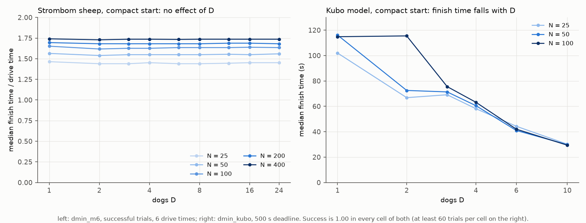

**Hình 2: Thời gian hoàn thành theo số lượng chó $D$ trên bầy xuất phát tập trung compact ($N = 100$).**
*Cách đọc biểu đồ:*
- **Các khung hình**: Khung bên trái đánh giá mô hình hành vi rời rạc Strömbom phối hợp đa chó; khung bên phải đánh giá mô hình trường thế liên tục của Kubo et al. (2022).
- **Các trục**: Trục hoành là số chó tham gia $D$; trục tung là thời gian hoàn thành nhiệm vụ tính bằng giây.
- **Ý nghĩa cốt lõi**: Trong mô hình Strömbom, thời gian hoàn thành không hề đổi theo số chó vì cừu di chuyển ở tốc độ tự nhiên ổn định ($1{,}0\text{ m/s}$); thêm chó phía sau không thể đẩy bầy chạy nhanh hơn. Trong mô hình Kubo, các trường lực thế cộng dồn nén bầy chặt hơn và dẫn đường nhanh hơn, rút ngắn thời gian từ $\approx 115\text{ s}$ với 1 chó xuống $29\text{ s}$ với 10 chó (bão hòa quanh mốc $D = 10$).

> 📊 **Tham chiếu dữ liệu trong `results_tables.md`**:
> Thời gian hoàn thành theo số chó của mô hình trường lực Kubo được lập bảng tại [`results_tables.md#kubo-compact-strict`](results_tables.md#kubo-compact-strict) (`dmin_kubo`).

Bảng 2 trình bày các hệ số góc tăng trưởng log-log thực nghiệm:

| Tiêu chí | Thời hạn | Độ dốc `wide` | Độ dốc `split` | Độ dốc `outlier_rich` |
| :--- | :---: | :---: | :---: | :---: |
| **Nghiêm ngặt 100%** | $12\times$ | 0,42 | 0,32 đến 0,42 | 0,42 |
| **Nghiêm ngặt 100%** | $6\times$ | 0,48 ($N \le 200$) | Đi ngang ($N \le 100$) | 0,79 ($N \le 100$) |
| **Nghiêm ngặt 100%** | $3\times$ | 0,79 ($N \le 100$) | Đi ngang ($N \le 100$) | 0,79 đến 1,50 ($N \le 100$) |
| **Tiếp cận 99%** | $12\times$ | 0,20 đến 0,30 | 0,20 | 0,30 |
| **Tiếp cận 99%** | $6\times$ | 0,30 đến 0,42 | Đi ngang ($N \le 100$) | 0,42 đến 0,48 |
| **Tiếp cận 99%** | $3\times$ | 0,62 đến 0,68 | Đi ngang ($N \le 100$) | 0,70 đến 1,10 ($N \le 200$) |

> 📊 **Tham chiếu dữ liệu trong `results_tables.md`**:
> Hệ số góc hồi quy log-log và số liệu phân tích số lần gấp đôi được tổng hợp tại [`results_tables.md#growth-with-n-strict`](results_tables.md#growth-with-n-strict) và [`results_tables.md#growth-with-n-99-percent`](results_tables.md#growth-with-n-99-percent).

**Cơ sở vật lý và ý nghĩa của Bảng 2:**
1. **Khái niệm Hệ số góc Log-Log ($\alpha$)**:
   Trong tọa độ log-log ($\log_2 D_{\min}$ theo $\log_2 N$), quan hệ tỷ lệ tuân theo hàm lũy thừa: $D_{\min} \propto N^\alpha$, trong đó độ dốc $\alpha = \frac{\Delta \log_2 D_{\min}}{\Delta \log_2 N}$ trực tiếp đo lường **tính kinh tế theo quy mô (economies of scale)**:
   - **$\alpha = 1{,}0$ (Tăng trưởng tuyến tính)**: Gấp đôi số cừu bắt buộc phải gấp đôi số chó (tỷ lệ cố định cừu/chó, không có hiệu quả quy mô).
   - **$\alpha < 1{,}0$ (Tăng trưởng dưới tuyến tính)**: Đàn cừu càng lớn thì số lượng chó bổ sung trên mỗi con cừu càng giảm đi. Ví dụ, tại $\alpha \approx 0{,}33$, quy mô bầy tăng gấp 8 lần ($2^3$) chỉ đòi hỏi tăng gấp 2 lần số chó ($2^1 = 2$).
   - **$\alpha = 0$ (Đi ngang)**: Nhu cầu chó không hề tăng theo $N$. Trên bố cục `split` ở $N \le 100$, 1 chú chó duy nhất ($D_{\min} = 1$) gom thành công cả 3 cụm con trong thời hạn.
2. **Lợi thế của Lực gắn kết sinh học**:
   Trong bài toán thu gom các mục tiêu độc lập bằng robot (ví dụ: robot dọn rác trên mặt phẳng), cận dưới lý thuyết là $\alpha = 0{,}50$ ($D \propto \sqrt{M}$). Ngược lại, đối với bầy cừu gắn kết ở thời hạn thong thả ($12\times$), độ dốc thực nghiệm giảm mạnh xuống **0,20 đến 0,42** (và **0,20 đến 0,30** dưới tiêu chí 99%). Điều này chứng minh lực hút xã hội tự nhiên đã làm giúp một nửa khối lượng công việc: khi quy mô bầy tăng lên, cừu tự động hút nhau về trung tâm, giảm bớt nhu cầu bổ sung thêm chó.
3. **Vì sao Áp lực thời gian làm tăng độ dốc**:
   Rút ngắn thời hạn từ $12\times$ xuống $3\times$ đẩy độ dốc vọt lên **0,62 đến 1,50**. Khi thời gian cạn kiệt, cừu không còn thời gian tự tụ về bầy, và một chú chó đơn độc không thể đi gom tuần tự từng con. Đội chó bắt buộc phải can thiệp song song cùng lúc, lấn át cơ chế tự gắn kết tự nhiên và đẩy hệ số góc tiến về (hoặc vượt qua) mức tuyến tính.

---

### 3.2 RQ2: Sự phân tán không gian so với Quy mô bầy: Yếu tố nào chi phối mạnh hơn?

**Đo lường độ phân tán thông qua "Số lần tăng đôi" (Doublings) trong Bảng 3**:
Vì quy mô bầy là biến số liên tục ($N \in [25, 400]$) trong khi các bố cục là các hình thái rời rạc (`compact`, `wide`, `split`, `outlier_rich`), chúng tôi so sánh mức độ tác động của chúng trên cùng một thước đo: số lần tăng gấp đôi ($\log_2$ span của $D_{\min}$):

$$
\text{Độ phân tán (doublings)} = \log_2 \left( \frac{D_{\min,\max}}{D_{\min,\min}} \right)
$$

Bảng 3 so sánh mức độ phân tán định lượng:

| Tiêu chí | Thời hạn | Biến thiên qua các Bố cục (Cố định $N$) | Biến thiên qua $N$ (Cố định Bố cục) | Yếu tố chi phối |
| :--- | :---: | :---: | :---: | :--- |
| **Nghiêm ngặt** | $12\times$ | 0,68 doublings | 1,19 doublings | Quy mô bầy $N$ |
| **Nghiêm ngặt** | $6\times$ | 1,67 doublings | 1,69 doublings | Ngang nhau / Quy mô $N$ |
| **Nghiêm ngặt** | $3\times$ | 0,76 doublings | 0,97 doublings | Quy mô bầy $N$ |
| **99%** | $12\times$ | 0,50 doublings | 0,75 doublings | Quy mô bầy $N$ |
| **99%** | $6\times$ | 0,92 doublings | 1,30 doublings | Quy mô bầy $N$ |
| **99%** | $3\times$ | 1,25 doublings | 1,28 doublings | Ngang nhau / Quy mô $N$ |

> 📊 **Tham chiếu dữ liệu trong `results_tables.md`**:
> Độ biến thiên doublings giữa các bố cục và quy mô bầy được tính từ số liệu tại [`results_tables.md#growth-with-n-strict`](results_tables.md#growth-with-n-strict) và [`results_tables.md#growth-with-n-99-percent`](results_tables.md#growth-with-n-99-percent).

**Kết luận cốt lõi từ Bảng 3**:
1. **Quy mô bầy $N$ là yếu tố chi phối hàng đầu**: Trong hầu hết điều kiện, sự biến thiên do tăng số lượng cừu luôn vượt qua sự biến thiên do thay đổi bố cục (trung bình 0,75 đến 1,69 lần tăng đôi so với 0,50 đến 1,67 lần tăng đôi).
2. **Tác động của bố cục chỉ mang tính nhị phân**: Gần như toàn bộ sự khác biệt giữa các bố cục bắt nguồn từ một bước chuyển duy nhất: chuyển từ **bầy đã co cụm sẵn (`compact`)** sang **đồng cỏ phân tán**. Khi cừu đã tản mác, việc chúng phân bố đều (`wide`) hay có cá thể lạc xa (`outlier_rich`) không làm thay đổi nhu cầu số chó quá 1 con.

---

### 3.3 RQ3: Áp lực thời hạn làm dịch chuyển *D*<sub>min</sub> như thế nào?

**Câu trả lời trực tiếp cho RQ3**:
- Áp lực thời gian là một hệ số nhân cực mạnh. Rút ngắn thời hạn đẩy toàn bộ ranh giới tin cậy dịch chuyển sang bên phải.
- Tác động này mang tính **phi tuyến**: nới lỏng từ $6\times$ lên $12\times$ chỉ giúp tiết kiệm tối đa 1 chó, nhưng rút ngắn từ $6\times$ xuống $3\times$ làm bùng nổ nhu cầu chó (trên `wide` $N = 400$ dưới tiêu chí 99%, $D_{\min}$ nhảy từ 2–3 lên 5–6 chó; trên `split` $N \ge 200$, thời hạn gấp gáp gây thất bại hoàn toàn trên mọi số lượng chó).
- **Cơ chế vật lý**: Chó và cừu có tốc độ di chuyển hữu hạn ($v_{\mathrm{sheep}} = 1{,}0$, $v_{\mathrm{dog}} = 1{,}5\text{ m/s}$). Ở $12\times$, một chú chó có thừa thời gian gom cừu lạc tuần tự từng con. Ở $3\times$, gom tuần tự là điều bất khả thi về mặt vật lý; đàn chó bắt buộc phải tỏa ra gom đồng thời cùng lúc.

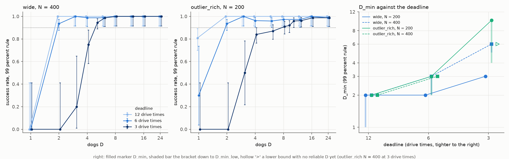

**Hình 3: Tác động của áp lực thời hạn lên đường cong thành công và quy mô đội chăn dắt.**
*Cách đọc biểu đồ:*
- **Khung trái & giữa**: Vẽ đường cong tỷ lệ thành công theo số chó $D$ dưới 3 mức thời hạn ($12\times$ xanh lá, $6\times$ cam, $3\times$ tím). Đường nét đứt ngang đánh dấu ngưỡng tin cậy 90% ($\theta = 0{,}90$).
- **Khung phải**: Vẽ trực tiếp giá trị $D_{\min}$ theo hệ số nhân thời hạn $m$ ($3\times, 6\times, 12\times$).
- **Ý nghĩa cốt lõi**: Đường cong dịch chuyển phi tuyến sang phải khi thời hạn bị siết chặt. Việc nới lỏng quá $6\times$ đem lại lợi ích giảm dần, trong khi siết chặt từ $6\times$ xuống $3\times$ làm tăng vọt số chó cần thiết do đòi hỏi bắt buộc phải làm việc nhóm song song.

> 📊 **Tham chiếu dữ liệu trong `results_tables.md`**:
> Bảng so sánh đầy đủ qua các mức thời hạn $12\times$, $6\times$, và $3\times$ được trình bày tại [`results_tables.md#d_min-by-layout-and-n-strict-success`](results_tables.md#d_min-by-layout-and-n-strict-success) (`dmin_m12`, `dmin_m6`, `dmin_m3`) và [`results_tables.md#d_min-by-layout-and-n-success-at-99-percent`](results_tables.md#d_min-by-layout-and-n-success-at-99-percent) (`dmin_f99_m12`, `dmin_f99_m6`, `dmin_f99_m3`).

---

### 3.4 RQ4: Tiêu chí thành công và "Hiệu ứng cá thể lạc đàn" (Straggler Effect)

**Câu trả lời trực tiếp cho RQ4**:
- Tiêu chí 99% cừu vào đích đòi hỏi số chó bằng hoặc ít hơn tiêu chí tuyệt đối 100% trên toàn bộ 34 ô thử nghiệm bầy phân tán, giúp giảm từ 1 đến 6 chó tại $N \ge 100$.
- Sáu ô tham số bầy lớn thất bại hoàn toàn dưới tiêu chí tuyệt đối đã được giải cứu thành công dưới tiêu chí 99%.
- **Cơ chế vi mô của Hiệu ứng cá thể lạc đàn**: Trong 95% số lượt thất bại nghiêm ngặt của các đội có từ 6 chó trở lên, bầy cừu thực chất đã đưa được 99% số thành viên vào trong vòng tròn đích từ rất sớm. Thất bại xảy ra do đàn chó phá vỡ đội hình lùa để lao theo 1–2 con cừu lạc ngoài cửa chuồng. Khi làm vậy, đàn chó vô tình chắn giữa bầy cừu và cửa đích, lao vụt qua cửa chuồng mở làm cả đàn đang nghỉ bên trong hoảng loạn chạy tán loạn ngược ra đồng cỏ trống.
- Cho chó chạy chậm hơn, điềm tĩnh hơn ($v_{\mathrm{dog}} = 1{,}15\text{ m/s}$) giúp triệt tiêu đà vượt qua cửa chuồng, đưa tỷ lệ thành công nghiêm ngặt trên `outlier_rich` $N = 400$ từ thất bại hoàn toàn (`none`) lên $D_{\min} = 6$.

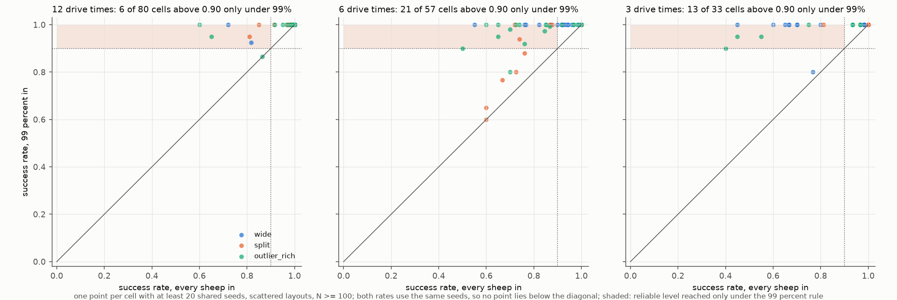

**Hình 4: So sánh từng ô tham số giữa tiêu chí nghiêm ngặt 100% và tiêu chí tiếp cận 99% trên cùng các hạt giống ngẫu nhiên.**
*Cách đọc biểu đồ:*
- **Các trục & Đường chéo**: Trục hoành là tỷ lệ thành công theo tiêu chí nghiêm ngặt; trục tung là tỷ lệ thành công theo tiêu chí 99%. Đường chéo là đường đồng nhất ($y = x$).
- **Vùng bóng mờ**: Các điểm nằm trong vùng bóng mờ phía trên bên trái đạt độ tin cậy $\ge 90\%$ dưới tiêu chí 99% nhưng lại trượt dưới tiêu chí tuyệt đối.
- **Ý nghĩa cốt lõi**: Tiêu chí 99% giải cứu hàng loạt ô tham số bị đánh rớt oan uổng do nhiễu ranh giới ở cửa chuồng mở, đặc biệt trên các đàn lớn ($N \ge 200$).

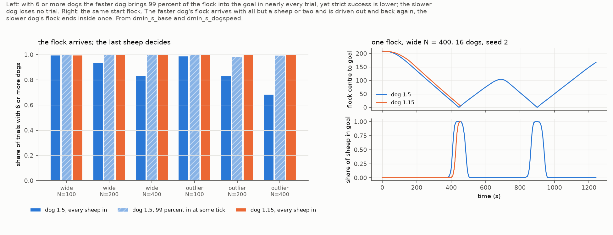

**Hình 5: Phân tích vi mô Hiệu ứng cá thể lạc đàn.**
*Cách đọc biểu đồ:*
- **Khung trái**: Đánh giá các lượt chạy với từ 6 chó trở lên ($D \ge 6$). Các cột so sánh tỷ lệ đạt 99% cừu vào đích với tỷ lệ đạt 100% tuyệt đối. Chó chạy chậm ($v = 1{,}15\text{ m/s}$) xóa bỏ hoàn toàn khoảng cách chênh lệch này.
- **Khung phải**: Quỹ đạo khoảng cách của trọng tâm bầy cừu tới đích theo thời gian trên cùng một bầy xuất phát. Chó chạy nhanh ($1{,}50\text{ m/s}$, đường đỏ) lùa bầy vào, đuổi theo một con lạc, chạy lố cửa chuồng và làm cả đàn bung ra ngoài. Chó chạy chậm ($1{,}15\text{ m/s}$, đường xanh) lùa bầy vào gọn gàng trong một lượt duy nhất.
- **Ý nghĩa cốt lõi**: Hiện tượng sụp đổ của các đội nhiều chó dưới tiêu chí nghiêm ngặt bắt nguồn từ quán tính chạy lố qua cửa chuồng mở của chó, chứ không phải do thiếu năng lực gom bầy.

> 📊 **Tham chiếu dữ liệu trong `results_tables.md`**:
> So sánh trên cùng hạt giống ngẫu nhiên giữa tiêu chí nghiêm ngặt và tiêu chí 99% được tổng hợp tại [`results_tables.md#strict-run-read-at-99-percent-arrival-for-comparison-with-the-99-percent-runs`](results_tables.md#strict-run-read-at-99-percent-arrival-for-comparison-with-the-99-percent-runs) (`dmin_m6`).

---

### 3.5 RQ5: Những quy luật mở rộng nào đứng vững trước các biến thể kiểm tra độ nhạy?

**Câu trả lời trực tiếp cho RQ5**:
- **Dưới tiêu chí tiếp cận 99%**: Các quy luật mở rộng có tính bền vững đặc biệt cao. Trước các thay đổi về cách thả chó (`handler`, `ring`, `arcs`), cự ly xuất phát (15, 30, 60 m), tốc độ chó (1,15 so với 1,50), và bộ tham số cừu thực địa thu từ vòng đeo GPS, giá trị $D_{\min}$ chỉ dao động trong phạm vi **$\pm 1$ chó** so với mốc cơ sở.
- **Dưới tiêu chí nghiêm ngặt 100%**: Giá trị biến động mạnh gấp 3 lần hoặc hơn, do những thay đổi nhỏ về hình học làm xáo trộn đường đi nhạy cảm của con cừu lạc cuối cùng.
- **Hình học chuồng đích**: Việc thu hẹp bán kính chuồng đích ($1{,}5 R_f$) là biến thể duy nhất làm tăng mạnh $D_{\min}$ dưới cả hai tiêu chí (đẩy `wide` $N = 400$ từ 2–3 lên 5–6 chó).

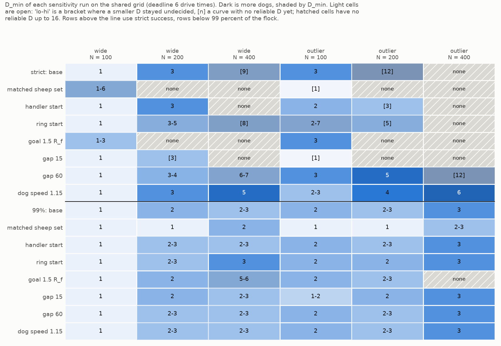

**Hình 6: Bản đồ nhiệt kiểm tra độ nhạy qua các biến thể thực nghiệm ở thời hạn $6\times$.**
*Cách đọc biểu đồ:*
- **Đường phân cách ngang**: Tách biệt tiêu chí nghiêm ngặt 100% (nửa trên) và tiêu chí tiếp cận 99% (nửa dưới).
- **Các hàng & Cột**: Các hàng thử nghiệm các biến thể thả chó (`handler`, `ring`), cự ly (`gap 15`, `gap 60`), chuồng nhỏ (`goal 1.5 R_f`), chó điềm tĩnh (`dog speed 1.15`), và tham số thực địa GPS (`matched sheep set`). Các cột tương ứng với các tổ hợp bố cục (`wide`, `outlier_rich`) và quy mô bầy ($N \in \{100, 200, 400\}$).
- **Màu sắc & Ô gạch chéo**: Màu càng đậm thể hiện $D_{\min}$ càng cao. Các ô gạch chéo ghi "none" thể hiện không có số chó nào đạt tin cậy.
- **Ý nghĩa cốt lõi**: Tiêu chí nghiêm ngặt (nửa trên) cực kỳ bất ổn và tràn ngập thất bại trên bầy lớn. Ngược lại, tiêu chí 99% (nửa dưới) duy trì sự nhất quán vững chắc: $D_{\min}$ chỉ lệch tối đa 1 chó so với chuẩn. Chỉ có việc thu hẹp chuồng đích mới thực sự làm tăng đòi hỏi số lượng chó.

> 📊 **Tham chiếu dữ liệu trong `results_tables.md`**:
> So sánh mốc cơ sở với 7 biến thể độ nhạy được lập bảng tại [`results_tables.md#sensitivity-strict-base--variant`](results_tables.md#sensitivity-strict-base--variant) và [`results_tables.md#sensitivity-99-percent-base--variant`](results_tables.md#sensitivity-99-percent-base--variant).

---

### 3.6 RQ6: Đội chó không phối hợp (FAT) có đạt được quy mô *D*<sub>min</sub> hữu hạn không?

**Câu trả lời trực tiếp cho RQ6**:
- Hoàn toàn không. Một thuật toán tham lam thiếu cơ chế phân chia nhiệm vụ và tránh va chạm sẽ thất bại toàn diện trên các đàn cừu lớn.
- Mặc dù FAT thành công trên đàn nhỏ ($N \le 100$), nó ghi nhận **0 ô đạt độ tin cậy** khi bầy cừu tăng lên $N \ge 200$ trên các bố cục phân tán, và thất bại ngay cả trên bầy tập trung $N = 400$ nơi thuật toán phối hợp `strombom_multi` chỉ cần đúng 1 chú chó.
- **Nguyên nhân vật lý**: Vì tất cả các chú chó đều có cùng góc nhìn toàn cục, chúng cùng nhắm vào đúng một con cừu xa nhất. Do không có lực đẩy né tránh nhau, các chú chó đâm sầm vào nhau và di chuyển như những bản sao trùng lặp (độ trùng lặp quỹ đạo $> 80\%$). Bổ sung thêm chó trong FAT không mang lại bất kỳ lợi ích làm việc song song nào.

Bảng 5 so sánh $D_{\min}$ giữa FAT và `strombom_multi` ở thời hạn $6\times$:

| Bố cục | $N = 25$ | $N = 50$ | $N = 100$ | $N = 200$ | $N = 400$ |
| :--- | :---: | :---: | :---: | :---: | :---: |
| `compact` | 1 / 1 (1 / 1) | 1 / 1 (1 / 1) | 1 / 1 (1 / 1) | 1 / 1 (1 / 1) | none / [12] (1 / 1) |
| `wide` | 1 / 1 (1 / 1) | 1 / 1 (1 / 1) | 1 / 1 (1 / 1) | none / none (3 / 2) | none / none ([9] / 2–3) |
| `split` | 1 / 1 (1 / 1) | 1 / 1 (1 / 1) | 1 / 1 (1 / 1) | none / none (none / [1]) | none / none (none / [5]) |
| `outlier_rich` | 1 / 1 (1 / 1) | 1 / 1 (1 / 1) | 2 / 2 (3 / 2) | none / none ([12] / 2–3) | none / none (none / 3) |

> 📊 **Tham chiếu dữ liệu trong `results_tables.md`**:
> Dữ liệu mô hình đối chứng FAT trên các kích thước bầy và bố cục được lập bảng tại [`results_tables.md#fat-dog-rule-deadline-6-strict-then-99-percent`](results_tables.md#fat-dog-rule-deadline-6-strict-then-99-percent) (`dmin_fat` và `dmin_f99_fat`), cùng phân tích độ dốc tại [`results_tables.md#growth-with-n-fat`](results_tables.md#growth-with-n-fat).

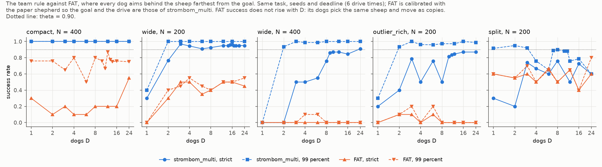

**Hình 7: Tỷ lệ thành công theo số lượng chó $D$ của thuật toán phối hợp `strombom_multi` (xanh dương) so với đối chứng không phối hợp FAT (cam) ở thời hạn $6\times$.**
*Cách đọc biểu đồ:*
- **Các trục**: Trục hoành là số chó tham gia $D$; trục tung là tỷ lệ thành công. Đường nét đứt ngang đánh dấu ngưỡng tin cậy 90%.
- **Ý nghĩa cốt lõi**: Đường cong của FAT hoàn toàn nằm bẹp ở mức 0%: tăng thêm chó không mang lại bất kỳ sự cải thiện nào vì toàn bộ đàn chó chỉ đuổi theo cùng một con cừu và va chạm vào nhau. Ngược lại, thuật toán phối hợp có đường cong cải thiện dạng chữ S dốc đứng rõ rệt.

---

### 3.7 RQ7: Vượt quá *D*<sub>min</sub>: Bao nhiêu chó là đủ (*D*<sub>sat</sub>), Chi phí vận hành, và Áp lực lên bầy cừu

Sau khi đã tìm ra đội hình nhỏ nhất đạt độ tin cậy $D_{\min}$, một câu hỏi thực tế tối quan trọng được đặt ra cho các nhà quản lý nông trại và kỹ sư điều khiển robot:
*Nếu chúng ta đưa thêm chó vào làm việc vượt quá mức tối thiểu $D_{\min}$, liệu đàn cừu có được lùa về nhanh hơn không? Chi phí vận hành tăng nhanh thế nào, đàn cừu có bị hoảng loạn quá mức không, và sự đông đúc có làm tắc nghẽn gây sụp đổ nhiệm vụ không?*

Để trả lời, chúng tôi phân tích lại toàn bộ tập dữ liệu tiêu chí 99% trên 11 thư mục giao thức, đồng thời chạy replay chẩn đoán chi tiết trên 164 lượt mô phỏng đại diện để đo lường áp lực chạy trốn của từng cá thể cừu qua từng tích tắc.

#### 1. Ngưỡng bão hòa tốc độ (*D*<sub>sat</sub>)
- **Định nghĩa**: *D*<sub>sat</sub> là quy mô đội tin cậy nhỏ nhất mà từ đó trở đi, việc bổ sung thêm chó không mang lại sự rút ngắn thời gian hoàn thành có ý nghĩa thống kê (tốc độ đi ngang).
- **Phát hiện thực nghiệm**:
  - *Trên bầy tập trung và bầy nhỏ ($N \le 50$)*: *D*<sub>sat</sub> = 1 ngay từ đầu. Một chú chó duy nhất đã lùa bầy cừu di chuyển ở vận tốc đi bộ tối đa ($1{,}0\text{ m/s}$); thêm chó không thể ép cừu đi nhanh hơn.
  - *Trên bầy phân tán ở thời hạn trung bình ($6\times$)*: *D*<sub>sat</sub> dao động từ 2 đến 7 chó ở $N = 100$–400 (ví dụ `outlier_rich` $N = 100$ bão hòa tại *D*<sub>sat</sub> = 3; `wide` $N = 400$ tại *D*<sub>sat</sub> = 5).

#### 2. Hiệu suất giảm dần và Chi phí vận hành (*D* > *D*<sub>sat</sub>)
- **Chó vượt quá bão hòa chỉ mang lại lợi ích tốc độ không đáng kể nhưng làm đội chi phí lên gấp bội**:
  - Trên toàn bộ 189 ô đạt tin cậy nằm trên ngưỡng *D*<sub>sat</sub> ở thời hạn $6\times$, thời gian hoàn thành luôn duy trì trong khoảng **0,96 đến 1,01 lần** thời gian tại mốc *D*<sub>sat</sub> (chỉ nhanh hơn tối đa 4%, đôi khi còn chậm đi 1%).
  - Trong khi đó, **tổng khối lượng công việc của đàn chó** ($\mathrm{dog\_time} = D \times T$) và tổng quãng đường chạy tăng tuyến tính theo đúng tỷ lệ $D / D_{\mathrm{sat}}$.
  - *Ví dụ thực tế*: Trên bầy cừu tập trung, việc thả 24 chú chó tiêu tốn năng lượng pin gấp 24 lần so với 1 chú chó, nhưng thời gian đưa đàn về đích là y hệt nhau (~140 giây).

Bảng 6 tóm tắt chi phí vận hành tại mốc gấp đôi bão hòa (2 *D*<sub>sat</sub>) và tại mốc tối đa ($D = 24$) so với mốc chuẩn *D*<sub>sat</sub>:

| Bố cục, Quy mô bầy $N$ | Ngưỡng *D*<sub>sat</sub> | Tại 2 *D*<sub>sat</sub>: Thời gian / Công sức chó | Tại $D = 24$: Thời gian / Công sức chó |
| :--- | :---: | :---: | :---: |
| `wide`, $N = 200$ | 3 | 0,97 / 1,94 | 0,96 / 7,70 |
| `wide`, $N = 400$ | 5 | 0,97 / 2,32 (tại $D = 12$) | 0,96 / 4,61 |
| `outlier_rich`, $N = 100$ | 3 | 0,99 / 1,98 | 0,98 / 7,85 |
| `outlier_rich`, $N = 400$ | 6–24 | 0,96 / 1,91 | 0,94 / 3,74 |
| `split`, $N = 100$ | 4 | 0,99 / 1,98 | 0,99 / 5,91 |

*Ý nghĩa của Bảng 6*: Tại $D = 24$, thời gian lùa chỉ nhanh hơn từ 1% đến 6% ($0{,}94 - 0{,}99$), nhưng tổng tiêu hao pin và công sức của đàn chó tăng vọt từ **3,7 đến 7,9 lần** ($3{,}74 - 7{,}85$).

> 📊 **Tham chiếu dữ liệu trong `results_tables.md`**:
> Ngưỡng bão hòa ($D_{\mathrm{sat}}$), thời gian hoàn thành và nỗ lực làm việc của đàn chó được tổng hợp tại [`results_tables.md#d_sat-effort-zones-and-methods-99-percent`](results_tables.md#d_sat-effort-zones-and-methods-99-percent).

#### 3. Tâm lý hoảng loạn và Phúc lợi bầy cừu
Một mối lo ngại lớn trong robot nông nghiệp là liệu một đàn chó đông đúc có gây stress hoặc làm đàn cừu kiệt sức không. Dữ liệu đo đạc từng giây cho thấy điều ngược lại:
- **Tổng thời gian chạy trốn của mỗi con cừu thực chất giảm đi**: Một con cừu chỉ rơi vào trạng thái hoảng loạn bỏ chạy khi có chó tiến vào cự ly $65\text{ m}$. Khi tăng số chó từ $D_{\min}$ lên *D*<sub>sat</sub>, việc gom cừu lạc diễn ra song song nhanh hơn nhiều, rút ngắn tổng thời gian mỗi con cừu phải tháo chạy (trên `wide` $N = 400$, thời gian chạy trốn trung bình của mỗi con cừu giảm từ 485 s tại $D = 3$ xuống còn 359 s tại $D = 6$). Vượt quá *D*<sub>sat</sub>, thời gian chạy trốn duy trì đi ngang.
- **Tỷ lệ cừu chạy trốn tức thời tăng lên**: Tại một giây bất kỳ, đàn chó đông hơn sẽ giăng một vòng cung rộng hơn, khiến một tỷ lệ bầy cừu lớn hơn cùng chuyển động (tăng từ 68% bầy cừu chạy trốn tại $D = 3$ lên 84% tại $D = 12$). Tuy nhiên, do tổng thời gian hoàn thành ngắn hơn, tổng mức độ phơi nhiễm áp lực không hề bị đội lên.
- **Khoảng cách an toàn luôn được bảo toàn**: Dưới quy tắc giữ khoảng cách $3 r_a = 6\text{ m}$, thời gian một chú chó áp sát dưới 6 m với bất kỳ con cừu nào chỉ chiếm dưới 1,3 giây trên toàn bộ lượt chạy, không hề tăng theo số lượng chó.

#### 4. Tính ổn định hệ thống: Không có hiện tượng quá tải sụp đổ dưới tiêu chí 99%
- Dưới tiêu chí 99%, trên toàn bộ 11 bộ thử nghiệm lên tới $D = 24$ chó, **chúng tôi không ghi nhận bất kỳ ngưỡng quá tải sụp đổ ($D_{\mathrm{overcrowd}}$) nào** trên năm quy mô bầy gốc.
- Không có đường cong nào bị rớt khỏi ngưỡng tin cậy sau khi đã đạt được nó. Sự sụp đổ từng thấy dưới tiêu chí 100% trên `split` $N = 100$ hoàn toàn biến mất dưới tiêu chí 99%.

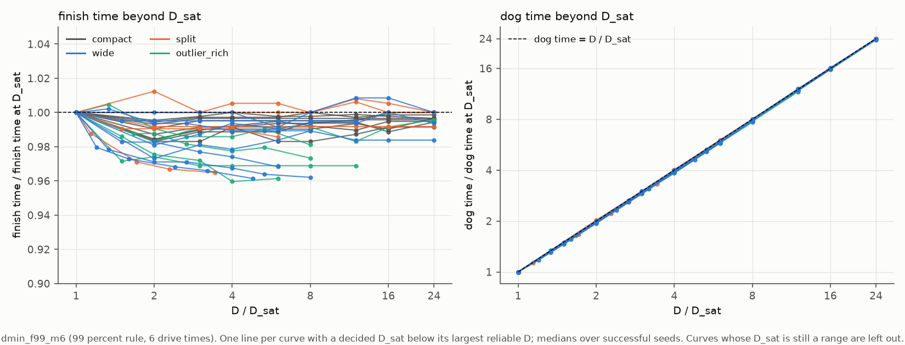

**Hình 8: Chi phí vận hành và hiệu suất giảm dần vượt quá quy mô bão hòa $D_{\mathrm{sat}}$ (thời hạn $6\times$, tiêu chí 99%).**
*Cách đọc biểu đồ:*
- **Khung trái**: Vẽ thời gian hoàn thành chuẩn hóa theo thời gian tại điểm bão hòa ($T / T_{\mathrm{sat}}$) theo số chó $D$. Đường cong đi ngang gần như hoàn hảo trong khoảng 0,96 đến 1,01.
- **Khung phải**: Vẽ tổng công sức của đàn chó ($\mathrm{dog\_time} = D \times T$) chuẩn hóa theo mức bão hòa. Đường cong bám sát đường chéo tỷ lệ thuận $D / D_{\mathrm{sat}}$.
- **Ý nghĩa cốt lõi**: Bố trí thêm chó vượt quá mức bão hòa $D_{\mathrm{sat}}$ chỉ giúp rút ngắn thời gian không đáng kể (dưới 4%), trong khi chi phí năng lượng và quản lý đội hình tăng tuyến tính theo số lượng cá thể.

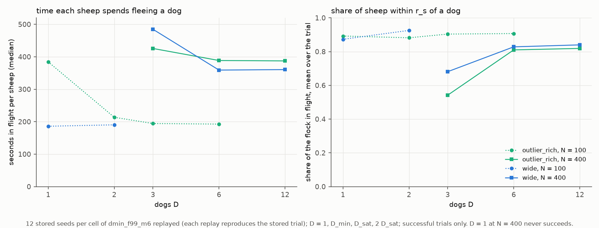

**Hình 9: Động lực học chạy trốn vi mô của bầy cừu qua các quy mô đội chó (12 hạt giống mỗi ô, `dmin_f99_m6`).**
*Cách đọc biểu đồ:*
- **Khung trái**: Vẽ số giây chạy trốn tích lũy trung bình của mỗi con cừu (thời gian nằm trong cự ly đe dọa $65\text{ m}$ của chó).
- **Khung phải**: Vẽ tỷ lệ phần trăm bầy cừu đang trong trạng thái bỏ chạy tức thời tại một thời điểm bất kỳ.
- **Ý nghĩa cốt lõi**: Thêm nhiều chó không làm tăng tổng thời gian chịu áp lực của từng cá thể cừu. Tăng từ $D_{\min}$ lên $D_{\mathrm{sat}}$ giúp rút ngắn thời gian lùa bầy, từ đó giảm tổng thời gian cừu phải bỏ chạy (trái). Mặc dù tại mỗi thời điểm có tỷ lệ cừu tháo chạy cao hơn (phải), tổng thời gian chịu đe dọa lại ít hơn.

> 📊 **Tham chiếu dữ liệu trong `results_tables.md`**:
> Động lực học tháo chạy vi mô và thời gian trốn chạy từng con cừu từ 12 hạt giống replay mỗi ô được lập bảng tại [`results_tables.md#pressure-dmin_f99_m6-replay-of-12-stored-seeds-per-cell-every-replay-reproduced-its-stored-trial`](results_tables.md#pressure-dmin_f99_m6-replay-of-12-stored-seeds-per-cell-every-replay-reproduced-its-stored-trial).

---

### 3.8 RQ8: Tăng trưởng theo *N* trên Lưới dày, *D*<sub>sat</sub>, và Hình dạng đường cong

Để xác định chính xác hình dạng hàm số của đường cong tăng trưởng $D_{\min}(N)$, chúng tôi mở rộng các lưới chạy 99% ($12\times$ và $6\times$) thêm 4 quy mô bầy trung gian: $N = 71, 141, 283$ (các trung điểm logarit giữa 50 và 400) và $N = 566 = 400\sqrt{2}$.

**Vì sao là các bước $\sqrt{2}$?** Việc chia tỷ lệ theo các bước nhân $\sqrt{2}$ đảm bảo mọi quy mô bầy đều có trọng số hình học ngang nhau khi khớp hồi quy log-log. Đồng thời, $N = 566$ là giới hạn vật lý của mô hình sinh học Strömbom: dưới 600 con, đàn cừu luôn ổn định về một bán kính dừng tự nhiên $R_f(N)$. Trên 600 con, bầy cừu xuất phát lỏng lẻo không còn khả năng tự co cụm về kích thước riêng (tại $N = 630$, bầy xuất phát rộng vẫn to hơn 17%; tại $N = 800$, quy trình hiệu chuẩn bán kính thất bại hoàn toàn).

**Câu trả lời trực tiếp cho RQ8**:
- **Hệ số góc được xác định chặt chẽ**: Trên lưới 9 quy mô bầy, hệ số góc log-log của $D_{\min}$ theo $N$ dao động từ **0,27 đến 0,38** (`wide`) và **0,28 đến 0,38** (`outlier_rich`) ở thời hạn thong thả ($12\times$), và từ **0,38 đến 0,61** ở thời hạn trung bình ($6\times$). Dưới điều kiện thong thả, tốc độ tăng trưởng luôn nằm dưới định luật căn bậc hai ($\alpha = 0{,}50$) của bầy không liên kết.
- ***D*<sub>sat</sub> tăng nhanh gấp đôi $D_{\min}$**: Trên bầy `wide`, *D*<sub>sat</sub> tăng đều đặn: $1, 1, 1, 2, 3, 3, 4, 5$ chó từ $N = 25$ đến $400$, và đạt $7\text{--}24$ ở $N = 566$ (độ dốc log-log **0,70 đến 0,91**). Khoảng cách giữa đội hình chỉ cần đạt độ tin cậy và đội hình đạt tốc độ tối đa ngày càng giãn rộng khi đàn cừu lớn dần.
- **Tăng đều hay chững lại**: Đến mốc $N = 566$, dữ liệu thực nghiệm khớp hoàn hảo với cả hàm lũy thừa không chặn ($D \propto N^\alpha$) lẫn hàm bão hòa đi ngang (tỷ số hợp lý $\approx 1$). Cả hai dạng đường cong đều đi qua toàn bộ các khoảng chặn tin cậy. Khi ngoại suy lên $N = 1600$, cả hai hàm số cho phép giá trị dao động từ 1,5 đến 6,7 chó; chỉ khi thử nghiệm các bầy cực lớn ($N > 1000$) mới có thể phân định được (mục 3.13).

Bảng 7 thể hiện bước tiến thực nghiệm qua 9 quy mô bầy (tiêu chí 99%):

| $N$ | 25 | 50 | 71 | 100 | 141 | 200 | 283 | 400 | 566 |
| :--- | :---: | :---: | :---: | :---: | :---: | :---: | :---: | :---: | :---: |
| `wide`, $12\times$ | 1 | 1 | 1 | 1 | 2 | 1–2 | 2 | 2 | 2–3 |
| `outlier_rich`, $12\times$ | 1 | 1 | 1 | 1–2 | 2 | 2 | 2 | 2 | 2–3 |
| `wide`, $6\times$ | 1 | 1 | 1 | 1 | 2 | 2 | 2–3 | 2–3 | 3–7 |
| `outlier_rich`, $6\times$ | 1 | 1 | 1 | 2 | 2 | 2–3 | 2–3 | 3 | 3–6 |
| *D*<sub>sat</sub> `wide`, $6\times$ | 1 | 1 | 1 | 2 | 3 | 3 | 4 | 5 | 7–24 |

> 📊 **Tham chiếu dữ liệu trong `results_tables.md`**:
> Lưới dày 9 kích thước ($N = 25$ đến $566$) và các lượt bổ sung thời gian hoàn thành được lập bảng tại [`results_tables.md#finish-time-top-up-densified-n-independent-shepherds-kubo-to-d--24-99-percent`](results_tables.md#finish-time-top-up-densified-n-independent-shepherds-kubo-to-d--24-99-percent).

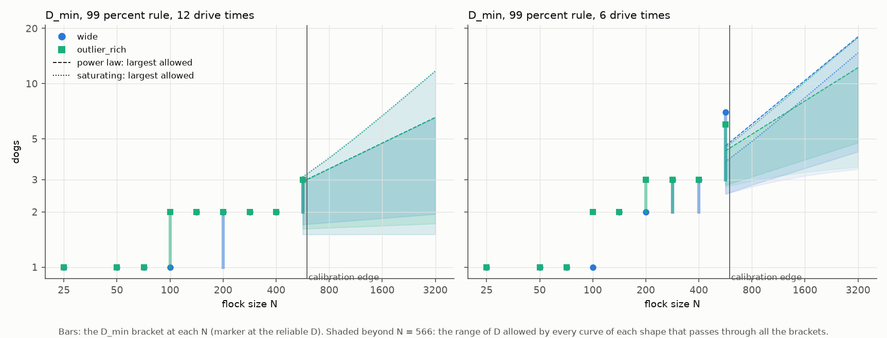

**Hình 10: Quy mô đội tối thiểu $D_{\min}$ qua chín kích thước bầy và các dải ngoại suy của hai mô hình tăng trưởng.**
*Cách đọc biểu đồ:*
- **Các trục & Dữ liệu**: Trục hoành là quy mô bầy $N$ theo các bước nhân $\sqrt{2}$; trục tung là $D_{\min}$. Các thanh dọc là các khoảng chặn tin cậy thực nghiệm.
- **Dải ngoại suy (Bên phải $N = 566$)**: Các vùng tô bóng minh họa phạm vi dự đoán của mô hình lũy thừa không chặn ($D \propto N^\alpha$) so với mô hình bão hòa hyperbol có giới hạn trên.
- **Ý nghĩa cốt lõi**: Dưới mốc $N = 566$, hai mô hình khớp dữ liệu thực nghiệm tốt như nhau và bao phủ trùng khít lên nhau. Cả hai đều khẳng định việc chăn hàng trăm con cừu chỉ cần một số lượng chó rất nhỏ, nhưng để biết đường cong có thực sự đi ngang hay không đòi hỏi phải khảo sát vượt qua ngưỡng hiệu chuẩn sinh học của mô hình.

---

### 3.9 RQ9: Phần nào của Quy tắc Đội đóng vai trò quyết định, và Mô hình lực liên tục

Trong Mục 3.6, mô hình không phối hợp FAT đã thất bại hoàn toàn ở $N \ge 200$. Tuy nhiên, FAT thiếu cả *hai* thành phần: (1) máy trạng thái hành vi Strömbom (chuyển đổi giữa gom cừu lạc và lùa đàn), và (2) tầng phối hợp đa tác tử (phân công Hungarian và dàn vòng cung lùa).

Để tách bạch hai thành phần này, chúng tôi thử nghiệm đội **chó độc lập (`dmin_f99_indep`)**: mỗi chú chó chạy máy trạng thái một-chó gốc của Strömbom (2014) hoàn toàn độc lập, không hề giao tiếp hay phân chia nhiệm vụ.

**Câu trả lời trực tiếp cho RQ9**:
- **Công tắc chuyển trạng thái gánh vác đội hình đến $N = 200$; tầng phối hợp đội là chìa khóa mở cánh cửa $N = 400$**:
  - Đội chó độc lập đạt độ tin cậy trên mọi bố cục phân tán lên đến $N = 200$, nơi FAT thất bại 100%. Điều này chứng minh riêng cơ chế chuyển đổi giữa gom cừu lạc và lùa bầy đã đủ để duy trì bầy đàn ở quy mô vừa và nhỏ.
  - Tuy nhiên, tại $N = 400$, đội chó độc lập thất bại hoàn toàn, trong khi thuật toán phối hợp `strombom_multi` thành công chỉ với 2–3 chó. Sự phối hợp phân công tối ưu là bắt buộc trên đàn lớn.
- **Động lực học của Mô hình lực liên tục (Kubo đến 24 chó)**:
  - Trên bầy tập trung, $D_{\min} = 1$ trên mọi $N \in [25, 100]$, tái khẳng định phát hiện cốt lõi của chúng tôi.
  - Khác với cừu Strömbom, cừu Kubo chịu các lực trường thế liên tục cộng dồn. Thời gian lùa giảm mạnh từ $115\text{ s}$ với 1 chó xuống $29\text{ s}$ với 10 chó, và đạt $25\text{ s}$ với 24 chó. Phần lớn mức cải thiện đạt được trước mốc $D = 10$, xác nhận quy luật hiệu suất giảm dần trên cả hai trường phái vật lý.

Bảng 8 so sánh chó độc lập với thuật toán phối hợp và FAT ở thời hạn $6\times$:

| So sánh phương pháp (`strombom_multi` / `independent` / `fat`), 99%, $6\times$ | $N = 200$ | $N = 400$ |
| :--- | :---: | :---: |
| `wide` | 2 / 2–3 / none | 2–3 / none / none |
| `outlier_rich` | 2–3 / 3 / none | 3 / none / none |
| `split` | [1] / 1–3 / none | [5] / none / none |

> 📊 **Tham chiếu dữ liệu trong `results_tables.md`**:
> So sánh các phương pháp (`strombom_multi`, chó độc lập, FAT, và mô hình lực Kubo đến $D = 24$) được tổng hợp tại [`results_tables.md#methods-at-99-percent-6-drive-times-team-rule-independent-paper-shepherds-fat`](results_tables.md#methods-at-99-percent-6-drive-times-team-rule-independent-paper-shepherds-fat) và [`results_tables.md#kubo-compact-d-to-24-99-percent`](results_tables.md#kubo-compact-d-to-24-99-percent).

---

### 3.10 RQ10: Quá nhiều chó: Bài toán Giữ đàn và Chó chiếm chỗ không gian

Trong bài toán lùa đàn mở, thêm chó vượt quá mức bão hòa không làm hỏng nhiệm vụ dưới tiêu chí 99%. Tuy nhiên, các tài liệu robot bầy đàn cho rằng sự quá tải gây hại chủ yếu ở giai đoạn chặn giữ (Green et al. 2022). Chúng tôi đánh giá hai thay đổi:

1. **Nhiệm vụ Giữ đàn (Holding Task)**: Nhiệm vụ chỉ thành công sau khi 99% cừu ở yên trong đích trọn vẹn một khoảng thời gian lùa ($T_{\mathrm{drive}}$). Khi cừu đã vào chuồng, đàn chó chủ động lùi xa ngoài cự ly đe dọa ($65 + 2\text{ m}$) để cừu gặm cỏ bình yên.
2. **Chó chiếm chỗ vật lý (Dog Spacing)**: Chó có kích thước cơ thể thực tế: không chú chó nào được bước vào phạm vi $2\text{ m}$ của đồng đội (`dog_spacing = 2.0`). Do vòng cung lùa có chu vi giới hạn, nó chỉ có thể chứa tối đa một số lượng chó nhất định: $D_{\mathrm{cap}} \approx 7, 9, 10, 11, 12$ tương ứng với $N = 25$ đến $400$.

**Câu trả lời trực tiếp cho RQ10**:
- **Nhiệm vụ Giữ đàn thành công từ $N = 100$, nhưng thất bại ở bầy nhỏ ($N \le 50$) do hình học chuồng đích**:
  - Khi đàn chó lùi xa, chúng mất khoảng $40\text{ s}$ để đi hết $65\text{ m}$. Ở bầy nhỏ, khoảng thời gian lùi này vẫn kịp đẩy bầy cừu trôi ra khỏi chuồng đích có bán kính chỉ $12\text{--}14\text{ m}$. Đây là hiệu ứng hình học của chuồng nhỏ chứ không phải lỗi quy mô đội. Ở $N \ge 100$, việc giữ đàn thành công hoàn hảo và $D_{\min}$ trùng khớp với bài toán lùa mở (1, 2, và 3 chó tại $N = 100, 200, 400$).
- **Kích thước cơ thể chó gây ra hiện tượng sụp đổ do quá tải ($D_{\mathrm{overcrowd}}$)**:
  - Trên bố cục `outlier_rich` ở $N = 400$, đội từ $3\text{--}6$ chó thành công trong $93\text{--}94\%$ lượt chạy. Nhưng khi quy mô đội đạt $D \ge 9$, **toàn bộ các đội đến 24 chó đều bị xác nhận không đạt độ tin cậy** (tỷ lệ thành công sụt xuống 0,77 tại $D = 9$, 0,65 tại $D = 12$, và 0,50 tại $D = 16$). Tình trạng ùn ứ trên vòng cung lùa khiến đàn chó mất khả năng xoay xở, phá hỏng hoàn toàn nhiệm vụ.
  - Trên bố cục `wide` và `compact`, các chú chó không tìm được vị trí trên vòng cung sẽ tự động đứng yên phía sau, duy trì độ tin cậy đến 24 chó. Tác hại của sự quá tải phụ thuộc mật thiết vào bố cục không gian và thể tích vật lý của tác tử.

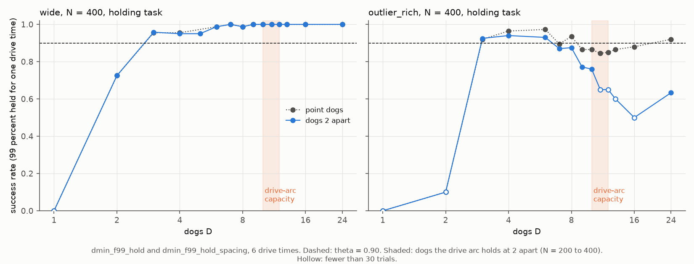

**Hình 11: Độ tin cậy của nhiệm vụ Giữ đàn tại $N = 400$ so sánh giữa chó dạng điểm và chó có kích thước vật lý (giãn cách $2\text{ m}$).**
*Cách đọc biểu đồ:*
- **Các khung hình**: Khung trái đánh giá bố cục `wide`; khung phải đánh giá bố cục `outlier_rich`.
- **Các trục & Đường nét**: Trục hoành là số chó $D$; trục tung là tỷ lệ thành công của nhiệm vụ giữ đàn. Đường màu xanh là chó dạng điểm; đường màu cam là chó có kích thước chiếm chỗ vật lý (giãn cách $2\text{ m}$).
- **Ý nghĩa cốt lõi**: Trên bố cục `wide`, chó chiếm chỗ không gây hại vì chó thừa đứng lùi lại phía sau. Nhưng trên `outlier_rich`, chó chiếm chỗ gây ra hiện tượng sụp đổ do quá tải nghiêm trọng: tỷ lệ thành công lao dốc từ $D = 9$ trở lên do vòng cung lùa bị kẹt cứng, triệt tiêu khả năng điều phối tập thể.

> 📊 **Tham chiếu dữ liệu trong `results_tables.md`**:
> Các lượt chạy giữ đàn và giãn cách chó chiếm chỗ được tổng hợp tại [`results_tables.md#d_min-dmin_f99_hold`](results_tables.md#d_min-dmin_f99_hold), [`results_tables.md#d_min-dmin_f99_hold_spacing`](results_tables.md#d_min-dmin_f99_hold_spacing), và phân tích điểm sụt tại [`results_tables.md#zones-dmin_f99_hold_spacing-1-cells-where-more-dogs-did-worse`](results_tables.md#zones-dmin_f99_hold_spacing-1-cells-where-more-dogs-did-worse).

---

### 3.11 RQ11: Độ gắn kết xã hội làm thay đổi quy luật mở rộng ra sao?

Định luật tỷ lệ căn bậc hai $\alpha = 0{,}50$ ($\sqrt{M}$) của Lama và di Bernardo (2024) được chứng minh trên các mục tiêu hoàn toàn không có lực gắn kết bầy đàn. Để bắc cầu giữa các hạt vật lý rời rạc với bầy cừu sinh học, chúng tôi thay đổi hai tham số gắn kết: (1) trọng số hút xã hội $c$ (từ $1{,}05$ lên $2{,}0$), và (2) tỷ lệ láng giềng tương tác $n / N$ (thử nghiệm $n = 0{,}5N$).

**Câu trả lời trực tiếp cho RQ11**:
- **Gắn kết mạnh hơn chỉ mang lại lợi ích rất nhỏ**: Tăng trọng số hút từ $c = 1{,}05$ lên $1{,}3, 1{,}6$, hoặc $2{,}0$ cho hệ số góc gần như không đổi ($\alpha \approx 0{,}30$ trên `wide`), chỉ tiết kiệm tối đa 1 chó trên toàn bộ các quy mô bầy. Lực hút tự nhiên vốn có của cừu đã đủ mạnh để việc kéo chặt hơn không giúp ích thêm nhiều.
- **Gắn kết yếu hơn làm độ dốc dựng đứng tiệm cận định luật căn bậc hai**: Giảm số lượng láng giềng tương tác xuống $n = 0{,}5N$ làm độ dốc tăng vọt lên **0,40 đến 0,70**, vượt qua mốc $\alpha = 0{,}50$ của mục tiêu không liên kết. Bố cục `split` trở nên khó hơn rất nhiều ($D_{\min}$ tăng từ 1–2 lên 3–4 ở $N = 200$, và từ 2 lên 4–5 ở $N = 400$). Bầy cừu có độ gắn kết yếu hơn $n = 0{,}5N$ sẽ vỡ vụn hoàn toàn dưới áp lực lùa của 1 chú chó.

Bảng 9 tóm tắt độ dốc mở rộng qua các mức độ gắn kết (`wide`, tiếp cận 99%, $12\times$):

| Mức độ gắn kết (`wide`, 99%, $12\times$) | $N = 50$ | $N = 100$ | $N = 200$ | $N = 400$ | Hệ số góc log-log $\alpha$ |
| :--- | :---: | :---: | :---: | :---: | :---: |
| **Gắn kết yếu ($n = 0{,}5N$)** | 1 | 1 | 2 | 2–4 | **0,40 đến 0,70** |
| **Mốc chuẩn sinh học ($c = 1{,}05$)** | 1 | 1 | 1–2 | 2 | **0,30 đến 0,40** |
| **Gắn kết rất mạnh ($c = 1{,}3, 1{,}6, 2{,}0$)** | 1 | 1 | 1 | 2 | **0,30** |

> 📊 **Tham chiếu dữ liệu trong `results_tables.md`**:
> Thử nghiệm thay đổi độ gắn kết ($c = 1{,}3, 1{,}6, 2{,}0$) và số láng giềng tương tác ($n = 0{,}5N$) được lập bảng tại [`results_tables.md#d_min-dmin_f99_c13`](results_tables.md#d_min-dmin_f99_c13), `dmin_f99_c1.6`, `dmin_f99_c2.0`, và [`results_tables.md#d_min-dmin_f99_k05`](results_tables.md#d_min-dmin_f99_k05).

---

### 3.12 RQ12: Giới hạn Tầm nhìn và Mạng lưới Giao tiếp giữa các Chú chó

Trong thực tế, robot hoặc thiết bị bay không người lái (drone) không thể có tầm nhìn toàn cục bao quát toàn bộ cánh đồng. Chúng tôi đánh giá các kịch bản trong đó mỗi chú chó chỉ nhìn thấy cừu trong một bán kính cảm nhận hữu hạn ($15, 30, 45, 65, 100\text{ m}$), kết hợp với ba cấu hình giao tiếp: `none` (tự quan sát độc lập), `neighbour` (chia sẻ với các chó ở gần), và `shared` (mạng lưới toàn đội).

**Câu trả lời trực tiếp cho RQ12**:
- **Tầm nhìn 30–65 m làm tốn thêm khoảng 1 chú chó ở $N = 200$**: Trên bầy `wide`, đội có tầm nhìn toàn cục cần $D_{\min} = 2$. Giới hạn tầm nhìn xuống $30\text{--}65\text{ m}$ đẩy nhu cầu lên $D_{\min} = 3$. Ở $N \le 100$, tầm nhìn cục bộ không gây thiệt hại nào vì cả đàn cừu nằm gọn trong phạm vi $65\text{ m}$.
- **Tầm nhìn dưới 30 m gây sụp đổ hoàn toàn**: Tại bán kính $15\text{ m}$, đàn chó thất bại toàn diện: ở $N = 50$, không đội nào đến 16 chó đạt độ tin cậy; ở $N = 100$, cần ít nhất 6 chó. Các chú chó mất dấu cừu lạc và đi lang thang mất phương hướng.
- **Giao tiếp mạng lưới mua lại chú chó bị mất**: Tại tầm nhìn $65\text{ m}$ ($N = 200$), chó độc lập cần 3 con. Việc chia sẻ thông tin vị trí cừu cho toàn đội giúp đưa $D_{\min}$ trở lại mức 2 chó, ngang bằng với tầm nhìn toàn cục mà không cần nâng cấp cảm biến phần cứng.

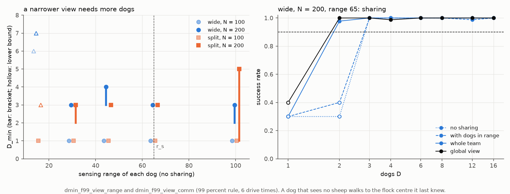

**Hình 12: Tác động của tầm cảm nhận cá thể và mạng lưới giao tiếp đa tác tử lên quy mô đội $D_{\min}$.**
*Cách đọc biểu đồ:*
- **Khung trái**: Vẽ $D_{\min}$ theo bán kính cảm nhận của từng chú chó (mét) qua các quy mô bầy trên bố cục `wide`. Các thanh dọc là khoảng chặn; tam giác rỗng là cận dưới.
- **Khung phải**: Vẽ tỷ lệ thành công theo số chó ở tầm nhìn $65\text{ m}$ dưới 3 chế độ: không giao tiếp (`none`, xanh lá), giao tiếp láng giềng (`neighbour`, cam), và chia sẻ toàn đội (`shared`, xanh dương).
- **Ý nghĩa cốt lõi**: Giới hạn tầm nhìn ở mức $30\text{--}65\text{ m}$ chỉ làm tốn thêm 1 chó ở $N = 200$, trong khi tầm nhìn dưới $30\text{ m}$ gây thất bại nặng nề. Cơ chế chia sẻ dữ liệu qua mạng lưới không dây giúp khắc phục hoàn toàn sự thiếu hụt cảm biến cục bộ.

> 📊 **Tham chiếu dữ liệu trong `results_tables.md`**:
> Thử nghiệm tầm cảm nhận giới hạn và các chế độ chia sẻ thông tin được tổng hợp tại [`results_tables.md#views-sensing-range-no-sharing-base-row--range-0-global`](results_tables.md#views-sensing-range-no-sharing-base-row--range-0-global) và [`results_tables.md#views-sharing-at-range-65-beside-the-no-sharing-rows-of-dmin_f99_view_range`](results_tables.md#views-sharing-at-range-65-beside-the-no-sharing-rows-of-dmin_f99_view_range).

---

### 3.13 RQ13: Đàn cừu quy mô cực lớn và Giới hạn Toán học của Quy tắc Lùa đàn

Để khảo sát giới hạn mở rộng tận cùng của bài toán chăn dắt, chúng tôi thử nghiệm các đàn cừu khổng lồ từ $N = 800$ đến $3200$ con ở thời hạn thong thả ($12\times$). Phía trên ngưỡng hiệu chuẩn ($N = 566$), bán kính đàn cừu được áp đặt bằng cách giữ nguyên mật độ: $R_f(N) = R_f(566)\sqrt{N/566}$.

**Câu trả lời trực tiếp cho RQ13**:
- **Quy tắc lùa của Strömbom gặp điểm kỳ dị toán học tại $N \approx 1056$**:
  - Quy tắc Strömbom nguyên bản đặt vị trí lùa đàn ở khoảng cách $r_a\sqrt{N}$ phía sau trọng tâm bầy cừu.
  - Tại $N = (r_s / r_a)^2 = (65 / 2)^2 = 1056$ cừu, cự ly này bằng đúng tầm nhìn phát hiện đe dọa của cừu ($65\text{ m}$).
  - Vượt quá $N = 1056$, các chú chó đứng quá xa đến mức **cừu hoàn toàn không nhìn thấy sự hiện diện của chó**. Tại $N = 1131$, đàn chó đứng cách con cừu gần nhất tới $59\text{ m}$; chỉ có khoảng $140\text{--}240$ trong tổng số 1131 con cừu cảm nhận được đe dọa, trong khi toàn bộ phần còn lại của bầy vẫn thong thả gặm cỏ neo bầy đứng yên. Bầy cừu di chuyển chưa đầy $3\text{ m}$ sau 400 giây. Không đội chó nào đến $D = 12$ đạt được thành công.
- **Giới hạn cự ly lùa giải cứu bài toán đàn cừu khổng lồ**:
  - Bằng cách đặt trần cự ly lùa tối đa ($r_s - r_a = 63\text{ m}$), đàn chó luôn duy trì tiếp xúc giác quan với rìa sau của bầy, lùa thành công các đàn cừu khổng lồ.
  - Trên bầy tập trung (`compact`), 1 chú chó duy nhất ($D_{\min} = 1$) lùa nhẹ nhàng đàn $N = 800$ và $1131$ con, và 2 chó lùa đàn $N = 1600$. Tại $N = 3200$, 1 chú chó đạt tỷ lệ thành công 100% trên toàn bộ 42 lượt chạy thử nghiệm.
  - Trên bầy phân tán (`wide`), nhu cầu chó tăng vọt: 3 chó ở $N = 800$, 5–9 chó ở $N = 1131$, và vượt quá 12 chó ở $N = 1600$. Sự gia tăng dốc đứng này chứng minh rằng việc bao quát chu vi của một bầy phân tán khổng lồ đòi hỏi một đội ngũ tác tử lớn hơn nhiều để khóa các cánh.

Bảng 10 tóm tắt kết quả với quy tắc lùa có giới hạn trần cự ly (tiêu chí 99%, $12\times$):

| Giới hạn cự ly lùa ($63\text{ m}$ cap), 99%, $12\times$ | $N = 800$ | $N = 1131$ | $N = 1600$ | $N = 3200$ (Kiểm thử một phần) |
| :--- | :---: | :---: | :---: | :---: |
| `compact` | 1 | 1 | 2 | **1 chó** (42 / 42 thành công) |
| `wide` | 3 | 5–9 | none đến 12 | **none** (0 / 58 ở $D = 2\text{--}12$) |

> 📊 **Tham chiếu dữ liệu trong `results_tables.md`**:
> Thử nghiệm đàn cừu quy mô lớn và kiểm tra độ nén bầy được lập bảng tại [`results_tables.md#d_min-dmin_f99_big`](results_tables.md#d_min-dmin_f99_big), [`results_tables.md#d_min-dmin_f99_big_dense`](results_tables.md#d_min-dmin_f99_big_dense), [`results_tables.md#d_min-dmin_f99_big_loose`](results_tables.md#d_min-dmin_f99_big_loose), và [`results_tables.md#large-n-flock-size-against-the-imposed-r_f-compact`](results_tables.md#large-n-flock-size-against-the-imposed-r_f-compact).

---

## 4. Phân tích vi mô: Dị thường Bố cục và Đo đạc Từng tích tắc

### 4.1 Dị thường Bố cục `split` (Bầy phân cụm)
Trên bố cục `split` ở $N \ge 200$, việc tăng thêm số lượng chó không cải thiện tỷ lệ thành công dưới các thời hạn trung bình và khẩn cấp ($6\times$ và $3\times$), với tỷ lệ thành công đi ngang trong khoảng 0,60 đến 0,90 cho mọi $D \ge 4$. Dữ liệu đo đạc chi tiết chỉ ra hai nguyên nhân chính:
1. **Dồn cục bộ khi gom cừu ($D = 4$)**: Do cừu lạc được chọn thuần túy theo khoảng cách tới trọng tâm toàn cục, $D$ con cừu xa nhất thường cùng thuộc về một cụm con duy nhất. Trong 12 lượt replay chẩn đoán, toàn bộ $D$ chú chó cùng lao về một cụm trong $82 - 91\%$ số giây gom đàn. Việc cưỡng bức chia đều mục tiêu ra các cụm giúp giảm thời gian hoàn thành từ 631 s xuống 318 s tại $D = 4$.
2. **Hiện tượng Chó đóng băng do Quy tắc Giữ khoảng cách $3 r_a$ ($D \ge 8$)**: Quy tắc của Strömbom bắt chó phải dừng bước khi cách bất kỳ con cừu nào dưới $3 r_a = 6\text{ m}$. Trên bố cục `split`, mật độ cục bộ cao khiến **25% đàn chó bị đóng băng bất động** trong suốt lượt chạy (so với $< 1\%$ trên bố cục `wide`). Trong lượt chạy thử nghiệm rút ngắn khoảng cách dừng xuống $r_a = 2\text{ m}$, tỷ lệ chó đứng yên giảm rõ rệt, rút ngắn thời gian lùa 20–24% và đạt 12/12 trận thắng tại $D = 16$.

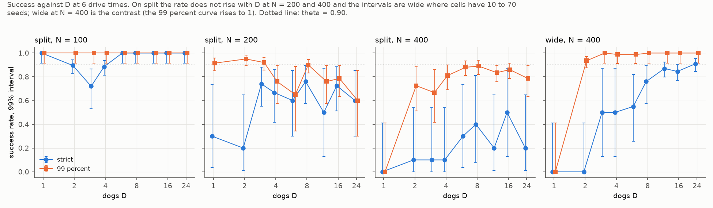

**Hình 13: Hiện tượng chững hiệu suất trên bố cục bầy phân cụm `split` ($N \ge 200$).**
*Cách đọc biểu đồ:*
- **Các trục**: Tỷ lệ thành công vẽ theo số chó $D$ qua các mức thời hạn ($12\times, 6\times, 3\times$).
- **Ý nghĩa cốt lõi**: Khác với `wide` và `outlier_rich` nơi thêm chó luôn nâng cao độ tin cậy, bố cục `split` bị tắc nghẽn dưới ngưỡng 90% ở $N \ge 200$ dưới thời hạn gấp gáp. Dữ liệu vi mô xác định nguyên nhân là do đàn chó dồn hết vào một cụm tại $D = 4$ và bị đóng băng hàng loạt theo quy tắc an toàn $6\text{ m}$ tại $D \ge 8$.

> 📊 **Tham chiếu dữ liệu trong `results_tables.md`**:
> Chẩn đoán replay phân tán mục tiêu và đo đạc chó đứng yên được tổng hợp tại [`results_tables.md#rq-b1-split-diagnostic-2026-10-24`](results_tables.md#rq-b1-split-diagnostic-2026-10-24).

### 4.2 Tương quan Đo đạc Từng tích tắc
- **Độ tản bầy so với Thành công**: Hệ số tương quan nghịch Spearman rất mạnh giữa độ phân tán trung bình của bầy (bán kính RMS) và thành công ($r = -0{,}56$ đến $-0{,}81$). Bầy cừu càng được nén gọn nhanh thì tỷ lệ thành công càng cao.
- **Động lực học Trùng lặp chó**: Trong `strombom_multi`, độ trùng lặp đường đi giữa các chú chó rất thấp trong giai đoạn gom cừu lạc, chỉ tăng lên khi dàn thành vòng cung lùa. Trong FAT, độ trùng lặp vượt quá 0,80 ngay từ giây đầu tiên, xác nhận sự sụp đổ do thiếu phối hợp.

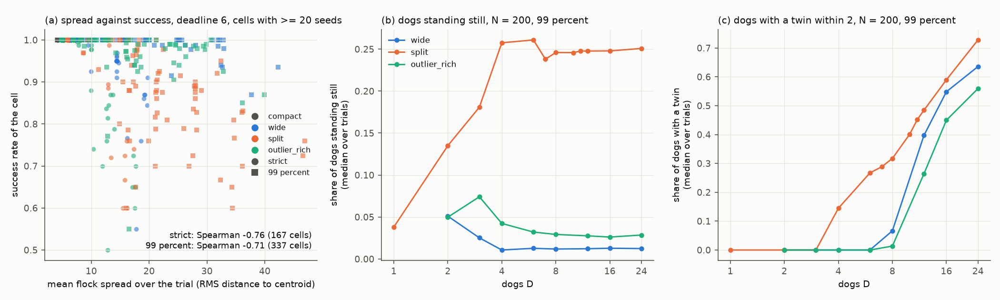

**Hình 14: Tương quan đo đạc vi mô và chẩn đoán đo đạc từng tích tắc.**
*Cách đọc biểu đồ:*
- **Khung (a)**: Biểu đồ phân tán giữa tỷ lệ thành công và độ tản bầy trung bình (bán kính RMS mét). Mối tương quan nghịch mạnh ($r = -0{,}56$ đến $-0{,}81$) chứng minh năng lực gom gọn bầy ban đầu là chỉ số dự báo thành công tốt nhất.
- **Khung (b)**: Tỷ lệ phần trăm đàn chó bị đóng băng đứng yên theo quy tắc khoảng cách an toàn $6\text{ m}$ trên bố cục `split` so với `wide`.
- **Khung (c)**: Độ trùng lặp quỹ đạo cặp đôi giữa các chú chó qua từng giây mô phỏng. Thuật toán phối hợp duy trì độ trùng lặp thấp, trong khi FAT trùng lặp $> 0{,}80$ ngay lập tức.

---

## 5. Thảo luận và Hàm ý Khoa học

### 5.1 So sánh với các Định luật Mở rộng Lý thuyết
Hệ số góc tăng trưởng dưới tuyến tính của chúng tôi ($\alpha = 0{,}20 - 0{,}50$ ở $12\times$ trên 5 kích thước; 0,27–0,38 trên 9 kích thước) tương phản sâu sắc với định luật tỷ lệ $\sqrt{M}$ ($\alpha = 0{,}50$) được chứng minh bởi Lama và di Bernardo (2024) trên các mục tiêu không gắn kết. Sự khác biệt này bắt nguồn từ bản chất sinh học: với các hạt rời rạc, mỗi hạt lạc phải được tiếp cận trực tiếp bởi một tác tử chăn dắt. Với bầy cừu có tính xã hội, lực hút toàn cục ($n = N - 1$) giúp một chú chó có thể gián tiếp tác động lên cả bầy ngay khi đưa được các con lạc vào tầm giao tiếp thị giác, giảm mạnh số lượng tác tử cần thiết.

### 5.2 Bản chất Hai giai đoạn của Bài toán Chăn dắt Tập thể
Kết quả của chúng tôi chỉ ra rằng bài toán chăn dắt tập thể bao gồm hai giai đoạn vật lý hoàn toàn khác biệt:
1. **Giai đoạn Di chuyển (Gom bầy và Lùa đàn)**: Khả năng mở rộng quy mô rất cao, dưới tuyến tính theo $N$, và được phản ánh chính xác bởi tiêu chí 99%.
2. **Giai đoạn Đóng chuồng (Xử lý cá thể lạc cuối cùng)**: Rất nhạy cảm, khó mở rộng quy mô, và dễ thất bại do quán tính chạy lố dưới tiêu chí nghiêm ngặt 100%.

Trong thực tế chăn thả cũng như điều khiển robot, một cá thể chậm chạp không đồng nghĩa với việc nhiệm vụ đã thất bại. Chúng tôi khuyến nghị các nghiên cứu đa tác tử tương lai nên tách bạch tiêu chí đưa đàn đến nơi khỏi giai đoạn chặn giữ cuối cùng (ví dụ: đóng cổng chuồng hoặc cử chó đi tuần vận tốc chậm).

### 5.3 Chín Đóng góp Khoa học Chính

1. **Bản đồ Ranh giới Thực nghiệm Hoàn chỉnh**: Thiết lập bản đồ ranh giới $D_{\min}$ và $D_{\mathrm{sat}}$ có độ tin cậy toán học 99% đầu tiên qua các quy mô đàn ($N \le 566$, mở rộng đến 3200), bố cục và thời hạn.
2. **Tiêu chí Thành công Định hình Vật lý**: Chứng minh tiêu chí tuyệt đối 100% tạo ra nút thắt cổ chai nhân tạo (Hiệu ứng cá thể lạc đàn), trong khi tiêu chí 99% phản ánh đúng năng lực phối hợp tập thể.
3. **Tách bạch Độ tin cậy khỏi Tốc độ**: Chứng minh quy mô đội để đạt tốc độ tối đa ($D_{\mathrm{sat}}$) tăng nhanh gấp đôi quy mô đội chỉ để đạt độ tin cậy ($D_{\min}$). Chó bổ sung vượt quá $D_{\mathrm{sat}}$ chỉ làm tăng chi phí mà không mang lại tốc độ.
4. **Giải phẫu Tầng Phối hợp Đa Tác tử**: Chứng minh việc chuyển trạng thái gom/lùa đưa đội chó độc lập tới $N = 200$, nhưng tầng phân công tối ưu Hungarian là bắt buộc ở $N \ge 400$.
5. **Hiện tượng Quá tải do Kích thước Vật lý**: Chứng minh tác hại của sự đông đúc không xuất hiện ở chó dạng điểm, nhưng bộc lộ rõ rệt khi chó có thể tích chiếm chỗ ($2\text{ m}$), gây nghẽn vòng cung lùa.
6. **Bắc cầu Vật lý Gắn kết và Không Gắn kết**: Kết nối thực nghiệm độ mạnh của lực hút xã hội với các định luật bầy hạt ngẫu nhiên, giải thích cơ chế phá vỡ cận dưới $\sqrt{N}$.
7. **Ranh giới Giải tích của Quy tắc Lùa Strömbom**: Phát hiện giới hạn toán học tại $N = 1056$ nơi khoảng cách lùa vượt quá tầm cảm nhận của cừu, chỉ ra sự cần thiết phải đặt trần cự ly cho các đàn khổng lồ.
8. **Đánh đổi giữa Cảm biến và Giao tiếp**: Định lượng chính xác cái giá của tầm nhìn cục bộ ($30\text{--}65\text{ m}$) và chứng minh việc chia sẻ thông tin toàn đội giúp xóa bỏ hoàn toàn khoảng cách này.
9. **Hệ thống Mô phỏng Mã nguồn mở Minh bạch**: Cung cấp bộ công cụ mô phỏng tất định, an toàn trước sự cố, có thể tái lập chính xác qua hơn 326.000 lượt chạy.

### 5.4 Gợi ý Ứng dụng Thực tế (Robot & Drone)

- **Định cỡ Đội hình**: Ở thời hạn thong thả, 1 đến 3 robot có thể kiểm soát đàn cừu tản mác lên tới 400 con. Áp lực thời hạn làm dịch chuyển nhu cầu tương đương với việc tăng đàn cừu lên gấp 4 lần, do đó cần xác định quỹ thời gian trước khi chốt số lượng robot.
- **Tốc độ tốn kém hơn Độ tin cậy**: Đội hình chạy nhanh nhất đòi hỏi số lượng robot gấp 1,5 đến 2,5 lần đội hình tối thiểu; robot vượt quá ngưỡng này chỉ làm hao pin vô ích.
- **Kích thước vật lý giới hạn quy mô đội**: Robot có kích thước cồng kềnh sẽ gây nghẽn vòng cung lùa từ khoảng 9 thiết bị tại $N = 400$.
- **Chia sẻ bản đồ trước khi mua thêm robot**: Tầm nhìn cục bộ tốn thêm khoảng 1 robot ở $N = 200$; việc kết nối mạng chia sẻ dữ liệu giữa các robot giúp giải quyết bài toán mà không cần bổ sung thiết bị.
- **Lùi xa để Giữ đàn**: Robot bắt buộc phải rút lui ra ngoài tầm phản ứng của động vật để giữ chúng trong chuồng; robot đứng lại ở cửa chuồng chỉ làm đàn vật nuôi tiếp tục bỏ chạy.

---

## 6. Hạn chế và Đe dọa Tính Đúng đắn

1. **Giản lược Động học 2D**: Cừu và chó được mô hình hóa dưới dạng chất điểm chuyển hướng tức thì và không bị mệt mỏi thể lực.
2. **Điều kiện Biên Mở**: Đồng cỏ tự nhiên không có hàng rào bao quanh như thực tế.
3. **Các Khoảng chặn Ranh giới**: Các ô tham số mấp mé ngưỡng $\theta = 0{,}90$ vẫn chưa ngã ngũ tại mốc trần 200 hạt giống, đòi hỏi phải báo cáo dưới dạng khoảng chặn.
4. **Tầm nhìn Toàn cục trong Lưới chính**: Ngoại trừ các thử nghiệm ở mục 3.12, mô hình giả định chó biết vị trí của mọi con cừu.
5. **Các Thiết lập Kỹ thuật Bổ sung**: Quy tắc rút lui giữ đàn, giãn cách chó $2\text{ m}$, và trần cự ly lùa là các giải pháp kỹ thuật do HerdSim đưa ra chứ không có nguồn gốc từ tài liệu sinh học.
6. **Mức trần Hiệu chuẩn Bầy**: Vượt quá $N \approx 600$, bầy cừu Strömbom không còn tự co cụm về kích thước riêng; các nghiên cứu trên 600 con dựa trên mật độ đàn được áp đặt.
7. **Cỡ mẫu Replay Chẩn đoán**: Các phép thử replay áp lực và dị thường split sử dụng 12 hạt giống mỗi ô, mang tính chỉ báo cơ chế chứ không phải phân tích giới hạn toàn diện.
8. **Cơ chế Chuẩn hóa Tổng Lực đe dọa từ Nhiều Chó**:
   - Mô hình gốc của Strömbom chỉ áp dụng cho một chú chó. HerdSim chuẩn hóa tổng vector lực đẩy từ các chú chó trong phạm vi $65\text{ m}$ về độ dài đơn vị tiêu chuẩn.
   - *Vì sao không dùng phép cộng lực*: Lực gắn kết xã hội của cừu là $c = 1{,}05$. Nếu cộng dồn lực đẩy độc lập từ hai chú chó ở góc $\theta$, độ lớn tổng lực là $2\cos(\theta/2)$, luôn lớn hơn $1{,}05$ trừ khi hai chú chó đứng đối diện nhau ở góc $> 116^\circ$. Do đó, phép cộng lực sẽ khiến 2 chú chó đi cạnh nhau xé toạc đàn cừu ngay từ $D = 2$. Replay trên 288 lượt chạy xác nhận phép cộng lực vượt quá lực gắn kết trong $46\text{--}77\%$ số giây chạy trốn.
   - *Hàm ý*: Mặc dù phép chuẩn hóa phản ánh đúng hiện tượng bão hòa sợ hãi sinh học, việc cừu thực tế có hoảng loạn hơn trước nhiều kẻ săn mồi hay không vẫn là câu hỏi mở cho các nhà sinh học thực địa.

---

## 7. Kết luận và Hướng Nghiên cứu Tương lai

Thông qua 326.870 lượt mô phỏng trên 37 giao thức, HerdSim đã lập bản đồ toàn diện về quy mô đội tối thiểu $D_{\min}$, quy mô bão hòa $D_{\mathrm{sat}}$, và các điều kiện khiến việc tăng thêm chó gây hại. Đàn cừu tập trung chỉ cần 1 chú chó ở mọi quy mô; trên đồng cỏ phân tán, số chó cần thiết tăng trưởng dưới tuyến tính với độ dốc 0,27–0,38 ở thời hạn thong thả và 0,38–0,61 ở thời hạn gấp gáp. Dưới tiêu chí nghiêm ngặt, con cừu lạc cuối cùng chi phối cuộc chơi; dưới tiêu chí 99%, kết quả có tính bền vững cao trước các quy ước mô phỏng. Sự phối hợp đội ngũ là bắt buộc ở các đàn lớn, chó thêm chỉ gây hại khi có kích thước chiếm chỗ vật lý, và quy tắc lùa kinh nghiệm của Strömbom bộc lộ giới hạn giải tích ở đàn trên một ngàn con.

### Hướng Nghiên cứu Tiếp theo

1. **Phân bổ Nhiệm vụ Nhận thức Cụm trên Bố cục Phân cụm**: Giải quyết hiện tượng tắc nghẽn trên bố cục `split` bằng cách thiết kế thuật toán phân công chó tỏa đều ra các cụm cấu trúc topo khác nhau thay vì chọn theo khoảng cách trọng tâm toàn cục.
2. **Nhiệm vụ Giữ đàn có Hàng rào Cổng**: Đánh giá giai đoạn giữ đàn bằng cổng rào vật lý thay vì rút lui ra đồng cỏ mở, kiểm tra xem nút thắt giữ đàn có còn tồn tại khi lối thoát bị chặn.
3. **Cảm nhận Góc nhìn Thuần túy (Bearing-Only)**: Mở rộng mô hình tầm nhìn cục bộ sang cảm nhận chỉ có góc hướng mà không có cự ly chính xác, mô phỏng chân thực camera trên các thiết bị drone.
4. **Thu thập Dữ liệu Thực địa Đa Chó / Drone với Vòng đeo GPS**: Hợp tác với các nhà nghiên cứu động vật thực địa để đo đạc phản ứng chính xác của đàn cừu khi bị rượt đuổi bởi từ 2 chú chó trở lên.

---

## Tính Sẵn sàng của Dữ liệu và Mã nguồn

Toàn bộ dữ liệu, cấu hình protocol và mã nguồn phân tích được công khai trong kho lưu trữ HerdSim:
- Công cụ CLI chính: `cli/campaign.py`
- Phân tích thống kê: `analysis/frontier.py` và `analysis/dmin_tables.py`
- Lệnh tái lập:
  ```bash
  make install && make check && make bench
  uv run cli/run_queue.py --workers 20
  uv run cli/dmin_tables.py record
  uv run cli/dmin_tables.py dmin dmin_m12 dmin_m6 dmin_m3 dmin_f99_m12 dmin_f99_m6 dmin_f99_m3
  ```

---

## Tài liệu Tham khảo

- Auletta F, Fiore D, Richardson MJ, di Bernardo M (2021). Herding stochastic autonomous agents via local control rules and online global target selection strategies. *arXiv:2010.00386*.
- Brown D, Garrity T, Perkins D, Hunter D, Pochman W (2025). Optimal control strategies for multi-agent sheep herding. *arXiv:2510.25115*.
- di Bernardo M (2026). Multi-scale control of large agent populations: from density dynamics to individual actuation. *arXiv:2603.15160*.
- Green T, et al. (2022). A minimalist solution to the multi-robot barrier coverage problem. *Towards Autonomous Robotic Systems (TAROS 2021)*, LNCS 13054.
- Jadhav V, Pasqua R, Zanon C, Roy M, Tredan G, Bon R, Guttal V, Theraulaz G (2024). Collective responses of flocking sheep (*Ovis aries*) to a herding dog (border collie). *Communications Biology* 7: 1543.
- Kubo M, Tashiro M, Sato H, Yamaguchi A (2022). Herd guidance by multiple sheepdog agents with repulsive force. *Artificial Life and Robotics* 27: 416–427.
- Lama A, di Bernardo M (2024). Shepherding control and herdability in complex multiagent systems. *Physical Review Research* 6: L032012.
- Li A, Ogura M, Wakamiya N (2025). Swarm shepherding using bearing-only measurements. *Philosophical Transactions of the Royal Society A* 383: 20240145.
- Pierson A, Schwager M (2015). Bio-inspired non-cooperative multi-robot herding. *IEEE International Conference on Robotics and Automation (ICRA)*.
- Ranganathan A, et al. Emergent strategies for shepherding a flock. *arXiv:2211.04352*.
- Strömbom D, Mann RP, Wilson AM, Hailes S, Morton AJ, Sumpter DJT, King AJ (2014). Solving the shepherding problem: heuristics for herding autonomous, interacting agents. *Journal of the Royal Society Interface* 11(100): 20140719.
- Yaxley KJ, Joiner KF, Abbass H (2021). Drone approach parameters leading to lower stress sheep flocking and movement: sky shepherding. *Scientific Reports* 11: 7803.

---

## Phụ lục: Nhật ký Các Giao thức Thực nghiệm

| Giao thức | Tổng lượt chạy | Số ô khảo sát | Số ô quyết định | Ô mở tại trần (200) | Lỗi | Thời gian chạy |
| :--- | :---: | :---: | :---: | :---: | :---: | :---: |
| `dmin_m12` | 17.220 | 183 | 179 | 4 | 0 | 1,24 h |
| `dmin_m6` | 13.470 | 191 | 170 | 21 | 0 | 0,41 h |
| `dmin_m3` | 9.530 | 183 | 178 | 5 | 0 | 0,17 h |
| `dmin_f99_m12` | 11.100 | 180 | 178 | 2 | 0 | 0,41 h |
| `dmin_f99_m6` | 14.240 | 191 | 174 | 17 | 0 | 0,49 h |
| `dmin_f99_m3` | 11.140 | 185 | 177 | 8 | 0 | 0,27 h |
| `dmin_fat` | 8.660 | 181 | 179 | 2 | 0 | 0,22 h |
| `dmin_f99_fat` | 8.670 | 184 | 183 | 1 | 0 | 0,23 h |
| `dmin_kubo` | 1.080 | 18 | 18 | 0 | 0 | 0,08 h |
| Các giao thức độ nhạy (14 runs) | 69.630 | 805 | 734 | 71 | 0 | 3,50 h |
| **Tổng cộng** | **164.740** | **2.291** | **2.190** | **148** | **0** | **~7,0 h** |

Các lượt chạy tiếp nối (tiêu chí 99%; thời gian ở 20 workers):

| Giao thức | Lượt chạy | Số ô | Ô mở tại trần | Lỗi | Số giờ |
| :--- | :---: | :---: | :---: | :---: | :---: |
| `dmin_f99_m12`, `dmin_f99_m6`, `dmin_f99_m3` (chạy tiếp: hạt giống thời gian; thêm $N$ 71, 141, 283, 566) | +38.770 | | | 0 | 4,0 |
| `dmin_f99_indep` | 12.990 | 181 | 18 | 0 | 0,30 |
| `dmin_f99_kubo` | 3.260 | 38 | 6 | 0 | 0,18 |
| `dmin_f99_hold` | 14.280 | 280 | 18 | 0 | 0,74 |
| `dmin_f99_hold_spacing` (chạy lại với quy tắc khoảng cách cứng) | 13.930 | 283 | 19 | 0 | 0,71 |
| `dmin_f99_c1.3`, `_c1.6`, `_c2.0` | 10.800 / 10.830 / 10.780 | 180 mỗi protocol | 1 / 0 / 0 | 0 | 0,31 / 0,29 / 0,41 |
| `dmin_f99_k05` | 11.630 | 149 | 14 | 0 | 2,29 |
| `dmin_f99_view_range` | 21.040 | 293 | 27 | 0 | 0,53 |
| `dmin_f99_view_comm` | 6.890 | 102 | 3 | 0 | 0,20 |
| `dmin_f99_big` | 2.230 | 84 | 1 | 0 | 3,12 |
| `dmin_f99_big_dense`, `_loose` | 1.320 / 830 | 15 / 14 | 2 / 1 | 0 | 0,73 / 0,26 |
| `dmin_f99_big_cap` | 2.550 (+100 ở $N = 3200$) | 45 | 3 | 0 | 7,6 |

Replay chẩn đoán: 164 lượt replay áp lực và 768 lượt replay split, mọi lượt replay không đổi đều cho kết quả bit-identical với lượt chạy đã lưu.
