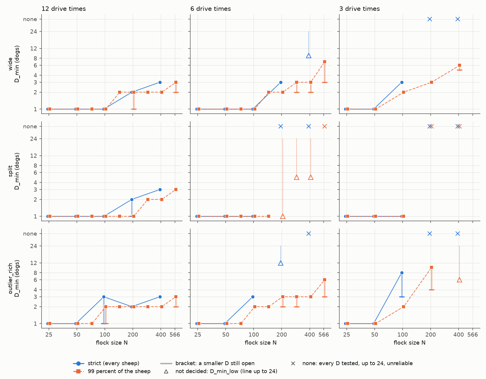
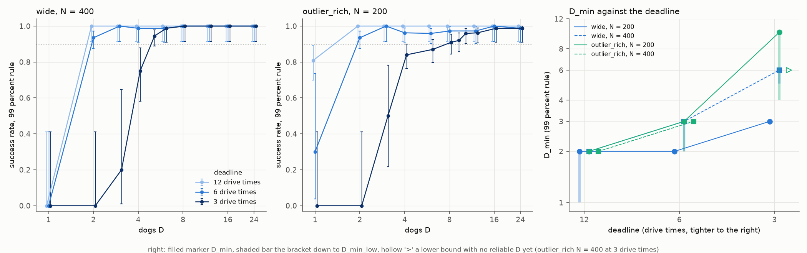
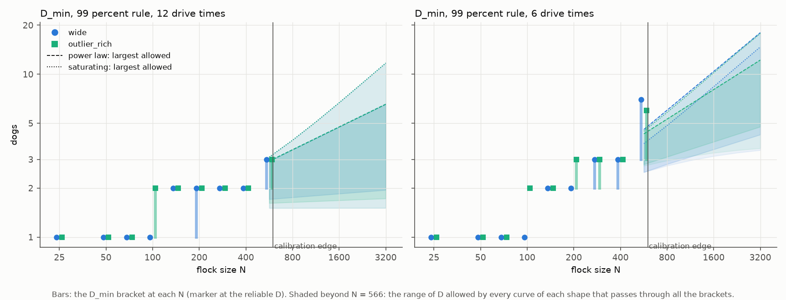

# Growth of the smallest team with flock size, layout and deadline

## 3.1 RQ1: How does D_min grow with N?

When there is time, a larger flock needs few more dogs. A `compact` flock, one tight group at the start, needs one dog at every deadline from $N = 25$ to 400. The scattered layouts `wide`, `split` and `outlier_rich` start some sheep far out, so the dogs must first bring them in ([layouts](d_min_report.md#22-start-layouts-dog-rules-and-protocols)). At the loose deadline of 12 [drive times](../experiments/task_design.md#deadlines-in-drive-times) a scattered flock of 400 needs 3 dogs when every sheep must reach the goal (the [strict rule](../glossary.md#success-and-reliability)) and 2 when 99% must (the 99% rule; Table 1).

$D_{\min}$, the subject of [RQ1](d_min_report.md#1-research-questions), is the smallest [reliable team](d_min_report.md#21-when-a-team-is-reliable), one whose success rate is at or above $\theta = 0.90$ with 99% confidence. While cells are undecided it is a bracket (`1-2`: 2 dogs reliable, 1 undecided) or a lower bound (`[9]`: no team reliable yet, $D_{\min}$ at least 9); `none` means no team up to 24 dogs is reliable. The [main runs](../glossary.md#trials-and-experiments) are the three strict and three 99% protocols on $N = 25$-400.

**Table 1: $D_{\min}$ on the scattered layouts, strict rule / 99% rule, main runs, $N = 25$-400 (`compact` is 1 / 1 in every cell).**

| Deadline | Layout | $N = 25$ | $N = 50$ | $N = 100$ | $N = 200$ | $N = 400$ |
| :---: | :--- | :---: | :---: | :---: | :---: | :---: |
| 12x | `wide` | 1 / 1 | 1 / 1 | 1 / 1 | 2 / 1-2 | 3 / 2 |
| 12x | `split` | 1 / 1 | 1 / 1 | 1 / 1 | 1-2 / 1 | 3 / 2 |
| 12x | `outlier_rich` | 1 / 1 | 1 / 1 | 1-3 / 1-2 | 2 / 2 | 3 / 2 |
| 6x | `wide` | 1 / 1 | 1 / 1 | 1 / 1 | 3 / 2 | [9] / 2-3 |
| 6x | `split` | 1 / 1 | 1 / 1 | 1 / 1 | none / [1] | none / [5] |
| 6x | `outlier_rich` | 1 / 1 | 1 / 1 | 3 / 2 | [12] / 2-3 | none / 3 |
| 3x | `wide` | 1 / 1 | 1 / 1 | 3 / 2 | none / 3 | none / 5-6 |
| 3x | `split` | 1 / 1 | 1 / 1 | 1 / 1 | none / none | none / none |
| 3x | `outlier_rich` | 1 / 1 | 1 / 1 | 3-8 / 2 | none / 4-10 | none / [6] |

*Data:* [results_tables.md: strict success](results_tables.md#d_min-by-layout-and-n-strict-success) (`dmin_m12`, `dmin_m6`, `dmin_m3`) and [results_tables.md: success at 99 percent](results_tables.md#d_min-by-layout-and-n-success-at-99-percent) (`dmin_f99_m12`, `dmin_f99_m6`, `dmin_f99_m3`).

**Figure 1: $D_{\min}$ against flock size $N$, four layouts, both rules, at 12, 6 and 3 drive times ($N = 25$-400; up to 566 under the 99% rule at 12 and 6 drive times).** Scattered flocks grow slowly at the loose deadline, and much faster under the strict rule from $N = 100$.

- Marks: each marker is the $D_{\min}$ of one [curve](../glossary.md#trials-and-experiments) (one layout and $N$ under one rule). Colours are the layouts; solid lines with circles are the strict rule, dashed lines with squares the 99% rule. Shaded bars are brackets still open at 200 [seeds](../glossary.md#trials-and-experiments), hollow triangles lower bounds, and crosses no reliable team up to 24. Markers are shifted sideways to avoid overlap.
- Panels: the three deadlines, 12, 6 and 3 drive times from left to right, on log-log axes.

*Data:* as Table 1, and the added sizes $N = 71, 141, 283, 566$.

On `compact` flocks extra dogs do not shorten the drive; [section 3.7, item 1](part3_beyond_dmin.md#1-when-more-dogs-stop-helping) gives the finish times and why.

Up to $N = 50$ one dog is enough on every layout and deadline. The drive point, where a driving dog stands, lies $r_a \sqrt{N}$ behind the flock centre ($r_a = 2$ m; [distances](../glossary.md#sheep-models-and-dog-rules)), 14 m at $N = 50$, and the farthest sheep starts at most 43 m from the centre (on `outlier_rich`), so one dog is at most about 57 m from any sheep, inside the reaction distance $r_s = 65$ m. One dog may therefore reach almost every sheep at once; we have not tested this.

From $N = 100$, $D_{\min}$ on the scattered layouts grows with $N$, and at the loose deadline more slowly than the square-root law. Table 2 gives the slope of $\log_2 D_{\min}$ against $\log_2 N$; a slope of 0.5 means a flock four times larger needs twice the dogs. Lama and di Bernardo (2024) predict $D \propto \sqrt{N}$ for non-cohesive targets with a finite sensing radius, above a critical number of targets (main text, p. 3). At 12 drive times every slope here is below 0.5 under both rules; at 6 and 3 some reach or pass it.

**Table 2: Slope of $\log_2 D_{\min}$ against $\log_2 N$, main runs, five original sizes ($N = 25$-400).**

| Rule | Deadline | `wide` | `split` | `outlier_rich` |
| :--- | :---: | :---: | :---: | :---: |
| Strict | 12x | 0.42 | 0.32 to 0.42 | 0.42 |
| Strict | 6x | 0.48 ($N \le 200$) | flat ($N \le 100$) | 0.79 ($N \le 100$) |
| Strict | 3x | 0.79 ($N \le 100$) | flat ($N \le 100$) | 0.79 to 1.50 ($N \le 100$) |
| 99% | 12x | 0.20 to 0.30 | 0.20 | 0.30 |
| 99% | 6x | 0.30 to 0.42 | flat ($N \le 100$) | 0.42 to 0.48 |
| 99% | 3x | 0.62 to 0.68 | flat ($N \le 100$) | 0.70 to 1.10 ($N \le 200$) |

A range is the set of slopes the brackets allow; "$N \le 100$" means larger sizes had no decided $D_{\min}$. The 99% grids at 12 and 6 drive times have four more sizes in [section 3.8](#38-rq8-growth-with-n-on-a-denser-grid-d_sat-and-the-shape-of-the-curve).

*Data:* [results_tables.md: Growth with N, strict](results_tables.md#growth-with-n-strict) and [results_tables.md: Growth with N, 99 percent](results_tables.md#growth-with-n-99-percent).

Under the 99% rule the slope on `wide` and `outlier_rich` is steeper at 3 drive times than at 12 or 6 (`outlier_rich` 3x fitted on $N \le 200$), and on `outlier_rich` steeper at 6 than at 12; on `wide` the 12 and 6 ranges meet at 0.30. On `split` it does not rise: at 6 and 3 drive times only $N \le 100$ has a decided $D_{\min}$, and there the curve is flat.

Cohesion may keep the slope low at the loose deadline. A sheep within $r_s$ of a dog also heads toward the centre of all $N - 1$ other sheep, with the cohesion weight $c = 1.05$ ([attraction to the flock](../methods/strombom_sheep.md#attraction-to-the-flock)), so an outlier that a dog turns back may walk to the flock by itself. The one weaker-cohesion run of [section 3.11](part6_square_root_law.md#311-rq11-cohesion-and-the-growth-of-d_min), `dmin_f99_k05`, fits this reading on `wide` only, and tests it only in part, since that flock is still cohesive.

## 3.2 RQ2: Layout or flock size, which moves D_min more?

The number of animals moves the team size at least as much as their layout, in every row of Table 3 except strict 6x, a tie within its lower bounds. Table 3 measures both in doublings of $D_{\min}$, the base-2 logarithm of the largest $D_{\min}$ over the smallest, so 1 dog to 2 is one doubling.

Each spread is averaged over the other factor; a bracket counts at its geometric midpoint and a lower bound such as [12] at its low end. Curves marked `none` are left out, so cases where the layout decides between a team and none (`split` at 3 drive times, $N \ge 200$) are not counted.

**Table 3: Spread of $D_{\min}$ across layouts and across $N$ (doublings), main runs, all four layouts, five original sizes.**

| Rule | Deadline | Spread across layouts (fixed $N$) | Spread across $N$ (fixed layout) |
| :--- | :---: | :---: | :---: |
| Strict | 12x | 0.68 | 1.19 |
| Strict | 6x | 1.67 | 1.69 |
| Strict | 3x | 0.76 | 0.97 |
| 99% | 12x | 0.50 | 0.75 |
| 99% | 6x | 0.92 | 1.30 |
| 99% | 3x | 1.25 | 1.28 |

*Data:* computed from the doubling summaries in [Growth with N, strict](results_tables.md#growth-with-n-strict) and [Growth with N, 99 percent](results_tables.md#growth-with-n-99-percent).

At strict 6x both spreads, 1.67 and 1.69, are lower bounds, because [12] (`outlier_rich` $N = 200$) and [9] (`wide` $N = 400$) enter at their low ends ([section 3.4](part2_success_rule.md#34-rq4-the-success-rule-and-the-last-sheep) gives their success rates); leaving those two curves out, the spread across layouts is 0.79. The 99% 3x row also uses one lower bound, [6] on `outlier_rich` $N = 400$.

Compact against scattered explains only part of the layout effect, because the scattered layouts also differ among themselves. Under the 99% rule at 12 drive times `wide` and `outlier_rich` never differ by more than one dog on any of the nine sizes of [section 3.8](#38-rq8-growth-with-n-on-a-denser-grid-d_sat-and-the-shape-of-the-curve); under the strict rule at 6 drive times they differ widely at $N = 200$ (Table 1).

## 3.3 RQ3: How does the deadline change D_min?

Under the 99% rule, less time needs more dogs on large `wide` and `outlier_rich` flocks, mostly in the step from 6 to 3 drive times (Table 1, Figure 2). The 99% $D_{\min}$ rises:

- `wide` $N = 400$: by at most one dog from 12 to 6 drive times, by 2 to 4 from 6 to 3.
- `outlier_rich` $N = 400$: by at most one from 12 to 6, by at least 3 from 6 to 3.
- `outlier_rich` $N = 200$: by 0 to 1 from 12 to 6 (2 to 2-3), by 1 to 8 from 6 to 3 (2-3 to 4-10).
- $N = 100$, and `wide` $N = 200$: by at most one in either step.
- $N = 566$: the brackets of [section 3.8](#38-rq8-growth-with-n-on-a-denser-grid-d_sat-and-the-shape-of-the-curve) leave the step from 12 to 6 open.

On `split` from $N = 200$ no team is decided reliable at 6 or 3 drive times.

**Figure 2: Success against team size at 12, 6 and 3 drive times, 99% rule (`wide` $N = 400$, `outlier_rich` $N = 200$, and $D_{\min}$ at $N = 200$ and 400).** A tighter deadline moves the curves to larger teams.

- Left and middle: success rate against $D$ on `wide` $N = 400$ (left) and `outlier_rich` $N = 200$ (middle), each point with its 99% Clopper-Pearson interval ([section 2.1](d_min_report.md#21-when-a-team-is-reliable)). Light, mid and dark blue are 12, 6 and 3 drive times; the dotted line is $\theta = 0.90$.
- Right: $D_{\min}$ against the deadline for `wide` and `outlier_rich` at $N = 200$ (solid, circles) and $N = 400$ (dashed, squares). Shaded bars are brackets and hollow markers lower bounds.

*Data:* `results/dmin_f99_m12`, `dmin_f99_m6` and `dmin_f99_m3`; values in [results_tables.md: D_min by layout and N, success at 99 percent](results_tables.md#d_min-by-layout-and-n-success-at-99-percent).

At $N = 400$ the limit of 3 drive times, 621 s, cuts off slow trials, and success grows with the team differently by layout (99% rule):

- `wide`: success climbs with the team, 2 of 10 trials for 3 dogs, 45 of 60 for 4, 189 of 200 for 5 (undecided) and 79 of 80 for 6, hence $D_{\min}$ 5-6 ([section 3.7, item 1](part3_beyond_dmin.md#1-when-more-dogs-stop-helping) compares it with the fastest team). A small team may bring the outliers back one after another before it drives the flock, while a larger team collects on several sides at once; we have not tested this.
- `outlier_rich`: success levels off at 0.60-0.86 from 5 dogs up and no team up to 24 is reliable, hence [6].

A late arrival is a trial in which the last 9% of the flock arrive more than a minute after the first 90%. On `outlier_rich` from 6 dogs up, the share of failed trials at 3 drive times is about the share of late arrivals in the 12-drive-time run (Table 4), whose grid has no 7-dog team to compare. More dogs do not remove these late arrivals, and they may be the failures; no run has checked that they are the same trials.

**Table 4: Failed trials at 3 drive times against late arrivals at 12 drive times, `outlier_rich` $N = 400$, 99% rule.**

| $D$ | Failed at 3 drive times | Late arrivals at 12 drive times |
| :---: | :---: | :---: |
| 6 | 28 of 200 | 28 of 200 |
| 8 | 26 of 150 | 10 of 60 |
| 12 | 8 of 20 (99% interval 0.15-0.70) | 76 of 190 |

A shorter deadline cuts the same trial short. In every pair of runs in Table 5, a shared trial (same cell and seed) succeeds at the shorter deadline exactly when it finished within that limit at the longer one, at the same second. $D_{\min}$ at any deadline up to 12 drive times can therefore be read from the 12-drive-time trials, as far as their seeds reach.

**Table 5: Trials shared by two runs at different deadlines (drive times); "base" is the sensitivity base run of the rule.**

| Rule | Runs compared | Shared trials |
| :--- | :--- | :---: |
| 99% | main, 12 against 6 | [26,620](results_tables.md#dmin_f99_m12-against-dmin_f99_m6-the-shorter-deadline-as-a-cut) |
| 99% | main, 6 against 3 | [10,760](results_tables.md#dmin_f99_m6-against-dmin_f99_m3-the-shorter-deadline-as-a-cut) |
| 99% | main, 12 against 3 | [10,360](results_tables.md#dmin_f99_m12-against-dmin_f99_m3-the-shorter-deadline-as-a-cut) |
| Strict | main, 12 against 6 | [10,500](results_tables.md#dmin_m12-against-dmin_m6-the-shorter-deadline-as-a-cut) |
| Strict | main, 6 against 3 | 8560 |
| Strict | main, 12 against 3 | 8250 |
| 99% | base against main at 12 | 2760 |
| 99% | base against main at 3 | 2550 |
| Strict | base against main at 12 | 2980 |

*Data:* `uv run cli/dmin_tables.py nested <longer> <shorter>`, with the longer-deadline folder first.

## 3.8 RQ8: Growth with N on a denser grid, D_sat, and the shape of the curve

The data cannot yet tell whether the team keeps growing with the flock or levels off. Under the 99% rule up to $N = 566$, a power law and a curve that levels off at a ceiling $D_\infty$ fit $D_{\min}$ on `wide` and `outlier_rich` equally well (Figure 3).

The 99% grids at 12 and 6 drive times got four more sizes, $N = 71, 141, 283$ and 566, so that the sizes step by $\sqrt{2}$ and weigh equally in a log-log fit (Table 6). Larger flocks could tell the two shapes apart, but the grids stop below the [calibration edge](../glossary.md#the-drive-task) at 600-630 sheep. The field and the goal are sized by the [flock radius](../glossary.md#the-drive-task) $R_f(N)$, and above that edge one radius no longer describes a flock started loose ([flock sizes](../experiments/task_design.md#flock-size)).

**Table 6: $D_{\min}$ and $D_{\mathrm{sat}}$ on nine flock sizes, 99% rule, 12 and 6 drive times.**

| $N$ | 25 | 50 | 71 | 100 | 141 | 200 | 283 | 400 | 566 |
| :--- | :---: | :---: | :---: | :---: | :---: | :---: | :---: | :---: | :---: |
| `wide`, 12x | 1 | 1 | 1 | 1 | 2 | 1-2 | 2 | 2 | 2-3 |
| `outlier_rich`, 12x | 1 | 1 | 1 | 1-2 | 2 | 2 | 2 | 2 | 2-3 |
| `wide`, 6x | 1 | 1 | 1 | 1 | 2 | 2 | 2-3 | 2-3 | 3-7 |
| `outlier_rich`, 6x | 1 | 1 | 1 | 2 | 2 | 2-3 | 2-3 | 3 | 3-6 |
| $D_{\mathrm{sat}}$ `wide`, 6x | 1 | 1 | 1 | 2 | 3 | 3 | 4 | 5 | 7-24 |

*Data:* [results_tables.md: finish-time top-up and densified N](results_tables.md#finish-time-top-up-densified-n-independent-shepherds-kubo-to-d--24-99-percent).

On the nine sizes the slopes the brackets allow are 0.27 to 0.38 on `wide` and 0.28 to 0.38 on `outlier_rich` at 12 drive times, below 0.5, and 0.38 to 0.61 on `wide` and 0.40 to 0.58 on `outlier_rich` at 6 drive times. On `wide` at 6 drive times $D_{\mathrm{sat}}$ has a slope of 0.70 to 0.91, about 1.6 times that of $D_{\min}$ (a ratio of midpoints; 1.15 to 2.4 over the brackets).

The two shapes are a power law $D = a N^b$ and a saturating curve $D = 1 + (D_\infty - 1) N / (N + K)$, which rises from 1 toward $D_\infty$ and is halfway there at $N = K$; $a$, $b$, $D_\infty$ and $K$ are fitted by maximum likelihood. The difference of their log-likelihoods, power law minus saturating curve (`log_odds` in the fits tables), is 0.0 at both deadlines, so neither is favoured. Fitted values are in the fits tables for [12 drive times](results_tables.md#fits-dmin_f99_m12-d_minn-power-law-against-saturating-curve) and [6 drive times](results_tables.md#fits-dmin_f99_m6-d_minn-power-law-against-saturating-curve). The large-flock runs of [section 3.13](#313-rq13-very-large-flocks-and-a-limit-of-the-drive-rule) cap the drive point and impose $R_f$; on `wide` at $N = 1600$ they need more than 12 dogs (Table 7), more than either 12-drive-time fit allows there.

**Figure 3: $D_{\min}$ on nine flock sizes ($N = 25$-566, 99% rule, 12 and 6 drive times), and where each curve shape could go.** Power laws and saturating curves both fit the data up to $N = 566$.

- Marks: `wide` circles and `outlier_rich` squares on log-log axes. Each marker is $D_{\min}$ at the reliable team, and a bar runs down to $D_{\min,\mathrm{low}}$ where a smaller team is still open (a bracket, [section 2.1](d_min_report.md#21-when-a-team-is-reliable)). The vertical line marks the calibration edge; to its right, the shaded regions show where power laws (dashed upper edge) and saturating curves (dotted upper edge) that fit the data could lie.
- Panels: 12 drive times (left) and 6 (right).

*Data:* [results_tables.md: D_min, dmin_f99_m12](results_tables.md#d_min-dmin_f99_m12), [results_tables.md: D_min, dmin_f99_m6](results_tables.md#d_min-dmin_f99_m6), and [results_tables.md: fits dmin_f99_m12](results_tables.md#fits-dmin_f99_m12-d_minn-power-law-against-saturating-curve).

## 3.13 RQ13: Very large flocks and a limit of the drive rule

Flocks of 800-3200 sheep show no plateau in $D_{\min}$, but they cannot settle whether $D_{\min}$ levels off, because the uncapped drive fails at every size tested above 1056 (1131 to 3200). The driving dog stands at the drive point, $2\sqrt{N}$ m behind the flock centre, and once $N > (65/2)^2 = 1056$ that is farther than $r_s = 65$ m, so the dog reaches only the rear of the flock ([the drive rule and its limit](../methods/strombom_multi.md#driving-and-its-limit-for-large-flocks)). In the uncapped run `dmin_f99_big` at $N = 1131$, no team up to 12 dogs succeeded in any of its 10 trials, on `compact` or `wide`.

The runs use 12 drive times, the 99% rule, `compact` and `wide` only, and teams of 1, 2, 3, 4, 6, 8 and 12 dogs (5, 9 and 10 added on `wide` $N = 1131$ in the capped run). Above $N = 566$ the flock radius is imposed to keep the density of the 566 flock, $R_f(N) = R_f(566)\sqrt{N/566}$, so these runs do not continue the curves of [section 3.8](#38-rq8-growth-with-n-on-a-denser-grid-d_sat-and-the-shape-of-the-curve).

### Runs with the drive point capped

The capped run `dmin_f99_big_cap` keeps the drive point at most $r_s - r_a = 63$ m behind the flock centre, a HerdSim variant of Strömbom's rule (Table 7). Its protocol no longer lists $N = 3200$, which the `cli/dmin_tables.py` verbs therefore skip; the counts at 3200 come from its 100 trials in `results/dmin_f99_big_cap/trials.jsonl`.

- Compact: one dog drives flocks of 800 and 1131, two are needed at 1600. At 3200 the run was stopped early and no team is decided reliable: 3 dogs succeeded in both trials run, and 4, 6, 8 and 12 dogs in all 10 trials each (10 of 10 gives a 99% lower bound of 0.59, below $\theta = 0.90$); 1 and 2 dogs were not run.
- Wide: 3 dogs at $N = 800$, 5-9 at 1131 and more than 12 at 1600. At 3200 no team succeeded, 0 of 8 trials with 2 dogs and 0 of 10 with each of 3, 4, 6, 8 and 12. A large scattered flock may need many dogs to keep its sides together; no run has tested that.
- Compact flocks no longer saturate at one dog: $D_{\mathrm{sat}}$ is 2 at $N = 800$ and 6 at 1131 and 1600. One dog at 1131 is reliable but takes a median 3838 s, against 1255-1367 s with 2 to 12 dogs.
- The imposed density matters: `wide` $N = 800$ needs 4-5 dogs when $R_f$ is set for a denser flock ($1/\sqrt{2}$ of the base radius), against 3 at the base and the looser setting. The cause is untested.

**Table 7: $D_{\min}$ with the drive point capped at 63 m, 99% rule, 12 drive times.**

| Layout | $N = 800$ | $N = 1131$ | $N = 1600$ | $N = 3200$ (partial) |
| :--- | :---: | :---: | :---: | :---: |
| `compact` | 1 | 1 | 2 | undecided |
| `wide` | 3 | 5-9 | none up to 12 | none up to 12 |

*Data:* [results_tables.md: dmin_f99_big_cap](results_tables.md#dmin_f99_big_cap); uncapped results in [results_tables.md: D_min, dmin_f99_big](results_tables.md#d_min-dmin_f99_big).

Animation 2 in [the team rule](../methods/strombom_multi.md#driving-and-its-limit-for-large-flocks) replays one dog at $N = 1131$, which drives the flock in only with the cap.
