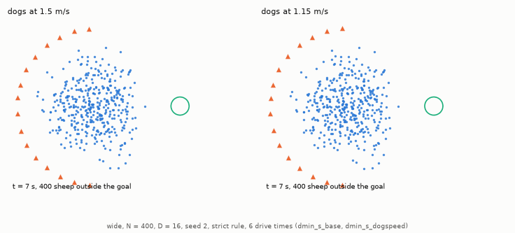

# The success rule and changes to the setup

Part 2 of the HerdSim report on team size. The [overview](d_min_report.md) holds the abstract, the research questions, the [decision rules](d_min_report.md#2-decision-rules-and-setup) that define $D_{\min}$, its brackets and lower bounds, the [start layouts and dog rules](d_min_report.md#22-start-layouts-dog-rules-and-protocols), the discussion and the [references](d_min_report.md#references). Terms are defined in the [glossary](../glossary.md).

## 3.4 RQ4: The success rule and the last sheep

In the main runs the 99% rule never needs more dogs than the strict rule, and on six large-flock curves it has a reliable team where the strict rule has none or only a lower bound. Under the strict rule large teams mostly fail on the last few sheep, after 99% of the flock has been in the goal. The strict rule needs every sheep in the goal at the same tick, the 99% rule 99% of them ([success and reliability](../glossary.md#success-and-reliability)). `none` means no team up to the top of the grid is reliable, a decided outcome; a bracket such as `3-8` and a lower bound such as `[9]` are still open ([section 2.1](d_min_report.md#21-when-a-team-is-reliable)).

The main runs compare `dmin_m12`, `dmin_m6` and `dmin_m3` with `dmin_f99_m12`, `dmin_f99_m6` and `dmin_f99_m3` at $N = 25$-400. In all 34 scattered curves where both rules give a reliable team, the 99% rule needs the same or fewer dogs. 18 of the 34 are at $N = 25$ and 50, where 99% of the flock rounds up to every sheep. Where both are decided and differ, the saving is exactly one dog. Six large-flock curves have no reliable team under the strict rule but one under the 99% rule: four are `none` under the strict rule, and two are lower bounds at 6 drive times, `wide` $N = 400$ at [9] and `outlier_rich` $N = 200$ at [12], whose cells stay undecided at 200 seeds with success rates of 0.84-0.91. All six have a reliable team under the 99% rule (two decided, three narrow brackets and one wide one, 4-10). Figure 1 compares the two rules cell by cell on the same seeds.

**Figure 1: Strict against 99% success, cell by cell, on the same seeds.** In 40 cells (32 at $N \ge 200$) the 99% success rate is at or above 0.90 while the strict rate is below it. In those cells, whether the last 1% of the flock gets in decides the strict result.

- Marks: each point is one cell (one layout, $N$ and $D$), coloured by layout, with the strict success rate across and the 99% success rate up. The diagonal is $y = x$, and no point lies below it, because a trial that brings every sheep in also meets the 99% rule. The shaded upper left holds the 40 cells above.
- Panels: one per deadline (12, 6 and 3 drive times), scattered layouts at $N \ge 100$, with 80, 57 and 33 shared cells that have at least 20 seeds.

*Data:* `results/dmin_m12`, `dmin_m6` and `dmin_m3`; values in [results_tables.md: strict success](results_tables.md#d_min-by-layout-and-n-strict-success) and [results_tables.md: success at 99 percent](results_tables.md#d_min-by-layout-and-n-success-at-99-percent).

Large teams fail under the strict rule on the last sheep. In the sensitivity base run `dmin_s_base` (`wide` and `outlier_rich`, $N = 100$-400, $D$ up to 16, 6 drive times), 99% of the flock had been in the goal before the deadline in 367 of 379 strict failures with 6 or more dogs (97%; Figure 2). At the tick with the most sheep in, 362 of these 367 had one or two sheep outside and 5 had three or four. In the main run `dmin_m6` (four layouts, $N = 25$-400, $D$ up to 24) the share is 499 of 550 (91%); it includes `split`, where 41 of 78 strict failures had 99% in, and without `split` it is 458 of 472 (97%). In the traced trial of Figure 2 (`wide` $N = 400$, 16 dogs, seed 2) the dogs go after the last sheep, end up between the flock and the goal, and drive the flock that was already in back out of it, twice. Of the 379 failures, 286 (75%) end with no sheep in the goal at the end of the trial. In the traced trial the flock is driven back out of the goal (Animation 1 replays it); we have not checked whether the other trials end the same way.

Slower dogs avoid most of these failures. With dogs at 1.15 m/s instead of 1.5 (`dmin_s_dogspeed`), 1.15 times the sheep's 1 m/s, the ratio of the dog's mean speed of 1.5 m/s to the mean speed of the sheep, 1.3 m/s, in the field data of Jadhav et al. (2024, Fig. 2f), the strict $D_{\min}$ at $N = 400$ drops from none on the grid to 6 on `outlier_rich` and from [9] to 5 on `wide`. Under the 99% rule the base run is already at 3 on `outlier_rich` $N = 400$ and the same slow dogs (`dmin_f99_s_dogspeed`) also give 3, so slower dogs change nothing there. The slower dogs also differ during gathering, so this variant supports the reading that the strict failures arise at the goal without proving it.

**Figure 2: Where strict failures arise, with 6 or more dogs.** With dogs at 1.5 m/s the flock arrives but the last sheep often does not. With dogs at 1.15 m/s nearly every trial brings every sheep in.

- Left: share of trials with 6 or more dogs, one group of bars per layout and $N$, in which every sheep got in (dark blue), in which 99% of the sheep were in at some tick (hatched), and in which every sheep got in with dogs at 1.15 m/s (orange). With dogs at 1.5 m/s the first two bars differ by 0.4, 5.8 and 15.2 percentage points on `wide` $N = 100$, 200 and 400, and by 1.0, 15.6 and 30.8 points on `outlier_rich`. Over the six groups together they differ by 10.5 points (367 of 3480 trials).
- Right: one trial (`wide` $N = 400$, 16 dogs, seed 2), with the distance from the flock centre to the goal (top) and the sheep outside the goal on a symmetric log scale, linear near zero (bottom). Fast dogs (blue) bring 399 sheep in, then drive the flock back out twice while chasing the last one. Slower dogs (orange) finish in one pass.

*Data:* `results/dmin_s_base` and `results/dmin_s_dogspeed`; values in [results_tables.md: Sensitivity, strict: base / variant](results_tables.md#sensitivity-strict-base--variant).

**Animation 1: The last sheep, replayed (`wide`, $N = 400$, 16 dogs, seed 2, strict rule, 6 drive times).** Fast dogs lose the last sheep and the flock with it, and slower dogs finish in one pass. Both start from the same flock, and each replay reproduces its stored trial.

- Left: dogs at 1.5 m/s bring the flock to the goal with a sheep or two missing, drive it out again while chasing them, and run out of time.
- Right: dogs at 1.15 m/s bring every sheep in on the first pass.

## 3.5 RQ5: Which results survive changes to the setup?

Some setup choices have no real-world value, such as where the dogs start. Apart from the goal size, changing one of them moves the 99% $D_{\min}$ by at most one dog for certain, except that the [field-matched sheep](../glossary.md#variants) may lower it by two on one curve. Under the strict rule the same changes move $D_{\min}$ a lot, in both directions. The [sensitivity runs](../glossary.md#trials-and-experiments) are 14 protocols at 6 drive times, a base run and six variants under each rule, each variant changing one choice on the seeds of its base (Figure 3).

Under the 99% rule, releasing the dogs from one point (`handler`) or a ring round the flock (`ring`), a start gap of 15 or 60 m instead of 30 m between the flock and the first dogs (the "start gap"), or dogs at 1.15 m/s move $D_{\min}$ by at most one dog for certain. With the [field-matched sheep](../glossary.md#variants), the parameters Strömbom et al. (2014) set to mimic real sheep, $D_{\min}$ on `outlier_rich` $N = 200$ may drop by two, from 2-3 to 1, and on the other five curves it moves by at most one dog.

The goal size moves the 99% $D_{\min}$ more, at $N = 400$ only. With a goal radius of $1.5 R_f$ instead of $1.9 R_f$ ($R_f$ is the calibrated flock radius, [the drive task](../glossary.md#the-drive-task)), `wide` $N = 400$ goes from 2-3 to 5-6 dogs and `outlier_rich` $N = 400$ from 3 to none; at $N = 100$ and 200 it does not change. Under the strict rule the smaller goal leaves `outlier_rich` $N = 100$ at 3 and takes `wide` $N = 100$ from 1 to 1-3. This may be because a settled flock only just fits in the smaller goal; we have not tested it.

Under the strict rule the changes go both ways. `wide` $N = 200$ goes from 3 to none with the field-matched sheep and to [3] with a start gap of 15 m. A start gap of 60 m brings `wide` $N = 400$ from [9] to 6-7 and `outlier_rich` $N = 200$ from [12] to 5, and slower dogs bring `outlier_rich` $N = 200$ from [12] to 4. This may be because small changes in the setup change how the last sheep comes in; we have not tested it.

**Figure 3: $D_{\min}$ for each setup change at 6 drive times.** Under the 99% rule most changes match the base within one dog. Under the strict rule many do not.

- Marks: each cell gives $D_{\min}$ in the forms of [section 2.1](d_min_report.md#21-when-a-team-is-reliable), a single value, a bracket such as `2-3`, or a lower bound such as `[9]`. Darker blue is a larger team. Brackets and lower bounds are drawn faded because they are still open. Hatched cells marked "none" have no reliable team up to 16, the top of these grids.
- Rows: the base, then the changes, the field-matched sheep, dog start (`handler`, `ring`), goal radius $1.5 R_f$, start gap 15 and 60 m, and dog speed 1.15 m/s. The top half uses the strict rule, the bottom half the 99% rule.
- Columns: layout and flock size ($N = 100, 200, 400$).

*Data:* [results_tables.md: Sensitivity, strict: base / variant](results_tables.md#sensitivity-strict-base--variant) and [results_tables.md: Sensitivity, 99 percent: base / variant](results_tables.md#sensitivity-99-percent-base--variant).
