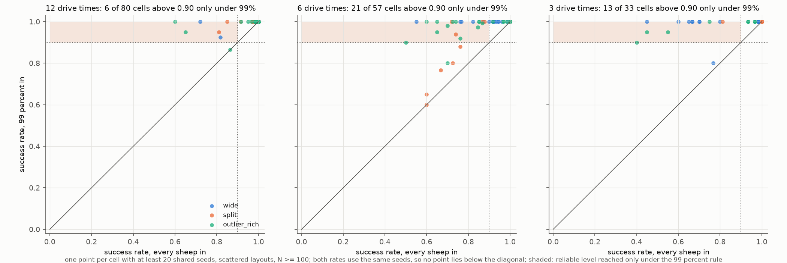
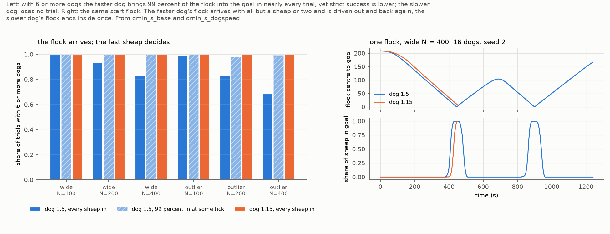
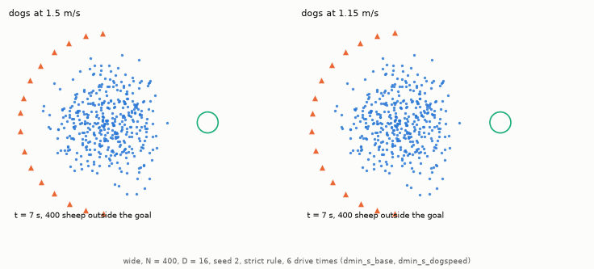
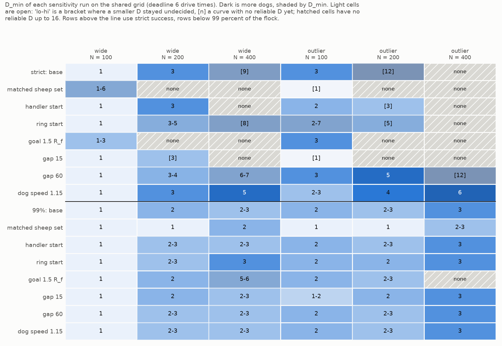

# The success rule and changes to the setup

## 3.4 RQ4: The success rule and the last sheep

[RQ4](d_min_report.md#1-research-questions) asks how the strict and 99% [success rules](../glossary.md#success-and-reliability) differ, and why large teams fail under the strict one. In the main runs the 99% rule never needs more dogs, and on six large-flock curves it has a reliable team where the strict rule has none or only a lower bound (Table 1). Large teams fail the strict rule mostly on the last few sheep.

$D_{\min}$ is the smallest reliable team on a curve, one layout and $N$; [section 2.1](d_min_report.md#21-when-a-team-is-reliable) defines reliable, decided and undecided cells, brackets and lower bounds, and the [glossary](../glossary.md#trials-and-experiments) curves, cells, seeds and protocol ids. The main runs compared are `dmin_m12`, `dmin_m6`, `dmin_m3` against `dmin_f99_m12`, `dmin_f99_m6`, `dmin_f99_m3` (12, 6 and 3 drive times).

**Table 1: Scattered curves of the main runs by outcome under each rule ($N = 25$-400, 12, 6 and 3 drive times).**

| Curves | Count | Strict rule | 99% rule |
| :--- | :---: | :--- | :--- |
| Both reliable, $N = 25$ and 50 | 18 | reliable | the same $D_{\min}$ |
| Both reliable, $N \ge 100$ | 16 | reliable | the same on 6, one dog fewer on 6, a bracket on 4 |
| Reliable only under 99% | 6 | `none` on four, a lower bound on two | two decided, three narrow brackets, one wide (4-10) |
| Total | 40 of 45 | | |

The other 5 have no reliable team under either rule (`split` at 6 and 3 drive times, $N = 200$ and 400; `outlier_rich` at 3 drive times, $N = 400$). At $N = 25$ and 50 the rules are the same, as 99% of the flock rounds up to every sheep ($0.99 \times 25 = 24.75$, $0.99 \times 50 = 49.5$). The two strict lower bounds, at 6 drive times, are `wide` $N = 400$ at [9] and `outlier_rich` $N = 200$ at [12]; their cells stay undecided after 200 seeds with success rates of 0.84-0.91. Figure 1 compares the rules cell by cell.

**Figure 1: Strict against 99% success, cell by cell on the same seeds (scattered layouts, $N \ge 100$, 12, 6 and 3 drive times).** In 40 cells (32 at $N \ge 200$) the 99% success rate is at or above 0.90 while the strict rate is below it. There the last 1% of the flock decides the strict result.

- Marks: each point is one cell (one layout, $N$ and $D$), coloured by layout, with the strict success rate across and the 99% success rate up. The diagonal is $y = x$; no point lies below it, because a trial that brings every sheep in also meets the 99% rule. These 40 cells are shaded.
- Panels: one per deadline (12, 6 and 3 drive times), with 80, 57 and 33 shared cells that have at least 20 seeds.

*Data:* `results/dmin_m12`, `dmin_m6` and `dmin_m3`; values in [results_tables.md: strict success](results_tables.md#d_min-by-layout-and-n-strict-success) and [results_tables.md: success at 99 percent](results_tables.md#d_min-by-layout-and-n-success-at-99-percent).

In 97% of the strict failures with 6 or more dogs (367 of 379), 99% of the flock had already been in the goal before the deadline (Figure 2), in the [sensitivity](#35-rq5-which-results-survive-changes-to-the-setup) base run `dmin_s_base` (`wide` and `outlier_rich`, $N = 100$-400, up to 16 dogs, 6 drive times). At the [tick](../glossary.md#trials-and-experiments) (1 s) with the most sheep in, 362 of these 367 had one or two sheep outside and 5 had three or four. The main run `dmin_m6` (four layouts, $N = 25$-400, $D$ up to 24) gives 499 of 550 (91%), lower because only 41 of its 78 `split` failures had 99% in; without `split` it is 458 of 472 (97%).

Of the 379 strict failures, 286 (75%) end with no sheep in the goal. In the trial of Figure 2 (right) and Animation 1 the dogs drive the flock back out of the goal while they chase the last sheep; we have not checked whether other trials end the same way.

Slower dogs avoid most of these failures. Jadhav et al. (2024) measured in the field a dog with "a mean speed of 1.5 ms-1, slightly higher than the mean speed of sheep, 1.3 ms-1" (main text, p. 4, Fig. 2f), 1.15 times as fast. The variant `dmin_s_dogspeed` keeps that ratio with the sheep at 1 m/s, so its dogs run at 1.15 m/s, not the default 1.5 m/s. The strict $D_{\min}$ at $N = 400$ then drops from none on the grid to 6 on `outlier_rich` and from [9] to 5 on `wide`. Under the 99% rule `outlier_rich` $N = 400$ stays at 3 with slow dogs (`dmin_f99_s_dogspeed`). This fits failures at the goal but does not prove it, since slower dogs change the whole drive.

**Figure 2: Where strict failures arise with 6 or more dogs (`dmin_s_base` against `dmin_s_dogspeed`, `wide` and `outlier_rich`, $N = 100$-400, strict rule, 6 drive times).** At 1.5 m/s, 99% of the flock got in but not every sheep in 367 of the 3480 trials with 6 or more dogs (10.5 percentage points pooled; Table 2 gives each group). At 1.15 m/s nearly every trial brings every sheep in.

- Left: per layout and $N$, the share of trials where every sheep got in (dark blue), 99% were in at some tick (hatched), and every sheep got in with dogs at 1.15 m/s (orange).
- Right: the trial of Animation 1 (`wide` $N = 400$, 16 dogs, seed 2), with the distance from the flock centre to the goal (top) and the sheep outside the goal on a symmetric log scale, linear near zero (bottom); blue for dogs at 1.5 m/s, orange for 1.15 m/s.

*Data:* `results/dmin_s_base` and `results/dmin_s_dogspeed`; values in [results_tables.md: Sensitivity, strict: base / variant](results_tables.md#sensitivity-strict-base--variant).

**Table 2: Percentage points of trials in which 99% of the flock got in but not every sheep (`dmin_s_base`, 6 or more dogs, strict rule, 6 drive times).**

| Layout | $N = 100$ | $N = 200$ | $N = 400$ |
| :--- | :---: | :---: | :---: |
| `wide` | 0.4 | 5.8 | 15.2 |
| `outlier_rich` | 1.0 | 15.6 | 30.8 |

**Animation 1: The last sheep, replayed (`wide`, $N = 400$, 16 dogs, seed 2, strict rule, 6 drive times).** Dogs at 1.5 m/s bring 399 sheep into the goal, then drive the flock back out twice while chasing the last one, and run out of time. Dogs at 1.15 m/s bring every sheep in on the first pass. Both start from the same flock, and each [replay](../glossary.md#trials-and-experiments) reproduces its stored trial.

- Left: dogs at 1.5 m/s.
- Right: dogs at 1.15 m/s.

## 3.5 RQ5: Which results survive changes to the setup?

Some setup choices have no measured value, such as where the dogs start. Apart from the goal size, changing one moves the 99% $D_{\min}$ by at most one dog, for any outcome of the open brackets, except that the field-matched sheep may take `outlier_rich` $N = 200$ from 2-3 to 1. Under the strict rule the same changes move $D_{\min}$ a lot, in both directions (Table 3, Figure 3).

The [sensitivity runs](../glossary.md#trials-and-experiments) are 14 protocols at 6 drive times: under each rule a base run and six variants on its seeds. The variants make seven changes, as the start-gap protocols (`dmin_s_gap`, `dmin_f99_s_gap`) run gaps of 15 and 60 m beside the base 30 m.

**Table 3: How each setup change moves $D_{\min}$ from the base run (sensitivity runs, `wide` and `outlier_rich`, $N = 100$-400, 6 drive times).**

| Change | 99% rule | Strict rule |
| :--- | :--- | :--- |
| [Dog start](../glossary.md#start-layouts-and-dog-starts) `handler` (one point) or `ring` (round the flock) instead of arcs behind it | at most one dog each | Figure 3 only |
| [Start gap](../glossary.md#start-layouts-and-dog-starts) 15 m instead of 30 m | at most one dog | `wide` $N = 200$: 3 to [3] |
| Start gap 60 m | at most one dog | `wide` $N = 400$: [9] to 6-7; `outlier_rich` $N = 200$: [12] to 5 |
| Dogs at 1.15 m/s ([section 3.4](#34-rq4-the-success-rule-and-the-last-sheep)) | at most one dog | `outlier_rich` $N = 200$: [12] to 4 |
| [Field-matched sheep](../glossary.md#variants) of Strömbom et al. (2014) | `outlier_rich` $N = 200$: 2-3 to 1; others at most one dog | `wide` $N = 200$: 3 to none |
| Goal radius $1.5 R_f$ instead of $1.9 R_f$ ([$R_f$](../glossary.md#the-drive-task)) | $N = 400$: `wide` 2-3 to 5-6, `outlier_rich` 3 to none; $N = 100$ and 200 unchanged | `outlier_rich` $N = 100$ stays 3; `wide` $N = 100$: 1 to 1-3 |

A settled flock of 400 may only just fit in the smaller goal; we have not tested that. The strict swings may come from how the last sheep comes in, as the slower dogs suggest; no run tests that for the other changes.

**Figure 3: $D_{\min}$ for each setup change (sensitivity runs, `wide` and `outlier_rich`, $N = 100$-400, 6 drive times, both rules).** Under the 99% rule most changes match the base within one dog. Under the strict rule many do not.

- Marks: each cell gives $D_{\min}$ in the forms of [section 2.1](d_min_report.md#21-when-a-team-is-reliable); darker blue is a larger team, and the still open brackets and lower bounds are faded. Hatched cells marked "none" have no reliable team up to 16, the top of these grids.
- Rows: the base, then one row per change of Table 3; strict rule in the top half, 99% rule in the bottom half.
- Columns: layout and flock size ($N = 100, 200, 400$).

*Data:* [results_tables.md: Sensitivity, strict: base / variant](results_tables.md#sensitivity-strict-base--variant) and [results_tables.md: Sensitivity, 99 percent: base / variant](results_tables.md#sensitivity-99-percent-base--variant).
