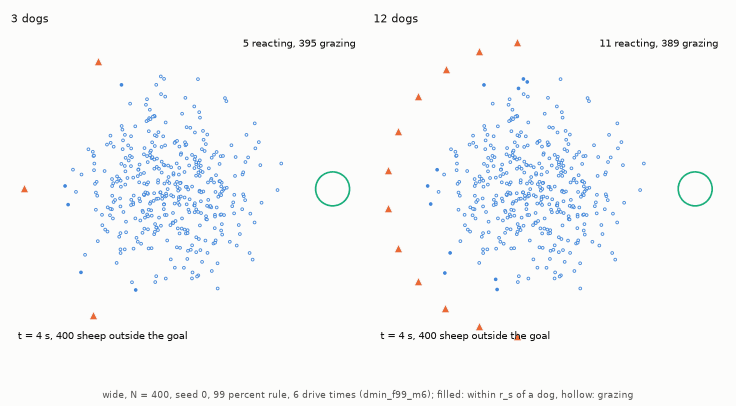
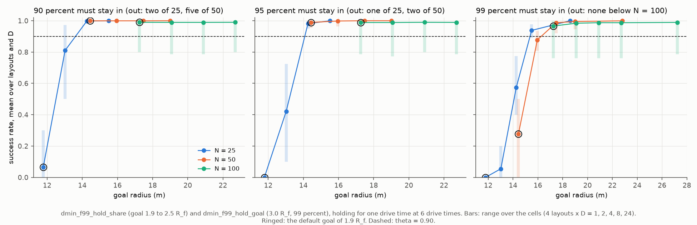

# Enough dogs and too many dogs

Part 3 of the HerdSim report on team size. The [overview](d_min_report.md) holds the abstract, the research questions, the [decision rules](d_min_report.md#2-decision-rules-and-setup) that define $D_{\min}$, its brackets and lower bounds, the [start layouts and dog rules](d_min_report.md#22-start-layouts-dog-rules-and-protocols), the discussion and the [references](d_min_report.md#references). Terms are defined in the [glossary](../glossary.md).

## 3.7 RQ7: Beyond D_min: enough dogs, cost, and pressure on the flock

The smallest reliable team leaves three practical questions open: whether more dogs make the drive faster, what each extra dog costs, and whether more dogs put the sheep under more stress. We read the answers from the 99% runs, and replayed 164 stored trials to measure how long each sheep spends fleeing (every replay reproduced its stored trial exactly). From the team size $D_{\mathrm{sat}}$ on, more dogs stop making the drive faster (item 1). Beyond it each dog adds dog time ($D$ times the finish time) but little speed (item 2). More dogs make more sheep flee at once but hardly longer in total (item 3), and under the 99% rule extra dogs almost never make the task fail (items 4 and 5).

### 1. When more dogs stop helping (D_sat)
$D_{\mathrm{sat}}$ is the smallest reliable team that no larger reliable team beats on finish time by more than 5%, at 99% confidence; when a comparison stays undecided, $D_{\mathrm{sat}}$ is shown as a range ([how teams are compared](../experiments/task_design.md#frontier-values)).
- Compact flocks and $N \le 50$: $D_{\mathrm{sat}} = 1$ (except `outlier_rich` $N = 50$, bracketed at 1–24). One dog already keeps the flock walking at 1 m/s.
- Scattered flocks at 6 drive times: $D_{\mathrm{sat}}$ is 2 to 7 where decided at $N = 100$ to 400 (`outlier_rich` $N = 100$: 3; `wide` $N = 400$: 5; `split` $N = 141$: 7); on `outlier_rich` at $N \ge 283$ the top of the bracket is still open.
- After the finish-time top-up runs ([section 3.8](part1_growth.md#38-rq8-growth-with-n-on-a-denser-grid-d_sat-and-the-shape-of-the-curve)), $D_{\mathrm{sat}}$ on `wide` is 1, 1, 1, 2, 3, 3, 4, 5 from $N = 25$ to 400.
- $D_{\mathrm{sat}}$ does not change between 12 and 6 drive times; at 3, $D_{\min}$ rises to $D_{\mathrm{sat}}$ on `wide` but not on `outlier_rich` or `split` ([section 3.3](part1_growth.md#33-rq3-how-does-the-deadline-change-d_min)).

### 2. What dogs beyond D_sat cost
- In all 189 reliable cells above a decided $D_{\mathrm{sat}}$ at 6 drive times, the finish time is 0.96 to 1.01 times the $D_{\mathrm{sat}}$ time: at most 4% faster, sometimes 1% slower (Figure 1).
- Dog time grows with $D / D_{\mathrm{sat}}$. On a compact flock of 50, 24 dogs take the same 154 s as one dog, for 24 times the dog time. The dogs are moving for nearly all of it: at $N = 400$ (6 drive times, 99% rule) the median dog runs at 1.44–1.50 m/s on `compact`, `wide` and `outlier_rich`, close to its top speed of 1.5 m/s, and at 1.20–1.40 m/s on `split`, where up to 20% of the dogs stand still.

Table 1 compares twice $D_{\mathrm{sat}}$ and $D = 24$ with the $D_{\mathrm{sat}}$ cell (scattered flocks, 6 drive times):

**Table 1: Finish time and dog time at twice $D_{\mathrm{sat}}$ and at $D = 24$, relative to the $D_{\mathrm{sat}}$ cell.**

| Layout, $N$ | $D_{\mathrm{sat}}$ | At $2 D_{\mathrm{sat}}$: finish time / dog time | At $D = 24$: finish time / dog time |
| :--- | :---: | :---: | :---: |
| `wide`, $N = 200$ | 3 | 0.97 / 1.94 | 0.96 / 7.70 |
| `wide`, $N = 400$ | 5 | 0.97 / 2.32 (at $D = 12$) | 0.96 / 4.61 |
| `outlier_rich`, $N = 100$ | 3 | 0.99 / 1.98 | 0.98 / 7.85 |
| `outlier_rich`, $N = 400$ | 6–24 | 0.96 / 1.91 | 0.94 / 3.74 |
| `split`, $N = 100$ | 4 | 0.99 / 1.98 | 0.99 / 5.91 |

At $D = 24$ the drive is 1% to 6% faster than at $D_{\mathrm{sat}}$, for 3.7 to 7.9 times the dog time.  
*Data:* [results_tables.md: Effort, dmin_f99_m6](results_tables.md#effort-dmin_f99_m6-cost-of-dogs-beyond-d_sat-relative-to-the-d_sat-cell-1) and [results_tables.md: D_sat, dmin_f99_m6](results_tables.md#d_sat-dmin_f99_m6-d_sat-1).

### 3. Pressure on the sheep
A sheep flees while a dog is within 65 m ($r_s$). The replays measure how long that lasts (Figure 2).
- Each sheep flees for less time, up to $D_{\mathrm{sat}}$: more dogs gather the flock sooner, so the drive is shorter. On `wide` $N = 400$ the median flight time per sheep falls from 485 s at $D = 3$ to 359 s at $D = 6$, and stays there (361 s at $D = 12$). The replay used $D = 6$ as $D_{\mathrm{sat}}$, its value before the finish-time top-up; it is now 5.
- More of the flock flees at once: a larger team spreads over a wider arc, and the median share of the flock fleeing at a given moment rises from 68% at $D = 3$ to 84% at $D = 12$. Because the drive ends sooner, the total time each sheep spends fleeing does not rise.
- Dogs stay off the sheep: the time a sheep spends within 6 m ($3 r_a$, the dog's stop distance) of a dog stays below 1.3 s per sheep (median) at every team size.

### 4. Extra dogs almost never make the task fail
Under the 99% rule, on the five original flock sizes and up to 24 dogs, no curve that reaches a reliable team becomes unreliable again at larger teams. The exceptions, and the cases where extra dogs only slow the drive:
- Dips: on the denser grid there is one (`split` $N = 141$, $D = 4$, success 0.80). Under the strict rule there are two more, both on `split` $N = 100$. At 3 drive times one dog is reliable (60 of 60), 2 to 4 dogs are not (5 of 10, 5 of 10, 97 of 120), and from 5 dogs the team is reliable again; at 6 drive times 3 dogs are decided unreliable (36 of 50) between a reliable 1 and a reliable 5.
- Slower drives: on `split` $N = 400$ at 12 drive times, the median finish time is 950–1040 s for $D \ge 9$ against 839 s at $D = 5$, though the task still succeeds.
- Where the time goes: the flock arrives in two parts ([section 4.1](part5_failures.md#41-why-more-dogs-do-not-help-on-split)). At 12 drive times:
  - on `split` at $N = 200$ to 566, teams from 3 dogs up (from 2 at $N = 283$, from 4 at $N = 566$) bring 90% of the flock in and then take a median 294 to 694 s for the next 9%;
  - on `outlier_rich` $N = 566$ teams from 12 dogs up take 465 to 578 s;
  - on `outlier_rich` $N = 283$ only 5 and 8 dogs show the gap (380 and 330 s); the other teams take 8 to 12 s.
- The upper values of `outlier_rich` $N = 566$ ([item 5](#5-the-upper-end-of-the-curves-d_max-d_crowd-and-d_overcrowd)): at 12 drive times 16 and 24 dogs succeed in 130 of 130 and 100 of 100 trials, and since a shorter deadline only cuts the same trials ([section 3.3](part1_growth.md#33-rq3-how-does-the-deadline-change-d_min)), their failures at 6 drive times are trials that finish later. Its $D_{\max}$ (12 at 6 drive times) may therefore be set by the late arrivals; we have not tested it. Its $D_{\mathrm{crowd}}$ (15 at 12) comes from the same slowing.
- Two groups of trials on `outlier_rich` $N = 283$ at 6 drive times: at $D = 5$ the quartiles are 367 and 799 s and the median, 725 s, lies in the slow group, while at 6 to 12 dogs the median lies in the fast group (357–375 s) and the upper quartile in the slow one (774–815 s). Medians compare such teams badly, and its $D_{\mathrm{sat}}$ stays a bracket from 5 (5–24).

### 5. The upper end of the curves: D_max, D_crowd and D_overcrowd
In the three 99% main runs no largest working team was found below 24 dogs, the top of the grid. Four values bound a curve from above ([frontier values](../experiments/task_design.md#frontier-values)): $D_{\mathrm{best}}$, the smallest team as fast as the fastest; $D_{\mathrm{crowd}}$, the first reliable team above $D_{\mathrm{best}}$ that is slower than it; $D_{\mathrm{overcrowd}}$, the first team from which two tested sizes in a row are unreliable, looked for above $D_{\min}$; and $D_{\max}$, the largest reliable team below $D_{\mathrm{overcrowd}}$. In the three 99% main runs:
- $D_{\max}$ is almost always the top of the grid: 84 of the 85 curves with a $D_{\min}$ are still reliable at 24 dogs, so no upper limit was found and $D_{\max}$ is only a lower bound. The one exception, `outlier_rich` $N = 566$ at 6 drive times, has $D_{\max} = 12$ because 16 and 24 dogs are still undecided at 0.94.
- $D_{\mathrm{crowd}}$ appears on 6 curves at 12 drive times: `split` at $N = 71$, 200, 283, 400 and 566 (from 2 to 14 dogs) and `outlier_rich` $N = 566$ (15 dogs). These teams still succeed but finish later than the fastest team, which is the slowing described in item 4.
- $D_{\mathrm{overcrowd}}$ appears on 4 curves on which no team is decided reliable: `split` $N = 200$, 283 and 400 at 6 drive times (from 4, 15 and 10 dogs) and `outlier_rich` $N = 400$ at 3 (from 7). On these curves the larger teams stay near but mostly below $\theta$ (`split` $N = 200$: 0.60–0.95; $N = 283$ and 400 from 5 dogs: 0.70–0.93; `outlier_rich` $N = 400$ from 5 dogs: 0.60–0.86). The onset is the first point where two tested sizes in a row are decided unreliable on a curve that never clears $\theta$.

More dogs do make the task fail in a few follow-up settings. With whole-team sharing at a range of 65 m, `split` $N = 200$ is reliable with 3 dogs, decided unreliable at 4, 6, 8, 9, 13, 14 and 16 dogs and undecided at 0.85 with 10 and 12 ([section 3.12](part4_coordination.md#312-rq12-what-a-dog-sees-and-sharing-it)); near the smallest goal that holds a flock of 25, larger teams fail ([section 3.10](#310-rq10-when-do-more-dogs-hurt-holding-the-flock-and-dogs-that-take-up-room)). The largest fall is with dogs kept 2 m apart in the holding task: on `outlier_rich` $N = 400$ teams of 3 to 8 reach 0.87–0.94 (200 trials each), and from 9 dogs up success is 0.50–0.77 (10 to 70 trials per cell), so $D_{\mathrm{overcrowd}} = 9$.  
*Data:* [results_tables.md: the upper end of the curves](results_tables.md#the-upper-end-of-the-curves-d_max-d_crowd-and-d_overcrowd) (`uv run cli/dmin_tables.py upper ...`); success rates per cell in each folder's `frontier_cells.csv`.

**Figure 1: Cost of dogs beyond $D_{\mathrm{sat}}$ (6 drive times, 99% rule).** On the curves with a decided $D_{\mathrm{sat}}$, dogs beyond it make the drive about 4% faster at most, while the dog time grows in proportion to the team.

- Marks: each line is one curve (one layout and $N$, coloured by layout) with a decided $D_{\mathrm{sat}}$, and each point is one reliable team from $D_{\mathrm{sat}}$ up, 27 lines and 189 cells above their $D_{\mathrm{sat}}$. The horizontal axis is $D / D_{\mathrm{sat}}$ (log scale), so every line starts at 1 and $x = 2$ means twice the team needed; on `wide` $N = 400$ ($D_{\mathrm{sat}} = 5$), $D = 24$ sits at 4.8.
- Left: median finish time divided by that of the $D_{\mathrm{sat}}$ cell, so 0.97 means 3% faster. Every curve stays within about 0.96 to 1.01 (the largest ratio is 1.012), a narrow range that the axis stretches. Points below 1 do not contradict $D_{\mathrm{sat}}$: a larger team counts as faster only when it saves more than 5% of the time with 99% confidence, judged by resampling the paired finish times of shared seeds (a paired bootstrap), and none does.
- Right: dog time ($D$ times the finish time) divided by that of the $D_{\mathrm{sat}}$ cell. The curves follow the diagonal $y = x$, so twice the dogs cost twice the dog time.

*Data:* [results_tables.md: Effort, dmin_f99_m6](results_tables.md#effort-dmin_f99_m6-cost-of-dogs-beyond-d_sat-relative-to-the-d_sat-cell-1).

**Figure 2: How long the sheep flee, against team size (6 drive times, 99% rule).** Larger teams make more sheep flee at once, for a shorter time.

- Marks: medians over successful trials for $N = 100$ (circles, dotted) and $N = 400$ (squares, solid); blue is `wide`, green `outlier_rich`. Each curve has points only at the replayed team sizes $D = 1$, $D_{\min}$, $D_{\mathrm{sat}}$ and $2 D_{\mathrm{sat}}$, as they stood before the finish-time top-up ($D_{\mathrm{sat}} = 6$ on `wide` $N = 400$ then, 5 now).
- Left: seconds each sheep spends with a dog within 65 m. From $D_{\min}$ to $D_{\mathrm{sat}}$ it falls, because the flock is gathered sooner; beyond $D_{\mathrm{sat}}$ it stays flat.
- Right: share of the flock fleeing, averaged over each trial.

At $N = 400$ one dog succeeded in none of its 10 trials and $D = 2$ was not replayed, so those curves start at 3.  
*Data:* [results_tables.md: Pressure, dmin_f99_m6](results_tables.md#pressure-dmin_f99_m6-replay-of-12-stored-seeds-per-cell-every-replay-reproduced-its-stored-trial).

**Animation 1: The flock under 3 and 12 dogs, replayed (`wide`, $N = 400$, seed 0, 99% rule, 6 drive times).** With 12 dogs more of the flock flees at once, but the drive is shorter, as in Figure 2. Both start from the same flock, and each replay reproduces its stored trial.

- Marks: filled dots are sheep within $r_s = 65$ m of a dog, which flee; hollow dots graze.
- Left: 3 dogs. At 148 s, 129 of the 400 sheep flee, and the flock is in at 727 s.
- Right: 12 dogs. At 148 s, 395 flee, and the flock is in at 431 s.

## 3.10 RQ10: When do more dogs hurt? Holding the flock, and dogs that take up room

In the open drive under the 99% rule, extra [point dogs](../glossary.md#sheep-models-and-dog-rules) (dogs with no size, as in all the main runs) never lost a reliable team in the main runs (one dip aside, [section 3.7](#37-rq7-beyond-d_min-enough-dogs-cost-and-pressure-on-the-flock)). They do in a few follow-up settings ([section 3.7](#37-rq7-beyond-d_min-enough-dogs-cost-and-pressure-on-the-flock), item 5), most clearly when the flock must stay in the goal while the dogs withdraw (holding): with dogs kept 2 m apart on `outlier_rich` $N = 400$ (result 2), and with a goal just too small for a flock of 25 (result 3). With 99% of the flock held, holding a flock of 50 or fewer fails with the default goal whatever the team (result 1). This may be because the flock walks out of the goal while the dogs withdraw; we have not tested it.

Three sets of protocols change the end of the task or the room each dog takes:

- Holding (`dmin_f99_hold`): the [holding task](../experiments/task_design.md#the-holding-task); a trial succeeds only once 99% of the flock has stayed in the goal for one drive time while the dogs withdraw beyond 65 m.
- Dogs that take up room (`dmin_f99_hold_spacing`): the same task with [dogs kept 2 m apart](../experiments/task_design.md#crowding-with-dogs-that-take-up-room). The arc of dogs behind the flock then has room for a limited number, about $D_{\mathrm{cap}} = 7, 9, 10, 11, 12$ at $N = 25$ to 400 (the arc length divided by the 2 m spacing).
- The goal that holds a small flock (`dmin_f99_hold_goal`, `dmin_f99_hold_share`): the holding task at $N = 25$, 50 and 100 with the goal radius raised from $1.9 R_f$ to 2.1, 2.3 and $2.5 R_f$, crossed with the share that must stay in (99%, 95%, 90%), and to $3.0 R_f$ at 99%, on the seeds of `dmin_f99_hold`.

### Results

1. With 99% held, holding fails on small flocks: on larger flocks ($N \ge 100$) holding works on `wide` and `compact`, with the same $D_{\min}$ as the open drive or one more (1, 2 and 3 dogs on `wide` at $N = 100$, 200, 400). On `split` it fails from $N = 200$ even with point dogs: at $N = 200$ one or two dogs succeed in 98 of 120 and 171 of 200 trials, larger teams in 10% to 75% (10 to 60 trials per cell), and at $N = 400$ no team passes 0.70; with dogs kept 2 m apart, `split` $N = 200$ falls to 0–10% from 6 dogs.

   On small flocks ($N \le 50$) no team holds the flock, and 72% of the failed trials end with no sheep in the goal. The flock enters the goal at its near edge with the dogs behind it. While the dogs withdraw they stay within 65 m of some sheep for 26 to 29 s, and the flock keeps walking: its centre moves a median 17 m at $N = 25$, 15 m at $N = 50$ and 13 m at $N = 100$ (`cli/diagnostics/hold_walk.py`: 239 of 240 replays of stored trials with a goal of $3.0 R_f$, large enough not to cut the walk short; in one the dogs never cleared). A goal of $1.9 R_f$ is 11.8 m at $N = 25$ and 14.4 m at $N = 50$, so the leading sheep cross the far edge. Below $N = 100$ the 99% share is every sheep, so the first sheep out ends the hold; the dogs come back, drive the flock from the far side and push it farther out. This points to the goal size against that walk as the cause of the failure; the walk itself was not varied.

2. Dogs that take up room make extra dogs harmful on `outlier_rich` $N = 400$ (Figure 3):
   - With 3 to 6 dogs the success rate is 0.925–0.94, undecided.
   - From $D = 9$ on, every team up to 24 is decided unreliable: 54 of 70 at $D = 9$ (99% interval 0.62–0.89), 13 of 20 at $D = 12$ (0.34–0.89), 5 of 10 at $D = 16$ (0.13–0.87).
   - This may be because the arc behind a flock of 400 holds only about 12 dogs 2 m apart ($D_{\mathrm{cap}}$); near or above that number, dogs push each other off their places on the arc and cannot leave it to catch a sheep that breaks away. We have not tested this, and it does not explain why failures start at 9 dogs, below that number.
   - On `wide` and `compact` the task stays reliable up to 24 spaced dogs. This may be because the dogs that do not fit on the arc stay behind it without getting in the way; we have not tested it. Whether extra dogs hurt therefore depends on the layout as well as on the space each dog takes.

**Figure 3: Holding at $N = 400$, point dogs against dogs kept 2 m apart.** On `wide` success holds up to 24 spaced dogs; on `outlier_rich` it falls from $D = 9$.

- Marks: success against $D$ (log scale), dotted grey for point dogs and solid blue for dogs 2 m apart. The orange band marks 10 to 12 dogs, the arc capacity $D_{\mathrm{cap}}$ of the larger flocks; the dashed line is $\theta = 0.90$, and hollow markers are cells with fewer than 30 trials.
- Panels: `wide` (left) and `outlier_rich` (right).

*Data:* [results_tables.md: D_min, dmin_f99_hold](results_tables.md#d_min-dmin_f99_hold) and [results_tables.md: D_min, dmin_f99_hold_spacing](results_tables.md#d_min-dmin_f99_hold_spacing).

3. A goal of about 16 to 19 m holds a small flock with one dog (Figure 4): Table 2 gives, for each share, the smallest goal tested from which one dog is decided reliable on every layout; a range means one dog is still undecided at the smaller goal.
   - With 99% held, the threshold is $2.5$–$3.0 R_f$ (15.5–18.6 m) at $N = 25$ and $2.1$–$2.3 R_f$ (16.0–17.5 m) at $N = 50$. At $N = 100$ the default $1.9 R_f$ (17.3 m) already holds the flock with one dog on three layouts; it is an upper bound, since no smaller goal was tested. In metres the thresholds are close to each other, while in flock radii they fall from about 2.5 to 1.9.
   - The walk predicts this. A flock that enters with its last sheep at the near edge and walks $w$ keeps every sheep in only if the goal radius exceeds about $w/2$ plus the distance of its farthest sheep from the centre: 14.3, 15.7 and 17.2 m at $N = 25$, 50 and 100 (medians over the replays), at or just below the thresholds observed. This agreement is consistent with the walk being the cause; the walk itself was not varied.
   - Letting sheep stay out lowers the goal needed: at $N = 25$ one sheep out (95%) lowers it by one step of the tested grid or more, from 15.5–18.6 m to 14.3 m, and a second (90%) by up to one more step, to 13.0–14.3 m. At $N = 50$ two sheep out (95%) are enough for the default goal of 14.4 m, at least 1.6 m below the 99% threshold.
   - Near the threshold extra dogs hurt: where a goal holds the flock with margin, one dog does and larger teams do as well. At a goal just short of that, one dog does best: at $N = 25$, 90%, $2.1 R_f$, one dog is reliable on `split` and `outlier_rich`, while on every layout teams from 3 to 7 dogs upward are decided unreliable (success down to 0.50); at $N = 50$, 99%, $2.1 R_f$, 4 dogs are decided unreliable on `wide` and `outlier_rich`. This may be because the flock walks about a metre farther during the withdrawal with two or more dogs (17.5–17.8 m) than with one (16.6 m) at $N = 25$, which could tip a marginal goal; we have not tested it.
   - At $N = 100$ only `outlier_rich` needs more than one dog: 3 at the default goal with 99% held, 2 with any larger goal or smaller share.
   - The cells the three holding protocols share (the default goal at 99%, and $2.5 R_f$ at 99%) reproduced each other's trials exactly: 2410, 3750 and 7420 shared trials, with the same outcome and length.

Table 2 lists the smallest goal tested from which one dog is decided reliable on every layout (holding for one drive time, 6 drive times; "≤" where the default $1.9 R_f$, the smallest goal tested, already holds):

**Table 2: Smallest goal tested from which one dog is decided reliable on every layout.**

| Share that must stay in | $N = 25$ | $N = 50$ | $N = 100$ |
| :--- | :---: | :---: | :---: |
| 99% (out: none below $N = 100$, one at 100) | $2.5$–$3.0 R_f$ = 15.5–18.6 m | $2.1$–$2.3 R_f$ = 16.0–17.5 m | ≤ $1.9 R_f$ = 17.3 m (`outlier_rich` 3) |
| 95% (out: one of 25, two of 50, five of 100) | $2.3 R_f$ = 14.3 m | ≤ $1.9 R_f$ = 14.4 m | ≤ $1.9 R_f$ = 17.3 m (`outlier_rich` 2) |
| 90% (out: two of 25, five of 50, ten of 100) | $2.1$–$2.3 R_f$ = 13.0–14.3 m | ≤ $1.9 R_f$ = 14.4 m | ≤ $1.9 R_f$ = 17.3 m (`outlier_rich` 2) |

At $N = 25$ and 99%, $2.5 R_f$ holds `compact` and `split` with one dog while `wide` (1–2) and `outlier_rich` (1–3) are still open; at $N = 25$ and 90%, $2.1 R_f$ holds `split` and `outlier_rich` with one dog while `compact` and `wide` are still bounds ([1]); at $N = 50$ and 99%, one dog at $2.1 R_f$ is undecided on every layout (success 0.90–0.94 over 200 seeds).  
*Data:* [results_tables.md: dmin_f99_hold_goal](results_tables.md#dmin_f99_hold_goal-dmin_f99_hold--dmin_f99_hold_goal), [results_tables.md: dmin_f99_hold_share](results_tables.md#dmin_f99_hold_share-dmin_f99_hold--dmin_f99_hold_share) and [results_tables.md: walk while the dogs withdraw](results_tables.md#walk-while-the-dogs-withdraw-dmin_f99_hold_goal-at-30-r_f-replay-of-5-stored-seeds-per-cell-every-replay-reproduced-its-stored-trial).

**Figure 4: Holding success against the goal radius in metres, for each share that must stay in.** With 99% held, the curves of $N = 25$ and 50 rise between about 13 and 17.5 m, and $N = 100$ is already above $\theta$ at its default 17.3 m; letting one or two sheep out moves the rise of the small flocks to smaller goals.

- Marks: each point is the mean success rate over the 20 cells of one flock size and goal (4 layouts × $D = 1, 2, 4, 8, 24$, each cell counted once, without the midpoints the adaptive run added). The bar is the range over those cells, and its low end near the threshold is the larger teams; at $N = 100$ the low end is `outlier_rich` with one dog. Blue is $N = 25$, orange $N = 50$, green $N = 100$; ringed points are the default goal of $1.9 R_f$, and the dashed line is $\theta = 0.90$.
- Panels: 90%, 95% and 99% of the flock must stay in the goal for one drive time, from left to right.

*Data:* `results/dmin_f99_hold_share` and `results/dmin_f99_hold_goal` (the $3.0 R_f$ points).

Animation 1 in [task design](../experiments/task_design.md#the-holding-task) replays one dog holding a flock of 25 in a goal of $1.9 R_f$, where the flock walks out, and of $3.0 R_f$, where it is held.
