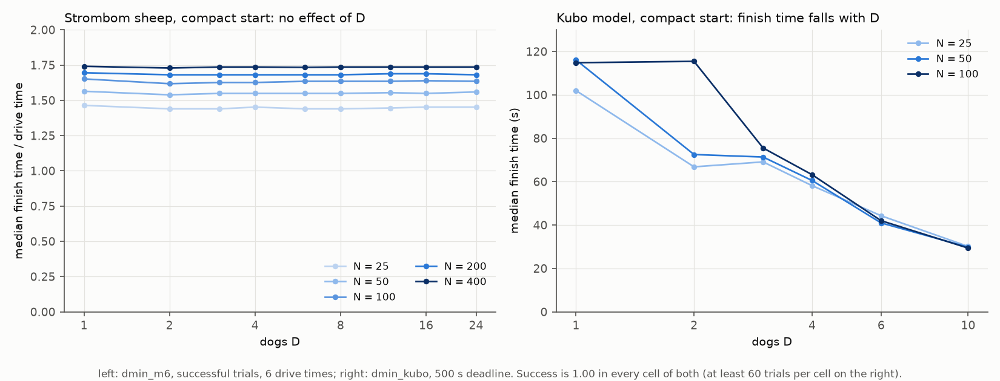
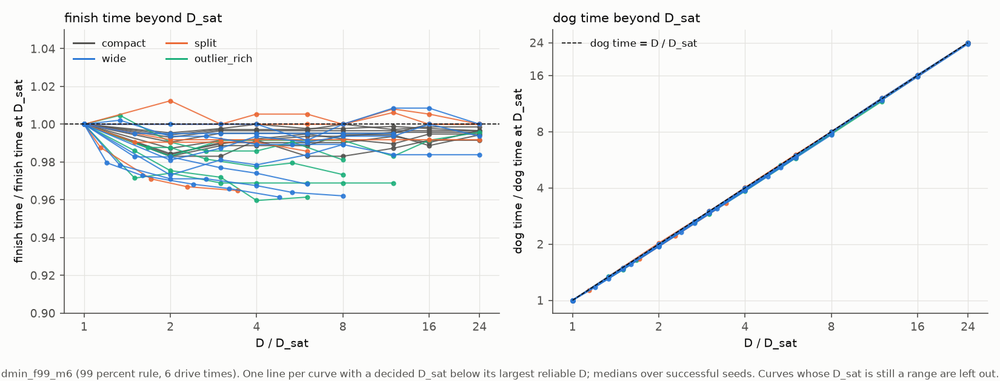
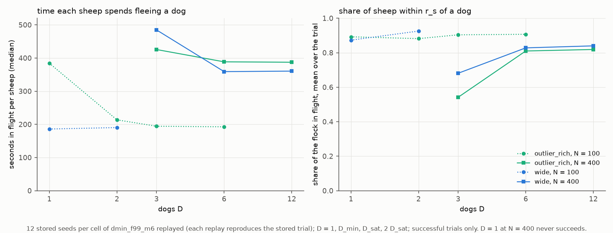
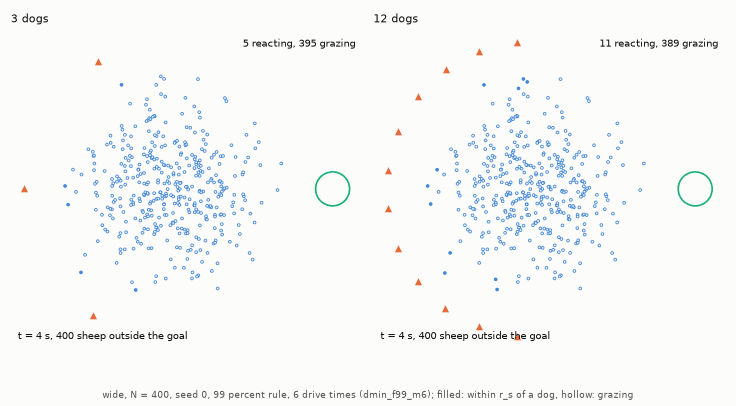
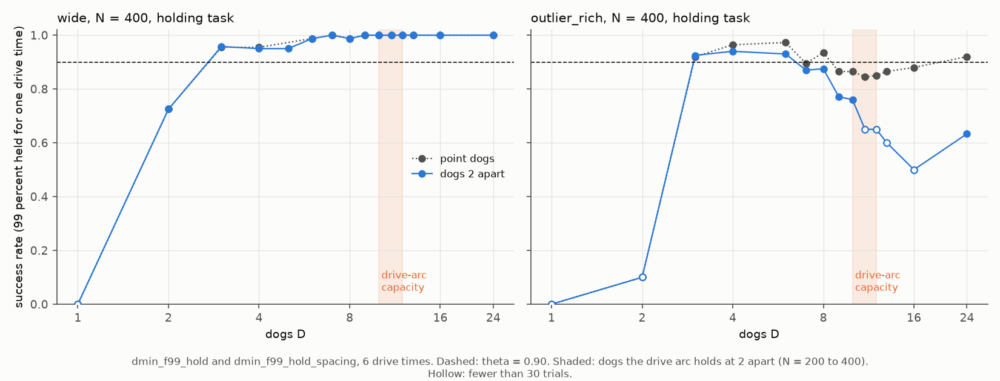
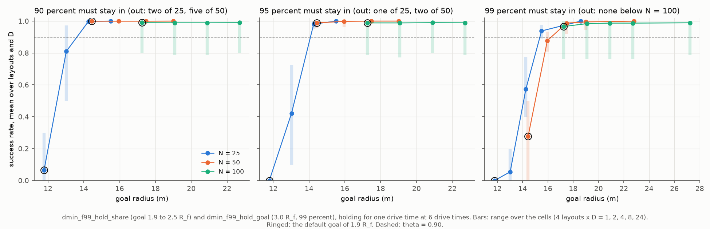

# Team sizes above D_min, and holding the flock

## 3.7 RQ7: Beyond D_min: enough dogs, cost, and pressure on the flock

Past some team size more dogs stop making the drive faster, and each extra dog adds its full dog time ($D$ times the finish time) for almost no gain; under the 99% rule they almost never make the task fail, and [item 3](#3-pressure-on-the-sheep) measures how long each sheep flees. Results are from the 99% runs; items 1 and [4](#4-extra-dogs-almost-never-make-the-task-fail) also cite strict-rule runs.

$D_{\min}$ is the smallest reliable team on a [curve](../glossary.md#trials-and-experiments) (one layout and $N$); [section 2.1](d_min_report.md#21-when-a-team-is-reliable) defines reliable and undecided cells, brackets and lower bounds. $D_{\mathrm{sat}}$ is the smallest working team that no larger one beats on finish time by more than 5% at 99% confidence, a range while undecided ([frontier values](../experiments/task_design.md#frontier-values)). Working teams are the reliable teams below $D_{\mathrm{overcrowd}}$, where the curve fails again ([item 4](#4-extra-dogs-almost-never-make-the-task-fail)), or all reliable teams if it has none.

### 1. When more dogs stop helping

$D_{\mathrm{sat}}$ is 1 on compact flocks up to $N = 566$ and on the other layouts at $N \le 50$ (except `outlier_rich` $N = 50$, a bracket of 1-24), and 2 to 7 where decided on scattered flocks of 100-400 sheep at 6 drive times:

- `wide` at 6 drive times: 1, 1, 1, 2, 3, 3, 4, 5 on the eight sizes from $N = 25$ to 400 ([part 1, Table 6](part1_growth.md#38-rq8-growth-with-n-on-a-denser-grid-d_sat-and-the-shape-of-the-curve)), decided with the finish-time seeds of the [top-up](../glossary.md#trials-and-experiments). Some `outlier_rich` and `wide` curves remain brackets, and `split` has none from $N = 200$.
- Deadline: the same at 12 and 6 drive times on every curve where both are decided (2, 3 and 5 on `wide` at $N = 100$, 200 and 400, above $D_{\min}$); `outlier_rich` $N = 566$ gives overlapping brackets, 8-24 at 12 and 8-12 at 6.
- At 3 drive times: on `wide` at $N = 100$, 200 and 400, $D_{\mathrm{sat}}$ is 2, 3 and 6 against $D_{\min}$ 2, 3 and 5-6 ([section 3.3](part1_growth.md#33-rq3-how-does-the-deadline-change-d_min)), so with little time the smallest reliable team is about the fastest (equal at 100 and 200, maybe at 400). On `outlier_rich` and `split` at $N = 100$ the two differ ($D_{\min}$ 2 and 1 against $D_{\mathrm{sat}}$ 3 and 4).

*Data:* $D_{\mathrm{sat}}$ tables for [3 drive times](results_tables.md#d_sat-dmin_f99_m3-d_sat), [6 drive times](results_tables.md#d_sat-dmin_f99_m6-d_sat-1) and [12 drive times](results_tables.md#d_sat-dmin_f99_m12-d_sat-1).

Under the strict rule too, one dog is as fast as any team on compact flocks: at 6 drive times (`dmin_m6`) the median finish time is 1.44-1.74 drive times for every team from 1 to 24 dogs, and at each $N$ it moves less than 0.04 drive times from 1 dog to 24 (Figure 1). A Strömbom sheep that reacts to a dog moves a fixed 1 m per tick (1 s), so more dogs can turn it but not speed it up. [Kubo sheep](../glossary.md#sheep-models-and-dog-rules) speed up under a stronger push, up to 5 m/s, so there more dogs finish sooner.

**Figure 1: Finish time against team size on compact flocks, Strömbom sheep ($N = 25$-400, strict rule, 6 drive times) against Kubo sheep ($N = 25$-100).** The Strömbom curves stay flat, while from 1 dog to 10 the Kubo median falls from 102-116 s to 29-30 s; at $N = 100$ it does not fall from 1 dog to 2 (115 s with both).

- Marks: each point is the median finish time of the successful trials of one cell (one $N$ and $D$); darker blue is a larger flock. Every cell of both panels succeeds in all its trials.
- Left: Strömbom sheep, team rule `strombom_multi`, $D$ = 1, 2, 3, 4, 6, 8, 12, 16 and 24, finish time in drive times of each $N$ so all sizes share one axis.
- Right: Kubo sheep, $N = 25, 50, 100$, finish time in seconds.

*Data:* successful compact trials in `results/dmin_m6` and `results/dmin_kubo`; Kubo $D_{\min}$ in [results_tables.md: Kubo (compact, strict)](results_tables.md#kubo-compact-strict).

### 2. What extra dogs cost

In all 189 reliable [cells](../glossary.md#trials-and-experiments) above a decided $D_{\mathrm{sat}}$ at 6 drive times (99% rule), the finish time is 0.96 to 1.01 times the $D_{\mathrm{sat}}$ time (largest ratio 1.012), while dog time grows with $D / D_{\mathrm{sat}}$ (Figure 2, Table 1). On a compact flock of 50, 24 dogs take the same 154 s as one dog, for 24 times the dog time. At $N = 400$ the median dog moves at 1.44-1.50 m/s on `compact`, `wide` and `outlier_rich`, close to its top speed of 1.5 m/s, and at 1.20-1.40 m/s on `split`, where up to 20% of the dogs stand still.

**Table 1: Finish time and dog time at twice $D_{\mathrm{sat}}$ and at $D = 24$, relative to the $D_{\mathrm{sat}}$ cell (99% rule, 6 drive times).**

| Layout, $N$ | $D_{\mathrm{sat}}$ | At $2 D_{\mathrm{sat}}$: finish time / dog time | At $D = 24$: finish time / dog time |
| :--- | :---: | :---: | :---: |
| `wide`, $N = 200$ | 3 | 0.97 / 1.94 | 0.96 / 7.70 |
| `wide`, $N = 400$ | 5 | 0.97 / 2.32 (at $D = 12$) | 0.96 / 4.61 |
| `outlier_rich`, $N = 100$ | 3 | 0.99 / 1.98 | 0.98 / 7.85 |
| `outlier_rich`, $N = 400$ | 6-24 | 0.96 / 1.91 | 0.94 / 3.74 |
| `split`, $N = 100$ | 4 | 0.99 / 1.98 | 0.99 / 5.91 |

Ratios on `outlier_rich` $N = 400$ are relative to $D = 6$, the low end of the bracket. On the 10 scattered curves at $N \ge 100$ with a decided $D_{\mathrm{sat}}$ (`wide` $N = 100$ to 400, `outlier_rich` 100 to 200, `split` 100 and 141), 24 dogs take 3.31 (`split` $N = 141$) to 11.94 (`wide` $N = 100$) times its dog time for 0.96 to 1.00 times its finish time.

**Figure 2: Cost of dogs beyond $D_{\mathrm{sat}}$ (99% rule, 6 drive times, curves with a decided $D_{\mathrm{sat}}$).** The finish time barely changes, while the dog time grows in proportion to the team.

- Marks: each line is one curve, coloured by layout, and each point one reliable team from $D_{\mathrm{sat}}$ up, 27 lines and 189 cells above their $D_{\mathrm{sat}}$. The horizontal axis is $D / D_{\mathrm{sat}}$ (log scale), so every line starts at 1; on `wide` $N = 400$ ($D_{\mathrm{sat}} = 5$), $D = 24$ sits at 4.8.
- Left: median finish time divided by that of the $D_{\mathrm{sat}}$ cell, so 0.97 means 3% faster. Points below 1 fit $D_{\mathrm{sat}}$, since no larger team saves more than 5% with 99% confidence in a paired bootstrap on shared seeds.
- Right: dog time divided by that of the $D_{\mathrm{sat}}$ cell, against the diagonal $y = x$.

*Data:* [results_tables.md: Effort, dmin_f99_m6](results_tables.md#effort-dmin_f99_m6-cost-of-dogs-beyond-d_sat-relative-to-the-d_sat-cell-1) and [results_tables.md: D_sat, dmin_f99_m6](results_tables.md#d_sat-dmin_f99_m6-d_sat-1).

### 3. Pressure on the sheep

A sheep flees while a dog is within $r_s = 65$ m, and its flight time per sheep is how long that lasts. On three of four replayed curves it falls as the team grows to $D_{\mathrm{sat}}$ and hardly rises beyond (Figure 3, Animation 1). The flock may just be gathered sooner; we have not tested that. The [replays](../glossary.md#trials-and-experiments) cover 164 stored trials on `wide` and `outlier_rich` at $N = 100$ and 400, each reproducing its stored trial exactly.

On `wide` $N = 400$ more dogs make more sheep flee at once, each for less time. The median flight time per sheep falls from 485 s at $D = 3$ to 359 s at $D = 6$ and stays there (361 s at $D = 12$), while the median share of the flock fleeing at a given moment rises from 68% to 84% between $D = 3$ and 12. At every replayed team size a sheep spends a median of at most 1.25 s within 6 m of a dog, the distance $3 r_a$ at which a dog [stops](../glossary.md#sheep-models-and-dog-rules).

**Figure 3: Flight time per sheep against team size (replays, `wide` and `outlier_rich`, $N = 100$ and 400, 99% rule, 6 drive times).** Up to $D_{\mathrm{sat}}$ it falls on three of the four curves; larger teams make more sheep flee at once, except on `outlier_rich` $N = 100$ (share 0.88-0.91).

- Marks: medians over successful trials for $N = 100$ (circles, dotted) and $N = 400$ (squares, solid); blue is `wide`, green `outlier_rich`. Points sit only at the replayed teams $D = 1$, $D_{\min}$, $D_{\mathrm{sat}}$ and $2 D_{\mathrm{sat}}$, with $D_{\mathrm{sat}}$ taken before the top-up; the current tables give 5 on `wide` $N = 400$ and 2 on `wide` $N = 100$. On `wide` $N = 100$ only $D = 1$ and 2 were replayed (186 s and 190 s), so no replayed team there lies beyond $D_{\mathrm{sat}}$. At $N = 400$ one dog succeeded in none of its 10 trials and $D = 2$ was not replayed, so those curves start at 3.
- Left: flight time per sheep (s).
- Right: share of the flock fleeing, averaged over each trial.

*Data:* [results_tables.md: Pressure, dmin_f99_m6](results_tables.md#pressure-dmin_f99_m6-replay-of-12-stored-seeds-per-cell-every-replay-reproduced-its-stored-trial).

**Animation 1: The flock under 3 and 12 dogs, replayed (`wide`, $N = 400$, seed 0, 99% rule, 6 drive times).** As in Figure 3, 12 dogs make more sheep flee but finish sooner: at 148 s, 129 of the 400 sheep flee with 3 dogs and 395 with 12, and the flock is in at 727 s and 431 s. Both start from the same flock.

- Marks: filled dots are sheep within $r_s = 65$ m of a dog, which flee; hollow dots graze.
- Left: 3 dogs.
- Right: 12 dogs.

### 4. Extra dogs almost never make the task fail

$D_{\mathrm{overcrowd}}$ is the first team above $D_{\min}$ (above $D_{\min,\mathrm{low}}$, the smallest team not decided unreliable, if no team is reliable) from which two tested sizes in a row are unreliable. A cell's [zone](../experiments/task_design.md#zones) is `unreliable_dip` for an unreliable team between $D_{\min}$ (or $D_{\min,\mathrm{low}}$) and $D_{\mathrm{overcrowd}}$, `collapse` from $D_{\mathrm{overcrowd}}$ up, and `recovered` for a reliable team above $D_{\mathrm{overcrowd}}$.

In the three 99% main runs (`dmin_f99_m12`, `dmin_f99_m6`, `dmin_f99_m3`, up to 24 dogs) only one curve becomes unreliable again above a reliable team: `split` $N = 141$ at 6 drive times, a size the nine-size grid added, where 4 dogs are decided unreliable (88 of 110, success 0.80) between a reliable 3 and a reliable 7. On the five original sizes ($N = 25$-400) none does.

On four 99% curves with no reliable team the larger teams are `collapse`, from $D_{\mathrm{overcrowd}}$ = 4, 15 and 10 dogs on `split` $N = 200$, 283 and 400 at 6 drive times and 7 on `outlier_rich` $N = 400$ at 3 drive times. Their success stays near but mostly below the reliability threshold $\theta = 0.90$.

The strict rule has one collapse and one dip, both on `split` $N = 100$:

- 3 drive times: one dog is reliable (60 of 60) and 2 to 4 dogs are not (5 of 10, 5 of 10, 97 of 120). Two unreliable sizes in a row make $D_{\mathrm{overcrowd}} = 2$, and the teams from 5 dogs up are `recovered`.
- 6 drive times: 3 dogs are decided unreliable (36 of 50) between a reliable 1 and a reliable 5 (`unreliable_dip`).

In follow-up settings more dogs can make the task fail: with whole-team sharing at 65 m on `split` $N = 200$ ([section 3.12](part4_coordination.md#312-rq12-what-a-dog-sees-and-sharing-it)), and when holding the flock ([section 3.10](#310-rq10-when-do-more-dogs-hurt-holding-the-flock-and-dogs-that-take-up-room)).

### 5. The upper end of the curves

$D_{\max}$ is the largest working team. $D_{\mathrm{crowd}}$ is the first working team above $D_{\mathrm{best}}$, the smallest team within 5% of the fastest, that is more than 5% slower than $D_{\mathrm{best}}$ ([team sizes](../glossary.md#team-sizes)).

In the three 99% main runs $D_{\max}$ is almost always the top of the grid: 84 of the 85 curves with a $D_{\min}$ are still reliable at 24 dogs and have no $D_{\mathrm{overcrowd}}$, so their $D_{\max}$ is only a lower bound. $D_{\mathrm{overcrowd}}$ appears only on the four curves of [item 4](#4-extra-dogs-almost-never-make-the-task-fail).

The exception, `outlier_rich` $N = 566$ at 6 drive times, stops at $D_{\max} = 12$ because 16 and 24 dogs are undecided (188 of 200 = 0.94 and 189 of 200 = 0.945), though at 12 drive times they succeed in 130 of 130 and 100 of 100 trials. Of their failures at 6 drive times (limit 1520 s), 8 of 12 at $D = 16$ and 7 of 11 at $D = 24$ use seeds also run at 12 drive times, and all 15 finished there, in 1521 to 1951 s. These late finishes may be why $D_{\max}$ stops at 12; we have not tested it.

Larger teams slow a drive that still succeeds on six curves at 12 drive times, those with a $D_{\mathrm{crowd}}$: `split` $N = 71$ and the five curves of Table 2. At $N = 71$ ($D_{\mathrm{crowd}} = 2$) only $D = 2$ is slower (209 s against 186 s), and the time from 90% to 99% of the flock in the goal is 4-5 s for every team.

On the other five curves the last 9% of the flock arrive minutes after the rest (Table 2): on `split` from $N = 200$ ([section 4.1](part5_failures.md#41-why-more-dogs-do-not-help-on-split)) and on `outlier_rich` $N = 566$ from 12 dogs.

On `split` $N = 400$ the median finish time is 950-1040 s for $D \ge 9$ against 839 s at $D = 5$.

**Table 2: $D_{\mathrm{crowd}}$ and the time from 90% to 99% of the flock in the goal, lowest and highest median over the teams (99% rule, 12 drive times, successful trials).**

| Curve | $D_{\mathrm{crowd}}$ | Teams | Median, lowest-highest (s) |
| :--- | :---: | :---: | :---: |
| `split`, $N = 200$ | 5 | $D \ge 3$ | 294-465 |
| `split`, $N = 283$ | 14 | $D \ge 2$ | 342-492 |
| `split`, $N = 400$ | 9 | $D \ge 3$ | 316-519 |
| `split`, $N = 566$ | 4 | $D \ge 4$ | 480-694 |
| `outlier_rich`, $N = 566$ | 15 | $D \ge 12$ | 465-578 |

*Data:* [results_tables.md: time from 90 to 99 percent, split](results_tables.md#dmin_f99_m12-time-from-90-to-99-percent-of-the-flock-in-the-goal) and the `tail` verb of `cli/dmin_tables.py` for `outlier_rich`.

On `outlier_rich` $N = 283$ at 12 drive times the median gap is long only with 5 and 8 dogs (380 s and 330 s, other teams 8-12 s), and at 6 drive times the finish times of $D = 5$ to 12 fall in a fast and a slow group (quartiles 367 and 799 s at $D = 5$), so its $D_{\mathrm{sat}}$ stays a bracket (5-24).

*Data:* [results_tables.md: the upper end of the curves](results_tables.md#the-upper-end-of-the-curves-d_max-d_crowd-and-d_overcrowd) (`uv run cli/dmin_tables.py upper ...`); success rates per cell in each folder's `frontier_cells.csv`.

## 3.10 RQ10: When do more dogs hurt? Holding the flock, and dogs that take up room

In the open drive under the 99% rule, extra dogs never lose a reliable team on the five original sizes; the one dip is on the denser grid, `split` $N = 141$ at 6 drive times ([section 3.7, item 4](#4-extra-dogs-almost-never-make-the-task-fail)). Once the flock must be held, they can make the task fail. In the [holding task](../experiments/task_design.md#the-holding-task) a share of the flock must stay in the goal for one drive time while the dogs withdraw. The share is 99% unless `dmin_f99_hold_share` sets 95% or 90%.

The four protocols, in three groups:

- `dmin_f99_hold`: the holding task itself, with each dog withdrawing to $r_s + r_a = 67$ m beyond the farthest sheep on its bearing from the flock centre.
- `dmin_f99_hold_spacing`: [dogs kept 2 m apart](../experiments/task_design.md#crowding-with-dogs-that-take-up-room) instead of the main runs' [point dogs](../glossary.md#sheep-models-and-dog-rules), which have no size. The arc behind the flock where the driving dogs spread then has room for about $D_{\mathrm{cap}}$ = 7, 9, 10, 11 and 12 dogs at $N = 25$ to 400 (its length over 2 m).
- `dmin_f99_hold_goal` and `dmin_f99_hold_share`: flocks of 25, 50 and 100, with the goal radius raised from $1.9 R_f$ to 2.1, 2.3 and $2.5 R_f$ ([$R_f$](../glossary.md#the-drive-task)), crossed with the share that must stay in (99%, 95%, 90%), and to $3.0 R_f$ at 99%, on the seeds of `dmin_f99_hold`. Trials shared by the three holding protocols reproduce each other exactly.

### 1. Holding in the default goal

With 99% held, holding works on $N \ge 100$ on `wide` and `compact`, with the same $D_{\min}$ as the open drive or one more (1, 2 and 3 dogs on `wide` at $N = 100$, 200, 400). On `split` no team is decided reliable from $N = 200$: at 200 two dogs succeed in 171 of 200 (undecided, 99% Clopper-Pearson interval 0.78-0.91), and at 400 every team is decided unreliable.

On $N \le 50$ no team holds the flock, and most failed trials end with no sheep in the goal (423 of 560 at $N = 25$, 301 of 444 at $N = 50$). The flock enters at the near edge of the goal and its centre keeps walking while the dogs withdraw, a median of 17 m at $N = 25$, 15 m at 50 and 13 m at 100 from the first tick with the share in the goal to the first tick with every dog beyond $r_s$ of every sheep. The default goal radius is 11.8 m at $N = 25$ and 14.4 m at 50, and below $N = 100$ the 99% share is every sheep, so the first sheep across the far edge ends the hold. The goal size against the walk may be the cause; we have not tested it, since the walk itself was not varied.

The walk comes from 240 replays with `cli/diagnostics/hold_walk.py` at a goal of $3.0 R_f$, 5 stored seeds per cell at $D = 1$, 2, 4 and 8; in one the dogs never got beyond $r_s$ of every sheep, so it has no walk.

### 2. Dogs kept 2 m apart

With dogs kept 2 m apart, extra dogs make holding fail on `outlier_rich` $N = 400$ (Figure 4). Teams of 3 to 6 succeed in 0.925-0.94 of trials (undecided), and from $D = 9$ every team up to 24 is decided unreliable: 54 of 70 at $D = 9$ (99% interval 0.62-0.89), 13 of 20 at $D = 12$ (0.34-0.89), 5 of 10 at $D = 16$ (0.13-0.87). This may be because the arc holds only about 12 spaced dogs, which near that number push each other off their places and cannot leave to catch a breakaway sheep. We have not tested it, and it would not explain failures from 9 dogs.

The layout matters as well. On `compact` $N = 400$ every spaced team from 1 to 24 is reliable, and on `wide` $N = 400$ 3 dogs and every team from 6 to 24 are reliable (4 and 5 undecided, 190 of 200 each). On `split` $N = 200$ success falls from 0.85 at $D = 2$ (170 of 200, undecided) to 0-0.10 from 6 dogs up (10 trials per cell).

**Figure 4: Holding at $N = 400$, point dogs against dogs kept 2 m apart (99% held for one drive time).** On `wide` success holds up to 24 spaced dogs; on `outlier_rich` it falls from $D = 9$.

- Marks: success against $D$ (log scale), dotted grey for point dogs and solid blue for dogs 2 m apart. The orange band marks 10 to 12 dogs, the arc capacity $D_{\mathrm{cap}}$ of the larger flocks; the dashed line is $\theta = 0.90$, and hollow markers are cells with fewer than 30 trials.
- Panels: `wide` (left) and `outlier_rich` (right).

*Data:* [results_tables.md: D_min, dmin_f99_hold](results_tables.md#d_min-dmin_f99_hold) and [results_tables.md: D_min, dmin_f99_hold_spacing](results_tables.md#d_min-dmin_f99_hold_spacing).

### 3. A larger goal or a smaller share held

A larger goal or a smaller share held lets one dog hold a small flock (Table 3, Figure 5). With 99% held one dog needs 15.5-18.6 m at $N = 25$, 16.0-17.5 m at 50 and at most 17.3 m at 100. With 95% or 90% held, 14.3 m is enough at $N = 25$ (13.0 m is still undecided at 90%) and at most 14.4 m at 50.

The walk of [item 1](#1-holding-in-the-default-goal) gives estimates of these goals. A flock that enters with its last sheep at the near edge and walks $w$ keeps every sheep in only if the goal radius exceeds about $w/2$ plus the distance of its farthest sheep from the centre. Over the replays at $D = 1$, 2, 4 and 8 the medians give 14.3 m at $N = 25$ and 15.7 m at 50, and with one dog 14.0 and 16.4 m, below or inside the observed ranges. At $N = 100$, where the 99% share lets one sheep out, they give 17.2 m (17.1 m with one dog) against a threshold of at most 17.3 m. This is consistent with the walk being the cause.

Just short of the threshold some larger teams fail. At $N = 25$, 90% held, $2.1 R_f$, one dog is reliable on `split` and `outlier_rich`, while every team from 3 dogs up on `wide`, 4 on `compact`, 5 on `outlier_rich` and 7 on `split` is decided unreliable (success down to 0.50). At $N = 50$, 99% held, $2.1 R_f$, no team is decided reliable and 4 dogs are decided unreliable on `wide` and `outlier_rich` (159 of 190 and 97 of 120). Their flock may walk farther: in the walk replays of item 1 at $N = 25$ (20 per team size, no interval computed) the median walk is 17.5-17.8 m with 2, 4 or 8 dogs and 16.6 m with one. Those replays use another goal and share, and no run has tested this cause.

**Table 3: Smallest goal tested from which one dog holds the flock reliably, by share held (held for one drive time, deadline 6 drive times; every layout except `outlier_rich` $N = 100$).**

| Share that must stay in (sheep allowed out) | $N = 25$ | $N = 50$ | $N = 100$ |
| :--- | :---: | :---: | :---: |
| 99% (none below $N = 100$, one at 100) | $2.5$-$3.0 R_f$ = 15.5-18.6 m | $2.1$-$2.3 R_f$ = 16.0-17.5 m | <= $1.9 R_f$ = 17.3 m (`outlier_rich` 3) |
| 95% (one of 25, two of 50, five of 100) | $2.3 R_f$ = 14.3 m | <= $1.9 R_f$ = 14.4 m | <= $1.9 R_f$ = 17.3 m (`outlier_rich` 2) |
| 90% (two of 25, five of 50, ten of 100) | $2.1$-$2.3 R_f$ = 13.0-14.3 m | <= $1.9 R_f$ = 14.4 m | <= $1.9 R_f$ = 17.3 m (`outlier_rich` 2) |

In Table 3, "<=" means the default $1.9 R_f$, the smallest goal tested, already holds, and a range means one dog is still undecided at the smaller goal on some layout. No goal tested makes one dog reliable on `outlier_rich` $N = 100$; the parentheses give its team at the default goal, and with 99% held it needs 2 with any larger goal.

*Data:* [results_tables.md: dmin_f99_hold_goal](results_tables.md#dmin_f99_hold_goal-dmin_f99_hold--dmin_f99_hold_goal), [results_tables.md: dmin_f99_hold_share](results_tables.md#dmin_f99_hold_share-dmin_f99_hold--dmin_f99_hold_share) and [results_tables.md: walk while the dogs withdraw](results_tables.md#walk-while-the-dogs-withdraw-dmin_f99_hold_goal-at-30-r_f-replay-of-5-stored-seeds-per-cell-every-replay-reproduced-its-stored-trial).

**Figure 5: Holding success against the goal radius in metres ($N = 25$, 50 and 100, held for one drive time), by share held.** With 99% held, the curves of $N = 25$ and 50 rise between about 13 and 17.5 m, and $N = 100$ is already above $\theta$ at its default 17.3 m; letting one or two sheep out moves the rise of the small flocks to smaller goals.

- Marks: each point is the mean success rate over the 20 cells of one flock size and goal (4 layouts x $D = 1, 2, 4, 8, 24$, each counted once, without the added [midpoint](../experiments/task_design.md#midpoint-densification) teams); the bar is their range. Near the threshold the low end of a bar is the larger teams, and at $N = 100$ it is `outlier_rich` with one dog. Blue is $N = 25$, orange $N = 50$, green $N = 100$; ringed points are the default goal of $1.9 R_f$, and the dashed line is $\theta = 0.90$.
- Panels: share held, 90%, 95% and 99% from left to right.

*Data:* `results/dmin_f99_hold_share` and `results/dmin_f99_hold_goal` (the $3.0 R_f$ points).

The [holding animation in task design](../experiments/task_design.md#the-holding-task) replays one dog holding a flock of 25 in a goal of $1.9 R_f$, where the flock walks out, and of $3.0 R_f$, where it is held.
