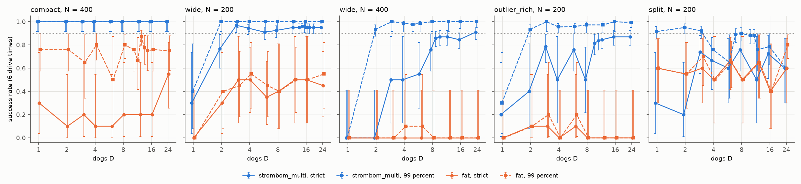
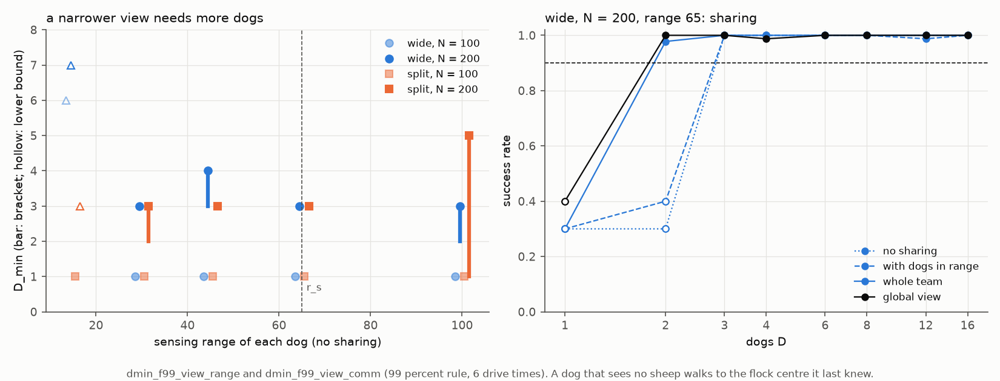
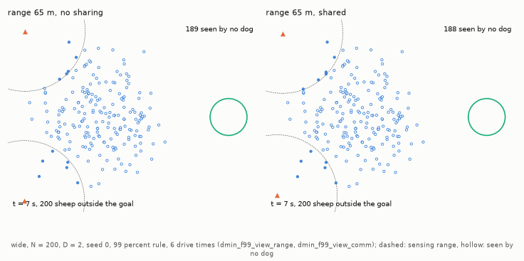

# Coordination and what the dogs see

## 3.6 RQ6: Do dogs without a team rule reach a finite D_min?

[FAT](../methods/fat.md#uncoordinated-greedy-baseline-fat) (farthest-agent targeting) dogs do not coordinate: every dog goes behind the sheep farthest from the goal. At 6 [drive times](../glossary.md#the-drive-task) they have no reliable team up to 24 dogs on any [scattered layout](../glossary.md#start-layouts-and-dog-starts) from $N = 200$, under either the [strict or the 99% rule](../glossary.md#success-and-reliability).

FAT lacks both parts of the team rule [`strombom_multi`](../methods/strombom_multi.md#coordinated-team-architecture-strombom_multi). The first is Strömbom's collect/drive switch: collect any [outlier](../glossary.md#sheep-models-and-dog-rules) (a sheep beyond the collect distance from the flock centre), otherwise drive. The second is a team layer that gives each of the $D$ farthest outliers its own dog and spreads the dogs on an arc behind the flock.

Up to $N = 100$ FAT does as well as the team rule or better. On `compact` $N = 400$ it has no reliable team under the strict rule and only the lower bound 12 under the 99% rule (Table 1; brackets, lower bounds and `none` are defined in [section 2.1](d_min_report.md#21-when-a-team-is-reliable)).

More FAT dogs raise success in some cells without making them reliable (Figure 1). On `compact` $N = 400$ (strict) success goes from 3 of 10 trials with one dog to 11 of 20 with 24. On `split` $N = 200$ (99%) it goes from 12 of 20 to 88 of 110, and the median finish time falls from 742.5 s to 305.5 s.

**Table 1: $D_{\min}$ of FAT and of the team rule `strombom_multi` at 6 drive times, each cell strict rule / 99% rule.**

| Dog rule, layout | $N = 25$ and 50 | $N = 100$ | $N = 200$ | $N = 400$ |
| :--- | :---: | :---: | :---: | :---: |
| FAT, `compact` | 1 / 1 | 1 / 1 | 1 / 1 | none / [12] |
| FAT, `wide` | 1 / 1 | 1 / 1 | none / none | none / none |
| FAT, `split` | 1 / 1 | 1 / 1 | none / none | none / none |
| FAT, `outlier_rich` | 1 / 1 | 2 / 2 | none / none | none / none |
| Team rule, `compact` | 1 / 1 | 1 / 1 | 1 / 1 | 1 / 1 |
| Team rule, `wide` | 1 / 1 | 1 / 1 | 3 / 2 | [9] / 2-3 |
| Team rule, `split` | 1 / 1 | 1 / 1 | none / [1] | none / [5] |
| Team rule, `outlier_rich` | 1 / 1 | 3 / 2 | [12] / 2-3 | none / 3 |

*Data:* [results_tables.md: FAT dog rule, deadline 6](results_tables.md#fat-dog-rule-deadline-6-strict-then-99-percent) (`dmin_fat`, `dmin_f99_fat`); `strombom_multi` in [results_tables.md: strict success](results_tables.md#d_min-by-layout-and-n-strict-success) and [results_tables.md: success at 99 percent](results_tables.md#d_min-by-layout-and-n-success-at-99-percent).

**Figure 1: Success against team size for `strombom_multi` and FAT at 6 drive times, $N = 200$ and 400, strict and 99% rules.** FAT reaches the reliability threshold $\theta = 0.90$ at no team size in any panel. It stays below about 0.55 on `wide` and `outlier_rich` and below 0.9 on `compact` $N = 400$ and `split` $N = 200$; its best cell is 174 of 200 trials (0.87), 12 dogs on `compact` $N = 400$ under the 99% rule, still undecided.

- Marks: blue is `strombom_multi` (circles strict, squares 99%), orange FAT (triangles, up strict, down 99%); solid lines are the strict rule, dashed the 99% rule, and the dotted line is $\theta$. Each marker is one [cell](../glossary.md#trials-and-experiments); a hollow one has fewer than 30 trials, decided early ([section 2.1](d_min_report.md#21-when-a-team-is-reliable)).
- Panels: `compact` $N = 400$, `wide` $N = 200$ and 400, `outlier_rich` $N = 200$, and `split` $N = 200$.

*Data:* `results/dmin_fat`, `dmin_f99_fat`, `dmin_m6` and `dmin_f99_m6`.

FAT dogs bunch behind one sheep on `compact` and `split`, less on `wide` and `outlier_rich` at $N = 400$ (Table 2). Every FAT dog sees every sheep and picks by the same rule, which may be why; we have not tested it.

**Table 2: [Dog bunching](part5_failures.md#42-per-tick-measures) at 6 drive times, the median over trials of the share of dogs with another dog within 2 m.**

| Layout | FAT, $N = 200$, strict, $D \ge 2$ | FAT, $N = 400$, strict, $D \ge 2$ | FAT, $N = 200$, 99%, $D = 16$ | Team rule, $N = 200$, 99%, $D = 16$ |
| :--- | :---: | :---: | :---: | :---: |
| `compact` | 0.86 | 0.96 | - | - |
| `split` | 0.79 | 0.79 | 0.90 | 0.59 |
| `wide` | 0.63 | 0.17 | 0.74 | 0.55 |
| `outlier_rich` | 0.40 | 0.19 | 0.78 | 0.45 |

The strict columns pool the teams of two or more in `dmin_fat`; pooled over both sizes the strict medians are 0.86 (`compact`, mostly $N = 200$: 1240 of 1330 trials), 0.79 (`split`), 0.46 (`wide`) and 0.30 (`outlier_rich`). Each FAT cell at $D = 16$ has 10 trials; `compact` at $D = 16$ is not reported. With 2 FAT dogs on `wide` and `outlier_rich` at $N = 200$ and 400 the median is 0.00-0.005 (10 trials each).

*Data:* stored per-trial bunching in `results/dmin_fat`, `dmin_f99_fat` and `dmin_f99_m6`; no `dmin_tables.py` verb prints it.

More FAT dogs keep the flock tighter: the median [flock spread](part5_failures.md#42-per-tick-measures) in `dmin_fat` is 64.4 m with one dog and 27.6 m with 24 on `wide` $N = 400$, and 61.9 m and 36.5 m on `outlier_rich` $N = 400$.

Whether FAT fails for lack of the switch or of the team layer is not separated. [Independent shepherds](#39-rq9-which-part-of-the-team-rule-matters) keep the switch and reach a finite $D_{\min}$ up to $N = 200$, but FAT also picks targets differently, and no run gave it the switch alone. The [animation in the independent-shepherds method](../methods/independent.md#independent-paper-shepherds-independent) replays the team rule, independent dogs and FAT on one start flock of 400; only the team rule brings it in.

## 3.9 RQ9: Which part of the team rule matters?

The run `dmin_f99_indep` (99% rule, 6 drive times) uses [independent shepherds](../methods/independent.md#independent-paper-shepherds-independent): each dog runs Strömbom's single-dog rule on the whole flock, so it has the collect/drive switch but no assignment and no arc. Table 3 gives their $D_{\min}$, to compare with the 99% values of Table 1.

**Table 3: $D_{\min}$ of independent shepherds on the scattered layouts at 6 drive times, 99% rule.**

| Layout | $N = 200$ | $N = 400$ |
| :--- | :---: | :---: |
| `wide` | 2-3 | none |
| `outlier_rich` | 3 | none |
| `split` | 1-3 | none |

*Data:* [results_tables.md: Methods at 99 percent, 6 drive times](results_tables.md#methods-at-99-percent-6-drive-times-team-rule-independent-paper-shepherds-fat).

Independent shepherds are reliable up to $N = 200$ on every scattered layout. At $N = 400$ on `wide` and `outlier_rich` they have no reliable team up to 24 dogs, so the team layer is needed there. Without assignment the dogs may keep going after the same sheep while other parts of a large flock spread, though we have not checked it. On `compact` $N = 400$ they are reliable from one dog (60 of 60 trials), and on `split` $N = 400$ neither rule has a reliable team.

On `split` $N = 200$ independent shepherds do better than the team rule. One and two dogs are undecided (183 and 188 of 200 trials) and every team from 3 to 24 is reliable, so $D_{\min}$ is 1-3, where the team rule has only the lower bound 1. Both rules succeed in 183 of 200 trials with one dog, since the rules are identical then. From 4 dogs no team-rule cell is reliable, some being undecided, while every independent team is ([section 4.1](part5_failures.md#41-why-more-dogs-do-not-help-on-split)).

### Kubo model: more dogs keep helping

With the sheep of [Kubo et al. (2022)](../methods/kubo.md#kubo-et-al-2022-continuous-potential-fields) and their dogs, more dogs keep shortening the drive. A reacting Strömbom sheep always moves at 1 m/s, while a Kubo sheep moves faster under a stronger push, up to HerdSim's cap of 5 m/s. In `dmin_f99_kubo` (99% rule, compact starts, a fixed 500 s limit, about 31 times the 16 s a sheep at the cap needs for the 80 m drive) one dog is enough at $N = 25$ to 100. At $N = 100$ the median finish is 115 s with one dog, 76.3 s with two, 29 s with ten and 25 s with 24, so ten dogs give 95% of the gain of 24. [$D_{\mathrm{sat}}$](../glossary.md#team-sizes) is still open, at least 16 or 17 dogs (16-24 at $N = 25$ and 100, 17-24 at 50).

The fall has small steps back under both rules, which give the same medians below $N = 100$. At $N = 25$ the median rises from 66.8 s with two dogs to 69.1 s with three, and at $N = 50$ and 100 it rises by less than a second between neighbouring teams of 15 to 17 dogs. The strict run `dmin_kubo` (up to 10 dogs) gives 115 s with both one and two dogs at $N = 100$.

*Data:* [results_tables.md: Kubo, compact, D to 24](results_tables.md#kubo-compact-d-to-24-99-percent); finish times from `results/dmin_f99_kubo` and `results/dmin_kubo` (`uv run cli/dmin_tables.py curve dmin_kubo dmin_f99_kubo --layout compact --n 25`, and `--n 50`, `--n 100`).

## 3.12 RQ12: What a dog sees, and sharing it

Real dogs, robots and drones do not see the whole field. In these runs (99% rule, 6 drive times) each dog sees only the sheep within 15, 30, 45, 65 or 100 m and shares them with no one (`none`), with the dogs within its range (`neighbour`) or with the whole team (`shared`, which then plans once on every sheep any dog sees). The range sweep `dmin_f99_view_range` uses `none`; the sharing run `dmin_f99_view_comm` fixes the range at 65 m. On `wide` a short range costs dogs and whole-team sharing wins them back; on `split` dogs that see 30 to 100 m and share nothing do better than dogs that see everything.

On `wide` $N = 200$ dogs that see everything need 2; with a range of 30 to 65 m they need 3 (3-4 at 45 m), and at 100 m 2-3 (Figure 2). On flocks of 100 or fewer a range of 30 m or more costs nothing. At 15 m no team up to 16 is reliable at $N = 50$, and at least 6 dogs are needed at $N = 100$ and 7 at $N = 200$. A plausible reason is that the dogs lose sight of the outer sheep once the range is shorter than the gaps between outliers, but we have neither tested this nor measured those gaps.

At 65 m on `wide` $N = 200$, sharing with the whole team brings $D_{\min}$ from 3 back to 2. With two dogs the cell succeeds in 3 of 10 trials without sharing (99% interval 0.04-0.74) and in 88 of 90 with sharing (0.90-1.00; Animation 1). Sharing only with the dogs in range leaves $D_{\min}$ at 3, perhaps because a dog far from an outlier gets no word of it from the dogs near it; that is untested.

On `split` $N = 200$ dogs that see everything have no reliable team (lower bound 1). Dogs that see 30 to 65 m and share nothing succeed in 60 of 60 trials at every team from 3 to 16 dogs, against 0.80-0.93 for the full-sight control of the same run. At 15 m no team from 3 to 16 dogs is decided reliable (lower bound 3); at 100 m $D_{\min}$ is 1-5.

With whole-team sharing on `split` $N = 200$, 3 dogs are reliable and no team of 4 or more is: 4, 6, 8, 9, 13, 14 and 16 dogs are decided unreliable, and 10 and 12 are undecided (170 and 171 of 200; [cells](results_tables.md#split-n--200-cell-by-cell-across-folders), [section 3.7](part3_beyond_dmin.md#37-rq7-beyond-d_min-enough-dogs-cost-and-pressure-on-the-flock)). This may be the effect of [section 4.1](part5_failures.md#41-why-more-dogs-do-not-help-on-split), where collecting dogs that plan on the whole flock may crowd one cluster; no run has tested the link.

**Figure 2: $D_{\min}$ against sensing range on `wide` and `split` at $N = 100$ and 200, and the effect of sharing on `wide` $N = 200$ at 65 m (99% rule, 6 drive times).** A short range costs `wide` flocks dogs, most at 15 m; at 65 m, sharing what each dog sees with the whole team matches full sight.

- Marks: dashed lines are references, 65 m (the distance at which a sheep reacts) on the left and $\theta = 0.90$ on the right.
- Left: $D_{\min}$ against the range for `wide` (circles) and `split` (squares) at $N = 100$ (faded) and 200, with a bar for a bracket and a hollow triangle for a lower bound ([section 2.1](d_min_report.md#21-when-a-team-is-reliable)), shifted sideways a little.
- Right: success against $D$ with no sharing (dotted blue), sharing with dogs in range (dashed blue), sharing with the whole team (solid blue) and full sight (solid black); a hollow marker is a cell with fewer than 30 trials, decided early.

*Data:* [results_tables.md: Views: sensing range](results_tables.md#views-sensing-range-no-sharing-base-row--range-0-global) and [results_tables.md: Views: sharing at range 65](results_tables.md#views-sharing-at-range-65-beside-the-no-sharing-rows-of-dmin_f99_view_range).

**Animation 1: Two dogs that see 65 m, without and with sharing, replayed (`wide`, $N = 200$, $D = 2$, seed 0, 99% rule, 6 drive times).** Sharing what each dog sees turns a failed trial into a success. Each replay reproduces its stored trial (`dmin_f99_view_range`, `dmin_f99_view_comm`).

- Marks: dashed circles are each dog's sensing range; hollow dots are sheep that no dog sees.
- Left: without sharing the two dogs end up on either side of a long, thin flock, and a few outliers at its ends stay unseen. The trial runs out of time at 817 s.
- Right: with sharing the dogs gather the flock and bring it in at 275 s.

Each variant is compared with its own run's control, because the full-sight control of `dmin_f99_view_range` is not the setup of `dmin_f99_m6`: its drive is 136.1 m against 139.8 m, its field 448.6 m wide against 459.1 m, and its time limit 817 s against 839 s. With one dog it succeeds in 169 of 200 trials against 183 of 200, and on the same 200 seeds 44 outcomes differ, in both directions. Both runs store the same calibrated flock radius, so the difference does not come from calibration; we have not found where it comes from.
