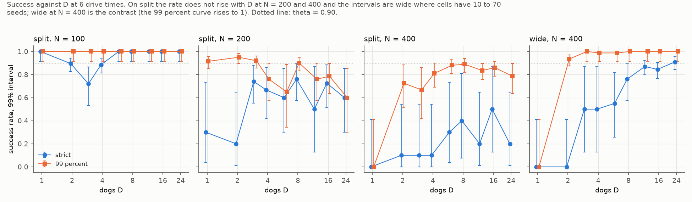
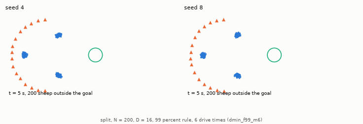
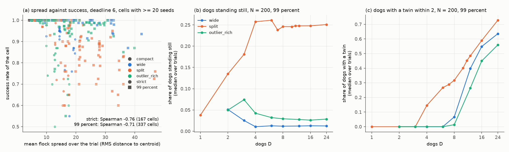

# The split layout and how trials fail

## 4. Split layout and failure measures

### 4.1 Why more dogs do not help on `split`

A [`split`](../glossary.md#start-layouts-and-dog-starts) flock starts as three separate clusters. From $N = 200$ sheep, adding dogs beyond about 4 to 5 does not raise success on it, and at 6 [drive times](../glossary.md#the-drive-task) no team is reliable at $N = 200$ or 400 under either [success rule](../glossary.md#success-and-reliability).

At 6 drive times under the 99% rule, every tested team of $D \ge 4$ dogs succeeds in 0.60-0.90 of trials at $N = 200$ and 0.70-0.92 at $N = 400$; under the strict rule, in 0.50-0.76 and 0.10-0.50 (Figure 1; Animation 1 replays a success and a failure of one cell). Some 99% cells reach 0.90-0.95 (2 dogs at $N = 200$: 190 of 200) but stay undecided. At 3 drive times success falls to at most 1 of 10 trials for 99%-rule teams of 6 or more dogs at $N = 200$ and 8 or more at $N = 400$, and for every strict-rule team at both sizes.

On `wide` $N = 400$, reliable from 3 dogs under the 99% rule, the best strict-rule cell reaches 182 of 200 (0.91) and none is reliable. On `split` $N = 100$ every team is reliable under the 99% rule; under the strict rule 3 dogs are unreliable (36 of 50), 2 and 4 undecided (179 and 177 of 200) and the rest reliable.



**Figure 1: Success against team size on `split` at $N = 100$, 200 and 400 and on `wide` at $N = 400$ (strict and 99% rules, 6 drive times).** From $N = 200$ no team on `split` is reliable under either rule, while `wide` $N = 400$ is reliable from 3 dogs under the 99% rule.

- Marks: blue circles are the strict rule and orange squares the 99% rule, each with its 99% Clopper-Pearson interval, against $D$ on a log scale. The dotted line is the reliability threshold $\theta = 0.90$.
- Panels: `split` at $N = 100$, 200 and 400, and `wide` at $N = 400$ for comparison.

*Data:* `results/dmin_m6` and `results/dmin_f99_m6`; values in results_tables.md, [dmin_m6](results_tables.md#dmin_m6) and [dmin_f99_m6](results_tables.md#dmin_f99_m6). The strict run tests 4, 6, 8, 12, 16 and 24 dogs, with 10 trials per cell at $N = 400$ (1 to 5 successes each); the 99% run adds 7, 10 and 11 at $N = 200$, and 5, 9, 10, 14, 15 and 18-20 at $N = 400$. The 3-drive-time runs are not plotted: `uv run cli/dmin_tables.py curve dmin_f99_m3 --layout split --n 200`, and the same verb on `dmin_m3` and $N = 400$.



**Animation 1: Two seeds of one `split` cell, replayed ($N = 200$, 16 dogs, 99% rule, 6 drive times).** The same team succeeds on one start and fails on another. Each replay reproduces its stored trial.

- Left: seed 4 brings the clusters together and succeeds at 283 s.
- Right: seed 8 brings 196 of the 200 sheep into the goal, then drives the flock back out and runs out of time with its centre 139 m from the goal.

*Data:* `results/dmin_f99_m6`.

From $N = 200$ up, in the successful trials of most teams from 3 dogs up, the flock arrives in two parts, the last few sheep long after the rest. We call the time from 90% to 99% of the flock in the goal the tail time (Table 1); the [results tables](results_tables.md#single-trials-and-curves-across-folders) give it for $N = 283$ to 566. Where the tail is long it is 43%-60% of the median finish time.

**Table 1: Median tail time on `split` in successful trials, shortest first (99% rule, 6 drive times).**

| $N$ | Dogs | Median tail time (s) |
| :---: | :--- | :---: |
| 100 | every $D$ | 4-5 |
| 200 | 1 or 2 | 7 |
| 200 | 4 (38 successes) | 22 |
| 200 | 3, and every team from 6 up (6 and 24 dogs: 13 and 12 successes) | 249-418 |

The 4-dog cell stopped at 50 trials, unreliable; about half its 38 successes have a tail over a minute ([tail table](results_tables.md#dmin_f99_m6-time-from-90-to-99-percent-of-the-flock-in-the-goal)), and the median falls among the short ones.

On `split` $N = 200$ (6 drive times, 99% rule), where the [team rule](../glossary.md#sheep-models-and-dog-rules) has no reliable team, independent shepherds ([section 3.9](part4_coordination.md#39-rq9-which-part-of-the-team-rule-matters)) and dogs that see only 30 to 65 m ([section 3.12](part4_coordination.md#312-rq12-what-a-dog-sees-and-sharing-it)) do better.

To look for a cause we replayed stored trials at $N = 200$ with `cli/diagnostics/split_diagnostic.py`, changing one part of the team rule per replay (Table 2):

- Collecting dogs in one cluster: the team rule sends its dogs to the $D$ [outliers](../glossary.md#sheep-models-and-dog-rules) farthest from the flock centre, whatever their cluster, so all of them can be in one cluster while another drifts. The change makes the dogs take the farthest outliers that lie at least the collect distance $f(N) = r_a N^{2/3}$ apart ($r_a = 2$ m, the sheep's repulsion distance).
- Dogs held still: under Strömbom's [stop rule](../glossary.md#sheep-models-and-dog-rules) a dog stands still while any sheep is within $3 r_a = 6$ m. In the stored trials at $N = 200$ (99% rule, 6 drive times) with $D \ge 4$, the median share of dogs whose rule asks for zero speed is about 1% on `wide`, 3% to 4% on `outlier_rich` and about 25% on `split` (Figure 2); it does not say where those dogs stand or which rule stopped them. The change cuts the stop distance to $r_a = 2$ m.

**Table 2: Replays of stored `split` trials, team rule against one change ($N = 200$, 99% rule, 6 drive times).**

| Change | $D$ | Team rule, median finish (s) | Changed, median finish (s) | Successful seeds of 12 (team rule / changed) |
| :--- | :---: | :---: | :---: | :---: |
| Outliers $f(N)$ apart | 2 | 365 | 393.5 | 10 / 12 |
| Outliers $f(N)$ apart | 4 | 631 | 317.5 | 11 / 10 |
| Stop at $r_a = 2$ m | 2 | 365 | 332 | 10 / 10 |
| Stop at $r_a = 2$ m | 4 | 631 | 476 | 11 / 10 |
| Stop at $r_a = 2$ m | 8 | 678.5 | 536 | 12 / 12 |
| Stop at $r_a = 2$ m | 16 | 724 | 550.5 | 10 / 12 |

Medians are over the successful seeds; at $D = 8$ and 16 the shorter stop makes the drive 21% and 24% faster. A median can fall when fewer seeds succeed, so where counts differ the medians compare different seeds. Spreading the outliers also changes the count at $D = 8$, from 12 to 10 of 12 ([split diagnostic](results_tables.md#split-layout-diagnostic)).

At 6 drive times both changes made the drive faster at most team sizes, but neither gave a reliable team, so the cause is not established. Twelve seeds cannot show a team reliable: even 12 of 12, at $D = 8$ and 16, leaves a cell undecided (lower end of the 99% interval 0.64). They can show the opposite: at 3 drive times and $N = 200$ no version succeeded in more than 7 of 12 seeds at 4, 8 and 16 dogs, which the 99% interval already rules out. With 2 dogs there the changed versions reach 10 or 11 of 12, which leaves the cell undecided, and at $N = 100$ every version succeeds in 11 or 12 of 12.

### 4.2 Per-tick measures

At 6 drive times, [cells](../glossary.md#trials-and-experiments) whose flock stays spread out succeed less often, and in teams of 16 many dogs stand within 2 m of another. Two measures show this, recorded every [tick](../glossary.md#trials-and-experiments) (simulation step) and averaged over the trial:

- Flock spread: the RMS distance of the sheep to the flock centre.
- Dog bunching: the share of the dogs that have another dog within 2 m.

Over cells with at least 20 seeds, so that no rate rests on one batch of 10, the Spearman rank correlation of mean spread and success rate asks whether success falls as spread grows, without assuming a straight line. At 6 drive times it is $-0.76$ under the strict rule (167 cells) and $-0.71$ under the 99% rule (337 cells; Figure 2). At 12 drive times under the 99% rule it is $-0.17$ (339 cells); we have not looked into why it is weaker there. The spread is a whole-trial average, so this does not tell whether a spread flock leads to failure or a failing trial keeps the flock spread.

[Table 2 of section 3.6](part4_coordination.md#36-rq6-do-dogs-without-a-team-rule-reach-a-finite-d_min) compares the bunching of FAT and team-rule dogs; Figure 2 gives the team rule against $D$.



**Figure 2: Flock spread against success (cells with at least 20 seeds, strict and 99% rules), and dogs standing still or bunched at $N = 200$ (99% rule), 6 drive times.** Cells whose flock stays more spread out succeed less often, and on `split` about a quarter of the dogs stand still at $D \ge 4$.

- Marks: colour is the layout in every panel. In the left panel one point is a cell, a circle for the strict rule and a square for the 99% rule; in the other two each point is a median over the trials of one cell.
- Left: mean flock spread against success rate.
- Middle: median share of dogs standing still (zero commanded speed) against $D$ for `wide`, `split` and `outlier_rich`.
- Right: median share of dogs bunched against $D$, for the same cells.

*Data:* per-trial columns of `results/dmin_m6` and `results/dmin_f99_m6`, read by `docs/generate_docs/make_result_figures.py`; no `dmin_tables.py` verb prints them.

### 4.3 How failed trials end

In each of the six main protocols, 70.6% to 90.6% of the failed drive trials end with the flock centre far from the goal (Table 3), that is, more than twice the goal radius from the goal centre; the cutoff is our choice and no other was tried. Far does not mean the flock never arrived (seed 8 of Animation 1 brought 196 of 200 sheep in), and the cutoff does not tell whether more time would have saved the trial.

**Table 3: Failed drive trials by where the flock centre ended, six main protocols (cutoff twice the goal radius).**

| Protocol | Rule, deadline | Failed trials | Far from goal | Near goal | Share far |
| :--- | :--- | :---: | :---: | :---: | :---: |
| `dmin_m12` | strict, 12 drive times | 235 | 180 | 55 | 76.6% |
| `dmin_m6` | strict, 6 drive times | 889 | 639 | 250 | 71.9% |
| `dmin_m3` | strict, 3 drive times | 710 | 571 | 139 | 80.4% |
| `dmin_f99_m12` | 99%, 12 drive times | 235 | 213 | 22 | 90.6% |
| `dmin_f99_m6` | 99%, 6 drive times | 1511 | 1067 | 444 | 70.6% |
| `dmin_f99_m3` | 99%, 3 drive times | 584 | 457 | 127 | 78.3% |

The shares are descriptive; 90.6% rests on 235 failed trials.

*Data:* the command below, on the six main protocols.

```bash
uv run cli/dmin_tables.py dispersion
```

Each failed trial also gets a [failure label](../experiments/task_design.md#how-failed-trials-end), a heuristic pattern read from its history, or `timeout` when none matches. Under the 99% rule at 6 drive times 1049 of the 1511 failures are `timeout` (Table 4), so the labels say little about how most of them failed. At 12 drive times 182 of the 235 match a pattern, most often `flock_escaped` (105 of 235).

**Table 4: Failure labels of `dmin_f99_m6` (99% rule, 6 drive times), failed trials per layout.**

| Layout | `flock_escaped` | `oscillation` | `scatter` | `split` | `stuck` | `timeout` | Failed |
| :--- | :---: | :---: | :---: | :---: | :---: | :---: | :---: |
| `outlier_rich` | 53 | 0 | 29 | 0 | 39 | 231 | 352 |
| `split` | 57 | 7 | 12 | 4 | 207 | 728 | 1015 |
| `wide` | 24 | 1 | 11 | 8 | 10 | 90 | 144 |

*Data:* `uv run cli/dmin_tables.py labels dmin_f99_m6 dmin_f99_m12`.

### 4.4 Start spread

The start spread $S_0$ is the mean over trials of the largest [flock spread](#42-per-tick-measures) in a trial, which the code takes as the start value because a trial row keeps only the mean, smallest and largest spread. That holds where the dogs only gather the flock; on `compact` the flock first spreads, and $S_0$ is up to 26% above the start. HerdSim takes $S_0 \times N$, which grows with both how far out the sheep start and how many there are, as a rough measure of how much gathering a layout asks for. At $N = 400$ it is 8 to 13 times larger on the scattered layouts than on `compact` (Table 5), a ratio that includes the `compact` over-estimate. It separates compact from scattered starts but does not order the scattered layouts.

Under the strict rule at 6 drive times, success pooled over every team size is 100% on `compact` at every $N$, and on the scattered layouts at $N = 25$; at $N = 50$ it is 100% on `wide`, 99.8% on `outlier_rich` and 99.3% on `split` (the same command prints these rows, which Table 5 leaves out). `outlier_rich` has a smaller product than `wide` and a lower success rate. How the outliers are placed may matter as well as how far out they start, though we have not tested it.

**Table 5: Start spread, its product with $N$, and success rate pooled over the tested teams (strict rule, `dmin_m6`, 6 drive times).**

| Layout | $N$ | Start spread $S_0$ (m) | $S_0 \times N$ (m) | Success rate over the tested $D$ |
| :--- | :---: | :---: | :---: | :---: |
| `compact` | 25 | 4.8 | 119 | 100.0% |
| `compact` | 100 | 6.7 | 665 | 100.0% |
| `compact` | 400 | 8.3 | 3316 | 100.0% |
| `wide` | 400 | 74.8 | 29,931 | 83.8% |
| `outlier_rich` | 400 | 66.2 | 26,496 | 55.3% |
| `split` | 400 | 108.8 | 43,507 | 21.1% |

$S_0$ is read from the `max_extent` column. The success rate pools every tested team, including $D = 1$, so it depends on the grid.

*Data:* `uv run cli/dmin_tables.py dispersion` on `dmin_m6`; the table keeps only `compact` below $N = 400$, and the command prints every row.
