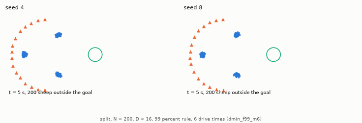

# Why trials fail: the `split` layout and how failed trials end

Part 5 of the HerdSim report on team size. The [overview](d_min_report.md) holds the abstract, the research questions, the [decision rules](d_min_report.md#2-decision-rules-and-setup) that define $D_{\min}$, its brackets and lower bounds, the [start layouts and dog rules](d_min_report.md#22-start-layouts-dog-rules-and-protocols), the discussion and the [references](d_min_report.md#references). Terms are defined in the [glossary](../glossary.md).

## 4. A closer look: the `split` layout and per-tick measures

### 4.1 Why more dogs do not help on `split`
On `split` flocks, which start as three separate clusters, more dogs do not raise success from $N = 200$: at 6 drive times under the 99% rule it stays between 0.60 and 0.92 for every $D \ge 4$ at $N = 200$ and 400 (0.10-0.76 under the strict rule), and at 3 drive times it falls toward zero (Figure 1).

Two measures over all stored trials show where the time goes ([single-trial tables](results_tables.md#single-trials-and-curves-across-folders)):
- The flock arrives in two parts: at 6 drive times on `split` $N = 200$, one or two dogs take a median 7 s from 90% to 99% of the flock in the goal; 3 dogs and teams from 6 up take 249 to 418 s, 43% to 60% of their finish time (4 dogs take 22 s, over only 38 successes). At $N = 283$ and 400 teams from 3 dogs take 274 to 480 s, and at $N = 566$ teams from 4 dogs take 474 to 540 s.
- Simpler rules do better than the team rule: on `split` $N = 200$ (6 drive times, 99% rule) the team rule stays at 0.60-0.95 with median finishes of 341-703 s, and sharing with the whole team fails from 4 dogs. Independent shepherds are reliable from 3 dogs (median 265-299 s), and dogs that see 30 to 65 m and do not share succeed in all 60 trials of every team from 3 to 16 dogs (median 237-350 s). Independent shepherds also plan on the whole flock, so what they lack is the team layer: the assignment of dogs to strays and the arc they drive from ([dog rules](d_min_report.md#22-start-layouts-dog-rules-and-protocols)). Why that helps on `split` was not tested; it fits the first cause below.

Replays of stored trials (`cli/diagnostics/split_diagnostic.py`, 12 seeds per cell, $N = 200$) point to two causes. Each change below made the drive faster at the team sizes given, at 6 drive times; at $D = 2$, spreading the collecting dogs slowed it (median 365 s to 393.5 s).

1. All collecting dogs go to one cluster ($D = 4$): the team rule assigns dogs to outliers by the least total walking distance. That ignores which cluster an outlier belongs to, so when the flock is in separate clusters, the nearer or more scattered cluster can take every dog while another drifts. When the collecting dogs were made to pick outliers at least $f(N) = r_a N^{2/3}$ apart, the median finish time at $D = 4$ fell from 631 s to 318 s.

2. Many dogs stand still under the stop rule ($D \ge 4$): Strömbom's dog stops while any sheep is within $3 r_a = 6$ m. On `wide` and `outlier_rich` that holds 1% to 7% of the dogs still. On `split` about 25% of the dogs stand still, held next to one cluster on their way to another. With the stop distance cut to $r_a = 2$ m, the drive was 21-24% faster at $D = 8$ and 16, and $D = 16$ succeeded in all 12 seeds.

At 3 drive times neither change made `split` reliable in these replays: at 4, 8 and 16 dogs no version succeeded in more than 7 of 12 seeds, few enough for the 99% interval to rule out reliability.


**Figure 1: Success on `split` flocks against team size (6 drive times).** On `wide` success rises to 1; on `split` at $N = 200$ and 400 it levels off below the threshold, and $N = 100$ is reliable under both rules.

- Marks: blue circles are the strict rule and orange squares the 99% rule, each with its 99% Clopper-Pearson interval, against $D$ on a log scale. The dotted line is $\theta = 0.90$.
- Panels: `split` at $N = 100$, 200 and 400, and `wide` at $N = 400$ for comparison.

*Data:* `results/dmin_m6` and `results/dmin_f99_m6`; values in [results_tables.md: dmin_m6](results_tables.md#dmin_m6) and [results_tables.md: dmin_f99_m6](results_tables.md#dmin_f99_m6).



**Animation 1: Two seeds of one `split` cell, replayed ($N = 200$, 16 dogs, 99% rule, 6 drive times).** The same team succeeds on one start and fails on another. Each replay reproduces its stored trial.

- Left: seed 4 brings the clusters together and succeeds at 283 s.
- Right: seed 8 brings 196 of the 200 sheep into the goal, then drives the flock back out and runs out of time with its centre 139 m from the goal.

### 4.2 Per-tick measures
Two measures were recorded at every tick, the simulation step, of every trial:

- Flock spread and success: across cells with at least 20 seeds at 6 drive times, the rank correlation (Spearman) between the mean flock spread (RMS distance to the centroid) and the success rate is $-0.76$ under the strict rule and $-0.71$ under the 99% rule ($-0.57$ to $-0.68$ at 3 drive times; Figure 2). The spread is averaged over the whole trial and failed trials end spread out, so the correlation does not show which comes first.
- How close the dogs come to each other: with `strombom_multi` at $N = 200$ (99% rule), no dog has another within 2 m up to $D = 6$ on `wide`; at $D = 16$ the share is 0.45-0.59 across the scattered layouts. With FAT (`dmin_f99_fat`) it is 0.45-0.66 at $D = 2$ and 0.72-0.90 at $D = 16$ (medians over all $N$), as expected when every dog chases the same sheep.


**Figure 2: Per-tick measures at 6 drive times.** Cells whose flock stays more spread out succeed less often, and on `split` about a quarter of the dogs stand still under the 6 m stop rule.

- Left: mean flock spread over the trial (RMS distance to the centroid) against the success rate, one point per cell with at least 20 seeds, coloured by layout, circles for the strict rule and squares for the 99% rule. The rank correlation is $-0.76$ strict and $-0.71$ at 99%.
- Middle: median share of dogs standing still against $D$ at $N = 200$ (99% rule) for `wide`, `split` and `outlier_rich`.
- Right: median share of dogs with another dog within 2 m against $D$, for the same cells.

*Data:* `results/dmin_m6` and `results/dmin_f99_m6`.

### 4.3 How failed trials end, and the start spread

Most failed trials end with the flock still far from the goal (item 1, Table 1). How spread out the start is separates compact from scattered starts but does not order the scattered layouts (item 2, Table 2).

1. Where failed trials end: we split failed drive trials by where the flock ended. A trial is near the goal when the flock centre ended within two goal radii of the goal centre: the flock got there but missed the deadline or left sheep outside. It is far from the goal when the flock centre ended farther away. Two goal radii is our choice; no other cutoff was tried. In 70% to 91% of failed trials the flock ended far from the goal (Table 1), so most failed trials end before the flock reaches the goal. This rule uses only where the flock ended; it does not tell whether more time would have saved the trial.

   The task's failure labels, heuristic patterns read from each trial's history and named after what they look for (`flock_escaped`, `stuck`, `scatter` and others), add little: at 6 drive times under the 99% rule 1049 of the 1511 failures match no pattern and are plain timeouts, and on `split` 207 of 1015 are `stuck`; at 12 drive times the most common label is `flock_escaped` (105 of 235).

**Table 1: Failed drive trials by where the flock ended.**

| Protocol | Rule | Failed trials | Far from goal | Near goal | Share far |
| :--- | :--- | :---: | :---: | :---: | :---: |
| `dmin_m12` | strict, 12x | 235 | 180 | 55 | 76.6% |
| `dmin_m6` | strict, 6x | 889 | 639 | 250 | 71.9% |
| `dmin_m3` | strict, 3x | 710 | 571 | 139 | 80.4% |
| `dmin_f99_m12` | 99%, 12x | 235 | 213 | 22 | 90.6% |
| `dmin_f99_m6` | 99%, 6x | 1511 | 1067 | 444 | 70.6% |
| `dmin_f99_m3` | 99%, 3x | 584 | 457 | 127 | 78.3% |

*Data:* the command below, on the six main protocols.

```bash
uv run cli/dmin_tables.py dispersion
```

2. The start spread times $N$: the product of the flock's start spread $S_0$ (its RMS radius at the start) and $N$ is a rough measure, our heuristic, of how much gathering a layout asks for. At $N = 400$ it is 8 to 13 times larger on the scattered layouts than on `compact`. Success at 6 drive times, pooled over every team size of the grid, is 100% for the three compact rows and 21% to 84% on the scattered layouts (Table 2). The product separates compact from scattered starts, but it does not order the scattered layouts: `outlier_rich` has a smaller product than `wide` and a lower success rate. How the strays are placed matters as well as how far.

**Table 2: Start spread, its product with $N$, and success rate at 6 drive times.**

| Layout | $N$ | Start spread $S_0$ (m) | $S_0 \times N$ (m) | Success rate (all $D$) |
| :--- | :---: | :---: | :---: | :---: |
| `compact` | 25 | 4.8 | 119 | 100.0% |
| `compact` | 100 | 6.7 | 665 | 100.0% |
| `compact` | 400 | 8.3 | 3316 | 100.0% |
| `wide` | 400 | 74.8 | 29,931 | 83.8% |
| `outlier_rich` | 400 | 66.2 | 26,496 | 55.3% |
| `split` | 400 | 108.8 | 43,507 | 21.1% |

*Data:* `uv run cli/dmin_tables.py dispersion` on `dmin_m6`; $S_0$ is the mean of `max_extent` (the flock's largest RMS radius in a trial, which is its start). The success rate pools every tested team, including $D = 1$, so it depends on the grid.
