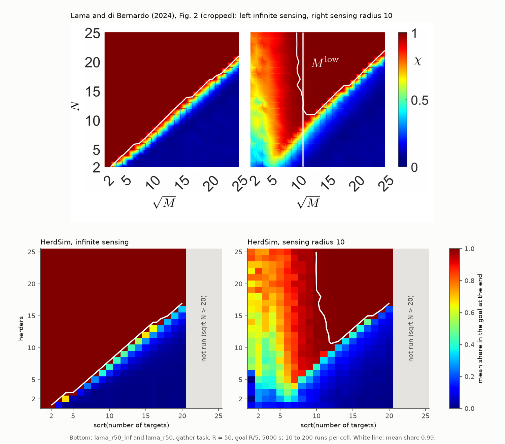
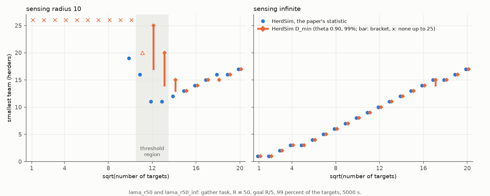

# Cohesion and the square-root law

## 3.11 RQ11: Cohesion and the growth of D_min

Cohesion is the pull that draws each sheep toward the others. Strömbom's sheep are drawn to all $N - 1$ others with an [attraction weight](../methods/strombom_sheep.md#attraction-to-the-flock) $c = 1.05$. We raised $c$ to 1.3, 1.6 and 2.0, and for one weaker level halved the number $n$ of neighbours each sheep is drawn to ($n = 0.5N$), all under the [99% rule](../glossary.md#success-and-reliability) at 12 [drive times](../glossary.md#the-drive-task).

Weakening cohesion makes $D_{\min}$ grow faster with $N$ on the `wide` [layout](../glossary.md#start-layouts-and-dog-starts): the slope of $\log D_{\min}$ against $\log N$ becomes 0.40-0.70. That range includes 0.5, the slope of the square-root law, under which the smallest team grows in proportion to the square root of $N$; Lama and di Bernardo (2024) found it for targets that do not flock, herded with infinite sensing ([section 3.14](#314-rq14-targets-without-cohesion-the-square-root-law-of-lama-and-di-bernardo-2024)). Strengthening cohesion changes little (Table 1). Where $D_{\min}$ is a bracket, the slope is the range the brackets allow.

**Table 1: $D_{\min}$ on `wide` and its slope for Strömbom's cohesion, the weaker level and the three stronger levels (99% rule, 12 drive times).**

| Cohesion | $N = 50$ | $N = 100$ | $N = 200$ | $N = 400$ | Slope |
| :--- | :---: | :---: | :---: | :---: | :---: |
| Weaker ($n = 0.5N$), fitted on $N = 50$-400 | 1 | 1 | 2 | 2-4 | 0.40-0.70 |
| Strömbom ($c = 1.05$, $n = N - 1$), fitted on $N = 25$-400 | 1 | 1 | 1-2 | 2 | 0.20-0.30 |
| Stronger ($c = 1.3$, 1.6 or 2.0), fitted on $N = 25$-400 | 1 | 1 | 1 | 2 | 0.20 |

The three stronger levels agree at every size and share a row; with no bracket, their slope is a single value. $N = 25$ is fitted but not shown; the weaker row has no $N = 25$, so its slope covers fewer sizes.

*Data:* [results_tables.md: cohesion runs](results_tables.md#holding-spacing-cohesion-views-large-n-99-percent) ($D_{\min}$), [results_tables.md: growth of the cohesion runs](results_tables.md#capped-drive-offset-and-growth-of-the-cohesion-runs-99-percent) (slopes) and [results_tables.md: Growth with N, 99 percent](results_tables.md#growth-with-n-99-percent) (Strömbom row).

With $c = 1.3$, 1.6 or 2.0, $D_{\min}$ on `wide` falls by at most one dog at any size. With every sheep already drawn to the whole flock, a tighter pull may not help the dogs; we have not tested this.

On `outlier_rich` the weaker level gives a slope of 0.30 on $N = 50$-400, the value Strömbom's cohesion gives on $N = 25$-400 ([results tables](results_tables.md#dmin_f99_k05)). On `split` it costs dogs: $D_{\min}$ goes from 1 to 3-4 at $N = 200$ and from 2 to 4-5 at $N = 400$.

At $N = 200$ one dog on `split` fails in 6 of 10 trials with the weaker level. At 400 it fails all 10 with the weaker level and with Strömbom's cohesion alike, so only $N = 200$ shows the effect of weaker cohesion. Of the 16 failed trials of the weaker level, 13 carry the [failure label](../experiments/task_design.md#how-failed-trials-end) `flock_escaped`, 2 the label `split` (the flock broke into groups; the label is not the layout) and 1 the label `scatter`. Perhaps the weaker flock comes apart under one dog at $N = 200$; no run has checked it.

Only one weaker level was run, from $N = 50$. The task is sized by the calibrated flock radius $R_f$, the radius the flock settles to under one driving dog ([sizing](../experiments/task_design.md#sizing-by-the-calibrated-flock-radius)); at $N = 25$ the weaker level's $R_f$ still changed by 62% between the 90 s windows that calibration compares, so it had not settled. Weaker settings ($n = 0.25N$ and below, $c = 0.8$ and 0.9) never settled to one flock size under a driving dog, so $R_f$ could not be calibrated. Those checks are not stored and cannot be re-read ([appendix B](appendix_run_record.md#appendix-b-claims-and-evidence), claim 6).

### Larger teams on the strongest flock

On `outlier_rich` the strongest flock slows larger teams. With $c = 2.0$ at $N = 400$ the median finish is 517 s with 4 dogs and 674-726 s with 6 to 24, so [$D_{\mathrm{best}}$ and $D_{\mathrm{crowd}}$](../glossary.md#team-sizes), the smallest team within 5% of the fastest and the first larger working team more than 5% slower on the same seeds at 99% confidence, are 4 and 6. At $N = 200$, $D_{\mathrm{best}} = 2$ (406 s), 3 and 4 dogs are undecided against it and 6 or more are slower, so $D_{\mathrm{crowd}}$ is 3-6; the generated table lists its upper end, 6. With $c = 1.3$ and 1.6 no `outlier_rich` curve has a $D_{\mathrm{crowd}}$.

## 3.14 RQ14: Targets without cohesion: the square-root law of Lama and di Bernardo (2024)

With infinite sensing, targets that do not flock follow the square-root law in HerdSim too. With a sensing radius $\xi = 10$, where each herder senses only what lies within distance 10, HerdSim's threshold, the size above which the law holds, is close to the paper's.

We ran the paper's model, whose targets are random walkers that do not attract each other, as method `lama` ([model](../methods/lama.md#lama-and-di-bernardo-2024-non-cohesive-targets)) on the [gather task](../experiments/task_design.md#7-the-gather-task-lama-and-di-bernardo-2024). Targets and herders start spread over a disc of radius $R = 50$, and herders with $\xi = 10$ or infinite sensing must bring the targets into a goal of radius 10 at its centre.

The paper writes $M$ for the number of targets, $N$ for the herders and $N^*$ for the smallest sufficient team; this report writes $N$, $D$ and $D^*$.

A run lasts at most 5000 s, the paper's $t_{\max} = 5.0 \times 10^3$ for $\xi = 10$ (Supplementary Fig. S8, no unit, [read as seconds](../experiments/task_design.md#geometry-of-the-gather-task)), which HerdSim also uses with infinite sensing. A failing run ends there, or earlier when every herder is in the goal and none senses a target outside it. The paper's main text gives only a "settling time required for stationarity", which HerdSim does not test.

### Two statistics for the smallest team

The same trials are read in [two ways](../experiments/task_design.md#two-statistics). The paper calls targets herdable when the herders bring "at least a certain fraction $\chi > \chi^*$" of them to the goal "within a finite time" (main text, p. 3). HerdSim reads this as a final share in the goal, averaged over runs, of at least $\chi^* = 0.99$; this is the paper's statistic, and $D^*$ is the smallest team from which every larger team passes. HerdSim's own rule needs at least 90% of the runs to succeed at 99% confidence, a run succeeding when 99% of the targets and every herder are in the goal; the smallest such team is $D_{\min}$.

An average can stay above 0.99 while some runs fail, so the two statistics can name different teams. At 144 targets ($\sqrt{N} = 12$, just above the paper's 99% threshold of 11; Table 2) and sensing radius 10, eleven herders gather on average 99.2% of the targets, so the paper's statistic accepts them. Yet only 21 of their 30 runs end with 99% in (99% interval 0.45-0.89); the 9 failed runs lose two to four targets. HerdSim's $D_{\min}$ is the bracket 17-25, so the answers differ by 6 to 14 herders here, and by less above. Animation 5 in [task design](../experiments/task_design.md#when-a-trial-ends-and-what-counts-as-success) replays two runs of this cell: seed 0 succeeds, seed 1 ends with two targets out of every herder's sight.

### Results against the paper

With limited sensing the paper finds "$N^* \propto \sqrt{M}$" "only above a critical threshold $M > M_{\mathrm{low}}$" (Fig. 2 caption, p. 3); in this report's symbols, $D^*$ grows as $\sqrt{N}$ above $\sqrt{N_{\mathrm{low}}}$. Its Supplementary Table I lists "Values of $\sqrt{M_{\mathrm{low}}}(\chi^*)$, with $\chi^* \in \{0.90, 0.95, 0.99\}$, for different values of $R$ and $\xi$". In the one row compared here, $R = 50$ and $\xi = 10$, these are 8, 9 and 11 at the 90%, 95% and 99% levels; HerdSim gives 8, 9 and 12 (Table 2).

HerdSim's values apply the paper's statistic at each level to HerdSim's trials. The criterion is our own: the first $\sqrt{N}$ from which $D^*$ stays in the band that grows with $\sqrt{N}$, read by eye from the `nstar_0.90`, `nstar_0.95` and `nstar_0.99` columns of the [results tables](results_tables.md#lama-and-di-bernardo-2024-gather-task); no tool computes it. These thresholds are the one result in this part read by eye rather than printed by a tool. The 90% and 99% values follow from the stored columns. The 95% value depends on how much wobble the band may have: `nstar_0.95` reads 25, 24, 9, 8, 10, 10 and 11 from $\sqrt{N} = 7$, so a rule that never lets $D^*$ fall would give 10.

The paper's value is a bound the law holds above, and HerdSim's the first size where it holds, so the two are not read in quite the same way.

**Table 2: Threshold $\sqrt{N}$ for the square-root law ($R = 50$, sensing radius 10).**

| Level $\chi^*$ | Paper (Supplementary Table I) | HerdSim |
| :--- | :---: | :---: |
| 90% | 8 | 8 |
| 95% | 9 | 9 |
| 99% | 11 | 12 |

The paper's other results are colour maps (its Fig. 2), and HerdSim's have the same shape by eye (Figure 1). At radius 10, below the threshold no team succeeds; above it a band of teams grows with $\sqrt{N}$, and with infinite sensing that band runs over the whole range. At radius 10 with few targets HerdSim's cells are a shade lower, and its 0.99 line bends a little farther right.

**Figure 1: Share of targets gathered, the paper's Fig. 2 above HerdSim's ($R = 50$, infinite sensing and sensing radius 10).** At radius 10 both show a threshold followed by a band of teams that grows with $\sqrt{N}$.

- Marks: each cell is the share of targets in the goal at the end, averaged over runs, for one number of targets (across, as its square root) and one number of herders (up). The white line marks 0.99. HerdSim's grid stops at 400 targets ($\sqrt{N} = 20$; [why](../experiments/task_design.md#flock-size)), so the grey band from 21 to 25 on the paper's axis has no data.
- Panels: the paper's Fig. 2 on top and HerdSim below, with infinite sensing on the left and sensing radius 10 on the right.

*Data:* top, Fig. 2 of Lama and di Bernardo (2024), Phys. Rev. Research 6, L032012, [CC BY 4.0](https://creativecommons.org/licenses/by/4.0/), cropped; bottom, `lama_r50_inf` and `lama_r50`, with 10 to 200 runs per cell against the paper's 50.

With infinite sensing both statistics give the square-root law, with exponents 0.52 (paper's statistic) and 0.53 (HerdSim's rule) on the 11 sizes from 100 targets up (Table 3). They give the same smallest team at almost every size: 8 herders for 100 targets, 13 for 225, 17 for 400. Unlike the Strömbom flock, more herders keep gathering faster: at 400 targets the median time is 1232 s with 17 herders, 451 s with 20 and 222 s with 25. From 169 targets [$D_{\mathrm{sat}}$](../glossary.md#team-sizes) is at least 25, the top of the grid.

With sensing radius 10 the two statistics part near the threshold (Figure 2). With 100 targets or fewer no team up to 25 herders is reliable; most failed runs up to 81 targets end early, with every herder back in the goal. From 100 to 196 targets the two statistics give different teams, as in the 144-target case above. Under HerdSim's own rule, $D_{\min}$ is first a single team, not a bracket or a lower bound, at 225 targets ($\sqrt{N} = 15$). One difference we have not examined: at 324 targets the statistics differ by one herder the other way (paper's statistic 16, $D_{\min}$ 15).

**Figure 2: The smallest team for each number of targets in the model of Lama and di Bernardo (2024), $R = 50$, sensing radius 10 and infinite sensing.** With infinite sensing the two statistics agree; at radius 10 they part near the threshold, where the average accepts teams that HerdSim's rule does not.

- Marks: circles apply the paper's statistic to HerdSim's runs; diamonds are HerdSim's $D_{\min}$, with bars for brackets, a triangle for a lower bound ([section 2.1](d_min_report.md#21-when-a-team-is-reliable)) and a cross for no reliable team up to 25.
- Panels: sensing radius 10 with the threshold region shaded (left), and infinite sensing (right).

*Data:* [results_tables.md: Lama and di Bernardo (2024): gather task](results_tables.md#lama-and-di-bernardo-2024-gather-task). Up to 81 targets at radius 10, 2087 of the 2182 failed runs end early by the stop reason each run records; the other 95 reach the 5000 s limit.

### Slopes: Strömbom flock against the Lama model

Under the 99% rule at 12 drive times, the Strömbom slopes on the nine sizes $N = 25$-566 are 0.27-0.38 on `wide` and 0.28-0.38 on `outlier_rich` ([section 3.8](part1_growth.md#38-rq8-growth-with-n-on-a-denser-grid-d_sat-and-the-shape-of-the-curve)) and 0.34 on `split` ([results tables](results_tables.md#growth-with-n-99-percent)), against 0.52 and 0.53 for the Lama model with infinite sensing (Table 3). On `wide`, weaker cohesion ([section 3.11](#311-rq11-cohesion-and-the-growth-of-d_min)) and a shorter deadline both move the slope toward 0.5: at 6 drive times it is 0.30-0.42 on $N = 25$-400 and 0.38-0.61 on the nine sizes.

This gap says little about cohesion. The models differ in task, herder rule and flock sizes, and a fit on six sizes does not separate the two sensing settings (last two rows of Table 3, without intervals). How much of the gap is due to cohesion is not yet measured.

A cohesive flock may need fewer added dogs because an [outlier](../glossary.md#sheep-models-and-dog-rules) drawn to the whole flock ($n = N - 1$) would rejoin it by itself once a dog turns it back, while without cohesion a herder has to fetch every target. No run has tested this: even the weaker flock is cohesive ($n = 0.5N$).

**Table 3: Exponents of the smallest team against the number of targets, Lama and di Bernardo model in HerdSim ($R = 50$).**

| Sensing | Sizes fitted | Paper's statistic | HerdSim's rule |
| :--- | :--- | :---: | :---: |
| Infinite | 11, from 100 targets | 0.52 | 0.53 |
| Infinite | 10, from 121 targets | 0.52 | 0.51 |
| Infinite | 6, from 225 targets | 0.41 | 0.49 |
| Radius 10 | 6, from 225 targets | 0.42 | 0.41 |

*Data:* [results_tables.md: gather task](results_tables.md#lama-and-di-bernardo-2024-gather-task) for the first and last rows; `uv run cli/dmin_tables.py herdability lama_r50_inf --above 121` and `--above 225` for the other two.
