# HerdSim scaling study: short report

## What this is about

When a few dogs guide a larger flock, how much control do you actually need as the flock gets bigger, or starts more spread out?

We treat that as something to measure, not something to assume. There is no universal scaling law baked into the setup. The runs lock the same rules so comparisons stay fair.

**HerdSim** is the platform for those runs. A few dogs guide sheep to a goal under settings we can freeze and repeat. Here it is a model system for *control demand* (how many dogs, or how much dog work, is enough). It is not meant as a copy of a real farm.

Control is also indirect. We cannot steer every sheep by hand; the dogs only push through local reactions. So "how much control" becomes a measurable quantity as size and starting shape change.

This short report summarises what those runs showed.

---

## What we asked

Once the core campaigns were in place, we wanted clear answers on four fronts:

- whether start shape matters beyond size,
- how dog need changes as the group grows,
- which processes seem to drive the pattern,
- what looks shared across herding methods versus method-specific.

### Core questions

**RQ1 (structure).** At the same flock size, does start shape (spread, split, outliers) change how many dogs are needed? We ran this on the baseline method only.

**RQ2 (size and regimes).** As flock size grows, how does the useful dog range change? That means the minimum for reliable herding, and whether adding more still helps, mostly wastes walking, or starts to hurt.

**RQ3 (mechanism).** Why does the pattern appear (for example dog interference, flock splitting, coverage limits)? This is analysis only, and only when we can match efficient cells with overcrowding cells at the same size.

**RQ4 (generality).** If we switch herding method, which parts of the pattern stay the same? We repeat size and structure maps for Kubo and FAT beside the baseline.

### Follow-on questions

**RQ5 (information).** Can better sensing or communication reduce the dog count at the same reliability?

**RQ6 (scaling fits).** Once we have minimum dog counts vs flock size, which simple curve best predicts a held-out size, and is one power law enough?

**RQ7 (early warning).** Can recent flock state warn of failure better than knowing only N and D?

We are not trying to pick the "best" herding algorithm, reproduce every detail of real livestock, or ship a farm product.

---

## How we studied it

### Shared rules

Every scientific run uses the same frozen protocol (`scaling_v2`):

| Piece | Setting |
|-------|---------|
| Task | Drive every sheep into a goal disk before the deadline (`drive_to_goal`) |
| Field | 500 by 500; flock centre (250, 250); goal (370, 250); drive length 120 |
| Goal radius | `15 * sqrt(N/50)` so area per sheep stays roughly constant |
| Reliability bar | succeed in at least 90% of repeats (`theta = 0.90`); we also report 0.50 and 0.70, but they do not define the minimum |
| Flock sizes `N` | `{5, 10, 25, 50, 75, 100, 150, 200, 300, 400}` |
| Dog counts `D` | `{1, 2, 3, 4, 6, 10, 15, 20, 25, 35}` |
| Start layouts | compact, wide, split, outlier_rich |
| Main deadline | T0 = 10,000 ticks; a longer T1 = 20,000 only if overcrowding cells appear |
| Seeds | smoke 5; scout 30; claim 100 (200 on soft edges); master seed 2026 |

`D_min` is the smallest tested dog count that clears the 90% bar. It is not a property of sheep in nature; it depends on this task and these locks.

### Why three methods

We wanted different *kinds* of dog rules on the same task, not three tiny variants of one idea:

| Method | Role | Plain description |
|--------|------|-------------------|
| `strombom_multi` | Baseline | Dogs gather stragglers (Collect), then push the flock to the goal (Drive) |
| `kubo` | Transfer | Continuous force rules; each dog pushes the sensed sheep farthest from the goal |
| `fat` | Transfer | Each dog chases the sheep farthest from itself; dogs do not space themselves apart |

If all three show the same pattern, that pattern is more likely about the task. If Kubo or FAT breaks it, we learn how far the story travels. That is the point of RQ4. These three methods do not cover every herding idea in the world.

### Why smoke, scout, then claim

We need accurate success rates near the important edges: where the minimum sits, and where overcrowding might start. Running every cell at 100 seeds would burn budget on cells that always succeed or always fail.

So each campaign stages the work:

1. **Smoke (5 seeds):** pipeline check on a small grid.
2. **Scout (30 seeds):** cheap map of the full scientific grid so we can see where reliability lives.
3. **Claim (100 seeds, or 200 on soft edges):** reseed only the window cells that matter.

Scout covers the whole map; claim covers a small window. Claims rest on claim-grade merges, not scout alone.

### How many trials we ran

| RQ | What | SMOKE | SCOUT | CLAIM | Total | Status |
|----|------|------:|------:|------:|------:|--------|
| RQ1 | Structure map (baseline, 4 layouts) | 600 | 3,600 | 2,400 | 6,600 | DONE |
| RQ2 | Size map (baseline, compact) | 150 | 3,000 | 2,200 | 5,350 | DONE |
| RQ3 | Mechanism contrast | 0 | 0 | 0 | 0 | SKIPPED |
| RQ4 | Kubo then FAT size + structure | 0 | 13,200 | 10,500 | 23,700 | DONE |
| RQ5 | Observation, range, communication ladders | 0 | 3,600 | 4,100 | 7,700 | DONE |
| RQ6 | Curve fits on claim frontiers | 0 | 0 | 0 | 0 | DONE (analyse) |
| RQ7 | Early warning on claim trajectories | 0 | 0 | 0 | 0 | DONE (analyse) |
| **All** | | **750** | **23,400** | **19,200** | **43,350** | |

RQ2's longer-deadline T1 was planned and then skipped (0 overcrowding cells). RQ5 ladders finished after the obs/comm sim fixes (obs/range/comm scout+claim). Claim merges hold about 37,110 rows (Phase 1-4 merges plus Phase 5 obs 1,920 + range 2,630 + comm 1,920; a reseeded cell drops its scout rows from that merge).

Commands used (from the HerdSim repo root):

```bash
# RQ2 size map
uv run cli/campaign.py run --protocol phase1_pilot --workers 16
uv run cli/campaign.py run --protocol phase1_scout --workers 16
uv run cli/campaign.py claim-reseed --protocol phase1_claim --workers 16

# RQ1 structure map
uv run cli/campaign.py run --protocol phase2_scout --workers 16
uv run cli/campaign.py claim-reseed --protocol phase2_claim --workers 16

# RQ4 transfer (kubo, then fat)
uv run cli/campaign.py run --protocol phase4_kubo_size_scout --workers 16
uv run cli/campaign.py claim-reseed --protocol phase4_kubo_size_claim --workers 16
uv run cli/campaign.py run --protocol phase4_kubo_structure_scout --workers 16
uv run cli/campaign.py claim-reseed --protocol phase4_kubo_structure_claim --workers 16
# then fat: phase4_fat_size_scout / phase4_fat_size_claim / phase4_fat_structure_*

# RQ5 ladders (obs, then range, then communication)
uv run cli/campaign.py run --protocol phase5_factor_sweep --workers 18
uv run cli/campaign.py claim-reseed --protocol phase5_obs_claim --workers 18
uv run cli/campaign.py run --protocol phase5_range_scout --workers 18
uv run cli/campaign.py claim-reseed --protocol phase5_range_claim --workers 18
uv run cli/campaign.py run --protocol phase5_comm_scout --workers 18
uv run cli/campaign.py claim-reseed --protocol phase5_comm_claim --workers 18
```

---

## What we found

### RQ1: does start shape change dog need?

**Status:** Answered on the baseline (`strombom_multi`). Kubo and FAT structure maps sit under RQ4.

At N = 50, 100, and 200, all four start layouts have `D_min = 1`. On the baseline, start shape does not change how many dogs you need to clear the 90% bar.

It does change cost. Wide and large outlier-rich starts take much longer and walk much farther than compact. Split looks a lot like compact. Because `D_min` never moved across layouts, we could not test whether early flock-state measures predict difficulty better than knowing only N and D.

One-dog cost by layout (median over successful trials; success rate 1.00 at D = 1 for every cell):

| Layout | N | Median ticks | Median path |
|--------|---:|---:|---:|
| compact | 50 | 195 | 158 |
| compact | 100 | 204 | 161 |
| compact | 200 | 191 | 144 |
| split | 50 | 195 | 158 |
| split | 100 | 205 | 162 |
| split | 200 | 193 | 144 |
| outlier_rich | 50 | 224 | 209 |
| outlier_rich | 100 | 501 | 554 |
| outlier_rich | 200 | 1,228 | 1,647 |
| wide | 50 | 2,138 | 2,925 |
| wide | 100 | 3,074 | 4,319 |
| wide | 200 | 3,870 | 5,213 |

Wide versus compact at one dog: about 11x to 20x more time, and about 19x to 36x more path. On wide starts, the cheapest reliable choice is two dogs (`B* = 2`): the second dog cuts path while staying reliable.

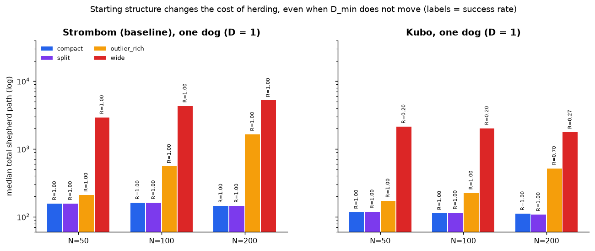

*Wide and large outlier-rich starts cost much more time and path at one dog; D_min stays 1.*

### RQ2: how does dog need change with flock size?

**Status:** Answered on the baseline (`strombom_multi`, compact) inside the tested dog list through D = 35.

The useful lower end is small and almost flat. At one dog, N = 5 and 10 fail the 90% bar (success about 0.07 and 0.24). From N = 25 upward, one dog is enough. Adding dogs past the minimum does not break success on that map; it mostly adds walking (88 of 100 cells labeled wasteful; 0 overcrowding).

Baseline compact frontier at the 90% bar:

| N | D_min | D_max | Maximum SR |
|---:|---:|---|---:|
| 5 | 2 | not reach | 100% |
| 10 | 2 | not reach | 100% |
| 25 | 1 | not reach | 100% |
| 50 | 1 | not reach | 100% |
| 75 | 1 | not reach | 100% |
| 100 | 1 | not reach | 100% |
| 150 | 1 | not reach | 100% |
| 200 | 1 | not reach | 100% |
| 300 | 1 | not reach | 100% |
| 400 | 1 | not reach | 100% |

Here "not reach" means no overcrowding appeared before D = 35, so `D_max` is only the top of our tested list, not a measured collapse. Bootstrap width on every `D_min` above is zero.

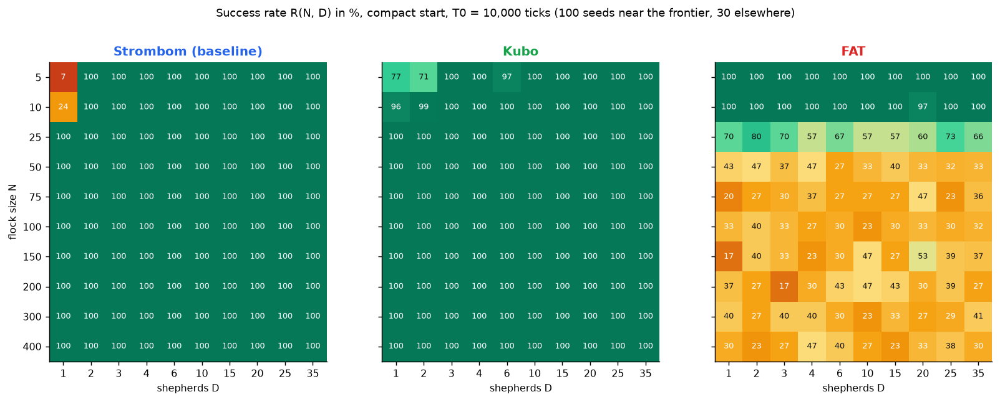

*Success-rate surfaces. Baseline and Kubo show a reliable band on compact starts; FAT does not for larger N.*

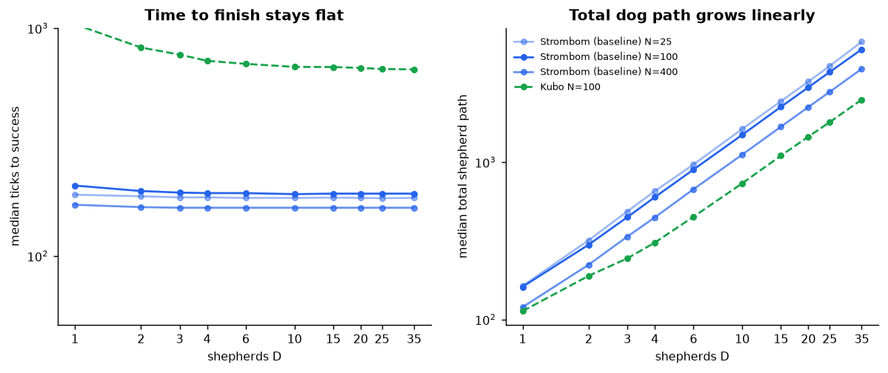

*Extra dogs mainly raise path after the minimum; success stays high (waste, not overcrowding).*

### RQ3: what mechanism drives the pattern?

**Status:** Not answerable yet. SKIPPED as a contrast.

The plan was to compare efficient cells with overcrowding cells at the same N. We never saw overcrowding on the baseline size map inside D <= 35, so that contrast never existed. Correlation candidates (interference, splitting, and related logs) were not tested against a real upper failure band.

RQ3 still needs either a measured collapse (for example D > 35, or a harder draft-style task) or another protocol where overcrowding appears. See [What we plan next](#what-we-plan-next).

### RQ4: do the patterns transfer across methods?

**Status:** Partial.

On tight (compact) starts, Strombom and Kubo share a low `D_min` floor for larger flocks. FAT does not copy that story.

Compact `D_min` at the 90% bar:

| N | Baseline (`strombom_multi`) | Kubo | FAT |
|---:|---:|---:|---|
| 5 | 2 | 3 | 1 |
| 10 | 2 | 1 | 1 |
| 25 | 1 | 1 | not reach |
| 50 | 1 | 1 | not reach |
| 75 | 1 | 1 | not reach |
| 100 | 1 | 1 | not reach |
| 150 | 1 | 1 | not reach |
| 200 | 1 | 1 | not reach |
| 300 | 1 | 1 | not reach |
| 400 | 1 | 1 | not reach |

Structure breaks transfer further. A shared compact floor does not mean structure behaves the same way.

Structure-map `D_min` at the 90% bar (N in `{50, 100, 200}`):

| Layout | N | Baseline | Kubo | FAT |
|--------|---:|---:|---:|---|
| compact | 50 | 1 | 1 | not reach |
| compact | 100 | 1 | 1 | not reach |
| compact | 200 | 1 | 1 | not reach |
| split | 50 | 1 | 1 | not reach |
| split | 100 | 1 | 1 | not reach |
| split | 200 | 1 | 1 | not reach |
| outlier_rich | 50 | 1 | 1 | not reach |
| outlier_rich | 100 | 1 | 1 | not reach |
| outlier_rich | 200 | 1 | 20 | not reach |
| wide | 50 | 1 | not reach | not reach |
| wide | 100 | 1 | not reach | not reach |
| wide | 200 | 1 | not reach | not reach |

On Kubo wide, best success is about 0.47 to 0.54. FAT clears no structure cell at these sizes. Kubo `outlier_rich` at N = 200 is a point estimate `D_min = 20` with a wide bootstrap interval `[2, 20]`.

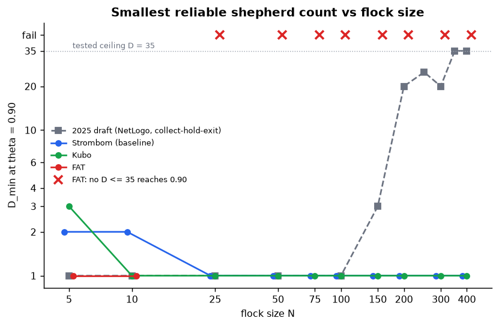

*Baseline and Kubo stay near one dog for large compact flocks. FAT has no D_min for N >= 25. A 2025 NetLogo draft on a harder collect-hold-gate task rose sharply; that draft was not rerun here.*

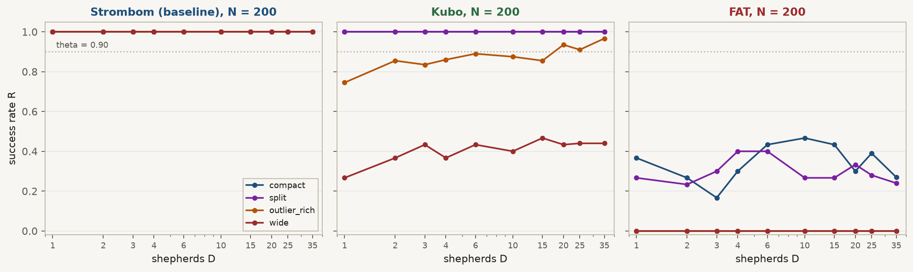

*At N = 200, compact and split look shared for Strombom and Kubo; wide and large outlier-rich do not.*

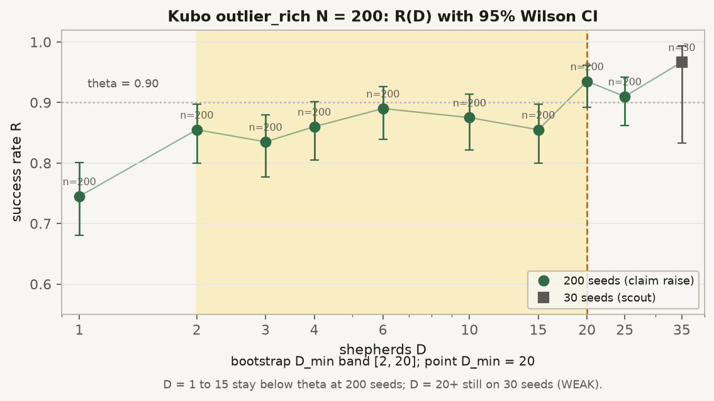

*Soft edge: point D_min = 20 after 200 seeds; bootstrap still wide.*

That is enough to reject "the same story everywhere," but not enough to say which patterns would hold across a broader method set.

### RQ5: can better information replace dogs?

**Status:** Answered on the baseline (`strombom_multi`, compact) at N in {100, 200} after the shared obs/comm fixes.

We ran three ladders on the same N/D grid (D in {1, 2, 3, 4, 6, 10}) with claim-grade reseeds:

| Ladder | What varies | Scout | Claim | Merge rows |
|--------|-------------|------:|------:|-----------:|
| Observation | `obs_mode` in {bearing_only, local_positions, global} | 1,080 | 1,200 | 1,920 |
| Sensing range | `sensing_range` in {32.5, 65, 97.5, 130} under `local_positions` | 1,440 | 1,700 | 2,630 |
| Communication | `communication` in {none, neighbour_broadcast, global_shared} under `local_positions` | 1,080 | 1,200 | 1,920 |

**Observation.** `global` and `local_positions` clear the 90% bar at `D_min = 1` for both N. `bearing_only` never reaches 90% for any tested D (merge success about 0.22). Bad observation can make the map fail hard; putting local positions back restores the one-dog floor. That is not a clean "one less dog" step (there is no finite `D_min` on bearing_only), but it shows that observation quality matters.

**Sensing range (main C5 evidence).** Short range needs more dogs; stretching range further does not keep buying dogs:

| sensing_range | N=100 `D_min` | N=200 `D_min` |
|--------------:|--------------:|--------------:|
| 32.5 | 3 | 2 |
| 65 | 1 | 1 |
| 97.5 | 1 | 1 |
| 130 | 1 | 1 |

Stepping from 32.5 to 65 lowers `D_min` by 2 at N=100 and by 1 at N=200. Further steps save 0 more dogs (`D_min` is already 1).

**Communication.** All three modes have `D_min = 1` and merge success 1.00 on this compact map. Sharing does not reduce dog count here, because one dog already clears the bar.

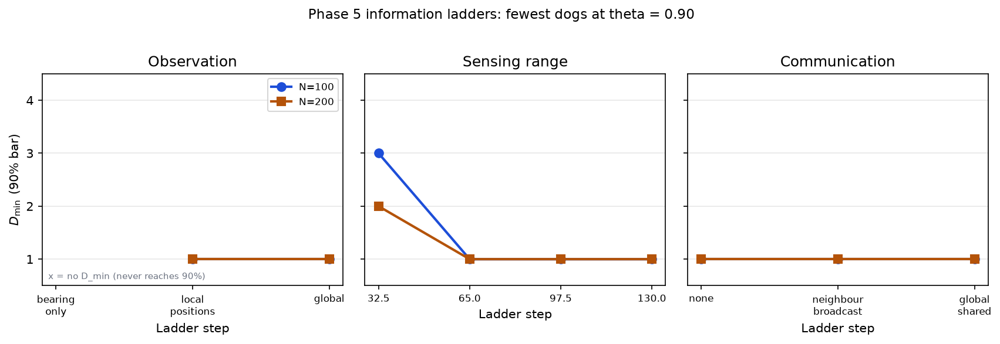

*Fewest dogs at the 90% bar across observation, range, and communication steps. Crosses mark levels that never reach 90%. Where N = 100 and N = 200 share the same D_min, the markers sit on top of each other (for example local/global and every communication step).*

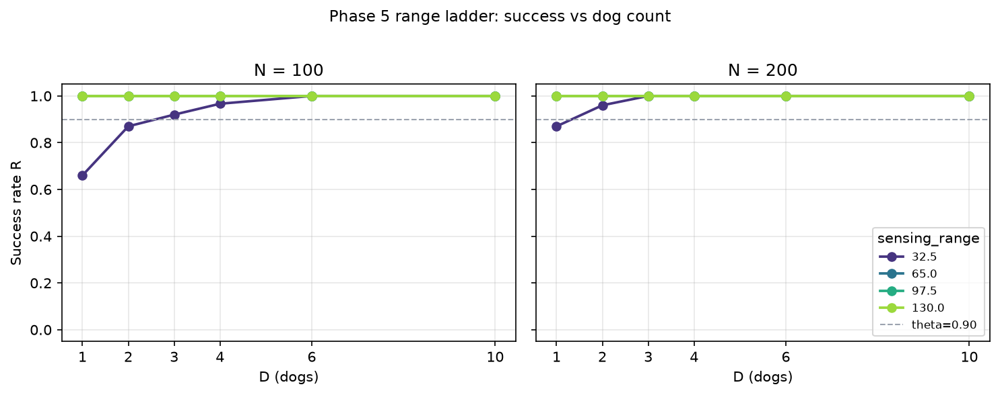

*Success vs dog count by sensing range. The short-range curve (32.5) is the only one that needs D > 1. Ranges 65, 97.5, and 130 all sit at R = 1.00 for every tested D, so those three curves overlap on the top line.*

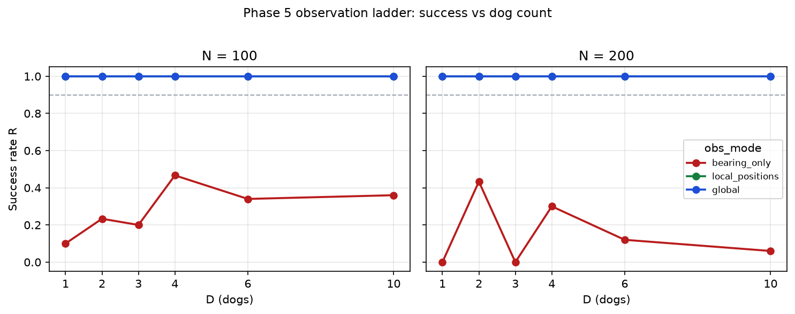

*bearing_only stays below the 90% bar. local_positions and global both sit at R = 1.00 across the tested D list, so those two curves overlap on the top line.*

### RQ6: which curve fits D_min vs N?

**Status:** The fit package ran; the signal is weak.

On the baseline compact map, `D_min` is almost only two values: 2 for N = 5 and 10, and 1 for everything larger. Leave-one-N-out RMSE (lower is better):

| Model | RMSE |
|-------|-----:|
| Constant | 0.44 |
| Linear | 0.44 |
| Power law | 0.25 |
| Piecewise | 0.13 |

Piecewise wins because it matches that step, not because we measured a rich growth law. These fits are not a universal scaling law.

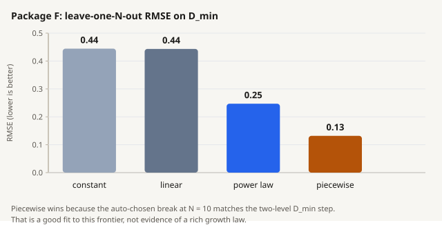

### RQ7: can state warn of failure early?

**Status:** Not answerable on this data.

By the first check at tick 1,000, almost every successful RQ2 size-map run has already finished (median success 182 ticks). Failures are almost all tiny flocks with one dog that run out the deadline. There is no late window left to warn before success or failure settles. Held-out AUROC folds were empty. Only 14 of 169 failures had a measured lead time of at least 500 ticks (about 8.3%; the bar was 30%).

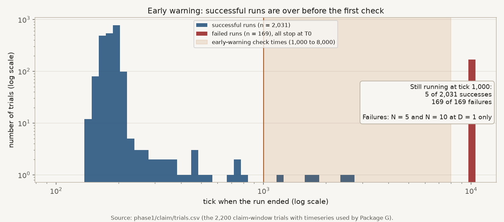

*Successful runs finish early; the shaded warning checks start after most successes are already done.*

### Claims scorecard

Verdicts use claim-grade evidence only.

| Claim | RQ | Verdict | Meaning |
|-------|----|---------|---------|
| C1a | RQ1 | REJECTED | Layout did not move `D_min` on the baseline |
| C1b | RQ1 | INCONCLUSIVE | No `D_min` shift, so state-vs-(N, D) predictor test could not run |
| C2a | RQ2 | REJECTED | No overcrowding on the baseline size map |
| C2b | RQ2 | SKIPPED | No overcrowding cell to extend to T = 20,000 |
| C3 | RQ3 | INCONCLUSIVE | Mechanism contrast undefined without overcrowding |
| C4 | RQ4 | SUPPORTED (partial) | Compact size shared for Strombom/Kubo (N >= 25); FAT and several structure cases break transfer |
| C5a | RQ5 | SUPPORTED | Range ladder: sensing_range 32.5 -> 65 lowers `D_min` by at least one grid step at N in {100, 200} |
| C5b | RQ5 | SUPPORTED | Same ladder: first step saves 1 to 2 dogs; further range steps save 0 more |
| C6a | RQ6 | SUPPORTED (weak) | Power law worse than piecewise on leave-one-N RMSE; only two D_min levels |
| C6b | RQ6 | SUPPORTED | Flat `D_min = 1` on compact N in {25..400}, so log-log slope 0 |
| C7a | RQ7 | INCONCLUSIVE | Held-out AUROC could not be computed |
| C7b | RQ7 | REJECTED | Too few failures with lead time >= 500 ticks |

These checks only support statements inside the tested protocol. They do not support a universal law, an untested task, or real-farm performance.

---

## What we did not settle / limits

- **One task.** Results are for `drive_to_goal` under this frozen protocol only.
- **Grid ceiling.** `D_max = 35` means "still OK at the largest D we tried," not "collapse begins at 35."
- **No overcrowding on the baseline size map.** That is why RQ3 did not run and T1 was skipped.
- **Transfer is only partial.** Compact size floors for Strombom and Kubo do not extend to FAT, Kubo-wide, or large Kubo outlier-rich.
- **Easy compact map.** Many baseline cells succeed at D = 1 with success near 1.00, so rising dog-count laws and early-warning overlap are hard to see. RQ5 communication could not show dog savings for the same reason.
- **RQ5 scope.** Ladders are on compact + `strombom_multi` at N in {100, 200} only. Observation contrast is mostly "bearing_only fails" vs "local/global works," not a graded dog-count saving. Range is the clean C5a/C5b evidence.
- **RQ7 timing.** Warning checks start after almost every success has finished.
- **Simulated controllers.** No farm or biology validity claim.
- **Discrete dog list.** We cannot resolve effects finer than one step on that list.
- **Time across methods.** Do not treat Kubo ticks as the same physical time as Strombom-family ticks.

A 2025 NetLogo draft on a collect-hold-gate task needed many dogs for large flocks. We did not rerun that draft. On *this* compact `drive_to_goal` map, the draft's "large N needs many dogs" story does not appear for the baseline or Kubo.

---

## What we plan next

None of the items below have been run as claim-grade work in this package. They are intentions.

### Measure an upper collapse (or a harder task)

We still do not know whether success eventually falls for D > 35, or whether path waste keeps rising without collapse. That matters because it turns the current list ceiling into a measured upper story, and it is what RQ3 needs (efficient vs overcrowding at the same N).

| Question | Why it matters | How we would run it |
|----------|----------------|---------------------|
| After a good band, does success fall for some D > 35? | Measured collapse instead of a ceiling | Extend the dog-count list past 35 on selected N |
| If success stays high, does path waste keep rising? | Waste-only upper band | Same extended sweep; report path and regimes |
| Does a longer deadline rescue high-D failures at T0? | Separates "too slow" from true overcrowding | T1 only on candidate overcrowding cells |
| Do efficient and overcrowding cells differ in interference or splitting? | Needed for RQ3 | Matched tests at the same N |
| Does that upper story transfer across methods? | RQ4 on the upper band | Repeat under Kubo / FAT (later `communication_free`) |

Another path without raising the dog cap: port the draft-style collect-hold-gate task into HerdSim and see whether overcrowding appears inside D <= 35. Not scheduled yet.

### Finish RQ4 more cleanly

1. Run the planned next transfer method, `communication_free`, on the same size and structure maps.
2. Tighten or clearly mark soft edges (especially Kubo `outlier_rich` at N = 200, bootstrap `[2, 20]`).
3. Ask why FAT and Kubo-wide fail under this protocol, then retry a fairer FAT setup if needed (for example local sensing as the method intends), still on the frozen grids.
4. Once an upper collapse exists, repeat the size/structure transfer check on that upper band.

### Follow-ups for RQ5 and RQ7

- RQ5: repeat the ladders on a harder layout or method where `D_min` > 1 (for example wide, or Kubo outlier_rich), so communication and finer observation steps can show dog savings beyond the compact one-dog floor.
- RQ7: need failures and successes overlapping in time (harder layout or method, or earlier check times).
