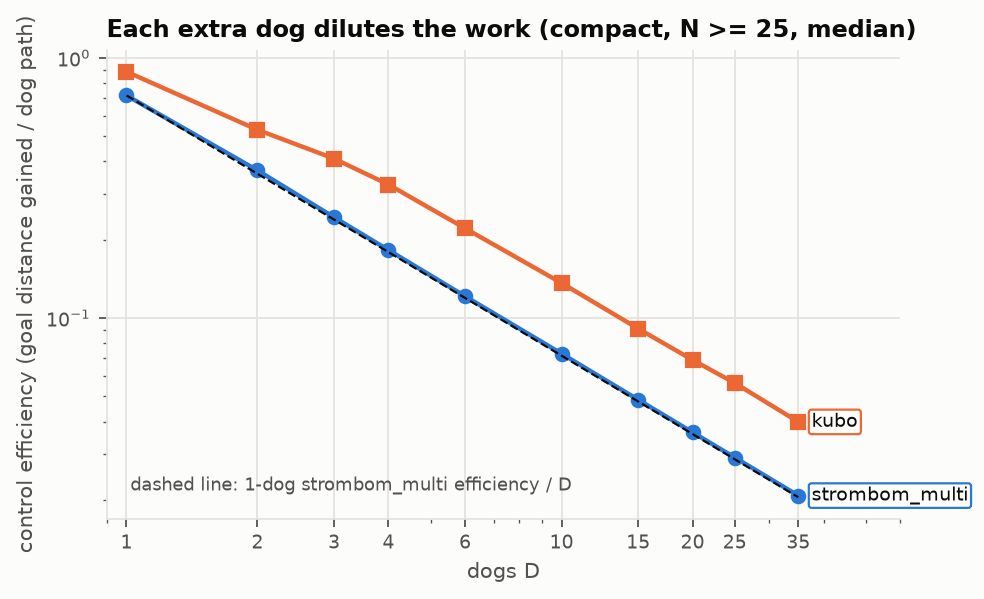
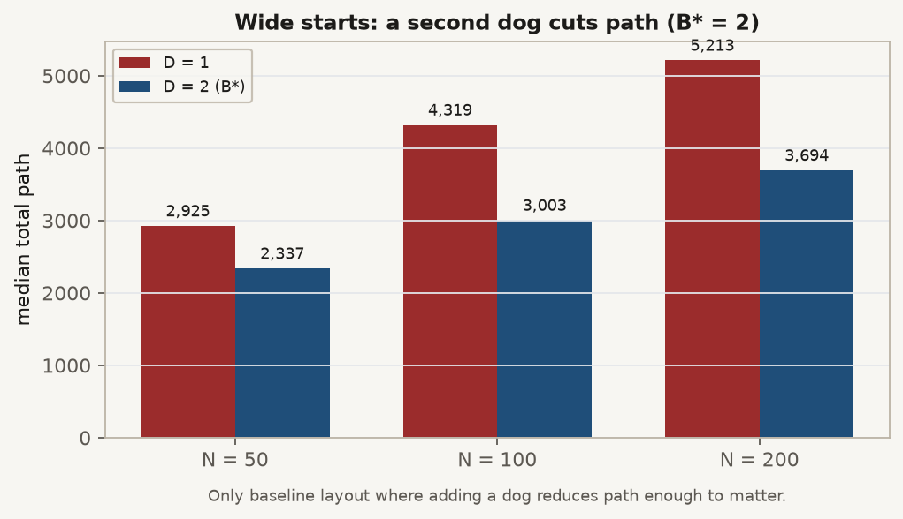
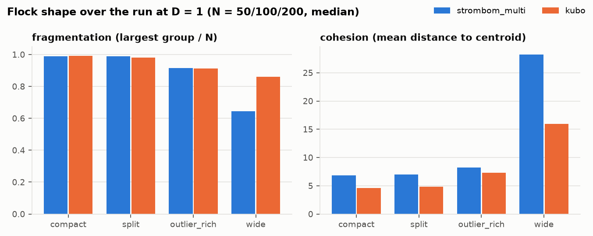
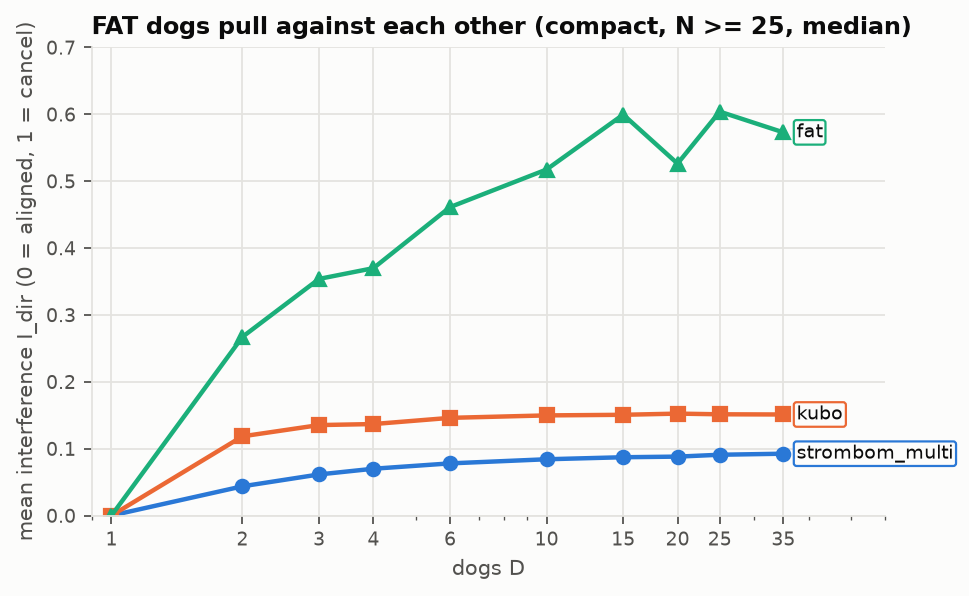
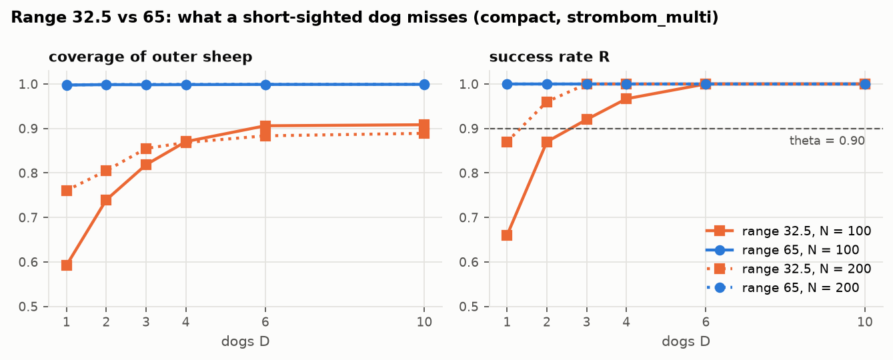

# HerdSim scaling study: results

This report covers what the claim-grade runs found, how we read each result, and where the evidence is weak.

It assumes you've read the [main README](../../README.md), which explains the setup: arena, grids, methods, cells and trials, the campaign flow, and the metric and regime definitions. Numbers below come from the claim merges (`merged_trials.csv`) unless stated otherwise.

## Summary

- On the baseline (`strombom_multi`, compact start), one dog herds every flock from N = 25 to N = 400 reliably. N = 5 and N = 10 need two.
- We saw no overcrowding up to D = 35. Extra dogs leave success and finish time unchanged and add dog path. Control efficiency drops roughly as 1/D.
- Wide and outlier-rich starts take 10x to 30x more time and path than compact, but `D_min` stays at 1.
- Results depend on the method. Kubo matches the baseline on compact starts and fails on wide ones. FAT doesn't reach theta for any N above 10, and its dogs show high interference.
- Of the information settings, only sensing range changed `D_min`. Range 32.5 needs 1 to 2 more dogs than 65. Ranges above 65 make no difference.
- Because `D_min` is 1 almost everywhere, the scaling fits, the mechanism contrast and the early-warning test had little to work with.

## How much we ran

| Question | What | Scout | Claim | Status |
|----------|------|------:|------:|--------|
| RQ2 size | baseline, compact, 10 x 10 grid | 3,000 | 2,200 | done |
| RQ1 structure | baseline, 4 layouts, N = 50/100/200 | 3,600 | 2,400 | done |
| RQ4 transfer | Kubo and FAT, size + structure | 13,200 | 10,500 | done |
| RQ5 information | obs / range / comm ladders | 3,600 | 4,100 | done |
| RQ3 mechanism | needs overcrowding cells | - | - | skipped |
| RQ6 fits, RQ7 early warning | analysis on RQ2 claim data | - | - | done |
| Phase 8 | collect-hold-gate size map | 2,062 / 3,000 | - | scout running |

In total that's about 43,000 trials for Phases 1 to 5, including 750 smoke runs. Claim reseeds only go to cells near `D_min`.

---

## 1. Flock size (RQ2)

Almost every cell on the baseline size map succeeds. The two exceptions are N = 5 and N = 10 with one dog, at R = 0.07 and 0.24. With two dogs both reach R = 1.00.

*Success rate R(N, D) on compact starts. Baseline on the left, then Kubo and FAT.*

| N | 5 | 10 | 25 | 50 | 75 | 100 | 150 | 200 | 300 | 400 |
|---|--:|--:|--:|--:|--:|--:|--:|--:|--:|--:|
| `D_min` | 2 | 2 | 1 | 1 | 1 | 1 | 1 | 1 | 1 | 1 |

The bootstrap interval has zero width for every N.

All 169 failed trials on this map are N = 5 or 10 with one dog. 111 of them are labelled `oscillation` and 58 `stuck`, and all of them run until the deadline. We don't know yet why a handful of sheep is harder for one dog than fifty. One possibility is that a small flock has weaker mutual attraction, so the dog keeps switching between collecting and driving. We haven't tested this.

### Above `D_min`

We found no overcrowding: success never dropped again as D went up to 35. `D_max = 35` is therefore just the top of the grid.

Regime labels on the 100 cells of the size map:

| Regime | Cells | Which ones |
|--------|------:|------------|
| `efficient_operation` | 10 | one per N, at D = `D_min` |
| `wasteful_overspend` | 88 | all other reliable cells |
| `under_resourced_failure` | 2 | N = 5 and N = 10 at D = 1 |
| `overcrowding_collapse` | 0 | - |

The median finish time is about 183 ticks at every D. Total dog path goes up with each dog added.

*Median control efficiency on compact starts, N >= 25. The dashed line is the 1-dog efficiency divided by D.*

For `strombom_multi`, efficiency goes from 0.72 at D = 1 to 0.021 at D = 35, which is 0.72 / 35. Flock progress is the same with 1 dog or 35; the extra dogs only add path. Kubo drops less over the first few dogs (0.89 at D = 1, 0.53 at D = 2) and follows the 1/D slope from about D = 10.

*Finish time stays flat while path increases with D.*

## 2. Start shape (RQ1)

At N = 50, 100 and 200, `D_min` is 1 for all four layouts on the baseline. The layout affects time and path:

| Layout | N = 50 ticks / path | N = 100 ticks / path | N = 200 ticks / path |
|--------|--------------------:|---------------------:|---------------------:|
| compact | 195 / 158 | 204 / 161 | 191 / 144 |
| split | 195 / 158 | 205 / 162 | 193 / 144 |
| outlier_rich | 224 / 209 | 501 / 554 | 1,228 / 1,647 |
| wide | 2,138 / 2,925 | 3,074 / 4,319 | 3,870 / 5,213 |

*Median over successful runs at D = 1. Success is 1.00 in every cell.*

Compared with compact, wide takes 11x to 20x more time and 19x to 36x more path. For wide starts `B*` is 2 dogs: the second dog lowers median path (5,213 to 3,694 at N = 200) and R stays at 1.00.

Fragmentation and cohesion help explain the costs:

Wide flocks have a median fragmentation of 0.64, meaning about a third of the sheep sit outside the main group on average, and cohesion four times the compact value. Most of the dog's path goes into collecting. Outlier-rich is in between at 0.92: the core is tight and each outlier needs its own collect trip.

Split looks the same as compact on every metric (fragmentation 0.99, same ticks and path). The clusters seem to merge before the dog gets to them. Until the split generator is fixed, split results shouldn't be read as a structure effect.

Since `D_min` didn't change with layout, we couldn't run C1b (whether early flock state predicts difficulty better than N and D).

## 3. Other methods (RQ4)

We ran the same size and structure maps with Kubo and FAT to see which results depend on the controller.

`D_min` at theta = 0.90 ("-" means no D up to 35 reached theta):

| Map | N | strombom_multi | kubo | fat |
|-----|---|---:|---:|---:|
| compact size | 5 | 2 | 3 | 1 |
| compact size | 10 | 2 | 1 | 1 |
| compact size | 25 to 400 | 1 | 1 | - |
| split | 50, 100, 200 | 1 | 1 | - |
| outlier_rich | 50, 100 | 1 | 1 | - |
| outlier_rich | 200 | 1 | 20 | - |
| wide | 50, 100, 200 | 1 | - | - |

*Compact starts. The steep curve is from a 2025 NetLogo draft on a harder collect-hold-gate task, shown for comparison only. We did not rerun it.*

Kubo has the same compact `D_min` as the baseline for N >= 10. On wide starts its best R is 0.47 to 0.54. On outlier_rich at N = 200 the point estimate is 20 dogs, but even with 200 seeds the bootstrap interval is [2, 20], so we treat this cell as unresolved.

FAT reaches theta only at N = 5 and 10. For larger N its best R on compact is 0.40 to 0.53, and close to 0 on outlier_rich and wide. More dogs don't raise it.

*Median `I_dir` per trial, compact, N >= 25.*

Baseline interference levels off around 0.09 and Kubo's around 0.15. FAT's rises from 0.27 at D = 2 to about 0.6 at D >= 15. In FAT each dog goes for the sheep farthest from itself, so dogs often end up on opposite sides of the flock.

Inside FAT, failed runs have a median `I_dir` of 0.63 and successful runs 0.01. The correlation between `I_dir` and success is -0.83 (N >= 25). Failed FAT runs also have low coverage (0.27, against 1.00 in successful runs). These are correlations; we haven't run a controlled test.

Failure modes by method (claim merges, size and structure maps together):

| Method | Trials | none | oscillation | split | scatter | stuck | timeout |
|--------|------:|-----:|------------:|------:|--------:|------:|--------:|
| strombom_multi | 9,820 | 9,651 | 111 | 0 | 0 | 58 | 0 |
| kubo | 11,140 | 10,107 | 0 | 0 | 320 | 13 | 700 |
| fat | 9,680 | 3,100 | 3,721 | 1,298 | 474 | 581 | 506 |

The baseline fails only on the tiny flocks with one dog. 742 of Kubo's 1,033 failures are on wide starts, mostly timeout or scatter, and most of the rest are on outlier_rich. FAT shows every failure label, with oscillation the most common.

C4 is partly supported. Strombom and Kubo share the compact size result, but the structure results and FAT differ.

## 4. Information (RQ5)

All three ladders use the baseline on compact starts, N = 100 and 200, and D in {1, 2, 3, 4, 6, 10}.

*Crosses mark levels that never reach theta. Markers overlap where N = 100 and N = 200 have the same value.*

### Sensing range

| Sensing range | 32.5 | 65 | 97.5 | 130 |
|---------------|-----:|---:|-----:|----:|
| `D_min` at N = 100 | 3 | 1 | 1 | 1 |
| `D_min` at N = 200 | 2 | 1 | 1 | 1 |

Going from 32.5 to 65 lowers `D_min` by 2 at N = 100 and by 1 at N = 200 (C5a). Larger ranges don't lower it further (C5b).

*Left: coverage. Right: success. Solid lines N = 100, dotted N = 200.*

At range 65 one dog already has coverage 1.00. At 32.5 and N = 100, one dog covers 0.59 of the outer sheep. Coverage rises with each added dog (0.74, 0.82, 0.87) and success passes 0.90 at D = 3. N = 200 needs one dog fewer, possibly because the larger flock is denser and its edge is closer to the dog.

### Observation mode

`global` and `local_positions` both give `D_min = 1`. `bearing_only` doesn't reach theta at any D (merge success about 0.22). With bearing only, dogs walk 10,000 to 78,000 units per run with control efficiency near 0, so the dogs keep moving but the flock makes almost no progress.

### Communication

All three modes give `D_min = 1` and R = 1.00. One dog already reaches theta here, so communication had nothing to improve.

## 5. Scaling fits (RQ6)

`D_min` only takes two values on this map (2, then 1), so there isn't much to fit. Leave-one-N-out RMSE:

| Model | Constant | Linear | Power law | Piecewise |
|-------|---------:|-------:|----------:|----------:|
| RMSE | 0.44 | 0.44 | 0.25 | 0.13 |

Piecewise fits best because its break lands at N = 10, where the step is. The power law's exponent is about -0.2, slightly negative. Neither fit describes `D_min` growing with N, because on this map it doesn't. We record C6a as weakly supported and C6b as supported (log-log slope 0 for N = 25 to 400).

## 6. Early warning (RQ7)

The test uses the last 200 ticks of flock state to predict failure 500 ticks ahead, with checks from tick 1,000. On the baseline size map, successful runs finish in a median of 183 ticks, and only 5 of 2,031 are still running at tick 1,000. The 169 failures are all N = 5 or 10 with one dog and run to the 10,000-tick deadline.

At each check, nearly all remaining runs are failures. The held-out AUROC folds were empty (C7a inconclusive). 14 of 169 failures had a lead time of at least 500 ticks, which is 8.3% against a 30% bar (C7b rejected). A proper test needs a map where successes and failures overlap in time, such as FAT or Kubo on wide starts.

---

## Claims

| Claim | Question | Verdict | Reason |
|-------|----------|---------|--------|
| C1a | RQ1 | rejected | Layout didn't change `D_min` on the baseline |
| C1b | RQ1 | inconclusive | No `D_min` change, so the state-vs-(N, D) test couldn't run |
| C2a | RQ2 | rejected | 0 overcrowding cells up to D = 35 |
| C2b | RQ2 | skipped | No overcrowding cell to extend to T = 20,000 |
| C3 | RQ3 | inconclusive | No overcrowding cells to compare against |
| C4 | RQ4 | supported (partial) | Compact size result shared by Strombom and Kubo; FAT, Kubo-wide and Kubo outlier_rich N = 200 differ |
| C5a | RQ5 | supported | Range 32.5 to 65 lowers `D_min` by 2 (N = 100) and 1 (N = 200) |
| C5b | RQ5 | supported | Larger ranges lower it no further |
| C6a | RQ6 | supported (weak) | Piecewise beats power law on held-out N, with only two `D_min` levels |
| C6b | RQ6 | supported | `D_min` = 1 for N = 25 to 400, slope 0 |
| C7a | RQ7 | inconclusive | Held-out AUROC couldn't be computed |
| C7b | RQ7 | rejected | 8.3% of failures have lead time >= 500 ticks (bar: 30%) |

The verdicts only apply to this protocol. They don't cover other tasks, real animals, or differences smaller than one step on the D grid.

## Other metrics

The claim packages only use success, ticks and path. We also looked at the other per-trial columns. These were useful:

| Metric | Result |
|--------|--------|
| `control_efficiency` | On the baseline it equals 1-dog efficiency / D |
| `mean_i_dir` | About 0.09 / 0.15 / 0.6 for baseline / Kubo / FAT; r = -0.83 with FAT success |
| `mean_coverage` | Explains the range result; 0.27 in failed FAT runs |
| `mean_fragmentation`, `mean_cohesion` | Explain the layout costs; show split starts behave like compact |
| `failure_mode` | Different failure patterns per method |

`mean_polarization` was less useful: it is about 0.99 under Kubo and 0.55 under Strombom, which reflects the sheep model more than anything else. `mean_coverage` reads 1.00 under `bearing_only` even though those runs fail, since it only checks which sheep are within range.

## Limits

- Most results are for `drive_to_goal` on compact starts, where one dog is usually enough. This is the main reason RQ3, RQ6 and RQ7 are weak.
- The D grid stops at 35, so overcrowding at higher D isn't ruled out.
- We can't resolve differences smaller than one step on the D grid.
- Kubo outlier_rich at N = 200 still has a wide interval after 200 seeds.
- Split starts behave like compact, so split isn't a real structure contrast yet.
- Kubo ticks and Strombom ticks aren't the same physical time, so finish times shouldn't be compared across methods.
- The `I_dir` and coverage results for FAT are correlations.
- This is a simulation; we make no claims about real dogs or sheep.

## Next steps

- Phase 8 (collect-hold-gate) is a harder task and the scout is running. If overcrowding appears within D <= 35, we can run the RQ3 contrast and recheck C2a.
- Extend D past 35 for a few N values to check for overcrowding at higher D.
- Rerun RQ5 and RQ7 on maps where `D_min` > 1, for example wide starts, Kubo outlier_rich or FAT.
- Fix the split generator so the clusters start apart.
- Add seeds for Kubo outlier_rich at N = 200, and try FAT with local sensing before drawing conclusions about it.
