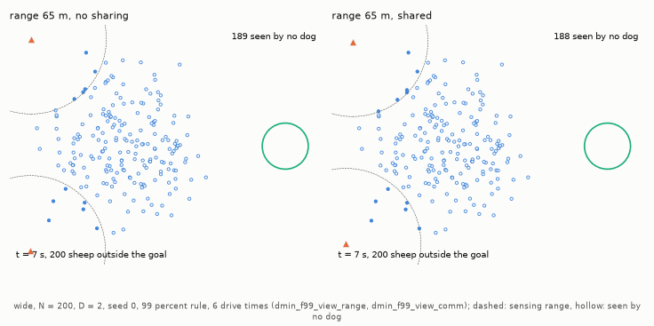

# Sự phối hợp và những gì chó thấy

Phần 4 của báo cáo HerdSim về quy mô đội. [Phần tổng quan](d_min_report_vi.md) gồm tóm tắt, các câu hỏi nghiên cứu, [quy tắc quyết định](d_min_report_vi.md#2-quy-tắc-quyết-định) định nghĩa $D_{\min}$, khoảng và cận dưới của nó, phần thảo luận và [tài liệu tham khảo](d_min_report_vi.md#tài-liệu-tham-khảo). Các thuật ngữ được định nghĩa trong [bảng thuật ngữ](glossary_vi.md).

## 3.6 RQ6: Chó không có quy tắc đội có đạt D_min hữu hạn không?

FAT (nhắm con xa nhất) là một đối chứng không phối hợp: mỗi chó đứng sau con cừu xa đích nhất. Nó được so với quy tắc đội `strombom_multi`, quy tắc chuyển mỗi chó giữa gom con lạc và lùa bầy, và có một tầng đội phân công chó cho các con lạc ([mục 3.9](#39-rq9-phần-nào-của-quy-tắc-đội-quan-trọng)).

Các chó không phối hợp có làm được việc nếu đủ đông không? Với bầy lớn thì không: từ $N = 200$, FAT không có đội tin cậy nào trên mọi bố cục phân tán, và thêm chó không giúp gì (ý 1). Các chó của nó dồn sát nhau sau cùng một con cừu (ý 2).

1. FAT thất bại trên bầy lớn.  
   FAT tin cậy trên bầy nhỏ ($N \le 100$) nhưng không có đội tin cậy nào ở $N \ge 200$ trên bất kỳ bố cục phân tán nào, và cũng không có trên bầy tập trung $N = 400$, nơi quy tắc đội chỉ cần một chó. Thêm chó không giúp gì (Hình 1).

2. Vì sao.  
   Mọi chó thấy mọi con cừu và chọn theo cùng một quy tắc, nên cả $D$ chó đuổi cùng một con cừu. Chúng dồn cục: ở $N \ge 200$, trung vị tỷ lệ chó có một chó khác trong vòng 2 m, với đội từ hai chó trở lên, là 0,86 trên `compact` và 0,79 trên `split` (0,46 trên `wide`, 0,30 trên `outlier_rich`). Một đội FAT lớn hơn chỉ là một đám đông lớn hơn sau một con cừu trong khi phần còn lại của bầy tản ra.  
   Các chó chăn độc lập ở [mục 3.9](#39-rq9-phần-nào-của-quy-tắc-đội-quan-trọng) cũng không có tầng đội, nhưng chúng giữ công tắc gom/lùa của Strömbom, và đạt $D_{\min}$ hữu hạn đến $N = 200$. FAT có thể thất bại vì nó không có cả tầng đội lẫn công tắc; chưa có lượt chạy nào cho FAT riêng công tắc.

Bảng 1 so FAT với `strombom_multi` ở 6 lần thời gian lùa (FAT nghiêm ngặt / 99%, `strombom_multi` trong ngoặc):

**Bảng 1: FAT so với `strombom_multi` ở 6 lần thời gian lùa, quy tắc nghiêm ngặt / 99%.**

| Bố cục | $N = 25$ | $N = 50$ | $N = 100$ | $N = 200$ | $N = 400$ |
| :--- | :---: | :---: | :---: | :---: | :---: |
| `compact` | 1 / 1 (1 / 1) | 1 / 1 (1 / 1) | 1 / 1 (1 / 1) | 1 / 1 (1 / 1) | none / [12] (1 / 1) |
| `wide` | 1 / 1 (1 / 1) | 1 / 1 (1 / 1) | 1 / 1 (1 / 1) | none / none (3 / 2) | none / none ([9] / 2–3) |
| `split` | 1 / 1 (1 / 1) | 1 / 1 (1 / 1) | 1 / 1 (1 / 1) | none / none (none / [1]) | none / none (none / [5]) |
| `outlier_rich` | 1 / 1 (1 / 1) | 1 / 1 (1 / 1) | 2 / 2 (3 / 2) | none / none ([12] / 2–3) | none / none (none / 3) |

*Dữ liệu:* [results_tables.md: FAT dog rule, deadline 6](../report/results_tables.md#fat-dog-rule-deadline-6-strict-then-99-percent) (`dmin_fat`, `dmin_f99_fat`); `strombom_multi` trong [results_tables.md: strict success](../report/results_tables.md#d_min-by-layout-and-n-strict-success) và [results_tables.md: success at 99 percent](../report/results_tables.md#d_min-by-layout-and-n-success-at-99-percent).

**Hình 1: Tỷ lệ thành công theo quy mô đội cho `strombom_multi` và FAT ở 6 lần thời gian lùa.** Quá hai chó, FAT không bao giờ đạt $\theta$, trong khi `strombom_multi` trở nên tin cậy trên `wide` và `outlier_rich`.

- Ký hiệu: xanh là `strombom_multi`, cam là FAT; đường liền là quy tắc nghiêm ngặt, đứt là quy tắc 99%, và đường chấm là $\theta = 0{,}90$. Mỗi điểm là một ô; điểm rỗng là ô có dưới 30 lượt, được quyết định sớm nên kém chắc chắn hơn.
- Các khung: `compact` $N = 400$, `wide` $N = 200$ và 400, `outlier_rich` $N = 200$, và `split` $N = 200$. FAT ở dưới khoảng 0,55 trên `wide` và `outlier_rich`, và dưới 0,9 trên `compact` $N = 400$ và `split` $N = 200$.

*Dữ liệu:* `results/dmin_fat`, `dmin_f99_fat`, `dmin_m6` và `dmin_f99_m6`.

Hoạt ảnh 7 trong [mô hình](models_vi.md#chó-chăn-độc-lập-theo-bài-báo-independent) chạy lại quy tắc đội, chó độc lập và FAT trên cùng một bầy xuất phát 400 con; chỉ quy tắc đội đưa được bầy vào.

## 3.9 RQ9: Phần nào của quy tắc đội quan trọng?

Phần nào của quy tắc đội làm cho một đội chó hoạt động: công tắc gom/lùa của Strömbom, hay tầng đội phân công chó cho các con lạc? Mỗi phần quan trọng ở một quy mô khác nhau: riêng công tắc đưa được một đội đến $N = 200$, còn ở $N = 400$ cần tầng đội (ý 1 và 2, Bảng 2). Trên `split` $N = 200$ thứ tự đảo ngược (ý 2).

FAT ([mục 3.6](#36-rq6-chó-không-có-quy-tắc-đội-có-đạt-d_min-hữu-hạn-không)) thiếu hai thứ mà quy tắc đội có: (1) công tắc của Strömbom giữa gom cừu lạc và lùa cả bầy, và (2) tầng đội, phân công chó cho các con lạc (phép gán Hungarian) và trải chó trên một vòng cung sau bầy theo thứ tự góc.

Để tách hai phần, `dmin_f99_indep` chạy một đội chó chăn độc lập theo bài báo: mỗi chó chạy quy tắc một chó của Strömbom trên cả bầy, không phân công, không vòng cung.

1. Riêng công tắc đã đủ đến $N = 200$.  
   Các chó chăn độc lập tin cậy trên mọi bố cục phân tán đến $N = 200$, nơi FAT thất bại: 2–3 chó trên `wide`, 3 trên `outlier_rich`. Có thể là do việc chuyển sang lùa khi bầy đã gom lại vẫn giữ bầy liền, ngay cả khi các chó đuổi cùng một con lạc; điều này chưa được kiểm chứng.

2. Ở $N = 400$ cần đến tầng đội.  
   Chó chăn độc lập không có đội tin cậy nào đến 24 chó ở $N = 400$. Quy tắc đội cần 2–3 chó trên `wide` và 3 trên `outlier_rich`. Có thể là do không có phân công, các chó cứ đuổi theo cùng những con cừu trong khi các phần khác của một bầy lớn tản ra; điều này chưa được kiểm chứng. Trên `split` $N = 200$ thứ tự đảo ngược: chó chăn độc lập tin cậy từ 3 chó, còn quy tắc đội không có đội tin cậy nào ([mục 4.1](part5_failures_vi.md#41-vì-sao-thêm-chó-không-giúp-trên-split)).

3. Trong mô hình Kubo, thêm chó vẫn giúp, nhưng lợi ích giảm dần.  
   Với cừu Kubo (`dmin_f99_kubo`), một chó là đủ trên bầy tập trung 25 đến 100. Khác cừu Strömbom, cừu Kubo đi nhanh hơn khi bị đẩy mạnh hơn (đến 5 m/s), nên thêm chó rút ngắn lượt lùa: ở $N = 100$, trung vị thời gian hoàn thành giảm từ 115 s với một chó xuống 29 s với mười chó, và 25 s với 24 chó. Mười chó đã cho 95% lợi ích của 24 chó, nhưng $D_{\mathrm{sat}}$ vẫn còn mở: nó ít nhất là 16 hoặc 17 chó (16–24 ở $N = 25$ và 100, 17–24 ở 50).

Bảng 2 so ba quy tắc ở 6 lần thời gian lùa (quy tắc 99%):

**Bảng 2: $D_{\min}$ của quy tắc đội, chó chăn độc lập và FAT ở 6 lần thời gian lùa, quy tắc 99%.**

| `strombom_multi` / `independent` / `fat` | $N = 200$ | $N = 400$ |
| :--- | :---: | :---: |
| `wide` | 2 / 2–3 / none | 2–3 / none / none |
| `outlier_rich` | 2–3 / 3 / none | 3 / none / none |
| `split` | [1] / 1–3 / none | [5] / none / none |

*Dữ liệu:* [results_tables.md: Methods at 99 percent, 6 drive times](../report/results_tables.md#methods-at-99-percent-6-drive-times-team-rule-independent-paper-shepherds-fat) và [results_tables.md: Kubo, compact, D to 24](../report/results_tables.md#kubo-compact-d-to-24-99-percent); thời gian hoàn thành của Kubo từ `results/dmin_f99_kubo`.

## 3.12 RQ12: Chó thấy gì, và chia sẻ điều đó

Chó, robot và drone thật không thấy cả cánh đồng. Ở đây mỗi chó chỉ thấy những con cừu trong một tầm cảm nhận (15, 30, 45, 65 hoặc 100 m), và các chó chia sẻ những gì chúng thấy theo một trong ba cách: không chia sẻ (`none`), chia sẻ với các chó trong tầm (`neighbour`), hoặc với cả đội (`shared`).

Tầm nhìn hạn chế tốn bao nhiêu, và chia sẻ có bù lại được không? Trên `wide` $N = 200$, một tầm 30 đến 65 m tốn khoảng một chó, và ở 65 m chia sẻ với cả đội đưa $D_{\min}$ về bằng khi thấy mọi thứ; ở 15 m cần nhiều chó hơn hẳn (ý 1 đến 3, Hình 2). Trên `split` $N = 200$ kết quả đảo ngược (ý 3).

1. Một tầm thực tế tốn khoảng một chó.  
   Trên `wide` $N = 200$, chó thấy mọi thứ cần 2 con. Với tầm 30 đến 65 m chúng cần 3 (3–4 ở 45 m). Trên bầy 100 con trở xuống, tầm cảm nhận từ 30 m trở lên không tốn gì (Hình 2).

2. Ở 15 m cần nhiều chó hơn hẳn.  
   Với tầm 15 m trên `wide`, không đội nào đến 16 là tin cậy ở $N = 50$, và ở $N = 100$ cần ít nhất 6 chó. Có thể là do khi tầm ngắn hơn khoảng cách giữa các con lạc, chó không còn thấy những con cừu ở rìa; khoảng cách đó chưa được đo.

3. Chia sẻ với cả đội lấy lại được một chó.  
   Ở 65 m trên `wide` $N = 200$, chó không chia sẻ cần 3 con. Chia sẻ với cả đội đưa $D_{\min}$ về 2, như khi thấy mọi thứ. Chỉ chia sẻ với các chó trong tầm thì không giúp (vẫn 3): một chó ở xa cần biết về một con lạc mà nó không thấy. Trên `split` $N = 200$ thứ tự đảo ngược: chó thấy mọi thứ không có đội tin cậy nào ([1], một cận dưới), còn chó nhìn xa 30 đến 65 m và không chia sẻ thành công 60 trong 60 lượt ở mọi đội từ 3 đến 16 chó. Chia sẻ với cả đội tin cậy với 3 chó nhưng thất bại từ 4 chó trở lên ([mục 3.7](part3_beyond_dmin_vi.md#37-rq7-vượt-quá-d_min-đủ-chó-chi-phí-và-áp-lực-lên-bầy)). Vì sao thấy mọi thứ lại có hại trên `split` thì chưa được kiểm chứng.

**Hình 2: $D_{\min}$ theo tầm cảm nhận, và tác dụng của chia sẻ.** Ở 15 m, `wide` cần ít nhất 6 chó ở $N = 100$ và 7 chó ở $N = 200$; trên `wide`, chia sẻ những gì mỗi chó thấy với cả đội thì bằng với thấy mọi thứ.

- Trái: $D_{\min}$ theo tầm cho `wide` (hình tròn) và `split` (hình vuông) ở $N = 100$ (nhạt) và $N = 200$, với một thanh cho khoảng và một tam giác rỗng cho cận dưới ([mục 2.1](d_min_report_vi.md#21-khi-nào-một-đội-là-tin-cậy)); mỗi bố cục và mỗi $N$ được dịch ngang một chút. Đường đứt đánh dấu 65 m, khoảng cách mà cừu phản ứng.
- Phải: tỷ lệ thành công theo $D$ trên `wide` $N = 200$ ở tầm 65 m, với không chia sẻ (chấm xanh), chia sẻ với chó trong tầm (đứt xanh), chia sẻ với cả đội (liền xanh) và thấy mọi thứ (liền đen). Điểm rỗng là ô có dưới 30 lượt.

*Dữ liệu:* [results_tables.md: Views: sensing range](../report/results_tables.md#views-sensing-range-no-sharing-base-row--range-0-global) và [results_tables.md: Views: sharing at range 65](../report/results_tables.md#views-sharing-at-range-65-beside-the-no-sharing-rows-of-dmin_f99_view_range).

**Hoạt ảnh 1: Hai chó nhìn xa 65 m, không và có chia sẻ, chạy lại (`wide`, $N = 200$, $D = 2$, hạt giống 0, quy tắc 99%, 6 lần thời gian lùa).** Chia sẻ những gì mỗi chó thấy biến một lượt thất bại thành thành công. Không chia sẻ, ô này thành công 3 trong 10 lượt (khoảng 99% là 0,04–0,74); có chia sẻ, 88 trong 90 lượt (0,90–1,00), nên 2 chó là đủ tin cậy. Mỗi lượt chạy lại khớp với lượt đã lưu (`dmin_f99_view_range`, `dmin_f99_view_comm`).

- Ký hiệu: vòng nét đứt là tầm cảm nhận của mỗi chó; chấm rỗng là cừu không chó nào thấy.
- Trái: không chia sẻ, mỗi chó lập kế hoạch trên tầm nhìn của riêng nó. Hai chó dừng ở hai bên một bầy dài và mỏng, vài con lạc ở hai đầu bầy không ai thấy, và lượt chạy hết giờ ở 817 s.
- Phải: có chia sẻ, cả đội lập kế hoạch một lần trên mọi con cừu mà một trong hai chó thấy, gom bầy lại và đưa vào đích ở 275 s.
