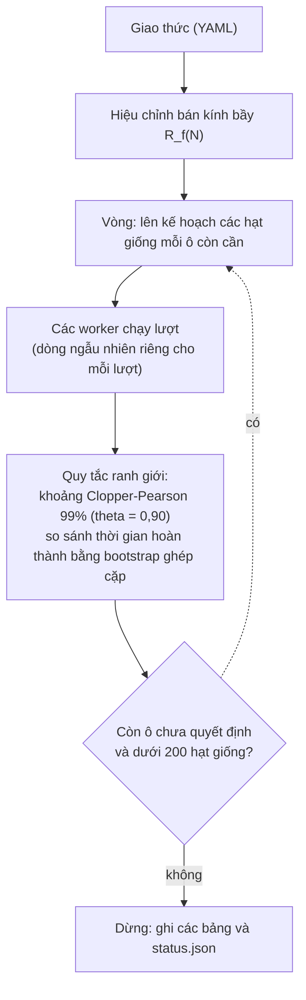

# Thiết kế nhiệm vụ và phương pháp thực nghiệm

Tài liệu này mô tả cách HerdSim thiết lập các nhiệm vụ: hình học, bố cục xuất phát, cách lấy mẫu thích ứng, các quy tắc quyết định, và vì sao các lưới dừng ở những giới hạn đã chọn. Các mô hình nằm ở [mô hình](models_vi.md) (ví dụ $r_a$, $r_s$ và khoảng cách gom $f(N)$), và định nghĩa ngắn của mọi thuật ngữ, như giao thức, hạt giống và bước, nằm trong [bảng thuật ngữ](glossary_vi.md).

## Mục lục

- [1. Hình học nhiệm vụ và quy mô](#1-hình-học-nhiệm-vụ-và-quy-mô)
- [2. Bố cục xuất phát và vị trí xuất phát của chó](#2-bố-cục-xuất-phát-và-vị-trí-xuất-phát-của-chó)
- [3. Động cơ lấy mẫu thích ứng tuần tự (adaptive sequential sampling)](#3-động-cơ-lấy-mẫu-thích-ứng-tuần-tự-adaptive-sequential-sampling)
- [4. Vì sao lưới dừng ở những giới hạn này](#4-vì-sao-lưới-dừng-ở-những-giới-hạn-này)
- [5. Quy tắc ranh giới và các vùng](#5-quy-tắc-ranh-giới-và-các-vùng)
- [6. Nhiệm vụ gom (Lama và di Bernardo 2024)](#6-nhiệm-vụ-gom-lama-và-di-bernardo-2024)

## 1. Hình học nhiệm vụ và quy mô

### Vì sao cánh đồng lớn theo bầy

HerdSim không có tường: tường sẽ chặn những con cừu mà chó không chặn được, và cả hai mô hình nguồn đều không có tường. Không có tường thì cánh đồng chỉ là phạm vi được vẽ ra, và thứ phải thay đổi theo quy mô là chính nhiệm vụ. Một đích có bán kính cố định sẽ chứa thoải mái bầy 25 con nhưng không chứa nổi bầy 400 con, và một quãng lùa cố định 100 m là mười sáu bán kính bầy với bầy nhỏ nhưng chỉ chín với bầy lớn. Vì vậy HerdSim đặt quãng lùa và bán kính đích là bội số của chính kích thước bầy, để nhiệm vụ có cùng hình dạng ở mọi $N$ (Hình 1).

**Hình 1: Hình học nhiệm vụ vẽ theo tỷ lệ.** Quãng lùa là số lớn nhất trong ba thành phần, còn bán kính bầy và bán kính đích tăng chậm theo $N$.

- Trái: cánh đồng ở $N = 200$ con, với bán kính bầy $R_f$, đích $1{,}9 R_f$, con cừu xuất phát xa nhất của bố cục rộng nhất và quãng lùa.
- Giữa: quãng lùa $l$ theo $N$, với từng thành phần trong ba thành phần (Bảng 1) và, màu xám, thành phần lớn nhất, là thành phần được dùng.
- Phải: bán kính bầy đã hiệu chỉnh $R_f(N)$ và bán kính đích $1{,}9 R_f$ theo quy mô bầy.

### Định cỡ theo bán kính bầy đã hiệu chỉnh

Mọi độ dài của nhiệm vụ lùa là bội số của **bán kính bầy đã hiệu chỉnh $R_f(N)$**: kích thước mà một bầy $N$ con ổn định về khi một chó lùa nó. Nó bằng $\sqrt{2}$ lần khoảng cách RMS từ các con cừu đến tâm bầy (bán kính của một đĩa đều có cùng RMS), lấy trung bình trên 90 s cuối của một lượt lùa 300 s bởi một chó thấy mọi thứ, và lấy trung vị trên 3 hạt giống và hai cỡ xuất phát. Nó được đo một lần cho mỗi phương pháp và $N$ ở đầu chiến dịch, không phải mỗi lượt, và một quy mô mà bán kính chưa ổn định hoặc phụ thuộc cách xuất phát bị từ chối. Bảng 1 liệt kê quy tắc cho từng độ dài.

**Bảng 1: Các độ dài của nhiệm vụ lùa.**

| Đại lượng | Quy tắc | Ý nghĩa |
| :--- | :--- | :--- |
| Bán kính bầy $R_f(N)$ | Hiệu chỉnh (ví dụ $6{,}2$ m ở $N = 25$, $11{,}4$ m ở $N = 400$) | Kích thước của một bầy $N$ con dưới một chó lùa. |
| Quãng lùa $l$ | $\max(13\,R_f(N),\ 80,\ l_{\mathrm{reach}} + R_{\mathrm{goal}} + R_f)$ | Từ tâm xuất phát của bầy đến tâm đích. Bầy lớn hơn được lùa xa hơn; sàn 80 m giữ cho bầy nhỏ nhất không bị lùa chỉ vài mét; số hạng thứ ba giữ đích cách xa mọi vùng xuất phát ($l_{\mathrm{reach}}$ là khoảng xa nhất mà một con cừu có thể xuất phát, trên mọi bố cục của giao thức). |
| Bán kính đích $R_{\mathrm{goal}}$ | $1{,}9\,R_f(N)$ | Đích chứa bầy đã ổn định với cùng một biên ở mọi $N$. Các bội số 13 và 1,9 là quy ước; các lượt độ nhạy thử đích $1{,}5\,R_f$. |
| Khoảng trống quanh cánh đồng | $80$ m quanh mọi thứ được đặt lúc xuất phát (bầy, chỗ đứng của chó, đích) | Chỉ để định cỡ cánh đồng; không có gì chặn con vật ở đó. |
| Biên | Không có | Con vật đi đâu cũng được, như trong Strömbom et al. (2014) và Kubo et al. (2022). |

### Thời hạn tính theo thời gian lùa

Một giới hạn cố định 5 phút cho mọi quy mô bầy sẽ không công bằng với bầy lớn, vốn được lùa hơn 200 m so với 80 m của bầy nhỏ.

HerdSim viết thời hạn dưới dạng bội số của **thời gian lùa** $T_{\mathrm{drive}}$, thời gian một con cừu đi thẳng với tốc độ của nó ($1{,}0$ m/s, tốc độ duy nhất của cừu Strömbom) cần để đi hết quãng lùa:

$$
T_{\mathrm{drive}} = \frac{l}{v_{\mathrm{sheep,max}}}
$$

Trung vị thời gian hoàn thành của một bầy tập trung là 1,44 đến $1{,}74\,T_{\mathrm{drive}}$ với mọi đội từ 1 đến 24 chó ở $N = 25$ đến 400 ([báo cáo, mục 3.1](part1_growth_vi.md#31-rq1-d_min-tăng-thế-nào-theo-n)). Các giao thức chính dùng thời hạn 3, 6 và 12 $T_{\mathrm{drive}}$: khoảng hai, bốn và tám lần thời gian đó, mỗi mức gấp đôi mức trước. Thời hạn thong thả để một chó kịp gom từng con lạc lần lượt; thời hạn gấp thì không. Thời hạn nào cần bao nhiêu chó là một kết quả ([báo cáo, mục 3.3](part1_growth_vi.md#33-rq3-thời-hạn-làm-d_min-thay-đổi-thế-nào)). Các giao thức Kubo dùng giới hạn cố định 500 s của Kubo et al. (2022) thay vì thế.

Bảng 2 cho thời hạn của các lưới chính (giao thức `dmin_m12` và các biến thể, bốn bố cục):

**Bảng 2: Thời hạn của các lưới chính.**

| Quy mô bầy ($N$) | Bán kính bầy $R_f$ | Quãng lùa $l$ | Thời gian lùa $T_{\mathrm{drive}}$ | Thời hạn $12\times$ | Thời hạn $6\times$ | Thời hạn $3\times$ |
| :---: | :---: | :---: | :---: | :---: | :---: | :---: |
| $N = 25$ | $6{,}20$ m | $80{,}6$ m | $80{,}6$ s (khoảng 1,3 phút) | $968$ s (khoảng 16,1 phút) | $484$ s (khoảng 8,1 phút) | $242$ s (khoảng 4,0 phút) |
| $N = 50$ | $7{,}60$ m | $98{,}8$ m | $98{,}8$ s (khoảng 1,6 phút) | $1186$ s (khoảng 19,8 phút) | $593$ s (khoảng 9,9 phút) | $297$ s (khoảng 4,9 phút) |
| $N = 100$ | $9{,}08$ m | $118{,}1$ m | $118{,}1$ s (khoảng 2,0 phút) | $1417$ s (khoảng 23,6 phút) | $709$ s (khoảng 11,8 phút) | $355$ s (khoảng 5,9 phút) |
| $N = 200$ | $10{,}47$ m | $139{,}8$ m | $139{,}8$ s (khoảng 2,3 phút) | $1678$ s (khoảng 28,0 phút) | $839$ s (khoảng 14,0 phút) | $420$ s (khoảng 7,0 phút) |
| $N = 400$ | $11{,}40$ m | $206{,}8$ m | $206{,}8$ s (khoảng 3,4 phút) | $2482$ s (khoảng 41,4 phút) | $1241$ s (khoảng 20,7 phút) | $621$ s (khoảng 10,3 phút) |

Các bố cục phân tán lớn theo $N^{2/3}$ còn $R_f(N)$ lớn chậm hơn nhiều, nên từ $N = 200$ số hạng tầm với thắng và quãng lùa dài hơn $13\,R_f$ (18 $R_f$ ở $N = 400$). Thời hạn tính theo thời gian lùa, nên quãng lùa dài hơn có thời hạn dài hơn, nhưng chó trên một bầy phân tán lớn lùa xa hơn, tính theo bán kính bầy, so với trên bầy nhỏ.

### Nhiệm vụ giữ bầy

Hai giao thức tiếp theo (`dmin_f99_hold`, `dmin_f99_hold_spacing`) thay đổi phần cuối của việc lùa: một lượt chỉ thành công khi 99% bầy đã ở trong đích liên tục trong một lần thời gian lùa. Khi bầy đã vào, chó lùi ra $r_s + r_a = 67$ m ngoài con cừu xa nhất, để không con cừu nào phản ứng với chúng và bầy gặm cỏ; một chó chỉ đứng lại sẽ giữ con cừu gần nhất trong trạng thái chạy trốn và đẩy nó xuyên qua đích. Hai giao thức nữa (`dmin_f99_hold_goal`, `dmin_f99_hold_share`) quét đích từ 1,9 đến $3{,}0\,R_f$ và tỷ lệ từ 99% xuống 90% ở $N \le 100$. Bầy tiếp tục đi trong lúc chó lùi ra, và một đích lớn hơn giữ được bầy nhỏ; các số đo, và vì sao quãng đi đó là nguyên nhân khả dĩ nhưng chưa được kiểm chứng, nằm ở [báo cáo, mục 3.10](part3_beyond_dmin_vi.md#310-rq10-khi-nào-thêm-chó-gây-hại-giữ-bầy-và-chó-chiếm-chỗ).

**Hoạt ảnh 1: Giữ một bầy nhỏ (`compact`, $N = 25$, một chó, hạt giống 0, giữ 99% trong một lần thời gian lùa).** Bầy tiếp tục đi sau khi chó lùi ra, và chỉ đích lớn hơn giữ được nó. Cả hai xuất phát từ cùng một bầy, và mỗi lượt chạy lại khớp với lượt đã lưu (`dmin_f99_hold`, `dmin_f99_hold_goal`).

- Trái: với đích $1{,}9 R_f$ (11,8 m), bầy đi tiếp và rời khỏi đích, nên việc giữ thất bại.
- Phải: với đích $3{,}0 R_f$ (18,6 m), cùng quãng đi đó kết thúc bên trong đích và bầy được giữ.

## 2. Bố cục xuất phát và vị trí xuất phát của chó

### Bố cục xuất phát của bầy

HerdSim có bốn bố cục xuất phát, từ một bầy không cần gom đến một bầy cần gom nhiều (Hình 2):

**Hình 2: Bốn bố cục xuất phát ($N = 200$, $D = 4$, vẽ cùng tỷ lệ).** Con cừu xuất phát ngoài khoảng cách gom của Strömbom phải được gom trước khi lùa cả bầy.

- Ký hiệu: vòng tròn đứt là khoảng cách gom $f(N) = r_a N^{2/3}$.
- Các khung: mỗi khung một bố cục, tên ghi phía trên.

**Hoạt ảnh 2: Cùng một đội trên bốn bố cục xuất phát ($N = 200$, $D = 4$, hạt giống 0, quy tắc 99%, 6 lần thời gian lùa).** Trên `compact` chó lùa ngay; trên các bố cục phân tán chúng gom trước, và `split`, có các cụm xuất phát cách xa nhau, lâu nhất. Mỗi lượt chạy lại khớp với lượt đã lưu (`dmin_f99_m6`).

- Các khung: `compact`, `wide`, `split` và `outlier_rich` từ trái sang phải. Bầy vào đích ở 236, 278, 631 và 277 s.

Các bố cục phân tán được định cỡ theo khoảng cách gom của Strömbom $L = f(N) = 2\,N^{2/3}$ (với $r_a = 2$), để "phân tán" có cùng một nghĩa ở mọi $N$: một tỷ lệ cố định số cừu xuất phát ngoài khoảng cách mà chó phải gom thay vì lùa.

- `compact`: phân phối Gauss với $\sigma = 0{,}5\,R_f$, cắt ở $3\sigma$. Mọi con cừu xuất phát trong $f(N)$, nên chó bắt đầu bằng việc lùa.
- `wide`: phân phối Gauss với $\sigma = 0{,}5\,L$, cắt ở $3\sigma$, nên khoảng 13% số cừu xuất phát ngoài $L$ ở mọi $N$ ($e^{-2}$ trước khi cắt).
- `split`: ba cụm có mật độ của bố cục tập trung ($\sigma = 0{,}5\,R_f / \sqrt{3}$ mỗi cụm) với tâm trên một vòng tròn bán kính $L$ quanh tâm bầy.
- `outlier_rich`: 80% số cừu trong một lõi tập trung và 20% trên một vành từ $1{,}1\,L$ đến $1{,}6\,L$ quanh lõi.

### Vì sao độ trải không xếp thứ tự được các bố cục

Các bố cục được định cỡ theo khoảng cách gom chứ không theo độ trải lúc xuất phát của bầy, vì riêng độ trải không xếp thứ tự được chúng: ở $N = 400$, `outlier_rich` xuất phát ít trải hơn `wide`, nhưng ở 6 lần thời gian lùa nó thành công ít hơn (55% số lượt trên mọi quy mô đội, so với 84%). Các con lạc nằm ở đâu cũng quan trọng như chúng xa đến đâu. Độ trải xuất phát và phân tích nằm ở [báo cáo, mục 5.2](part5_failures_vi.md#52-các-lượt-thất-bại-kết-thúc-thế-nào-và-độ-trải-lúc-xuất-phát).

### Vị trí xuất phát của chó

Vòng chó đầu tiên nằm cách điểm xa nhất mà một con cừu của bố cục đó có thể xuất phát $30$ m (`dog_start_gap`), nên không chó nào xuất phát giữa bầy cừu. Khoảng cách này nhỏ hơn $r_s = 65$ m, nên những con cừu gần chó nhất phản ứng ngay từ bước đầu; khoảng cách và độ giãn là quy ước, và các lượt độ nhạy thử khoảng cách 15 và 60 m. Các chó trên một vòng cách nhau ít nhất $5$ m (`dog_start_spacing`); chó thừa đứng trên vòng xa hơn $5$ m. Có ba kiểu xuất phát (Hình 3):

**Hình 3: Vị trí xuất phát của chó.** Mặc định chó xuất phát trên các cung sau bầy; vòng tròn và điểm thả là các phương án mà các lượt chạy độ nhạy kiểm tra.

- Trên: các cung mặc định cho $D = 1$ đến $64$ sau một bầy $N = 100$.
- Dưới: so sánh cung, vòng tròn và điểm thả ở $N = 200$ với $D = 8$ chó.

- `arcs` (mặc định): các nửa vòng tròn sau bầy, ở phía xa đích, các chó trải đều trên mỗi cung; khi số chó lẻ, một chó xuất phát trên trục lùa.
- `ring`: các vòng tròn đầy đủ quanh bầy, chừa ra hình nón chứa đích.
- `handler`: mọi chó ở một điểm ngay sau bầy, như được thả từ cọc của người chăn.

**Hoạt ảnh 3: Ba cách thả chó trên cùng một bầy (`wide`, $N = 200$, $D = 8$, hạt giống 0, quy tắc nghiêm ngặt, 6 lần thời gian lùa).** Cả ba cách đều đưa mọi con cừu vào đích, ở 272, 290 và 271 s. Mỗi lượt chạy lại khớp với lượt đã lưu (`dmin_s_base`, `dmin_s_ring`, `dmin_s_handler`).

- Trái: `arcs`, mặc định. Chó xuất phát sau bầy và khép lại từ phía đó.
- Giữa: `ring`. Chó xuất phát quanh khắp bầy, trừ phía đích.
- Phải: `handler`. Chó xuất phát ở một điểm sau bầy và tản ra quanh bầy trước khi bầy được gom.

## 3. Động cơ lấy mẫu thích ứng tuần tự (adaptive sequential sampling)

Chạy mọi ô đến 200 lượt sẽ tốn phần lớn thời gian cho những ô có câu trả lời hiển nhiên (một chó với 400 con cừu phân tán ở thời hạn gấp, hay mười hai chó với 25 con cừu tập trung).

Thay vào đó HerdSim chạy theo vòng và chỉ thêm lượt ở những ô chưa có câu trả lời.

Các thuật ngữ dùng dưới đây ([bảng thuật ngữ](glossary_vi.md#lượt-chạy-và-thí-nghiệm)): một ô là một phương pháp, bố cục, $N$ và $D$ trong một giao thức, và chứa các lượt của nó, mỗi hạt giống một lượt. Một đường cong là các ô của một phương pháp, bố cục và $N$ theo $D$. Một ô là tin cậy khi tỷ lệ thành công của nó ít nhất $\theta = 0{,}90$ với độ tin cậy 99%. $D_{\mathrm{sat}}$ và $D_{\mathrm{best}}$, mà quy tắc cắt tỉa dùng, được định nghĩa ở [mục 5](#5-quy-tắc-ranh-giới-và-các-vùng).

### Vòng lặp lấy mẫu thích ứng

Sơ đồ cho một lần chạy: bán kính bầy được hiệu chỉnh một lần, rồi các vòng lặp lại cho đến khi không còn ô nào vừa chưa quyết định vừa dưới 200 hạt giống:

### Dừng sớm bằng khoảng tin cậy Clopper-Pearson 99%

Mỗi ô bắt đầu với một lô 10 hạt giống. Sau mỗi lô, HerdSim tính khoảng Clopper-Pearson hai phía 99% chính xác $[L, U]$ cho tỷ lệ thành công:
- Không tin cậy: $U < 0{,}90$. Thường được quyết định sau 10 đến 20 lượt; ô không nhận thêm hạt giống.
- Tin cậy: $L \ge 0{,}90$. Mẫu nhỏ nhất đạt được mức này là 51 lần thành công liên tiếp, nên sớm nhất một ô được gọi là tin cậy là ở cuối lô 60 lượt của nó.
- Chưa quyết định: nếu không; ô nhận thêm một lô 10, đến tối đa 200.

Khoảng tin cậy được tính lại sau mỗi lô (Hình 4), nên mức 99% là độ tin cậy của một lần xem, không phải của cả chuỗi ([báo cáo, các hạn chế](d_min_report_vi.md#6-hạn-chế)).

**Hình 4: Dừng sớm.** Thất bại rõ ràng dừng sau 10 đến 20 hạt giống; thành công rõ ràng dừng khi đã có 51 lần thành công liên tiếp, ở cuối lô 60 lượt; chỉ những ô gần ngưỡng mới tiếp tục về phía 200.

- Ký hiệu: hình minh họa, không vẽ từ các lượt đã lưu. Đường đỏ là cận trên của khoảng Clopper–Pearson 99% khi không lượt nào thành công, đường xanh lá là cận dưới khi mọi lượt đều thành công, và các điểm xanh dương là một ô chưa quyết định với khoảng của nó sau mỗi lô 10 lượt. Đường đứt là $\theta = 0{,}90$.

### Chèn điểm giữa

Khi hai số chó đã thử cạnh nhau trên một đường cong nằm ở hai vùng khác nhau (khi thời gian hoàn thành không được quyết định, điều này nghĩa là một ô tin cậy và ô kia không; ví dụ $D = 2$ không tin cậy và $D = 4$ tin cậy) và chênh nhau hơn `refine_min_gap` $= 1$, vòng sau thêm số chó ở giữa ($D = 3$, Hình 5). Nhờ đó tìm được $D_{\min}$ mà không phải thử mọi số chó.

**Hình 5: Chèn điểm giữa.** Một thay đổi vùng giữa $D = 2$ và $D = 4$ thêm $D = 3$ vào vòng sau.

- Ký hiệu: hình minh họa, không vẽ từ các lượt đã lưu. Mỗi chấm là một $D$ đã thử, tô màu theo vùng của nó; hàng trên là vòng đầu và hàng dưới là vòng sau, với $D = 3$ được thêm vào là ngôi sao.

### Tỉa ô trên mức bão hòa

Khi $D_{\mathrm{sat}}$ đã được quyết định và số chó đã thử kế tiếp cũng bão hòa, mọi ô lớn hơn bị cắt tỉa (Hình 6) khi ít nhất 90% số chó của nó, trung bình trên các bước và các lượt, có một chó khác trong vòng 2 m (`prune_overlap`), trừ khi ô đó không tin cậy hoặc chậm hơn $D_{\mathrm{best}}$. Chó gần nhau đến thế đẩy như một, nên ô đó lặp lại ô dưới nó và thêm hạt giống sẽ không đổi vùng của nó. Các ô đó được đánh dấu `pruned` trong `frontier_cells.csv`.

**Hình 6: Tỉa ô.** Trên mức bão hòa, các ô có chó chồng lên nhau (ít nhất 0,90) không nhận thêm hạt giống.

- Ký hiệu: hình minh họa, không vẽ từ các lượt đã lưu. Xanh dương là trung vị thời gian hoàn thành (trục trái) và cam là tỷ lệ chó chồng lên nhau trung bình (trục phải); đường chấm là mức chồng 0,90, và vùng tô là vùng bị tỉa.

### Dòng ngẫu nhiên ghép cặp

Hạt giống $i$ của mọi ô là `master_seed + i` (ví dụ $2026 + i$). Mỗi lượt lấy vị trí xuất phát, các lựa chọn ngẫu nhiên của cừu và các lựa chọn ngẫu nhiên của chó từ ba dòng riêng. Giới hạn thời gian không tham gia vào lượt chạy cho tới khi bị chạm tới, nên một thời hạn ngắn hơn chỉ cắt ngắn cùng một lượt chạy, và các lượt đã lưu xác nhận điều đó ([báo cáo, mục 3.3](part1_growth_vi.md#33-rq3-thời-hạn-làm-d_min-thay-đổi-thế-nào)).

Vì vậy hạt giống $i$ cho $D = 2$ và $D = 4$ cùng một bầy xuất phát và cùng nhiễu của cừu (Hình 7), và chênh lệch thời gian hoàn thành ở hạt giống đó là tác động của đội. Phép bootstrap ghép cặp ở [mục 5](#5-quy-tắc-ranh-giới-và-các-vùng) so sánh các chênh lệch theo từng hạt giống này.

**Hình 7: Hạt giống ghép cặp.** Hạt giống 2026 cho cùng một bầy xuất phát ở mọi số chó $D$.

- Ký hiệu: hình minh họa, không vẽ từ các lượt đã lưu. Các cột là hạt giống 2026 đến 2028 và các hàng là số chó 2 đến 4; bầy trong mỗi cột giống nhau ở mọi $D$, nên chỉ có đội là khác.

### Lưu lượt chạy và chạy tiếp

Mỗi lượt xong được ghi ngay vào `trials.jsonl`. Một lần chạy có thể dừng bất cứ lúc nào (`Ctrl+C`) và chạy tiếp bằng cùng lệnh mà không mất lượt nào. Một khóa trên thư mục ngăn lần chạy thứ hai ghi vào cùng lúc. Git giữ một bản nén gzip, `trials.jsonl.gz`, vì file gốc của một giao thức lớn vượt giới hạn 100 MB của GitHub; lần chạy ghi bản nén khi kết thúc, và một bản clone mới giải nén nó ở lần đầu mở thư mục.

## 4. Vì sao lưới dừng ở những giới hạn này

### Quy mô bầy

Bảng 3 cho khoảng quy mô bầy $N$ của từng thiết lập và lý do nó dừng ở đó:

**Bảng 3: Quy mô bầy theo thiết lập.**

| Thiết lập | Khoảng | Lý do |
| :--- | :---: | :--- |
| Lưới chính và độ nhạy | $25$ đến $400$ | Ở $N \le 50$, mọi bố cục chỉ cần một chó ở mọi thời hạn, nên quy mô nhỏ hơn không thêm gì. $N = 400$ là quy mô lớn nhất đã hiệu chỉnh khi nghiên cứu đầu chạy. |
| Các quy mô thêm | $71, 141, 283, 566$ | Các bước $\sqrt{2}$, cách đều theo $\log N$, để phép khớp không bị các quy mô nhỏ chi phối. $566 = 400\sqrt{2}$ là bước cuối như vậy dưới khoảng $N = 600$, quá đó bán kính hiệu chỉnh phụ thuộc bố cục xuất phát, nên một $R_f(N)$ không còn mô tả được bầy. |
| Mô hình Kubo | $25$ đến $100$ | Bầy Kubo co về bán kính khoảng $6$ m ($5{,}9$ đến $6{,}2$) ở mọi $N$, nên $N$ lớn hơn chỉ làm bầy dày hơn. |
| Tầm cảm nhận | $50$ đến $200$ | Tầm cảm nhận của mỗi chó được thay đổi từ 15 đến 100 m quanh khoảng cách phản ứng của cừu ($65$ m). Quy mô bầy dừng ở 200, nơi khoảng cách gom $f(N) = 68$ m đã chạm khoảng cách đó; ở $N$ lớn hơn, phép quét sẽ đo cả giới hạn đó lẫn tác động của tầm cảm nhận. |
| Nhiệm vụ gom (`lama`) | $1$ đến $400$ mục tiêu, số chính phương | Các ô của bài báo đến $\sqrt{N} = 20$; trục của bài báo đi tới 25. Phạm vi này chứa ngưỡng trong Bảng I của bài báo ($\sqrt{N} = 8$ đến 11) và đoạn tăng theo căn bậc hai phía trên ngưỡng, là những kết quả được so sánh ([mục 6](#6-nhiệm-vụ-gom-lama-và-di-bernardo-2024)). Năm quy mô lớn hơn sẽ làm thời gian chạy tăng gần gấp đôi mà không thêm gì cho phép kiểm tra. |
| $N$ lớn | $566$ đến $3200$ | Thử bầy lớn với $R_f$ áp đặt từ mật độ của bầy $N = 566$, vì trên khoảng 600 việc hiệu chỉnh không cho một bán kính duy nhất, và giới hạn nơi điểm lùa của Strömbom vượt khoảng cách phản ứng của cừu ($N \approx 1056$). |

### Quy mô đội

- Lưới chính ($1, 2, 3, 4, 6, 8, 12, 16, 24$): các bước khoảng $1{,}5\times$, nên có ít nhất hai số chó cho mỗi lần gấp đôi. $D = 24$ nằm cao hơn hẳn mọi $D_{\min}$ đã quyết định của các lưới chính.
- Nhiệm vụ gom ($1$ đến $25$, mọi số): lưới của Lama và di Bernardo (2024), với độ phân giải một người chăn.
- Giữ bầy với chó giãn cách (thêm $7, 9, 10, 11, 13$): vòng cung sau bầy chứa khoảng $7, 9, 10, 11, 12$ chó cách nhau 2 m ở $N = 25$ đến $400$; thử quanh các số đó cho thấy chỗ bắt đầu chật.
- Giữ bầy nhỏ, đích và tỷ lệ (`dmin_f99_hold_share`, $1, 2, 4, 8, 24$): câu hỏi là đích và tỷ lệ, nên lưới đội được làm thưa; $D$ lớn nhất vẫn là 24 để vị trí xuất phát của chó giống `dmin_f99_hold`. `dmin_f99_hold_goal` giữ lưới của `dmin_f99_hold` đến 24.

### Số hạt giống mỗi ô (trần 200)

Trần là 200 vì ở 200 hạt giống, một ô chỉ được quyết định nếu tỷ lệ thành công ít nhất $0{,}955$ hoặc nhiều nhất $0{,}835$. Tăng gấp đôi lên 400 chỉ thu hẹp dải đó còn $0{,}94$ và $0{,}86$, với gấp đôi số lượt. Trên 41 giao thức, 411 trên 6.845 ô (6,0%) kết thúc còn mở ở mức trần. Một đường cong mà $D_{\min}$ phụ thuộc một ô còn mở được ghi dưới dạng khoảng (ví dụ `2-3`).

### Quy tắc thành công

- Nghiêm ngặt: mọi con cừu trong đích cùng một thời điểm. Các đội lớn thường thất bại vì con cừu cuối cùng ([báo cáo, mục 3.4](part2_success_rule_vi.md#34-rq4-quy-tắc-thành-công-và-con-cừu-cuối-cùng)).
- 99%: ít nhất $\lceil 0{,}99\,N \rceil$ con cừu trong đích cùng một thời điểm, nên hai quy tắc trùng nhau dưới $N = 100$; từ $N = 100$ cho phép một con lạc, và bốn con ở $N = 400$.

## 5. Quy tắc ranh giới và các vùng

Các quy tắc nằm trong [`analysis/frontier.py`](../../analysis/frontier.py); Hình 8 cho thấy các vùng theo $D$:

**Hình 8: Các vùng theo số chó $D$.** Các vùng suy ra từ độ tin cậy của từng ô và các phép so sánh thời gian hoàn thành ghép cặp.

- Ký hiệu: các đường minh họa, không phải dữ liệu. Các dải màu là năm vùng chính, từ quá ít đến sụp đổ (danh sách ở [Các vùng](#các-vùng) thêm các trường hợp lõm, phục hồi và chưa quyết định), với $D_{\min}$, $D_{\mathrm{best}}$, $D_{\mathrm{sat}}$, $D_{\mathrm{crowd}}$ và $D_{\max}$ đánh dấu bên dưới.
- Trên: tỷ lệ thành công của một ô theo $D$; đường đứt là $\theta = 0{,}90$.
- Dưới: trung vị thời gian hoàn thành theo $D$; dải tô là biên quanh $D_{\mathrm{best}}$.

### Các giá trị ranh giới

Các giá trị về thời gian hoàn thành dùng khoảng làm việc: các $D$ tin cậy từ $D_{\min}$ đến $D_{\max}$. Hai ô được so thời gian hoàn thành bằng bootstrap ghép cặp: các chênh lệch theo từng hạt giống giữa thời gian hoàn thành của các hạt giống thành công chung (ít nhất 5) được lấy mẫu lại 4000 lần, và trung vị chênh lệch, so với trung vị của ô chậm hơn, cho một khoảng 99%. Ô là nhanh hơn hoặc chậm hơn khi cả khoảng nằm ngoài $\pm 5$% (`time_margin`), bằng khi nằm trong, và chưa quyết định nếu không. $D_{\mathrm{best}}$ trả lời đội nào nhanh bằng đội nhanh nhất; $D_{\mathrm{sat}}$ trả lời từ đội nào thêm chó không còn giúp. Bảng 4 định nghĩa các giá trị.

**Bảng 4: Các giá trị ranh giới.**

| Giá trị | Định nghĩa |
| :--- | :--- |
| $D_{\min}$ | $D$ tin cậy nhỏ nhất ($L \ge 0{,}90$). |
| $D_{\min,\mathrm{low}}$ | $D$ nhỏ nhất có cận trên đạt $\theta$ ($U \ge 0{,}90$): đội thấp nhất còn có thể tin cậy, và đầu dưới của một khoảng. |
| $D_{\mathrm{overcrowd}}$ | $D$ nhỏ nhất trên $D_{\min}$ mà nó và $D$ đã thử kế tiếp đều không tin cậy; cần hai ô liên tiếp, vì một ô không tin cậy đơn lẻ có thể chỉ là một chỗ lõm do lấy mẫu gần ngưỡng. Trên một đường cong chưa có $D$ tin cậy nào, việc tìm bắt đầu trên $D_{\min,\mathrm{low}}$, nên các đội thất bại phía trên một đội còn có thể tin cậy được tính là quá nhiều chó, không phải quá ít. |
| $D_{\max}$ | $D$ tin cậy lớn nhất dưới $D_{\mathrm{overcrowd}}$ (hoặc $D$ tin cậy lớn nhất). |
| $D_{\mathrm{best}}$ | $D$ làm việc nhỏ nhất mà phép so sánh ghép cặp với $D$ làm việc nhanh nhất được quyết định là bằng hoặc nhanh hơn. |
| $D_{\mathrm{sat}}$ | $D$ làm việc nhỏ nhất mà không $D$ làm việc lớn hơn nào nhanh hơn. |
| $D_{\mathrm{crowd}}$ | $D$ làm việc nhỏ nhất trên $D_{\mathrm{best}}$ chậm hơn $D_{\mathrm{best}}$. |

### Các vùng

- `too_few`: không tin cậy, dưới $D_{\min}$ (dưới $D_{\min,\mathrm{low}}$ trên một đường cong chưa có $D$ tin cậy nào).
- `improving`: tin cậy, dưới $D_{\mathrm{sat}}$; thêm chó xong sớm hơn.
- `saturated`: tin cậy, từ $D_{\mathrm{sat}}$ trở lên, và không chậm hơn $D_{\mathrm{best}}$.
- `crowded`: tin cậy, nhưng chậm hơn $D_{\mathrm{best}}$.
- `unreliable_dip`: không tin cậy, giữa $D_{\min}$ (hoặc $D_{\min,\mathrm{low}}$) và $D_{\mathrm{overcrowd}}$.
- `collapse`: không tin cậy, từ $D_{\mathrm{overcrowd}}$ trở lên.
- `recovered`: tin cậy trở lại trên $D_{\mathrm{overcrowd}}$, ngoài khoảng làm việc.
- `undecided`: độ tin cậy, hoặc phép so sánh với $D_{\mathrm{best}}$, vẫn còn mở.

Một ô tin cậy chậm hơn $D_{\mathrm{best}}$ là `crowded` dù nằm ở đâu; `improving` và `saturated` chỉ áp dụng cho các ô không chậm hơn.

### Các lượt thất bại kết thúc thế nào

Các lượt lùa thất bại được chia theo nơi bầy kết thúc, xa đích hoặc gần đích (`analysis/dispersion_burden.py`); định nghĩa và số đếm nằm ở [báo cáo, mục 5.2](part5_failures_vi.md#52-các-lượt-thất-bại-kết-thúc-thế-nào-và-độ-trải-lúc-xuất-phát).

### Cản trở khi chó chiếm chỗ

Ở các lượt chạy chính, chó không có kích thước (chó dạng điểm), nên hai chó có thể đứng cùng một điểm. Một tình huống được thử nơi chó thêm cản nhau: chó chiếm chỗ, khi không chó nào được đến gần chó khác dưới 2 m; một chó mà bước đi sẽ kết thúc quá gần thì đứng yên bước đó. Nó được chạy trong nhiệm vụ giữ bầy, nơi trên `outlier_rich` $N = 400$ nó làm các đội lớn thất bại; kết quả nằm ở [báo cáo, mục 3.10](part3_beyond_dmin_vi.md#310-rq10-khi-nào-thêm-chó-gây-hại-giữ-bầy-và-chó-chiếm-chỗ).

**Hoạt ảnh 4: Mười hai chó dạng điểm so với mười hai chó giữ cách nhau 2 m, giữ cùng một bầy (`outlier_rich`, $N = 400$, hạt giống 0, giữ 99% trong một lần thời gian lùa, 6 lần thời gian lùa).** Chỉ chó dạng điểm đưa được bầy vào và giữ được nó; chó cách nhau 2 m không bao giờ đưa được 99% bầy vào đích trước hạn chót. Mỗi lượt chạy lại khớp với lượt đã lưu (`dmin_f99_hold`, `dmin_f99_hold_spacing`).

- Trái: chó dạng điểm, tức chó không có kích thước như trong các lượt chạy chính, nên hai chó có thể đứng cùng một điểm. Việc giữ đạt ở 1162 s với mọi con cừu trong đích.
- Phải: chó giữ cách nhau 2 m, nên chó nào có bước đi kết thúc gần chó khác hơn mức đó thì đứng yên ở tick ấy. Ở hạn chót 1241 s, 289 con cừu ở ngoài đích.

## 6. Nhiệm vụ gom (Lama và di Bernardo 2024)

Mọi điều ở trên mô tả nhiệm vụ lùa (`drive_to_goal`), dùng cho mọi giao thức Strömbom và Kubo. Phương pháp `lama` chạy trong nhiệm vụ thứ hai, `gather`, tái lập bối cảnh của [Lama & di Bernardo (2024)](https://doi.org/10.1103/PhysRevResearch.6.L032012) (mô hình: [`docs/methods/models_vi.md`](models_vi.md#mô-hình-mục-tiêu-brownian-không-liên-kết-lama-2024)). Một giao thức chọn nó bằng `task: gather`. Hình 8 của [tài liệu mô hình](models_vi.md#người-chăn-cảm-nhận-cục-bộ-lama_herders) minh họa quy tắc người chăn và một lượt gom thật từ đầu đến cuối.

Các lượt chạy phủ lưới của bài báo tới $\sqrt{N} = 20$ (40.280 lượt); kết quả nằm ở [báo cáo, mục 3.14](part6_square_root_law_vi.md#314-rq14-mục-tiêu-không-gắn-kết-quy-luật-căn-bậc-hai-của-lama-và-di-bernardo-2024).

### Hình học: một hình tròn quanh đích

Bảng 5 liệt kê hình học của nhiệm vụ gom:

**Bảng 5: Hình học của nhiệm vụ gom.**

| Đại lượng | Quy tắc | Nguồn |
| :--- | :--- | :--- |
| Hình tròn xuất phát $R$ | `gather_start_radius`, $50$ | Trường hợp chính của bài báo (Hình 2) |
| Bán kính đích | `gather_goal_fraction` $\times R = R/5 = 10$ | $r^{\ast} = R/5$ của bài báo |
| Xuất phát (bố cục `uniform`) | Cừu và chó phân bố đều trên hình tròn, kể cả trong đích | $\Omega_0$ của bài báo |
| Tỷ lệ cần đạt | `success_fraction` $= 0{,}99$ | $\chi^{\ast} = 0{,}99$ của bài báo |
| Giới hạn thời gian | $166.667$ bước $= 5000$ s với $\Delta t = 0{,}03$ | $t_{\max}$ của bài báo (Hình S8) |
| Biên | Không có | Như nhiệm vụ lùa |

Các mục tiêu không tụ bầy, nên không có bán kính bầy để hiệu chỉnh: nhiệm vụ được định cỡ theo $R$. Mục tiêu được rút trước người chăn, nên một hạt giống cho cùng các mục tiêu bất kể quy mô đội, và các ô ở các $D$ khác nhau vẫn ghép cặp như trong nhiệm vụ lùa.

### Khi nào một lượt kết thúc và thế nào là thành công

- Thành công: ít nhất 99% mục tiêu ở trong đích tại một bước mà mọi người chăn đều ở trong đích. Đây là điểm dừng của bài báo ("the simulation is stopped when all the herders are inside $\Omega_G$").
- Kết thúc sớm (thất bại): bài báo dừng một lượt khi mọi người chăn ở trong đích. Đọc theo đúng chữ, điều đó kết thúc một lượt một người chăn ngay bước đầu nếu người chăn đó xuất phát trong đích. Vì vậy HerdSim chỉ kết thúc sớm khi mọi người chăn ở trong đích và không ai cảm nhận được mục tiêu nào bên ngoài: người chăn đã đưa vào mọi thứ họ thấy, phần còn lại bị mất.
- Còn lại: lượt chạy đến giới hạn thời gian.

Thất bại được gắn nhãn `targets_lost` (một số mục tiêu nằm ngoài tầm của mọi người chăn lúc kết thúc) hoặc `outnumbered` (mọi mục tiêu đều được thấy, nhưng chưa đạt tỷ lệ kịp thời hạn). Mỗi dòng còn giữ tỷ lệ trong đích lúc kết thúc (`final_in_goal_fraction`), nên thống kê của bài báo (trung bình của tỷ lệ đó qua các hạt giống) tính được cạnh quy tắc tin cậy của HerdSim.

**Hoạt ảnh 5: Hai cách một lượt gom kết thúc (144 mục tiêu, 11 người chăn, bán kính cảm nhận 10).** Một lượt thành công; lượt kia kết thúc sớm vì mất mục tiêu. Mỗi lượt chạy lại khớp với lượt đã lưu (`lama_r50`).

- Trái: hạt giống 0 gom được tất cả trừ một mục tiêu và thành công theo quy tắc 99%.
- Phải: hạt giống 1 kết thúc với hai mục tiêu nằm ngoài tầm cảm nhận của mọi người chăn, nên người chăn về đích và lượt chạy kết thúc sớm với nhãn `targets_lost`.

### Hai thống kê

Bảng 6 đặt thống kê của bài báo cạnh thống kê của HerdSim:

**Bảng 6: Thống kê của bài báo và của HerdSim.**

| | Bài báo | HerdSim |
| :--- | :--- | :--- |
| Một đội là đủ khi | trung bình tỷ lệ trong đích lúc kết thúc, qua 50 lượt, ít nhất $0{,}99$ | khoảng Clopper-Pearson 99% của tỷ lệ thành công nằm ở hoặc trên $0{,}90$ |
| Hạt giống | 50 mỗi ô | thích ứng, 10 đến 200 mỗi ô |

Cả hai được đọc từ cùng các dòng lượt chạy.

### Ghi số đo mỗi 10 bước

Với $\Delta t = 0{,}03$, một lượt thất bại chạy $166.667$ bước, và các số đo theo từng bước tốn hơn chính mô hình. Vì vậy các giao thức gom đặt `metrics_stride: 10` (một bản ghi mỗi $0{,}3$ s). Thành công, kết thúc sớm và giới hạn thời gian vẫn được kiểm tra mỗi bước, và bước cuối luôn được ghi, nên kết quả của một lượt không phụ thuộc bước ghi. Chỉ các thời điểm đến đầu tiên (bước đầu tiên mà một tỷ lệ mục tiêu cho trước ở trong đích) được đọc từ các bước đã ghi, nên chúng không bao giờ sớm hơn thời điểm chính xác và có thể muộn hơn (một tỷ lệ đạt rồi mất giữa hai lần ghi sẽ bị bỏ sót).

### Các giao thức

Bảng 7 liệt kê các giao thức gom:

**Bảng 7: Các giao thức gom.**

| Giao thức | Bán kính cảm nhận $\xi$ | Hình của bài báo |
| :--- | :---: | :--- |
| `lama_r50` | $10$ | Hình 2b, Bảng I |
| `lama_r50_inf` | vô hạn | Hình 2a |
